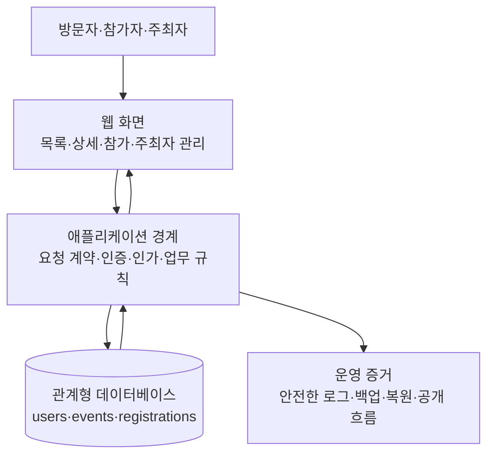

# Meeting Webapp Capstone Implementation Plan

> **For agentic workers:** REQUIRED SUB-SKILL: Use superpowers:subagent-driven-development (recommended) or superpowers:executing-plans to implement this plan task-by-task. Steps use checkbox (`- [ ]`) syntax for tracking.

**Goal:** 기존 북마크 초안을 비개발자가 일반적인 풀스택 아키텍처·개발 절차·권한·동시성·운영 책임을 끝까지 추적할 수 있는 소규모 모임 일정·참가 신청 웹앱 캡스톤으로 교체합니다.

**Architecture:** 공개 조회부터 주최자 생성, 참가·취소, 정원·마감, 운영 인수까지 다섯 수직 조각을 하나의 모놀리식 웹앱·단일 관계형 데이터베이스 책임 지도로 설명합니다. 제품 이름과 실행 코드 대신 사용자 행동, 상태 모델, API 계약, 인증·인가, 트랜잭션, UI 상태, 테스트 오라클과 운영 증거를 정본으로 둡니다.

**Tech Stack:** Markdown/MDX, 접근 가능한 SVG, Mermaid 원본, Astro 7.1.6, Starlight 0.41.4, Node.js 22.16.0, npm 10.9.2

## Global Constraints

- 실제 서비스를 구현하거나 새 프레임워크·패키지를 설치하지 않습니다.
- Supabase·Vercel·Codex Sites는 이 원고의 아키텍처 정의에 포함하지 않고 별도 도구 매핑 계획에서만 다룹니다.
- 첫 범위는 모임 생성·공개 조회·참가·취소·정원·마감·주최자 권한이며 결제·알림·채팅·지도·캘린더·대기 명단·파일 업로드를 제외합니다.
- 예시 계정·이름·로그·fixture는 모두 명시적인 가상 값이며 실제 개인정보를 사용하지 않습니다.
- 기존 `first-full-stack-project.md`의 `draft` 상태를 유지하고 독립 검토 전 `review`로 올리지 않습니다.
- 산문 문단과 목록 항목의 산문은 임의 하드랩 없이 한 줄로 저장합니다.
- 각 독립 작업은 자동 검증과 실제 렌더링 확인 뒤 로컬 커밋하고 푸시·배포하지 않습니다.

---

### Task 1: 모임 웹앱 교육 계약 고정

**Files:**
- Create: `research/meeting-webapp-case-brief.md`
- Read: `docs/superpowers/specs/2026-08-07-dual-case-study-system-design.md`
- Read: `templates/chapter-template.md`
- Read: `docs/project/quality-rubric.md`

**Interfaces:**
- Consumes: 승인 명세의 W-01~W-05와 첫 범위 비목표
- Produces: 캡스톤 원고·다이어그램·반복 사례가 공유하는 역할, 상태, 데이터 관계, API와 증거 계약

- [ ] **Step 1: 현재 북마크 기준선 확인**

```bash
rg -n "북마크|bookmark" src/content/docs/12-case-studies/first-full-stack-project.md src/assets/diagrams/bookmark-architecture.svg src/assets/diagrams/source/bookmark-architecture.mmd
```

Expected: 원고 6개 직접 표현, SVG의 북마크 설명·상태 표현, `bookmark-architecture` 파일 경로 확인.

- [ ] **Step 2: 교육 계약 문서 작성**

`research/meeting-webapp-case-brief.md`에 다음 구조와 값을 확정합니다.

```markdown
# 모임 일정·참가 신청 웹앱 사례 브리프

## 독자 문제
주최자와 참가자의 행동이 화면·API·데이터·권한·운영 책임을 어떻게 통과하는지 설명합니다.

## 역할
- 비로그인 방문자: 공개 모임 조회
- 참가자: 자신의 참가 신청·취소
- 주최자: 자신이 만든 모임 생성·수정·취소·마감과 참가 현황 조회

## 상태 모델
- event.status: open | closed | cancelled
- registration.status: confirmed | cancelled
- event.version: 동시 수정 감지용 정수

## 데이터 관계
- users 1:N events via events.host_id
- users N:M events via registrations
- registrations(event_id, participant_id)는 활성 참가 기준 중복을 허용하지 않음

## 수직 조각
- W-01 GET /events/:eventId 공개 조회
- W-02 POST /events와 PATCH /events/:eventId 주최자 소유권
- W-03 POST /events/:eventId/registrations와 DELETE /events/:eventId/registrations/me
- W-04 capacity·status·중복·동시 요청을 하나의 트랜잭션에서 판정
- W-05 비밀·환경·로그·백업·복원·공개 흐름 인수

## 비목표
결제, 환불, 채팅, 댓글, 알림, 지도, 캘린더, 반복 모임, 대기 명단, 추천, 파일 업로드, 운영자 신고 시스템을 포함하지 않습니다.
```

- [ ] **Step 3: 사례 계약 자체 검사**

```bash
rg -n "W-01|W-02|W-03|W-04|W-05|host_id|participant_id|capacity|open|closed|cancelled|confirmed" research/meeting-webapp-case-brief.md
! rg -n "Supabase|Vercel|Codex Sites|실제 개인정보|결제 구현" research/meeting-webapp-case-brief.md
```

Expected: 다섯 조각과 상태·관계 필드가 모두 존재하고 제품 종속·실데이터·범위 확장 표현 0건.

### Task 2: 북마크 아키텍처 자산을 모임 웹앱 책임 지도로 교체

**Files:**
- Rename: `src/assets/diagrams/source/bookmark-architecture.mmd` → `src/assets/diagrams/source/meeting-webapp-architecture.mmd`
- Rename: `src/assets/diagrams/bookmark-architecture.svg` → `src/assets/diagrams/meeting-webapp-architecture.svg`
- Modify: `src/assets/diagrams/source/meeting-webapp-architecture.mmd`
- Modify: `src/assets/diagrams/meeting-webapp-architecture.svg`

**Interfaces:**
- Consumes: Task 1의 역할·상태·관계 계약
- Produces: 원고가 참조할 `meeting-webapp-architecture.svg`와 동일 의미 Mermaid 원본

- [ ] **Step 1: 자산 이름 변경**

```bash
git mv src/assets/diagrams/source/bookmark-architecture.mmd src/assets/diagrams/source/meeting-webapp-architecture.mmd
git mv src/assets/diagrams/bookmark-architecture.svg src/assets/diagrams/meeting-webapp-architecture.svg
```

Expected: Git이 두 자산을 삭제·신규가 아닌 이름 변경 후보로 추적.

- [ ] **Step 2: Mermaid 책임 흐름 작성**

Mermaid 원본은 다음 노드와 경계를 정확히 포함합니다.



그림 설명에는 UI가 권한의 최종 경계가 아니며 정원·중복·상태 판단은 신뢰할 수 있는 애플리케이션·데이터 경계에서 다시 확인한다는 한계를 적습니다.

- [ ] **Step 3: 접근 가능한 SVG 동기화**

SVG의 `<title>`은 `모임 일정·참가 신청 웹앱의 책임 지도`, `<desc>`는 사용자 역할에서 웹 화면·애플리케이션 경계·관계형 데이터베이스·운영 증거로 이어지는 흐름과 인증·인가·정원 규칙을 설명하도록 작성합니다. SVG 안의 보이는 레이블은 Mermaid 노드와 같은 책임 이름을 사용하고 `북마크`·`bookmark` 문자열을 남기지 않습니다.

- [ ] **Step 4: 자산 검증**

```bash
rg -n "<title|<desc|방문자|참가자|주최자|인증|인가|정원|백업|복원" src/assets/diagrams/meeting-webapp-architecture.svg src/assets/diagrams/source/meeting-webapp-architecture.mmd
! rg -n "북마크|bookmark" src/assets/diagrams/meeting-webapp-architecture.svg src/assets/diagrams/source/meeting-webapp-architecture.mmd
npm run validate:references
```

Expected: 필수 역할·책임·접근성 텍스트 존재, 옛 사례 표현 0건, 참조 검증 성공.

### Task 3: 첫 풀스택 프로젝트 원고를 완결된 모임 캡스톤으로 확장

**Files:**
- Modify: `src/content/docs/12-case-studies/first-full-stack-project.md`
- Modify: `research/source-map.md`
- Modify: `CONTENT_MAP.md` via generator

**Interfaces:**
- Consumes: Task 1의 사례 계약, Task 2의 SVG 경로, 앞선 Build Track 11개 장
- Produces: 문제에서 운영 인수까지 독립적으로 읽을 수 있는 `draft` 캡스톤과 정확한 교차 링크

- [ ] **Step 1: frontmatter와 장 구조 교체**

frontmatter는 다음 메타데이터를 사용합니다.

```yaml
title: "첫 풀스택 프로젝트: 모임 참가 웹앱"
description: "모임 생성·공개 조회·참가·취소·정원·마감 흐름으로 요구사항, 아키텍처, 권한, 테스트, Git, 배포와 운영을 연결합니다."
contentStatus: draft
audience:
  - 바이브 코딩을 하는 비개발자
learningObjectives:
  - 모임 웹앱을 사용자 역할·상태·경계·흐름으로 설계한다
  - 공개 조회부터 권한과 동시성이 있는 쓰기까지 수직 기능 조각으로 나눈다
  - 요구사항별 실패 위험을 테스트·화면·데이터·운영 증거에 연결한다
  - 프레임워크와 제품을 아키텍처 책임과 동일시하지 않는다
```

본문은 `먼저 결론`, `왜 이 사례인가`, `문제와 비목표`, `역할과 사용자 작업`, `시스템 지도`, `상태와 데이터 관계`, `W-01 공개 조회`, `W-02 주최자 생성과 소유권`, `W-03 참가와 취소`, `W-04 정원·마감과 동시성`, `W-05 배포와 운영 인수`, `요구에서 증거까지 추적`, `AI 작업 계약`, `완료 체크리스트`, `짧은 연습`, `관련 장과 출처` 순서를 사용합니다.

- [ ] **Step 2: W-01과 W-02의 수용 기준·증거 작성**

W-01은 `정상 공개 모임`, `존재하지 않음`, `취소됨`, `로딩`, `전달 실패`를 구분하고 인증이 없어도 조회 가능하다는 계약을 적습니다. W-02는 인증된 주최자만 생성하고 `host_id`가 현재 주체에서 결정되며 다른 사용자의 `event_id` 수정은 거절한다는 인가 부정 테스트를 포함합니다.

- [ ] **Step 3: W-03과 W-04의 데이터 일관성 작성**

W-03은 자신의 참가만 취소하고 동일 `(event_id, participant_id)` 활성 신청을 중복 생성하지 않는 계약을 설명합니다. W-04는 마지막 한 자리의 동시 요청에서 `event.status = open`, 현재 확정 참가 수, `capacity`, 중복 여부를 같은 트랜잭션 경계에서 판정하고 한 요청만 확정되며 나머지는 안전한 충돌·마감 응답을 받는 오라클을 적습니다. 애플리케이션 검사만으로 데이터베이스 제약과 트랜잭션을 대체할 수 있다고 표현하지 않습니다.

- [ ] **Step 4: W-05와 개발 절차 연결 작성**

운영 인수는 비밀과 환경 설정, 마이그레이션, 운영 데이터베이스, 최소 로그, 백업 생성뿐 아니라 격리된 복원 시험, 배포 버전, 공개 URL의 조회·참가·취소 smoke 흐름을 구분합니다. `문제 → PRD 요구 → 설계 결정 → 작은 작업 → 테스트 → Git diff·commit → build → deploy → 공개 확인 → 운영 신호·복구` 추적표에 각 단계의 산출물과 증거를 한 행씩 작성합니다.

- [ ] **Step 5: 영속 개념과 프레임워크 선택 상자 작성**

프레임워크를 정답으로 제시하지 않고 렌더링 방식, 사용자별 상태, 서버 측 권한 집행, 배포 환경, 팀 역량, 유지 비용을 선택 질문으로 적습니다. 현재 도구 이름은 사용하지 않고 “관리형 백엔드나 배포 서비스에 매핑하더라도 데이터·권한·복구 책임은 사라지지 않는다”는 한계만 적습니다.

- [ ] **Step 6: 교차 링크와 출처 범위 동기화**

앞선 Build Track 11개 장에 각각 한 번 이상 연결하고 `research/source-map.md`에 이 장의 적용 범위를 기존 OpenAPI·OWASP 인증/인가·PostgreSQL 트랜잭션·SWEBOK·MDN·Git·Astro 출처와 연결합니다. 새 제품 기능이나 실제 서비스 동작을 주장하지 않으므로 네트워크 조사를 추가하지 않습니다.

- [ ] **Step 7: 콘텐츠 지도 재생성**

```bash
npm run sync:content-map
npm run check:static
```

Expected: `CONTENT_MAP.md`의 해당 원고 문자 수만 갱신되고 테스트·콘텐츠·참조 오류 0개.

### Task 4: 캡스톤 렌더링 검증과 커밋

**Files:**
- Verify: `src/content/docs/12-case-studies/first-full-stack-project.md`
- Verify: `src/assets/diagrams/meeting-webapp-architecture.svg`
- Verify: `research/meeting-webapp-case-brief.md`
- Verify: `research/source-map.md`
- Verify: `CONTENT_MAP.md`

**Interfaces:**
- Consumes: Task 1~3의 완성 원고와 자산
- Produces: 독립 검토를 요청할 수 있는 `draft` 캡스톤 커밋

- [ ] **Step 1: 범위·용어·링크 검사**

```bash
! rg -n "북마크|bookmark|Supabase|Vercel|Codex Sites" src/content/docs/12-case-studies/first-full-stack-project.md src/assets/diagrams/meeting-webapp-architecture.svg src/assets/diagrams/source/meeting-webapp-architecture.mmd
rg -n "W-01|W-02|W-03|W-04|W-05|인증|인가|트랜잭션|동시|복원|비유가 깨지는" src/content/docs/12-case-studies/first-full-stack-project.md
rg -o "\.\./\.\./[0-9]{2}-[^/]+/[^/)]+/" src/content/docs/12-case-studies/first-full-stack-project.md | sort -u | wc -l
```

Expected: 옛 사례·제품 종속 표현 0건, 다섯 조각과 안전 책임 존재, 앞선 Build Track 장 링크 11개.

- [ ] **Step 2: 전체 빌드 검증**

```bash
ASTRO_TELEMETRY_DISABLED=1 npm run check
git diff --check
```

Expected: 테스트 26개, 공개 콘텐츠 58개, 학습 SVG 12개, 생성 HTML 59개 검증 성공. 이름 변경으로 SVG 수는 그대로 12개.

- [ ] **Step 3: 데스크톱·모바일 브라우저 확인**

`npm run preview`를 실행하고 1440×1000과 390×844에서 `/12-case-studies/first-full-stack-project/`를 확인합니다. H1 1개, `검토용 초안` 배지, W-01~W-05, 표·코드 블록·다이어그램 대체 텍스트, 페이지 전역 가로 넘침 0개, 콘솔 오류·경고 0개를 기록합니다.

- [ ] **Step 4: 범위 고정 커밋**

```bash
git add research/meeting-webapp-case-brief.md research/source-map.md src/content/docs/12-case-studies/first-full-stack-project.md src/assets/diagrams/meeting-webapp-architecture.svg src/assets/diagrams/source/meeting-webapp-architecture.mmd CONTENT_MAP.md
git diff --cached --check
git commit -m "docs: build meeting webapp capstone"
```

Expected: 모임 캡스톤 관련 파일만 커밋되고 작업 트리가 깨끗함. `review` 승격은 별도 검토 계획에서 수행합니다.
