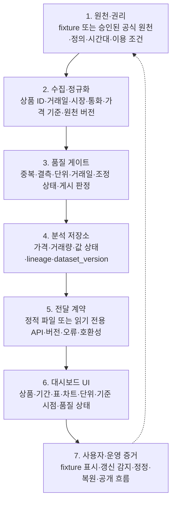

# Stock Dashboard Capstone Implementation Plan

> **For agentic workers:** REQUIRED SUB-SKILL: Use superpowers:subagent-driven-development (recommended) or superpowers:executing-plans to implement this plan task-by-task. Steps use checkbox (`- [ ]`) syntax for tracking.

**Goal:** 기존 반도체 기업 지표 캡스톤을 실제 투자 판단과 분리된 교육용 가상 주가·거래량 분석 대시보드로 재설계하고 데이터 원천·품질·재현성·전달·운영 책임을 끝까지 연결합니다.

**Architecture:** 공식 원천을 선택하기 전에는 `IDX-X`, `STK-A`, `STK-B`라는 가상 상품과 `EDU-FIXTURE` 원천만 사용합니다. 데이터 계약·품질 게이트·정적 전달·UI 상태·버전·정정·복구 구조는 유지하되 기업 분기 지표를 거래일·가격 기준·거래량·결측·조정 상태가 있는 시계열 계약으로 바꿉니다.

**Tech Stack:** Markdown/MDX, 접근 가능한 SVG, Mermaid 원본, Astro 7.1.6, Starlight 0.41.4, Node.js 22.16.0, npm 10.9.2

## Global Constraints

- 실제 종목명·티커·가격·수익률·계좌·주문 데이터를 사용하지 않습니다.
- 매수·매도 추천, 목표 가격, 수익 보장, 자동 주문과 실시간 시세는 포함하지 않습니다.
- 실제 원천의 정의·조정 방식·거래일·시간대·이용 조건·재배포 범위는 네트워크 조사 승인 전 확정하지 않습니다.
- `analytics-dashboard-case-study.md`는 실질 변경 시작과 동시에 `review`에서 `draft`로 내리고 기존 `reviewEvidence`는 제거하되 과거 검토 파일은 수정하지 않습니다.
- 기존 데이터 품질·접근성·버전·복구 설명 중 주가 계약에도 유효한 영속 지식은 보존합니다.
- 산문 문단과 목록 항목의 산문은 임의 하드랩 없이 한 줄로 저장합니다.
- 검증을 통과한 캡스톤 단위는 로컬 커밋하고 푸시·배포하지 않습니다.

---

### Task 1: 주가 대시보드 fixture와 안전 계약 작성

**Files:**
- Create: `research/stock-dashboard-case-brief.md`
- Read: `docs/superpowers/specs/2026-08-07-dual-case-study-system-design.md`
- Read: `src/content/docs/12-case-studies/analytics-dashboard-case-study.md`

**Interfaces:**
- Consumes: 승인 명세의 D-01~D-05와 금융·데이터 안전 경계
- Produces: 원고·다이어그램·테스트 오라클이 공유하는 가상 데이터 계약과 공식 원천 조사 금지선

- [ ] **Step 1: 기존 캡스톤 기준선 확인**

```bash
rg -n "반도체|기업 A|기업 B|contentStatus|reviewEvidence" src/content/docs/12-case-studies/analytics-dashboard-case-study.md research/source-map.md docs/project/reviews/2026-08-05-analytics-dashboard-case-study-*.md
```

Expected: 공개 원고의 직접 표현 11건과 `review` 증거, 출처 지도의 미확인 반도체 원천 범위, 과거 검토 기록 확인.

- [ ] **Step 2: fixture 계약과 예시 행 작성**

`research/stock-dashboard-case-brief.md`에 다음 필드와 예시를 그대로 포함하고 모든 식별자와 값이 교육용 가상 데이터임을 표 위와 아래에 명시합니다.

```csv
instrument_id,instrument_type,market,trading_date,value_type,value,unit,volume,price_basis,source_id,source_version,transform_version,value_status,missing_reason
IDX-X,index,MARKET-X,2026-01-05,close,2500,point,,not_applicable,EDU-FIXTURE,v1,tf-v1,valid,
STK-A,stock,MARKET-X,2026-01-05,close,10000,KRW,1000000,unadjusted,EDU-FIXTURE,v1,tf-v1,valid,
STK-B,stock,MARKET-X,2026-01-05,close,20000,KRW,700000,unadjusted,EDU-FIXTURE,v1,tf-v1,warning,late_source
IDX-X,index,MARKET-X,2026-01-06,close,2510,point,,not_applicable,EDU-FIXTURE,v1,tf-v1,valid,
STK-A,stock,MARKET-X,2026-01-06,close,10100,KRW,1100000,unadjusted,EDU-FIXTURE,v1,tf-v1,valid,
STK-B,stock,MARKET-X,2026-01-06,close,,KRW,,unadjusted,EDU-FIXTURE,v1,tf-v1,blocked,source_missing
```

계약 설명은 `value = 0`과 빈 값, `valid`·`warning`·`blocked`·`review_required`, `price_basis`, 지수의 거래량 비적용, 날짜·시장·통화·단위, 원천·변환 버전을 구분합니다.

- [ ] **Step 3: 사용자 요구와 비목표 고정**

브리프에 다음 요구를 기록합니다.

```markdown
- D-01: 사용자는 IDX-X·STK-A·STK-B가 실제 종목이 아닌 교육용 fixture임을 첫 화면에서 확인합니다.
- D-02: 사용자는 기간과 상품을 선택하고 가격 기준·단위·거래일·값 상태를 함께 확인합니다.
- D-03: 같은 fixture와 transform_version으로 같은 표·차트·요약을 재현합니다.
- D-04: 표와 차트는 같은 선택 결과를 사용하며 값 0·결측·경고·차단·오래됨을 구분합니다.
- D-05: 갱신 실패 시 차단된 후보를 게시하지 않고 마지막 정상 dataset_version과 지연 이유를 표시합니다.
- 비목표: 실제 투자 결론, 추천, 수익률 우열, 실시간 시세, 주문, 개인 포트폴리오를 다루지 않습니다.
```

- [ ] **Step 4: 계약 안전 검사**

```bash
rg -n "IDX-X|STK-A|STK-B|EDU-FIXTURE|price_basis|value_status|missing_reason|D-01|D-02|D-03|D-04|D-05" research/stock-dashboard-case-brief.md
! rg -n "삼성전자|SK하이닉스|KOSPI|NASDAQ|매수|매도|목표가|수익 보장|실시간 API" research/stock-dashboard-case-brief.md
```

Expected: 계약 필드와 다섯 요구 존재, 실제 종목·시장·투자 권유·현재 API 주장 0건.

### Task 2: 분석 책임 다이어그램을 주가 계약과 동기화

**Files:**
- Modify: `src/assets/diagrams/source/analytics-dashboard-architecture.mmd`
- Modify: `src/assets/diagrams/analytics-dashboard-architecture.svg`

**Interfaces:**
- Consumes: Task 1의 fixture 필드와 D-01~D-05
- Produces: 캡스톤과 시스템 장이 공통으로 참조할 주가 분석 책임·증거 흐름

- [ ] **Step 1: Mermaid 노드 의미 갱신**

기존 7단계 흐름은 유지하되 노드 세부를 다음 책임으로 바꿉니다.



- [ ] **Step 2: SVG 접근성 텍스트와 레이블 동기화**

`<title>`은 `교육용 주가 데이터 대시보드의 책임과 증거 흐름`으로 바꾸고 `<desc>`는 가상 fixture 또는 승인된 공식 원천에서 거래일·가격 기준·품질 게이트·버전이 있는 전달과 UI·복구까지 이어지며 화면 성공이 데이터 의미와 권리를 증명하지 않는다는 한계를 설명합니다. 보이는 레이블과 Mermaid 원본의 단계·용어를 일치시킵니다.

- [ ] **Step 3: 다이어그램 검사**

```bash
rg -n "거래일|가격 기준|거래량|fixture|dataset_version|정정|복원" src/assets/diagrams/source/analytics-dashboard-architecture.mmd src/assets/diagrams/analytics-dashboard-architecture.svg
! rg -n "반도체|기업 A|기업 B" src/assets/diagrams/source/analytics-dashboard-architecture.mmd src/assets/diagrams/analytics-dashboard-architecture.svg
npm run validate:references
```

Expected: 주가 계약 책임 존재, 옛 도메인 표현 0건, SVG 접근성 검사 성공.

### Task 3: 분석 캡스톤을 주가 데이터 흐름으로 재작성

**Files:**
- Modify: `src/content/docs/12-case-studies/analytics-dashboard-case-study.md`
- Modify: `research/source-map.md`
- Modify: `CONTENT_MAP.md` via generator

**Interfaces:**
- Consumes: Task 1의 fixture, Task 2의 다이어그램, 기존 캡스톤의 데이터 품질·전달·복구 구조
- Produces: 실제 원천 없이도 D-01~D-05가 독립적으로 완결되는 `draft` 원고

- [ ] **Step 1: frontmatter 상태와 메타데이터 재판정**

`reviewEvidence` 전체를 제거하고 다음 frontmatter를 사용합니다.

```yaml
title: "데이터 분석가의 주가 대시보드 사례"
description: "교육용 가상 주가·거래량 데이터를 원천과 권리, 데이터 계약, 품질, 화면, 검증, 배포와 운영 인수까지 연결합니다."
contentStatus: draft
audience:
  - 바이브 코딩을 하는 데이터 분석가
  - 공개 데이터로 분석 제품을 만들려는 비개발자
learningObjectives:
  - 실제 원천과 교육용 fixture, 분석 결과와 투자 판단을 구분한다
  - 거래일·가격 기준·단위·값 상태·버전이 있는 데이터 계약을 설명한다
  - 데이터 품질과 화면 동작 성공을 서로 다른 증거로 검증한다
  - 정적 전달과 읽기 전용 API를 데이터 규모·최신성·권리·운영 책임으로 선택한다
  - 갱신 실패·정정·철회·복원과 공개 사용자 흐름을 연결한다
```

- [ ] **Step 2: 도입·사용자 요구·계약을 fixture로 교체**

첫 120줄 안에 `IDX-X`, `STK-A`, `STK-B`, `EDU-FIXTURE`가 모두 실제 상품·시세가 아닌 교육용 가상 값임을 명시합니다. 기업 A·B 분기 지표 요구를 `상품·기간 선택`, `가격 기준·거래일·단위·원천·갱신 상태 확인`, `표·차트 동일 데이터`, `결측·차단·오래됨 구분`으로 바꾸고 Task 1의 CSV 예시를 축약하지 않고 포함합니다.

- [ ] **Step 3: 데이터 계약·품질·재현성 개정**

기존 data contract·canonical schema·lineage·checksum·quality gate 설명은 유지하되 필드를 Task 1과 일치시킵니다. `price_basis`가 조정주가의 정확한 계산을 주장하지 않고 현재 값이 어떤 기준인지 표시하는 계약이라는 점, 실제 원천 채택 전에는 corporate action과 조정 방식의 정확한 규칙을 확정하지 않는다는 한계를 적습니다. 거래일 공백, 값 0, source_missing, not_applicable, warning, blocked, review_required를 각각 다른 상태와 행동으로 설명합니다.

- [ ] **Step 4: 분석·화면·테스트 오라클 개정**

표와 차트는 같은 선택 결과와 단위·반올림을 사용하고, 지수 `point`와 주식 `KRW` 값을 하나의 축에서 직접 비교하지 않습니다. 정상 fixture 결과, 결측, 경고, 차단, 오래된 배포, 파일 로드 실패, 렌더링 실패의 오라클을 분리합니다. “상승·하락 원인”을 데이터만으로 단정하거나 투자 결론을 생성하지 않으며 변화 설명은 관찰과 추가 확인 질문으로 제한합니다.

- [ ] **Step 5: 전달·운영·정정·AI 작업 계약 개정**

첫 버전은 작은 공개 fixture와 사용자별 상태·비밀이 없으므로 정적 전달을 선택합니다. 실제 원천·대규모 데이터·짧은 최신성·재배포 제한·사용자별 저장이 생길 때 읽기 전용 API를 검토하는 전환 신호를 적습니다. 마지막 정상 `dataset_version`, 차단 후보 미게시, 정정 이력, 복원 시험, 공개 URL의 fixture 표시·필터·표·차트·출처 패널 smoke 흐름을 운영 인수로 연결합니다.

- [ ] **Step 6: 출처 지도와 이전 검토 경계 기록**

`research/source-map.md`의 기존 반도체 미확인 문단을 삭제하지 말고 날짜가 있는 역사적 적용 기록으로 명확히 표시한 뒤, 새 주가 캡스톤 행을 추가합니다. 새 행은 현재 사용한 값이 `EDU-FIXTURE`이고 실제 시장·상품·시세·조정 방식·거래일·시간대·이용 조건·재배포 범위가 확인되지 않았으므로 실제 데이터 주장을 하지 않는다고 적습니다. 과거 Opus 검토 파일은 수정하지 않습니다.

- [ ] **Step 7: 콘텐츠 지도 동기화와 정적 검사**

```bash
npm run sync:content-map
npm run check:static
```

Expected: 전체 공개 상태가 `review` 8개·`draft` 37개·`seed` 13개·`ready` 0개로 바뀌고 콘텐츠·참조 오류 0개.

### Task 4: 상태 문맥·렌더링·커밋 완료

**Files:**
- Modify: `PROJECT_CONTEXT.md`
- Modify: `PROJECT_MANIFEST.json`
- Modify: `ROADMAP.md`
- Modify: `CHANGELOG.md`
- Verify: `VERIFICATION_REPORT.md` is not rewritten as current evidence until new browser results exist

**Interfaces:**
- Consumes: Task 3의 실제 상태 수와 검증 결과
- Produces: 새 `draft`의 한계와 새 검토 필요성을 정확히 표시한 프로젝트 상태

- [ ] **Step 1: 프로젝트 상태 동기화**

`PROJECT_CONTEXT.md`, `PROJECT_MANIFEST.json`, `ROADMAP.md`, `CHANGELOG.md`에 분석 캡스톤이 실질 변경으로 `draft`가 됐고 과거 `review`는 이전 반도체 정본의 역사적 증거이며 새 Opus·사람 검토 전에는 재승격하지 않는다고 기록합니다. 모든 상태 수치는 `CONTENT_MAP.md`의 생성 결과와 일치시킵니다.

- [ ] **Step 2: 옛 표현·안전 경계·JSON 검사**

```bash
! rg -n "반도체|기업 A|기업 B" src/content/docs/12-case-studies/analytics-dashboard-case-study.md src/assets/diagrams/analytics-dashboard-architecture.svg src/assets/diagrams/source/analytics-dashboard-architecture.mmd
rg -n "교육용|가상|fixture|투자 판단|매수|매도|실시간|이용 조건|재배포" src/content/docs/12-case-studies/analytics-dashboard-case-study.md
node -e "JSON.parse(require('fs').readFileSync('PROJECT_MANIFEST.json','utf8')); console.log('manifest valid')"
git diff -- docs/project/reviews/2026-08-05-analytics-dashboard-case-study-opus5-review.md docs/project/reviews/2026-08-05-analytics-dashboard-case-study-review-prep.md
```

Expected: 옛 공개 표현 0건, 안전 경계 존재, JSON 유효, 과거 검토 기록 diff 0줄.

- [ ] **Step 3: 전체 빌드와 브라우저 검증**

```bash
ASTRO_TELEMETRY_DISABLED=1 npm run check
git diff --check
```

Expected: 테스트 26개, 공개 콘텐츠 58개, SVG 12개, 생성 HTML 59개 통과. 이어서 1440×1000과 390×844에서 `/12-case-studies/analytics-dashboard-case-study/`의 `검토용 초안` 배지, fixture 고지, 표·차트 계약, 다이어그램 대체 텍스트, 가로 넘침 0개와 콘솔 오류·경고 0개를 확인합니다.

- [ ] **Step 4: 범위 고정 커밋**

```bash
git add research/stock-dashboard-case-brief.md research/source-map.md src/content/docs/12-case-studies/analytics-dashboard-case-study.md src/assets/diagrams/analytics-dashboard-architecture.svg src/assets/diagrams/source/analytics-dashboard-architecture.mmd CONTENT_MAP.md PROJECT_CONTEXT.md PROJECT_MANIFEST.json ROADMAP.md CHANGELOG.md
git diff --cached --check
git commit -m "docs: redesign stock dashboard capstone"
```

Expected: 주가 캡스톤·상태 문맥만 커밋되고 작업 트리가 깨끗함. 새 독립 검토 전 `draft`를 유지합니다.
