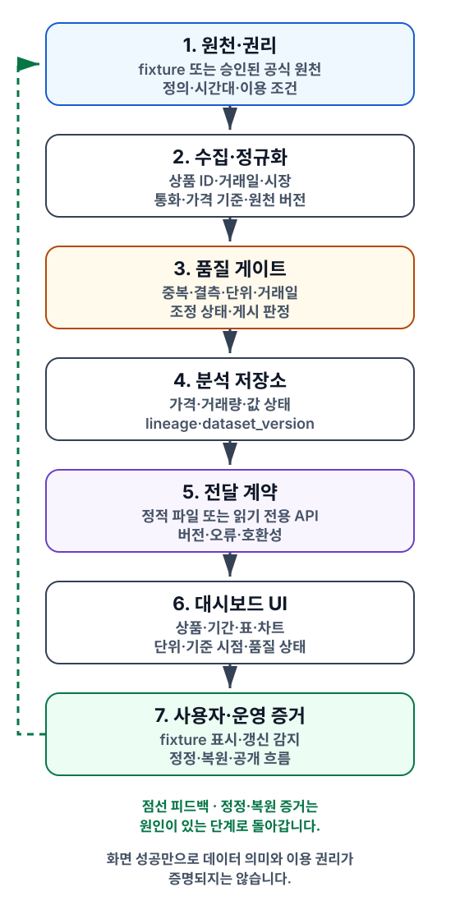

## 먼저 결론

소프트웨어는 눈앞의 화면이나 코드 파일 하나가 아니라, 여러 구성요소가 책임과 약속을 나누어 입력을 처리하고 상태를 바꾸며 결과를 내는 시스템입니다. 화면이 그럴듯하거나 코드가 많이 생성됐다는 사실만으로 데이터, 권한, 실패, 배포와 복구까지 작동한다고 판단할 수 없습니다.

비개발자가 모든 코드를 읽을 필요는 없지만 **구성요소, 책임, 경계와 인터페이스, 상태, 흐름, 제약과 품질 속성**이라는 여섯 렌즈로 시스템을 질문할 수 있어야 합니다. 이 지도가 있어야 AI가 만든 결과에서 무엇이 구현됐고 무엇이 비어 있는지 확인할 수 있습니다.

## 왜 필요한가

AI에게 “모임 참가 웹앱을 만들어 주세요”라고 요청하면 모임 정보와 참가 버튼이 있는 화면을 빠르게 받을 수 있습니다. 하지만 누가 모임을 바꿀 수 있는지, 같은 사람이 두 번 참가하지 않는지, 마지막 한 자리에 두 요청이 겹쳐도 정원을 넘지 않는지, 응답이 끊겼을 때 확정된 참가 상태를 어떻게 확인하고 복구하는지는 별개의 문제입니다.

사용자가 참가 버튼을 눌러 성공 문구를 봤다는 것은 한 경로의 화면을 확인한 증거일 뿐입니다. 권위 있는 참가 관계가 저장됐는지, 정원과 모집 상태가 일관적인지, 권한 우회가 거절되는지, 배포 뒤 장애에서 안전한 상태로 돌아오는지는 알 수 없습니다. 시스템 관점이 없으면 이런 빈칸을 “AI가 알아서 처리했겠지”라고 넘기기 쉽습니다.

시스템 관점은 복잡한 아키텍처를 먼저 설계하라는 뜻도 아닙니다. 지금 필요한 구성요소와 경계를 가장 단순한 형태로 정하고, 중요한 실패를 어디에서 발견하고 복구할지 확인하자는 뜻입니다.

## 한 문장 정의

**소프트웨어는 여러 구성요소가 정해진 책임과 인터페이스로 연결되어 입력을 처리하고 상태를 바꾸며 결과를 내는 시스템입니다.**

코드는 그 시스템을 표현하는 핵심 재료이지만 전부는 아닙니다. 실행 환경, 설정, 데이터 구조, 외부 서비스, 배포 산출물, 로그, 테스트와 운영 절차도 실제 동작과 복구 가능성에 영향을 줍니다.

사람과 조직의 업무 절차도 시스템의 성공에 영향을 주지만, 소프트웨어 경계를 어디까지 잡을지는 질문에 따라 달라집니다. 예를 들어 “대시보드 요청이 어떻게 처리되는가”를 볼 때는 사용자 행동을 입력으로 놓을 수 있고, “잘못된 지표가 공개됐을 때 누가 승인하고 정정하는가”를 볼 때는 사람의 검토 절차까지 시스템 경계에 포함해야 합니다.

## 집으로 이해하기

집을 지을 때 예쁜 거실 사진만 보고 수도, 전기, 출입, 구조 안전과 유지보수를 생략하지는 않습니다. 소프트웨어도 화면이라는 한 공간만 보는 대신 다음 관계를 함께 볼 수 있습니다.

- 방과 설비는 **구성요소**입니다.
- 각 공간의 용도는 **책임**입니다.
- 벽과 문은 **경계**이고, 문과 배관의 연결 규격은 **인터페이스**입니다.
- 현재 잠긴 문, 온도와 물탱크의 양은 **상태**입니다.
- 사용자와 운영자는 흐름을 시작하거나 결과를 판단하는 사람이고, 전기와 물이 이동하는 경로는 **흐름**입니다.
- 건축법, 예산, 안전, 접근성과 유지비는 **제약과 품질 속성**입니다.

설계도, 점검표와 검사 기록은 일곱 번째 렌즈가 아니라 여섯 렌즈로 내린 판단과 결과를 확인하는 **명세와 검증 증거**에 가깝습니다.

### 비유가 맞는 지점

- 구성요소마다 맡은 일이 있고 연결 규격이 맞아야 전체가 작동합니다.
- 눈에 잘 보이지 않는 설비와 안전장치가 실제 사용 가능성을 좌우합니다.
- 한 부분을 바꾸면 다른 부분의 용량, 동선과 안전에 영향을 줄 수 있습니다.
- 완공 사진과 안전 검사 기록은 서로 다른 증거입니다.

### 비유가 깨지는 지점

소프트웨어 경계는 물리적 벽보다 쉽게 바뀌고 복제됩니다. 같은 코드가 여러 서버에서 실행되고, 한 데이터가 브라우저·캐시·데이터베이스에 서로 다른 시점의 사본으로 존재할 수 있습니다. 외부 API나 클라우드 서비스처럼 소유하지 않은 구성요소도 시스템 동작에 영향을 줍니다.

집에는 보통 하나의 물리적 위치가 있지만 소프트웨어의 요청과 상태는 여러 실행 환경과 네트워크를 오갑니다. 그래서 구조를 눈으로 추측하지 않고 다이어그램, 인터페이스 계약, 설정, 테스트, 로그와 실제 실행 결과로 확인해야 합니다.

집에는 완공 시점이 있지만 소프트웨어는 변경과 배포 뒤에도 계속 달라집니다. 이전에 통과한 테스트나 화면 확인을 영구 증거로 보지 않고 변경할 때마다 필요한 증거를 다시 만들어야 합니다.

## 시스템을 보는 여섯 렌즈

여섯 렌즈는 이 책이 초보자의 누락을 줄이기 위해 묶은 편집상 검토 틀이며, 업계 표준이나 정답 아키텍처를 고르는 공식이 아닙니다.

이 장은 현재 시스템에 무엇이 있고 어떻게 연결되는지 관찰하는 지도를 만듭니다. 아키텍처(architecture)는 그 지도 위에서 책임·경계·관계·배치와 중요한 품질 트레이드오프를 선택하는 구조적 결정입니다.

| 렌즈 | 쉬운 뜻 | 대표 질문 | 확인할 증거 |
|---|---|---|---|
| 구성요소 | 존재하거나 실행되는 부분 | 무엇이 존재·실행되며 어디에 있나요? | 폴더·모듈·실행 프로세스·배포 구성·구조도 |
| 책임 | 보장할 일과 실패 처리 | 무엇을 누가 보장하고 실패하면 누가 처리하나요? | 설계 문서·파일 위치·소유 테스트·운영 책임 |
| 경계와 인터페이스 | 소유·신뢰가 바뀌는 지점과 약속 | 무엇이 어떤 형식과 권한으로 오가나요? | API·함수·파일·데이터 스키마·오류 계약 |
| 상태 | 시스템이 기억하는 값 | 권위 있는 값은 어디에 있고 누가 바꾸나요? | 데이터베이스·파일·URL·브라우저 상태·캐시 |
| 흐름 | 입력이 결과가 되는 경로 | 성공과 실패가 어느 순서로 이동하나요? | 요청·응답·로그·추적 정보·화면 상태 |
| 제약과 품질 속성 | 반드시 지킬 조건과 품질 우선순위 | 무엇을 반드시 지키고, 그 안에서 어떤 품질이 중요한가요? | 제약 목록·수용 기준·측정값·보안·복구·접근성 검증 |

### 1. 구성요소

구성요소(component)는 현재 질문에서 따로 존재하거나 실행되는 것으로 구분해 살펴볼 수 있는 부분입니다. 브라우저 화면, 백엔드 서비스, 데이터베이스와 데이터 수집 작업이 예가 될 수 있고, 소유하지 않은 외부 API는 외부 의존 구성요소로 표시할 수 있습니다. 배포 환경은 구성요소가 실행되는 조건이지만 배포 플랫폼 자체의 장애와 설정을 살피는 질문에서는 별도 요소로 지도에 포함할 수 있습니다. 구성요소가 반드시 별도 서버나 별도 저장소일 필요는 없으며, 작은 프로젝트에서는 한 애플리케이션 안의 모듈일 수도 있습니다.

`component`의 범위는 방법론마다 다릅니다. 예를 들어 C4 모델은 구성요소를 잘 정의된 인터페이스 뒤에 캡슐화된 관련 기능의 묶음으로 정의하지만, 이 장에서는 특정 방법론을 표준으로 가정하지 않고 현재 질문에서 책임과 실패 경계를 찾기 위한 관찰 단위로 사용합니다. 소프트웨어 시스템의 경계도 조직명이나 배포 수만으로 고정하지 않고, 현재 질문에서 책임·소유·사용자가 어디까지 이어지는지 명시합니다.

구성요소를 너무 잘게 나누면 지도가 코드 파일 목록이 되고, 너무 크게 묶으면 모든 것이 “프런트엔드”나 “백엔드”가 되어 책임을 찾기 어렵습니다. 이번 질문에 영향을 주는 독립적인 역할과 실패 경계를 기준으로 나눕니다.

구성요소와 책임은 1:1로 대응하지 않습니다. 한 구성요소가 표시·검증·복구처럼 여러 책임을 맡을 수 있고, 개인정보 보호처럼 한 책임이 브라우저·서버·로그를 가로지를 수도 있습니다. 먼저 무엇이 존재하는지 표시한 뒤, 각 책임의 최종 보장 위치와 협력 범위를 따로 적습니다.

### 2. 책임

책임(responsibility)은 구성요소나 사람이 맡고 보장해야 하는 일과 실패했을 때 처리할 범위입니다. 화면은 사용자의 입력과 로딩·오류 표시를 맡을 수 있지만, 모임 참가의 권한·중복·정원 판단은 신뢰할 수 있는 애플리케이션·데이터 경계가 보장해야 합니다. 원천을 읽고 정규화·변환하는 데이터 대시보드에서는 파이프라인이 데이터 계약에 맞는 원천·거래일·단위·가격 기준을 보존하고, 품질 검사가 결측·중복·차단 상태를 판정하는 책임이 더 중요합니다.

같은 업무 규칙이 브라우저와 서버와 배치 작업에 서로 다르게 복제되면 무엇이 권위 있는 판단인지 불명확해집니다. 반대로 “백엔드가 다 한다”처럼 책임이 너무 넓으면 변경 영향과 테스트 범위를 찾기 어렵습니다. 한 규칙의 최종 판단 위치와 다른 구성요소가 맡는 보조 검증을 구분합니다.

사람이 승인·정정·공개 중지 같은 최종 판단을 맡는다면 `사람이 확인한다`로 끝내지 않습니다. 누가 어떤 근거로 언제 판단하고, 그 판단이 언제 만료되거나 다시 확인되어야 하는지 기록하며 소프트웨어가 자동으로 보장하는 범위와 구분합니다.

### 3. 경계와 인터페이스

경계(boundary)는 책임, 신뢰, 소유권 또는 실행 환경이 바뀌는 지점이고, 인터페이스(interface)는 그 경계를 건너는 약속입니다. API의 요청·응답, 함수의 입력·출력, 데이터 파일의 컬럼과 타입, 배치 작업의 산출물 경로가 인터페이스가 될 수 있습니다.

화면에서 입력을 검사했다고 서버의 신뢰 경계가 사라지지는 않습니다. 외부에서 들어온 데이터도 파일이라는 이유만으로 안전하거나 정확한 것이 아닙니다. 경계를 넘을 때 형식, 권한, 범위, 오류와 버전을 누가 확인하는지 정해야 합니다.

### 4. 상태

상태(state)는 시스템이 현재 기억하는 값입니다. 선택한 기간, 로그인 여부, 모임의 모집 상태와 참가 관계, 공개 중인 데이터셋 버전, 데이터 갱신 시점, 작업 진행 상태와 실패 기록이 모두 상태가 될 수 있습니다.

같은 정보가 여러 곳에 있으면 어느 값이 권위 있는지와 언제 동기화되는지가 중요합니다. 브라우저에 보이는 숫자, 캐시의 사본, 현재 배포가 가리키는 데이터 파일과 데이터베이스의 값은 서로 다른 시점을 가리킬 수 있습니다. HTTP 캐시는 응답의 현재 나이와 명시되거나 계산된 최신성 수명을 비교해 `fresh`와 `stale`을 판단하며, 오래된 응답의 재사용과 재검증은 RFC 9111의 조건을 따릅니다. 애플리케이션 캐시, CDN과 브라우저 내부 사본은 서로 다른 정책을 사용할 수 있으므로 `캐시`라는 이름만으로 갱신 시점을 추측하지 않습니다. 상태 위치와 데이터 버전을 모르면 새로고침, 여러 탭, 여러 사용자, 서버 재시작과 재처리 상황을 예측하기 어렵습니다.

### 5. 흐름

흐름(flow)은 입력이 경계를 지나 결과가 되는 경로입니다. 사용자 클릭 같은 동기적 요청뿐 아니라 정해진 시각의 데이터 수집, 큐에 쌓인 작업, 배포와 장애 복구도 흐름입니다.

정상 경로만 그리면 실제 운영에서 필요한 판단이 빠집니다. 입력 오류, 권한 거절, 데이터 없음, 원천 지연, 부분 실패, 시간 초과와 재시도도 어느 상태로 끝나는지 표시합니다. 흐름을 그리는 목적은 화살표를 예쁘게 만드는 것이 아니라 각 경계의 입력·출력·실패·증거를 찾는 것입니다.

### 6. 제약과 품질 속성

제약(constraint)은 반드시 지켜야 하는 조건이고, 품질 속성(quality attribute)은 시스템이 얼마나 빠르고 안전하며 변경·운영하기 쉬워야 하는지를 나타냅니다. 개인정보를 저장하지 않는다는 조건, 무료 호스팅 범위, 하루 한 번의 갱신, 모바일 접근성과 장애 시 복구 시간 등이 예입니다.

먼저 권리, 개인정보, 법규, 예산과 허용된 호스팅 범위처럼 협상할 수 없는 제약을 고정합니다. 그 제약을 지키는 선택지 안에서 속도, 접근성, 변경 용이성, 복구와 비용 같은 품질 속성의 우선순위를 정합니다. 제약을 품질 우선순위와 한 목록에 섞으면 반드시 지켜야 할 조건이 성능이나 편의와 교환 가능한 것처럼 보일 수 있습니다.

모든 품질을 동시에 최대화할 수는 없습니다. 실시간 갱신은 최신성을 높일 수 있지만 비용과 장애 지점을 늘릴 수 있고, 기능을 한 서비스에 모으면 초기 운영은 단순할 수 있지만 일부 변경 영향은 커질 수 있습니다. 현재 독자 문제와 위험에 맞는 우선순위를 기록하고, 나중에 조건이 달라지면 결정을 다시 검토합니다.

## 두 사례로 책임 차이 보기

같은 여섯 렌즈를 사용해도 시스템이 바꾸고 지켜야 하는 상태에 따라 핵심 책임은 달라집니다. 모임 참가 웹앱은 여러 사용자가 권한이 필요한 쓰기를 요청하므로 참가 관계·모집 상태·정원을 일관되게 바꾸는 책임이 중심입니다. 교육용 주가 fixture 대시보드는 원천을 읽고 정규화·변환한 분석 결과를 제공하므로 값이 어느 계약과 버전에서 왔고 어떤 거래일·단위·가격 기준·품질 상태를 가지는지 추적하고 같은 입력을 재현하는 책임이 중심입니다.

| 비교 지점 | 모임 참가 웹앱 | 교육용 주가 fixture 대시보드 |
|---|---|---|
| 권위 있는 상태 | 이벤트·참가 관계·모집 상태 | 승인된 `dataset_version`·값 상태·원천/변환 버전 |
| 핵심 실패 | 권한 우회·중복 참가·정원 초과 | 잘못된 단위·거래일·가격 기준·차단 값 게시 |
| 완료 증거 | 데이터 재조회·권한 부정 테스트·동시 요청·공개 조회와 참가 흐름 | fixture 고지·품질 게이트·lineage·표/차트 일치·갱신 복구 |

이 장에서는 완료 증거를 **화면 성공**, **업무 성공**, **데이터 성공**, **운영 성공**의 네 관점으로 나눕니다. 이는 모든 프로젝트가 순서대로 통과하는 업계 표준이나 공식 성숙도 단계가 아니라, 한 종류의 성공을 시스템 전체의 성공으로 확대하지 않기 위한 편집상 구분입니다.

모임 화면의 성공 문구는 화면 성공, 권위 있는 참가 관계와 정원이 일관된 것은 업무 성공, 장애 뒤 데이터와 사용자 흐름을 복구한 것은 운영 성공의 증거입니다. 주가 fixture의 차트 렌더링은 화면 성공일 뿐이고, 데이터 계약·원천과 변환 버전·거래일·가격 기준·값 상태가 이어지는 것은 데이터 성공, 차단 후보를 게시하지 않고 마지막 정상 버전과 지연 이유를 전달하는 것은 운영 성공의 증거입니다.

### 보조 비교: 교육용 주가 fixture 대시보드

다음 그림과 표는 실제 시세나 실제 원천을 설명하지 않습니다. 저장소에 고정한 `EDU-FIXTURE`라는 교육용 가상 계약을 사용해 읽기·분석 시스템의 책임을 비교합니다. 실제 상품·가격·거래일·조정 방식·이용 조건·재배포 범위는 이 장에서 확인하거나 주장하지 않습니다.



이 구조에서 대시보드 화면은 사용자가 접하는 마지막 내부 제품 구성요소이고, 사용자 작업 완료와 운영 증거가 흐름을 다시 앞 단계에 연결합니다. 사용자가 보는 가상 값의 의미를 계약대로 설명하려면 그 앞의 fixture 고지, 수집·정규화 역할, 품질 검사, 분석 저장소와 API 또는 정적 데이터 경계가 함께 작동해야 합니다.

그림은 읽기 쉽도록 사용자와 운영자를 한 상자에 묶고 되먹임을 앞 단계로 돌아가는 한 화살표로 단순화했습니다. 두 역할이 같다는 뜻은 아니며, 실제 수정은 원천·변환·품질 검사·전달·화면 중 원인이 있는 단계로 돌아갑니다.

| 시스템 렌즈 | 교육용 주가 fixture 대시보드 사례 |
|---|---|
| 구성요소 | `EDU-FIXTURE` 계약, 정규화 작업, 품질 게이트, 분석 저장소, 버전이 붙은 정적 데이터 파일 또는 읽기 전용 API, 대시보드 UI |
| 책임 | fixture와 실제 원천의 경계 고지, 거래일·단위·가격 기준 보존, 중복·결측·차단 검사, 승인된 버전 보존, 같은 선택 결과의 표·차트 전달 |
| 경계와 인터페이스 | fixture 행 계약, 정규화 산출물, 품질 결과, `dataset_version`이 있는 정적 JSON 또는 API, UI가 기대하는 필드 |
| 상태 | 현재 공개·마지막 정상 데이터셋 버전, 값·신선도 상태와 사유, 사용자가 선택한 가상 상품·기간 |
| 흐름 | 사용자 조회: 배포된 데이터 읽기·표와 차트 렌더링<br />fixture 갱신: 후보 생성·검사·승인된 버전 전달<br />실패 대응: 차단 후보 미게시·마지막 정상 버전과 지연 이유 표시·복구 확인 |
| 제약과 품질 속성 | 실제 시장 주장·추천·거래·실시간 시세 제외, fixture 고지, 개인정보·비밀 제외, 재현성, 접근성, 비용과 갱신 계약 |

차트가 보인다는 사실은 UI 렌더링을 확인한 증거입니다. 값의 계약, 갱신 상태, 품질 검사, 장애 발견과 복구까지 완료됐다는 증거는 아닙니다. 반대로 모든 구성요소를 별도 서버로 나눌 필요도 없습니다. 개인별 응답, 서버 측 쓰기와 요청 시점의 실시간 데이터가 필요 없고, 승인된 데이터 스냅샷의 갱신 주기·재빌드·배포·실패 시 마지막 정상 버전 조건이 요구사항을 충족한다면 작은 읽기 전용 대시보드는 검증된 정적 데이터와 정적 사이트만으로 요구사항을 만족할 수 있습니다. Astro가 기본적으로 페이지를 빌드 시점에 미리 렌더링하고 요청 시점의 개인화나 최신 데이터가 필요한 경로에 온디맨드 렌더링을 선택하게 하는 것은 한 구현 예일 뿐, 모든 프레임워크의 공통 규칙은 아닙니다. 중요한 것은 도구 수가 아니라 책임과 증거가 빠지지 않는 것입니다.

## 화면 동작과 시스템 완성도를 구분하기

다음 구분은 공식 성숙도 모델이 아니라 완료 주장을 검토하기 위한 간단한 관점입니다.

| 관찰한 상태 | 확인된 것 | 아직 확인되지 않은 것 |
|---|---|---|
| 화면 모형이 보임 | 정보 구조와 시각 배치 | 실제 데이터·권한·저장·실패 처리·키보드·보조 기술·작은 화면 |
| 로컬 빌드·미리보기 통과 | 현재 컴퓨터에서 산출물이 생성되고 대표 페이지가 열림 | 원격 CI·공개 호스팅·실제 URL과 하위 경로 |
| 대표 요청 한 건이 성공 | 한 입력과 환경의 연결 경로 | 경계값·오류·동시성·복구·다른 환경 |
| 주요 실패 테스트 통과 | 알려진 조건의 예방·처리 | 운영 설정·외부 장애·관측과 대응 |
| 공개 URL에서 핵심 흐름 확인 | 해당 공개 배포의 사용자 경로와 자산·데이터 접근 | 장기 운영·다음 데이터 갱신·백업 복구 |

“작동한다”는 말은 어떤 범위의 증거인지 함께 적어야 합니다. `로컬 빌드·미리보기 통과`, `대표 요청 성공`, `주요 실패 테스트 통과`, `공개 URL 확인`, `복구 연습 완료`는 서로 다른 주장을 증명합니다.

## 실제 작업에서 보이는 시스템 증거

시스템은 아키텍처 다이어그램에만 존재하지 않습니다. 저장소와 실행 환경의 여러 흔적을 함께 봅니다.

- **파일과 폴더**: 책임이 어디에 배치됐는지 보여주지만 실제 실행과 소유 관계를 완전히 증명하지는 않습니다.
- **API·스키마·설정**: 경계를 건너는 형식과 환경 차이를 보여주지만 현재 배포가 그 계약을 지키는지는 별도 확인이 필요합니다.
- **테스트와 빌드 출력**: 정해진 조건의 동작과 생성 가능성을 보여주지만 모든 사용자 행동과 운영 환경을 보증하지 않습니다.
- **화면과 브라우저 개발자 도구의 네트워크 기록**: 브라우저에서 실제 요청과 표현을 보여주지만 서버 내부 상태와 복구 가능성을 모두 설명하지는 않습니다. Chrome DevTools는 `Network` 패널, Firefox 개발자 도구는 `Network Monitor`라는 이름을 사용하며, 명칭·위치와 제공 기능은 브라우저와 버전에 따라 달라질 수 있습니다.
- **로그와 지표**: 실행 중 발생한 사건과 추세를 보여주지만 기록하지 않은 사실은 알 수 없고 민감정보를 남기면 안 됩니다.
- **배포·백업·복구 기록**: 운영 책임과 되돌리는 절차의 실행 여부를 보여주지만 정기적으로 다시 검증해야 합니다.

한 증거를 전체 시스템의 증거로 확대하지 않는 것이 핵심입니다. 파일이 있다는 것, 테스트가 통과했다는 것, 화면이 보인다는 것은 각각 중요한 사실이지만 증명 범위가 다릅니다.

## 판단 규칙

1. 프레임워크 이름을 고르기 전에 사용자, 입력, 결과, 권위 있는 상태와 가장 위험한 실패를 적습니다.
2. 구성요소는 배포 단위가 아니라 현재 질문에 필요한 책임과 실패 경계를 기준으로 나눕니다.
3. 중요한 업무 규칙마다 최종 판단 위치와 소유 테스트를 정하고 여러 곳의 복제된 진실을 피합니다.
4. 경계를 건너는 데이터에는 형식, 권한, 오류, 버전과 민감정보 범위를 명시합니다.
5. 정상 흐름과 함께 입력 오류, 데이터 없음, 외부 장애, 부분 실패와 복구 흐름을 그립니다.
6. 상태가 여러 곳에 존재하면 권위 있는 원본, 사본의 최신성, 갱신과 무효화 조건을 확인합니다.
7. 권리·개인정보·법규·예산·호스팅 범위처럼 협상할 수 없는 제약을 먼저 목록으로 고정합니다.
8. 제약을 지키는 선택지 안에서 속도·보안·비용·접근성·변경 용이성·복구 중 현재 중요한 품질을 우선순위로 기록합니다.
9. 완료 주장은 구성요소와 경계별 증거로 나누고, 확인하지 않은 범위는 미확인으로 남깁니다.

## 흔한 오해와 실패

- **화면이 제품의 전부라고 생각함**: 데이터·권한·배포·운영 실패가 숨습니다. 사용자 행동을 원천과 저장·복구까지 추적합니다.
- **코드 양을 진행률로 사용함**: 생성된 파일이 많아도 요구사항과 연결되지 않을 수 있습니다. 학습 목표와 수용 기준별 증거를 확인합니다.
- **서로 다른 책임을 `백엔드`라는 한 단어로 묶음**: 책임과 실패 위치를 찾기 어렵습니다. 업무 규칙, 데이터 저장, 외부 연동과 비동기 작업을 구분하되 실제 실패 경계와 운영 필요가 없으면 별도 서비스로 나누지 않습니다.
- **권위를 정하지 않은 채 같은 값을 여러 곳에서 수정함**: 브라우저·캐시·데이터베이스의 값이 어긋납니다. 상태 종류마다 권위 있는 원본과 의도한 사본이 다를 수 있으므로 각각의 변경 권한과 동기화 정책을 정합니다.
- **인터페이스를 암묵적으로 둠**: 한쪽의 필드나 오류 형식 변경이 다른 쪽을 조용히 깨뜨립니다. 계약과 호환성 테스트를 둡니다.
- **외부 서비스를 내부 구성요소처럼 신뢰함**: 한도, 장애, 응답 변경과 권한 문제를 놓칩니다. 시간 초과·재시도·대체·알림 범위를 정합니다.
- **실패를 예외 한 줄로 끝냄**: 사용자는 무한 로딩을 보고 운영자는 원인을 알 수 없습니다. 사용자 상태, 안전한 로그와 복구 행동을 연결합니다.
- **복잡한 구조가 더 전문적이라고 생각함**: 필요하지 않은 서비스와 도구가 실패 경계와 운영 비용을 늘립니다. 현재 요구를 만족하는 가장 단순한 구조에서 시작합니다.

## AI와 작업할 때

모호한 지시는 AI가 빈 경계를 임의로 채우게 합니다.

나쁜 지시:

> 모임 참가 웹앱을 완벽하게 만들어 주세요.

더 나은 지시:

```text
목표:
- 모임 참가 웹앱의 현재 시스템 지도를 작성하라.

비목표:
- 기능 추가, 구조 재설계, 파일 수정과 배포를 하지 마라.

권한:
- 현재 저장소 읽기만 허용한다.
- 네트워크 접근과 패키지 설치를 하지 마라.
- 파일 수정, Git 작업과 배포를 하지 마라.
- 토큰·쿠키를 출력하지 마라.
- 개인정보·비공개 데이터를 출력하지 마라.

검토 범위:
- 비로그인 방문자·참가자·주최자의 역할과 허용 행동
- 모임·참가 관계·모집 상태·정원의 권위 있는 저장 위치
- 공개 조회와 참가·취소의 입력·출력·인증·인가 경계
- 중복 참가·마감·마지막 한 자리 동시 요청과 응답 유실 흐름
- 운영자가 실패를 발견하고 안전한 상태로 복구하는 절차

산출물과 검증:
- 시스템 렌즈별 결과를 표로 정리하라.
- 확인한 사실, 결정, 가정과 미확인을 구분하라.
- 데이터 재조회, 권한 부정 테스트, 동시 요청 테스트와 복구 확인 중 완료 주장에 필요한 증거를 제시하라.
- 읽은 파일 경로와 미확인 범위를 보고하라.
- 파일 근거가 없는 기능은 추측하지 마라.
```

이 지시는 AI에게 큰 아키텍처를 발명하라는 요청이 아닙니다. 현재 상태를 여섯 렌즈로 관찰하고, 구현 전에 책임과 증거의 빈칸을 드러내라는 요청입니다. 결과를 받은 뒤에는 AI가 언급한 파일, 설정, 테스트와 실행 결과를 직접 확인합니다.

## 확인 체크리스트

- [ ] 이 시스템의 사용자와 해결하려는 문제가 한 문장으로 정해져 있나요?
- [ ] 주요 구성요소와 각 책임을 설명할 수 있나요?
- [ ] 내부 소유와 외부 의존을 구분하고 책임·신뢰·소유권·실행 환경이 바뀌는 경계를 표시했나요?
- [ ] 경계를 건너는 입력·출력·오류·권한 계약이 있나요?
- [ ] 권위 있는 상태와 캐시·화면 같은 사본을 구분했나요?
- [ ] 정상 경로와 입력 오류·데이터 없음·외부 장애·부분 실패 경로가 있나요?
- [ ] 권리·개인정보·법규·예산·호스팅 범위처럼 반드시 지켜야 하는 제약을 따로 적었나요?
- [ ] 제약을 지키는 범위에서 보안·비용·성능·접근성·변경 용이성·복구의 우선순위를 정했나요?
- [ ] 화면, 테스트, 로그, 빌드와 배포 증거의 범위를 구분했나요?
- [ ] 외부 서비스의 장애·한도·변경에 대한 행동이 정해져 있나요?
- [ ] 데이터 손상이나 잘못된 배포를 되돌리고 복구할 방법이 있나요?
- [ ] 현재 요구보다 복잡한 구성요소를 이유 없이 추가하지 않았나요?
- [ ] AI가 제시한 구조와 완료 주장을 실제 저장소와 실행 결과로 확인했나요?
- [ ] AI 작업 지시에 범위·권한·산출물·검증 방법과 금지 범위를 포함했나요?

## 짧은 연습

이 장의 모임 참가 웹앱 또는 자신이 만들고 싶은 프로젝트 하나를 골라 다음 표를 채우세요. 각 칸에는 기술 이름보다 책임과 증거를 먼저 적습니다. 모임 사례를 고르면 참가 관계·정원·권한 가운데 무엇이 권위 있는 상태인지 포함합니다.

| 렌즈 | 내 프로젝트 | 아직 모르는 것 | 확인할 증거 |
|---|---|---|---|
| 구성요소 |  |  |  |
| 책임 |  |  |  |
| 경계와 인터페이스 |  |  |  |
| 상태 |  |  |  |
| 흐름 |  |  |  |
| 제약과 품질 속성 |  |  |  |

마지막으로 가장 위험한 실패 하나를 고르고 `어디에서 발생하는가 → 사용자에게 무엇이 보이는가 → 운영자는 무엇으로 발견하는가 → 어떻게 안전한 상태로 복구하는가`를 한 줄씩 적으세요. 답할 수 없는 칸이 다음 조사나 설계 작업입니다.

그다음 `아직 모르는 것` 한 칸을 골라 AI에게 보낼 읽기 전용 지시를 다섯 줄 안으로 작성하세요. 읽을 범위, 허용·금지 권한, 받을 산출물, 검증 방법과 미확인 보고 방식을 포함합니다.

## 관련 용어와 출처

- [개발 용어집](../../reference/development-glossary/) — software, component, responsibility, boundary, trust boundary, interface, state, source of truth, flow, constraint, quality attribute, architecture
- [클라이언트·서버·풀스택](../../03-full-stack/client-server-full-stack/) — 사용자 행동이 웹 구성요소를 지나는 흐름
- [HTTP 요청과 응답](../../03-full-stack/http-request-response/) — 네트워크 경계의 메시지 계약과 증거
- [아키텍처와 프레임워크](../../06-requirements-design/architecture-and-frameworks/) — 품질 속성과 기술 선택의 관계
- [테스트 전략](../../08-quality/testing-strategy/) — 구성요소와 경계에 맞는 검증 수준
- [로그·모니터링·백업](../../10-deployment-operations/logs-monitoring-backup/) — 배포 후 발견과 복구 책임
- [첫 풀스택 프로젝트: 모임 참가 웹앱](../../12-case-studies/first-full-stack-project/) — 역할·참가 상태·정원·권한과 동시성이 있는 쓰기 사례
- [데이터 분석가의 주가 대시보드 사례](../../12-case-studies/analytics-dashboard-case-study/) — fixture 계약·품질·재현성·갱신 책임이 있는 읽기·분석 사례
- [IEEE Computer Society SWEBOK](https://www.computer.org/education/bodies-of-knowledge/software-engineering) — 요구사항·설계·테스트·운영을 포함한 소프트웨어공학 지식 체계
- [SWEBOK Topics](https://www.computer.org/education/bodies-of-knowledge/software-engineering/topics) — 소프트웨어공학 세부 주제와 교육과정 범위
- [SEI Attribute-Driven Design Method Collection](https://www.sei.cmu.edu/library/attribute-driven-design-method-collection) — 요구사항과 제약을 바탕으로 요소에 책임을 할당하고 인터페이스를 정의하는 설계 관점
- [C4 model: Component](https://c4model.com/abstractions/component) — C4 모델 안에서 사용하는 구성요소 정의와 `component` 용어의 다의성
- [C4 model: Software system](https://c4model.com/abstractions/software-system) — 소프트웨어 시스템 경계와 용어 범위가 맥락에 따라 달라질 수 있다는 설명
- [RFC 9111: HTTP Caching](https://www.rfc-editor.org/info/rfc9111) — HTTP 캐시의 최신성 수명, 현재 나이와 오래된 응답 처리 조건
- [Astro: On-demand rendering](https://docs.astro.build/en/guides/on-demand-rendering/) — 빌드 시점 사전 렌더링과 요청 시점 렌더링을 구분하는 Astro의 현재 공식 설명
- [Chrome DevTools: Network panel](https://developer.chrome.com/docs/devtools/network/) — Chrome에서 네트워크 요청을 확인하는 도구의 현재 공식 명칭과 범위
- [Firefox DevTools: Network Monitor](https://firefox-source-docs.mozilla.org/devtools-user/network_monitor/) — Firefox에서 HTTP 요청을 확인하는 도구의 현재 공식 명칭과 범위

출처의 확인일과 이 장에 적용한 범위는 저장소의 `research/source-map.md`에서 관리합니다. SWEBOK과 SEI 자료는 소프트웨어공학의 전체 범위와 책임·인터페이스 중심의 설계 관점을, C4 자료는 특정 모델에서 쓰는 구성요소와 시스템 경계의 정의를 뒷받침합니다. RFC 9111은 HTTP 캐시에만, Astro·Chrome·Firefox 문서는 각 제품의 현재 동작과 명칭에만 적용하며 이를 모든 캐시·프레임워크·브라우저의 공통 규칙으로 일반화하지 않습니다.
