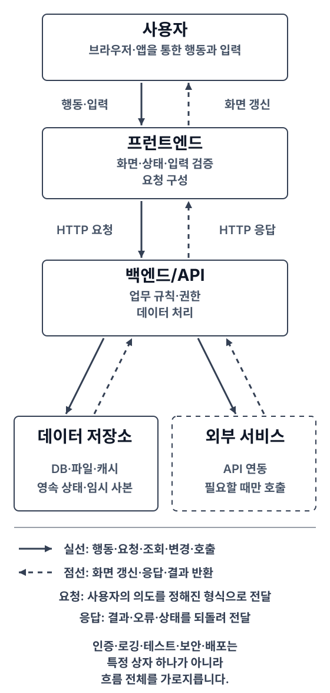

## 먼저 결론

웹 서비스는 화면 파일 하나가 아니라 **사용자가 조작하는 클라이언트, 신뢰할 수 있는 규칙을 실행하는 서버, 상태를 보존하는 저장소와 이들을 연결하는 계약**으로 이루어집니다. 풀스택을 이해한다는 것은 모든 기술을 직접 구현한다는 뜻이 아니라, 한 사용자 작업이 이 경계를 어떻게 통과하며 각 단계의 성공을 무엇으로 확인하는지 설명할 수 있다는 뜻입니다.

결과 문구가 화면에 나타났다는 사실만으로 서버의 중요한 규칙 검사가 안전하다고 결론 내릴 수 없고, 구성요소 사이의 입력·결과·오류에 관한 약속인 API를 통해 성공 응답을 받았다는 사실만으로 사용자가 결과를 올바르게 확인했다고 결론 내릴 수도 없습니다. 각 층의 책임과 증거 범위를 분리해야 AI가 만든 결과를 실제 시스템처럼 검토할 수 있습니다.

## 왜 필요한가

사용자가 중요한 버튼을 눌렀는데 결과를 알 수 없다고 가정해 보겠습니다. 화면 상태가 의도와 다를 수도 있고, 요청이 만들어지지 않았거나, 서버가 규칙에 따라 거절했거나, 저장은 끝났지만 응답이 늦거나 끊겼거나, 응답을 받은 뒤 화면 반영에 실패했을 수도 있습니다. 풀스택 지도가 없으면 이 모든 상황이 “프런트엔드가 안 된다” 또는 “API가 안 된다”로 뭉칩니다.

반대로 AI가 “프런트엔드와 백엔드를 모두 구현했습니다”라고 말해도 그 문장만으로는 완료를 판단할 수 없습니다. 어떤 사용자 작업을 지원하는지, 양쪽이 어떤 데이터 계약으로 연결되는지, 중요한 상태의 원본이 어디인지, 실패를 어디에서 관찰하고 복구하는지가 빠졌다면 화면과 서버 파일이 모두 있어도 하나의 서비스로 연결됐다고 보기 어렵습니다.

## 한 문장 정의

- **클라이언트(client)**: 다른 구성요소에 기능이나 데이터를 요청해 서비스를 사용하는 프로그램입니다. 브라우저, 모바일 앱과 명령줄 도구가 클라이언트가 될 수 있습니다.
- **서버(server)**: 다른 구성요소의 요청을 받아 정해진 규칙을 실행하고 결과를 응답하는 역할을 맡은 프로그램입니다. 일상적으로는 그 프로그램이 실행되는 호스트나 환경까지 서버라고 부르므로 문맥에서 무엇을 가리키는지 확인해야 합니다.
- **프런트엔드(frontend)**: 사용자의 입력, 화면, 브라우저 안의 상태와 상호작용을 주로 담당합니다.
- **백엔드(backend)**: 신뢰할 수 있는 업무 규칙, 권한 판단, 데이터 처리와 외부 서비스 연동을 주로 담당하는 서버 측 영역입니다.
- **풀스택(full-stack)**: 사용자 인터페이스부터 서버, 데이터, 배포와 운영까지 이어지는 전체 시스템 범위입니다.

클라이언트·서버는 **한 상호작용에서 누가 요청하고 응답하는지를 보는 역할 축**이고, 프런트엔드·백엔드는 **사용자 경험과 신뢰 가능한 규칙 중 어떤 책임을 맡는지를 보는 책임 축**입니다. 그래서 둘을 각각 같은 말로 등치할 수 없습니다. 명령줄 도구는 프런트엔드라고 부르지 않아도 클라이언트일 수 있고, 백엔드 프로그램도 외부 데이터 API를 호출할 때는 그 API의 클라이언트 역할을 합니다.

클라이언트와 서버는 고정된 신분도 특정 기계의 이름도 아닙니다. 서버 역할을 하는 프로그램은 원격 환경에 있을 수도 있고 지금 사용하는 컴퓨터에서 개발 서버로 실행될 수도 있습니다. 따라서 “어느 기계인가?”보다 “이 상호작용에서 누가 누구에게 무엇을 요청하고 어떤 약속으로 응답하는가?”를 먼저 묻고, 로컬에서 성공한 결과는 공개 환경의 성공 증거와 구분해야 합니다.

이 정의를 모임 참가 웹앱에 적용해 보겠습니다. 공개 모임 상세 화면에서 사용자가 남은 한 자리를 보고 참가를 눌렀는데 결과를 알 수 없다면, 로그인 상태를 잘못 표시했을 수도 있고, 참가 요청이 만들어지지 않았거나, 서버가 권한·중복·마감·정원을 이유로 거절했거나, `registrations`에는 이미 확정됐지만 응답이 늦거나 끊겼거나, 응답을 받은 뒤 화면 반영에 실패했을 수도 있습니다. 같은 화면 증상이어도 클라이언트·서버 역할과 프런트엔드·백엔드 책임을 따라가면 확인할 경계와 증거가 달라집니다.

## 식당으로 이해하기

사용자는 손님, 화면은 메뉴판과 주문 상태판, API 계약은 주문서의 칸과 전달 규칙, 백엔드는 주문 가능 여부와 가격을 판단하는 주방 업무, 데이터베이스는 재고와 주문 기록에 비유할 수 있습니다.

### 비유가 맞는 지점

- 손님이 보는 메뉴와 주방이 관리하는 재고는 같은 책임이 아닙니다.
- 주문 형식이 정해져 있어야 요청을 빠뜨리거나 잘못 해석하는 일을 줄일 수 있습니다.
- 주문을 받았다는 사실과 조리가 끝났다는 사실, 손님이 음식을 받았다는 사실은 서로 다른 상태입니다.
- 주방은 메뉴판에 적힌 값만 믿지 않고 재고와 주문 권한을 다시 확인해야 합니다.

### 비유가 깨지는 지점

실제 웹 시스템에서는 한 요청이 프록시, 캐시, 여러 서버와 외부 서비스를 거칠 수 있고, 같은 데이터의 사본이 여러 위치에 존재할 수 있습니다. 주방도 외부 공급자에게 재료를 요청할 때는 클라이언트 역할을 하며 여러 사용자의 작업이 동시에 진행될 수 있습니다. 오래 걸리는 작업은 주문한 연결을 계속 붙잡는 대신 작업을 접수한 뒤 별도의 상태 조회나 알림으로 완료를 전달할 수 있고, 연결을 유지한 채 서버 쪽 갱신을 보내는 구조도 있습니다. 또한 프로그램은 사람처럼 애매한 주문을 눈치로 보정해서는 안 됩니다. 경계마다 입력, 출력, 오류와 권한을 명시적으로 정해야 합니다.

## 시스템에서의 위치

아래 지도에서 사용자 행동이 프런트엔드와 백엔드를 오가고, 백엔드가 저장소와 외부 서비스에 각각 어떻게 연결되는지 확인해 보세요.



화살표는 책임 사이의 연결을 보여 줄 뿐, 실제 권한 집행이나 저장·화면 갱신의 성공을 증명하지 않습니다.

가장 단순한 동적 웹 요청은 다음과 같이 볼 수 있습니다.

```text
사용자 행동
→ 프런트엔드가 현재 상태를 읽고 요청을 구성
→ 네트워크를 통해 API 계약에 맞는 메시지를 전달
→ 백엔드가 신원·권한·입력·업무 규칙을 확인
→ 데이터 저장소나 외부 서비스에서 필요한 결과를 얻음
→ 백엔드가 성공 또는 실패 응답을 구성
→ 프런트엔드가 응답을 로딩·성공·빈 결과·오류 상태로 표현
→ 사용자가 결과와 다음 행동을 확인
```

이 흐름은 학습을 위한 기본 지도이지 모든 시스템의 고정 배치도가 아닙니다. 페이지를 처음 표시할 때는 HTML, CSS, JavaScript와 공개 모임 안내 사본을 받는 흐름에서 시작하지만 이후 참가를 누르는 상호작용은 현재 브라우저 상태에서 시작하므로 순서와 요청 수가 다를 수 있습니다. 안내 문구를 접거나 이미 받은 일정의 표시 형식을 바꾸는 동작처럼 클라이언트 안에서만 끝나는 행동도 있고, 변하지 않는 공개 안내는 실행 중인 업무 API 없이 미리 만든 파일로 전달할 수도 있습니다.

## 한 사용자 작업을 끝에서 끝까지 추적하기

모임 참가 웹앱을 단계별로 만드는 학습 경로인 Build Track에서 사용자가 “공개 모임 상세를 확인하고 로그인한 뒤 참가를 요청해 자신의 확정 상태를 확인한다”는 작업을 수행한다고 해보겠습니다. 아래 표는 W-01 공개 조회와 W-03 참가 요청이 W-04 정원·동시성 판단을 통과하는 흐름입니다. `Network`와 `Console`은 많이 쓰는 브라우저 개발자 도구 명칭이며 브라우저에 따라 이름과 위치가 다를 수 있습니다.

| 단계 | 맡는 책임 | 경계를 넘는 값 | 직접 확인할 증거 |
|---|---|---|---|
| 1. 공개 모임 상세 조회 | 클라이언트가 공개 `eventId`로 제목·설명·일정과 현재 모집 정보를 요청함 | `eventId` | 브라우저 Network의 실제 공개 요청과 응답 |
| 2. 로그인 상태 확인 | 프런트엔드는 로그인 필요 여부를 안내하고 서버는 참가 요청을 처리할 현재 주체를 확인함 | 브라우저가 보내는 식별 정보와 서버가 확인한 요청 주체 | 브라우저 Network의 인증 교환과 비밀을 제외한 서버 로그 |
| 3. 참가 요청 | 클라이언트가 현재 사용자의 참가 의도를 API 계약에 맞게 보냄 | URL, 메서드, `eventId`, 요청 상관 식별자 | 브라우저 Network의 실제 요청과 중복 전송 여부 |
| 4. 서버 계약·인가·정원 판단 | 백엔드가 입력 계약, 인증된 주체, 자신의 참가 행동, 활성 중복, `event.status`, `capacity`와 현재 확정 수를 신뢰 가능한 경계에서 판단함 | 검증된 `eventId`와 요청 주체, 현재 모집·참가 상태 | 비밀·개인정보를 제외한 서버 로그와 계약·인가·동시성 테스트 |
| 5. `registrations` 확정 | 저장소가 같은 트랜잭션에서 참가 관계를 `confirmed`로 확정하고 정원 초과와 활성 중복을 막음 | `event_id`, `participant_id`, `registration.status` | 처리 뒤 데이터 재조회에서 확정 행·현재 확정 수·활성 중복 0건 확인 |
| 6. 응답 | 서버가 확정 또는 인증·인가·중복·마감·정원 충돌·서버 실패 결과를 계약에 맞게 보냄 | 상태 코드와 안전한 응답 본문 | 브라우저 Network의 실제 응답 헤더·본문과 요청 상관 관계 |
| 7. 화면 상태 | 프런트엔드가 로딩·확정·이미 참가함·마감·충돌·전달 실패를 접근 가능한 상태로 표현함 | 응답과 재조회한 최신 참가 상태 | 사용자 화면(UI) 상태, 브라우저의 문서 구조(DOM), 화면과 접근성 구조 |
| 8. 사용자 완료 | 사용자가 자신의 참가 확정 여부와 다음 행동인 취소 가능 여부를 이해함 | 사용자에게 전달된 업무 결과 | 대표 흐름에서 사용자가 도움 없이 결과와 다음 행동을 설명하는 사용자 성공 |

트랜잭션으로 묶는 것만으로 동시 요청의 정원 초과가 자동 방지되지는 않습니다. 선택한 데이터베이스의 동시성 전략과 고유성 제약을 함께 설계하고, 마지막 한 자리를 두 요청이 동시에 시도하는 테스트로 확인해야 합니다.

한 단계의 증거를 다음 단계의 성공으로 확대하지 마세요. 브라우저 Network의 성공 응답은 메시지 교환의 증거이지 서버가 정원과 중복을 올바르게 판단했다는 증거가 아닙니다. 서버 로그는 서버가 기록한 판단 범위만 보여 주며 `registrations` 확정은 데이터 재조회로, 화면 표현은 UI 상태로, 사용자가 결과를 이해하고 다음 행동을 할 수 있는지는 사용자 성공으로 따로 확인해야 합니다. 데이터베이스에 행이 있다는 사실도 데이터 저장의 증거이지 사용자가 그 행을 볼 권한이 있고 화면에서 올바르게 이해했다는 증거는 아닙니다.

변하지 않는 행사 소개·준비물·장소 안내의 공개 사본은 빌드 때 공개 범위를 확인해 정적 파일로 전달할 수 있습니다. 그러나 남은 자리·자신의 참가 상태·모집 마감은 여러 사용자의 행동으로 동시에 바뀌는 권위 있는 상태이므로, 정적 사본이나 화면 표시만으로 참가 쓰기를 승인해서는 안 됩니다. 공개 환경에서는 동적 API와 정적 파일 모두 HTTPS로 전달되는지 확인해야 하며, HTTPS는 전송 중 도청·변조 위험을 줄일 뿐 권한·입력·정원 검증을 대신하지 않습니다. 자세한 요청·응답 증거는 [HTTP 요청과 응답](../http-request-response/)에서 이어서 다룹니다.

## 프런트엔드와 백엔드는 책임으로 나눕니다

파일 확장자나 폴더 이름만으로 책임을 판단하면 경계를 놓치기 쉽습니다. 서버에서 HTML을 만들어 보내는 방식도 있고, 브라우저가 API 응답으로 화면을 갱신하는 방식도 있으며, 하나의 프로젝트 안에 양쪽 코드가 함께 있을 수도 있습니다. 다음 기준으로 책임을 먼저 정한 뒤 기술과 배치를 선택하세요.

| 질문 | 프런트엔드의 주된 책임 | 백엔드의 주된 책임 |
|---|---|---|
| 사용자가 무엇을 보거나 조작하는가? | 화면 구조, 입력, 피드백, 포커스와 UI 상태 | 화면에 필요한 데이터와 허용된 행동 제공 |
| 빠른 입력 피드백은 어디서 하는가? | 필수값·형식의 즉각적인 안내 | 같은 입력을 신뢰하지 않고 다시 검증 |
| 누가 행동할 권한을 결정하는가? | 허용되지 않은 버튼을 숨기거나 비활성화할 수 있음 | 실제 요청마다 신원과 권한을 최종 판단 |
| 중요한 규칙은 어디서 보장하는가? | 규칙을 설명하고 오류를 이해할 수 있게 표시 | 업무 규칙과 데이터 무결성을 강제 |
| 비밀값은 어디에 두는가? | 브라우저로 전달된 코드·설정·데이터는 사용자가 열람할 수 있다고 보고 공개 가능한 값만 사용 | 외부 API 비밀값과 서버 전용 설정을 브라우저 번들·정적 파일에 넣지 않고 보호 |
| 영구 데이터는 누가 바꾸는가? | 변경 의도를 요청하고 결과를 반영 | 저장소 변경, 동시성, 실패와 복구 처리 |

프런트엔드 검증은 사용자 경험을 좋게 하지만 보안 경계가 아닙니다. 브라우저에서 보낸 값과 화면에서 숨긴 기능은 사용자가 바꿀 수 있다고 가정해야 합니다. 권한, 가격, 소유권과 데이터 무결성처럼 우회되면 안 되는 규칙은 서버나 그 책임을 맡은 신뢰 가능한 경계에서 다시 확인해야 합니다.

그렇다고 모든 계산을 서버로 옮겨야 한다는 뜻도 아닙니다. 이미 받은 데이터의 정렬, 표시 형식과 임시 필터처럼 보안·무결성 판단이 아닌 상호작용은 클라이언트가 담당할 수 있습니다. 핵심 질문은 “어디가 더 고급 기술인가?”가 아니라 “어느 경계를 사용자가 우회할 수 있고, 어떤 결과를 누가 최종 보장해야 하는가?”입니다.

## 상태의 권위 있는 원본과 사본을 구분하세요

화면에 보이는 값, 서버가 기억하는 값과 데이터베이스에 저장된 값이 항상 동시에 같지는 않습니다. **권위 있는 원본(source of truth)**: 특정 상태의 최종 값을 결정하고 충돌을 해결하는 위치이며, 시스템 전체에 하나만 있다는 뜻이 아니라 상태 종류마다 다를 수 있습니다. 각 상태의 원본과 사본의 갱신 규칙을 정해야 새로고침, 여러 탭, 여러 사용자와 서버 재시작을 예측할 수 있습니다.

| 상태 예 | 주된 위치 | 확인 질문 |
|---|---|---|
| 현재 보고 있는 `eventId` | URL과 브라우저 상태 | 새로고침·공유 링크에서 같은 모임을 가리키는가? |
| 서버에서 받은 공개 모임 정보 | 브라우저 상태와 캐시 | 행사 안내 사본과 동적으로 바뀌는 모집 상태를 구분하는가? |
| 로그인 상태 | 브라우저가 가진 식별 정보와 서버의 검증 체계 | 만료·로그아웃·탈취 시 어떻게 거절하는가? |
| 확정된 참가 관계 | 데이터베이스 같은 영속 저장소의 `registrations` | 누가 자신의 참가를 바꿀 수 있고 활성 중복을 어떻게 막는가? |
| `event.status`, `capacity`, 현재 확정 수 | 신뢰 가능한 애플리케이션·데이터 경계 | 참가 확정과 정원·마감 판단을 같은 일관성 경계에서 수행하는가? |
| 남은 자리·참가 여부 표시 | 클라이언트·서버·중간 캐시의 사본 | 원본이 바뀌면 언제 무효화하고 언제 재조회하는가? |
| 진행 중인 참가 요청 | 브라우저 UI 상태와 서버 처리 기록 | 전송 중·확정·거절·응답 유실을 어떻게 구분하는가? |

UI가 먼저 바뀐 뒤 서버 요청이 실패하면 화면을 되돌리거나 실패 상태를 표시해야 할 수 있습니다. 서버 변경은 성공했지만 응답이 끊기면 클라이언트는 실패처럼 보더라도 실제 저장 상태를 다시 확인해야 합니다. 쓰기 요청을 다시 보내기 전에는 같은 변경이 이미 반영됐는지와 중복 저장·결제·알림 위험을 확인하고, 필요한 경우 멱등 키·고유 제약·처리 기록 같은 보호 장치를 둡니다. 자세한 판단은 [HTTP 요청과 응답의 재시도 전에 멱등성을 확인하기](../http-request-response/#재시도-전에-멱등성을-확인하기)에서 이어집니다.

모임 흐름의 대표 충돌을 상태 원본과 사본에 연결하면 다음과 같습니다.

| 상황 | 원본과 사본의 문제 | 직접 확인할 증거와 복구 판단 |
|---|---|---|
| 늦은 응답 | 이전 참가·취소 요청의 응답이 현재 UI 상태보다 늦게 도착해 최신 결과를 덮을 수 있음 | 브라우저 Network의 요청 시작·완료 순서와 데이터 재조회를 비교하고 현재 요청과 맞지 않는 응답은 화면에 반영하지 않음 |
| 중복 클릭 | 버튼 비활성화는 브라우저 사본의 중복 의도만 줄이며 두 요청이 서버에 도달할 수 있음 | Network에서 실제 요청 수를 확인하고 서버의 활성 참가 중복 거절과 데이터 재조회에서 활성 중복 0건을 확인함 |
| 취소 뒤 재참가 | 화면은 `cancelled`로 바뀌었지만 서버나 캐시에 이전 `confirmed` 사본이 남을 수 있음 | 현재 `registration.status`를 재조회하고 취소와 재참가 순서·고유성 계약에 따라 새 확정 여부를 판단함 |
| 마지막 한 자리 충돌 | 두 브라우저가 모두 남은 한 자리 사본을 보아도 확정 경계의 권위 있는 정원 상태는 요청 사이에 바뀔 수 있음 | 동시 요청 뒤 데이터 재조회에서 정확히 한 건만 확정되고 `confirmed <= capacity`이며 다른 요청은 안전하게 거절됐는지 확인함 |
| 캐시된 정원 표시 | 정적 파일·중간 캐시·브라우저 캐시의 남은 자리 사본이 권위 있는 모집 상태보다 오래될 수 있음 | 응답 시점과 캐시 정책을 확인하고 참가 결정은 서버가 최신 `event.status`·`capacity`·확정 수를 다시 판단하게 함 |

동시에 바뀐 값의 충돌을 조용히 덮어쓸지, 오래된 버전의 변경을 거절할지, 사용자에게 비교·병합을 요청할지는 서로 다른 결과를 만듭니다. 하나를 보편적인 정답으로 가정하지 말고 데이터 손실 비용과 사용자 작업에 맞춰 선택하고 그 규칙을 증거로 남겨야 합니다.

## 하나의 화면 증상에는 여러 실패 위치가 있습니다

참가 버튼을 눌렀지만 완료 여부를 알 수 없다는 같은 증상도 원인은 다를 수 있습니다.

| 위치 | 대표 실패 | 확인 증거 | 다음 판단 |
|---|---|---|---|
| 사용자 입력 | 로그인하지 않은 상태, 이미 참가한 사용자의 중복 의도 | 현재 로그인·참가 안내와 버튼 상태 | 요청 전 안내가 충분한가? |
| 클라이언트 상태 | 로딩 상태 고착, 중복 클릭, 취소 뒤 재참가 순서 혼동, 늦게 도착한 이전 응답 반영 | UI 상태·DOM·요청 시작과 완료 순서 | 현재 행동과 표시 조건이 같은가? 최신 요청을 구분하는가? |
| 브라우저·네트워크 | 요청 미생성, 연결 실패, 브라우저 정책 차단 | Console과 Network | 서버에 도달했는가? |
| API 계약 | 경로·메서드·필드·형식 불일치 | 실제 요청과 응답 | 양쪽이 같은 계약 버전을 쓰는가? |
| 서버 규칙 | 인증·인가·중복·마감·정원 거절 | 상태 코드, 안전하게 정리된 서버 로그 | 의도된 거절인가 결함인가? |
| 데이터 | `registrations` 확정·취소 상태 불일치, 정원 초과, 활성 중복 | 처리 뒤 데이터 재조회와 제약·동시성 테스트 | 응답과 무관하게 실제 권위 상태는 무엇인가? |
| 외부 서비스 | 시간 초과, 한도, 응답 형식 변경 | 외부 호출 상태와 실패 기록 | 재시도가 안전하고 필요한가? |
| 렌더링 | 응답 해석·상태 분기·참가 상태 표현 실패 | 응답 본문, UI 상태, DOM과 화면 | 응답은 왔지만 현재 확정 상태 표현에 실패했는가? |

브라우저 Console에 오류가 없다는 사실만으로 서버와 데이터가 정상이라고 결론 내리지 마세요. 반대로 서버 로그에 오류가 없다고 화면까지 성공했다고 결론 내리지 마세요. 관찰 지점마다 보이는 범위가 다르므로 대표 사용자 작업을 따라 증거를 연결해야 합니다.

## 풀스택은 항상 동적 서버를 뜻하지 않습니다

작은 모임 안내에서 요구사항이 변하지 않는 행사 소개·준비물·장소를 공개 읽기로 제공하는 것뿐이라면 정적 HTML·JavaScript와 빌드 시 만든 공개 데이터 파일로 충분할 수 있습니다. 이 경우에도 공개 범위 확인, 빌드, 호스팅의 파일 응답, HTTPS·캐시·접근 설정, 브라우저 상태와 운영 확인까지 전체 전달 흐름은 존재합니다. 요청 시점의 업무 서버가 없더라도 공개 사본 준비 책임은 빌드·배치 시점에 수행될 수 있습니다.

정적 행사 안내의 갱신은 새 산출물과 새 배포로 이루어지며 원본·배포 버전·중간 캐시·브라우저 캐시가 잠시 다른 값을 가질 수 있습니다. 따라서 갱신 완료는 빌드 성공만이 아니라 실제 배포 버전, 응답 헤더와 사용자가 받은 사본 시점까지 확인해야 합니다. 브라우저에 전달되는 정적 파일과 번들은 누구나 열람할 수 있는 공개 범위로 보고 비밀 키·내부 규칙·비공개 참가 행을 넣지 않습니다. 남은 자리·자신의 참가 상태·마감처럼 쓰기 결정을 좌우하는 값은 이 사본과 분리하고 참가 요청 때 신뢰 가능한 서버·데이터 경계에서 다시 판단합니다.

다음 신호가 생길 때 동적 백엔드를 검토할 수 있습니다.

- 사용자별 권한이나 비공개 데이터가 있습니다.
- 브라우저에 둘 수 없는 비밀 키로 외부 서비스를 호출해야 합니다.
- 데이터가 커서 사용자 조건에 따라 서버에서 조회하거나 계산해야 합니다.
- 필요한 최신성을 빌드·배포 주기로 감당할 수 없습니다.
- 사용자가 만든 상태를 여러 기기와 세션에 걸쳐 저장해야 합니다.
- 변경 요청의 동시성, 감사 기록과 사용량 제어가 필요합니다.

학습을 위해 서버를 억지로 추가하면 운영 책임만 늘어날 수 있습니다. 반대로 실제 권한과 비밀정보 책임이 있는데 정적 화면만으로 감추려 해도 안전하지 않습니다. 아키텍처는 “풀스택처럼 보이는가?”가 아니라 현재 요구사항과 실패 비용으로 결정합니다.

## 개발자가 사용하는 판단 규칙

1. **사용자 작업에서 시작합니다.** 페이지나 파일 목록보다 사용자가 끝내야 하는 행동과 성공 상태를 먼저 씁니다.
2. **대표 흐름 하나를 끝까지 그립니다.** 사용자 입력부터 데이터와 화면 결과까지 단계마다 책임, 입력, 출력과 오류를 적습니다.
3. **경계마다 계약을 찾습니다.** HTTP API뿐 아니라 URL 상태, 데이터 스키마, 파일 형식과 외부 서비스 응답도 계약입니다.
4. **중요 상태의 권위를 지정합니다.** 원본 위치, 사본, 갱신·만료·충돌 규칙이 없으면 화면과 서버가 쉽게 어긋납니다.
5. **신뢰 경계(trust boundary)에서 다시 검증합니다.** 클라이언트가 보낸 신원·권한·가격·소유권과 중요한 입력을 그대로 믿지 않고, 서버가 받는 외부 API 응답과 원천 파일도 신뢰 수준과 계약에 맞게 확인합니다.
6. **성공 증거의 범위를 제한합니다.** 화면, 요청, 서버, 데이터와 운영 증거를 서로 대신 사용하지 않습니다.
7. **가장 단순한 충분한 구조를 선택합니다.** 정적 전달이 요구사항을 만족하면 서버를 추가하지 않고, 서버 책임이 실제로 생기면 숨기지 않습니다.

## 흔한 실패와 복구 질문

### 화면과 서버 파일이 있으면 연결됐다고 생각합니다

프런트엔드와 백엔드가 같은 필드 이름, 상태와 오류 의미를 쓰는지 확인하지 않으면 각자 따로 동작할 수 있습니다. 실제 요청과 응답을 캡처하고 계약 테스트와 대표 사용자 흐름으로 연결을 확인하세요.

### 프런트엔드 검증을 권한 통제로 착각합니다

버튼을 숨기거나 입력창을 제한해도 직접 요청을 보내면 우회할 수 있습니다. 서버가 신원, 대상 자원의 소유권과 행동 권한을 다시 검증하는지 확인하세요.

### 모든 상태를 한곳의 진실로 부릅니다

현재 보고 있는 모임과 아직 보내지 않은 참가 의도의 권위는 브라우저일 수 있고 확정된 `registrations`의 권위는 데이터베이스일 수 있습니다. 상태별 원본과 사본을 따로 적고 동기화 실패 시 사용자에게 어떤 상태를 보여줄지 정하세요.

### 하나의 성공 신호로 전체 완료를 주장합니다

`200` 응답, 데이터베이스 행, 스크린샷과 테스트 하나는 각각 제한된 범위만 증명합니다. 요구사항별로 어떤 층의 증거가 필요한지 정하고, 핵심 작업은 끝에서 끝까지 확인하세요.

### 풀스택이라는 이유로 모든 계층을 추가합니다

데이터베이스, 인증, 큐와 별도 API가 실제 책임 없이 들어가면 실패 지점과 운영 비용이 늘어납니다. 요구사항과 위험에 없는 구성요소는 빼고, 필요 신호가 생길 때 아키텍처 결정 기록(ADR)으로 추가 여부를 기록하세요.

### 오류 메시지에 민감정보를 그대로 담습니다

디버깅을 위해 토큰, 쿠키, 전체 요청 본문이나 데이터베이스 오류를 화면과 로그에 그대로 남기면 새로운 위험이 생깁니다. 사용자에게 필요한 설명과 운영자가 필요한 진단 정보를 분리하고 민감값은 제거하거나 가리세요.

## AI와 작업할 때

“풀스택으로 만들어줘”라는 지시에는 책임, 범위와 완료 증거가 없습니다. 다음처럼 대표 사용자 작업과 경계를 먼저 고정하세요.

```text
모임 참가 웹앱에서 사용자가 공개 모임 상세를 조회하고 로그인한 뒤 참가를 요청해 확정 상태와 다음 행동을 확인하는 흐름을 분석하라.
공개 모임 상세 조회 → 로그인 상태 확인 → 참가 요청 → 서버 계약·인가·정원 판단 → registrations 확정 → 응답 → 로딩·확정·이미 참가함·마감·충돌·전달 실패 화면 → 사용자 완료 순서로 추적하라.
각 단계의 책임, 입력, 출력, 실패 상태, 권위 있는 상태와 직접 검증 증거를 표로 작성하라.
변하지 않는 행사 안내 사본을 정적으로 전달할 수 있는 책임과 남은 자리·참가 상태·마감처럼 동적 백엔드가 최신 상태에서 판단해야 하는 책임을 구분하고, 현재 저장소 근거가 없는 부분은 미확인으로 표시하라.
토큰·쿠키·개인정보·비공개 데이터는 출력하지 말고 파일은 수정하지 마라.
```

AI의 표를 받은 뒤에는 실제 파일과 실행 결과를 대조하세요. 존재하지 않는 API나 로그를 AI가 추정했을 수 있고, 화면에서 보이는 필드가 서버 계약과 다를 수 있습니다. “그럴듯한 아키텍처 설명”은 증거가 아닙니다.

## 확인 체크리스트

- [ ] 대표 사용자 작업과 완료 상태를 한 문장으로 썼습니다.
- [ ] 클라이언트, 서버, 저장소와 외부 서비스의 책임을 구분했습니다.
- [ ] 클라이언트와 서버가 고정된 기계가 아니라 상호작용의 역할임을 설명할 수 있습니다.
- [ ] 경계마다 입력, 출력, 오류와 권한 계약을 찾았습니다.
- [ ] 프런트엔드 검증과 서버의 최종 검증을 구분했습니다.
- [ ] 브라우저에 전달되는 코드·설정·데이터에 비밀이나 비공개 정보가 없는지 확인했습니다.
- [ ] 공개 환경의 동적 요청과 정적 파일 응답이 HTTPS인지 확인했습니다.
- [ ] 중요한 상태마다 권위 있는 원본, 사본과 동기화 규칙을 정했습니다.
- [ ] 브라우저 Network·서버 로그·데이터 재조회·UI 상태·사용자 성공이 각각 무엇을 증명하는지 구분했습니다.
- [ ] 빈 결과, 권한 거절, 서버 오류와 렌더링 실패를 서로 다른 상태로 다룹니다.
- [ ] 정적 전달과 동적 백엔드 중 현재 요구사항에 더 단순하고 충분한 쪽을 선택했습니다.
- [ ] 오류 화면과 로그에 토큰·쿠키·개인정보를 남기지 않습니다.
- [ ] 응답이 끊긴 쓰기 요청을 다시 보내기 전에 실제 반영 여부와 중복 부작용을 확인합니다.
- [ ] 핵심 흐름을 실제 요청과 응답 또는 정적 데이터 접근부터 화면 결과까지 검증했습니다.

## 짧은 연습

이 장의 모임 참가 흐름이나 자신의 프로젝트에서 버튼, 검색 또는 파일 생성처럼 중요한 사용자 작업 하나를 고르세요. 아래 표는 본문의 8단계를 그대로 복사하기보다 자신의 프로젝트에서 함께 판단할 책임 단위로 다시 묶는 연습입니다. 각 행에 해당하는 본문 단계를 찾아 채우되 모르는 칸은 추측하지 말고 `미확인`으로 남깁니다.

| 단계 | 책임 주체 | 입력 | 출력 | 실패 상태 | 직접 확인할 증거 |
|---|---|---|---|---|---|
| 사용자 입력 |  |  |  |  |  |
| 클라이언트 상태 |  |  |  |  |  |
| 경계와 계약 |  |  |  |  |  |
| 서버 규칙 또는 정적 데이터 |  |  |  |  |  |
| 데이터 원본·사본 |  |  |  |  |  |
| 화면 결과 |  |  |  |  |  |
| 운영 확인 |  |  |  |  |  |

마지막으로 다음 세 질문에 답하세요.

1. 사용자가 우회할 수 있는 경계에서 어떤 규칙을 다시 검증해야 하나요?
2. 화면이 성공해도 아직 증명되지 않은 것은 무엇인가요?
3. 지금 구조에서 제거해도 요구사항을 만족하는 구성요소가 있나요?

## 관련 용어와 출처

- [소프트웨어는 시스템입니다](../../01-mental-models/software-is-a-system/)
- [HTTP 요청과 응답](../http-request-response/)
- [프런트엔드와 백엔드의 경계](../frontend-backend-boundary/): 이 장은 전체 사용자 흐름을, 인접 장은 화면과 서버 사이의 책임·신뢰 경계를 더 좁게 다룹니다.
- [브라우저·DOM·렌더링](../../05-frontend/browser-dom-rendering/)
- [API·데이터베이스·인증](../../04-backend-data/api-database-auth/)
- [첫 풀스택 프로젝트: 모임 참가 웹앱](../../12-case-studies/first-full-stack-project/)
- [개발 용어집의 웹과 풀스택](../../reference/development-glossary/#웹과-풀스택)
- [개발 용어집의 시스템과 코드](../../reference/development-glossary/#시스템과-코드)
- [SWEBOK 소프트웨어공학 지식체계](https://www.computer.org/education/bodies-of-knowledge/software-engineering)
- [RFC 9110 HTTP Semantics](https://www.rfc-editor.org/rfc/rfc9110.html): client와 server의 요청·응답 역할, 메시지와 HTTPS의 규범 범위
- [RFC 9111 HTTP Caching](https://www.rfc-editor.org/rfc/rfc9111.html): 저장 응답의 재사용·최신성·검증 범위
- [OWASP AJAX Security Cheat Sheet](https://cheatsheetseries.owasp.org/cheatsheets/AJAX_Security_Cheat_Sheet.html)와 [Authorization Cheat Sheet](https://cheatsheetseries.owasp.org/cheatsheets/Authorization_Cheat_Sheet.html): 사용자가 바꿀 수 있는 클라이언트 로직과 서버의 매 요청 권한 확인 경계
- [Chrome DevTools Sources panel](https://developer.chrome.com/docs/devtools/sources): 브라우저가 불러온 배포 자산을 사용자가 확인할 수 있는 범위
- [Astro On-demand rendering](https://docs.astro.build/en/guides/on-demand-rendering/): 정적 사전 렌더링과 요청 시점 서버 렌더링을 구분하는 한 프레임워크의 공식 예시
- [PostgreSQL 18 트랜잭션](https://www.postgresql.org/docs/18/tutorial-transactions.html), [트랜잭션 격리](https://www.postgresql.org/docs/18/transaction-iso.html), [제약 조건](https://www.postgresql.org/docs/18/ddl-constraints.html): 원자성·동시 접근·데이터 무결성을 확인하는 선택 데이터베이스의 구체 예시

RFC와 공식 보안·브라우저·프레임워크·데이터베이스 문서는 이 장의 역할, 신뢰 경계, 배포 자산 노출, HTTP 캐시, 정적·요청 시점 렌더링, 트랜잭션·격리·제약의 판단 범위를 직접 뒷받침합니다. 다만 Astro와 PostgreSQL은 각각 한 프레임워크와 한 데이터베이스의 예시이므로 그 설정·격리 동작을 다른 제품의 기본값으로 확대하지 않습니다. 낙관적 화면 변경의 되돌림 방식, 캐시 무효화 시점과 충돌 해결 전략도 요구사항·제품·데이터 손실 비용에 따라 달라지므로 이 장은 보편 구현법이 아니라 원본·사본·증거를 분리하는 판단 계약만 제시합니다.

출처의 확인일, 적용 범위와 후속 조사 대기는 저장소의 `research/source-map.md`에서 관리합니다.
