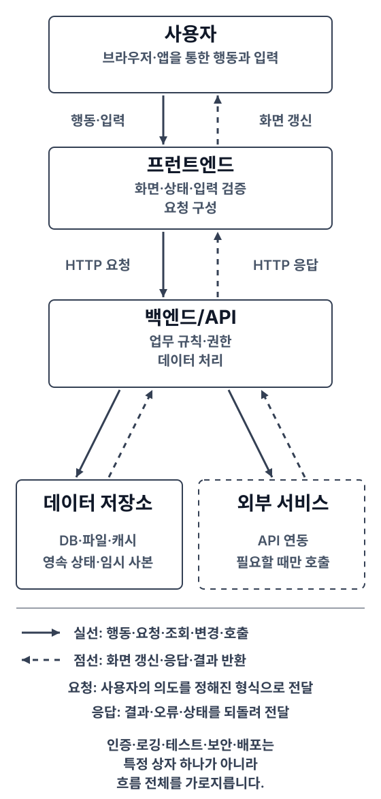

## 먼저 결론

웹에서 버튼을 누른 뒤 결과가 나타나는 과정은 대부분 **요청(request)을 보내고 응답(response)을 받는 교환**으로 이어집니다. 화면만 보고 “작동한다”고 판단하지 말고, 어떤 요청을 보냈고 어떤 상태와 데이터가 돌아왔는지 확인해야 문제의 위치를 좁힐 수 있습니다.

## 왜 필요한가

모임 상세 화면은 보이는데 참가 버튼을 누른 뒤 결과를 알 수 없다고 가정해 보겠습니다. 화면 코드가 잘못됐을 수도 있지만, 요청 경로가 틀렸거나, 로그인 정보가 빠졌거나, 서버가 중복·정원·마감 규칙으로 거절했거나, 변경을 완료한 뒤 응답 전달만 실패했을 수도 있습니다. HTTP를 모르면 이 모든 상황이 “화면이 안 된다”로 뭉치지만, 요청과 응답을 읽을 수 있으면 실패한 경계와 현재 상태를 다시 확인할 지점을 구체적으로 찾을 수 있습니다.

AI가 API를 구현했다고 보고해도 마찬가지입니다. 파일이 생겼다는 설명만으로는 입력 형식, 권한, 오류 상태, 중복 요청과 민감정보 노출이 안전한지 알 수 없습니다. 실제 요청과 응답은 AI의 완료 주장을 확인하는 핵심 증거입니다.

## 한 문장 정의

**HTTP(Hypertext Transfer Protocol)는 클라이언트와 서버가 요청과 응답 메시지를 교환하기 위한 웹의 응용 계층 규칙입니다.** 요청은 대상과 의도와 필요한 데이터를 전달하고, 응답은 처리 결과의 상태와 데이터를 돌려줍니다.

HTTP는 데이터 자체의 업무 의미까지 정해주지는 않습니다. 같은 `POST` 요청이라도 한 서비스에서는 보고서 생성, 다른 서비스에서는 결제 승인일 수 있으므로 구체적인 입력·출력과 권한은 각 API 계약에서 정의해야 합니다.

HTTP 자체는 전송 구간을 암호화하지 않습니다. 공개 환경에서는 전송 구간을 보호하는 전송 계층 보안(Transport Layer Security, TLS)을 HTTP에 적용한 **HTTPS**를 기본값으로 사용하고, 브라우저 주소와 Network 탭에서 실제 요청 URL이 `https://`인지 확인해야 합니다. 이 장의 `http://localhost` 예시는 자기 컴퓨터 안에서 동작을 확인하는 로컬 예시입니다.

## 택배 송장으로 이해하기

HTTP 요청은 정해진 칸이 있는 택배 송장과 비슷합니다. 배송지에 해당하는 URL, 처리 의도를 나타내는 메서드, 포장과 취급 정보를 적는 헤더, 실제 내용물에 해당하는 본문이 함께 전달됩니다. 응답은 접수·처리 결과를 나타내는 상태 코드와 추가 정보인 헤더, 결과물 또는 오류 설명인 본문으로 돌아옵니다.

### 비유가 맞는 지점

- 보내는 쪽과 받는 쪽이 약속된 형식을 지켜야 합니다.
- 주소, 처리 방식, 부가 정보와 내용물이 서로 다른 역할을 합니다.
- 형식이 맞아도 권한이나 업무 규칙 때문에 처리가 거절될 수 있습니다.
- 중간에서 지연되거나 목적지에 도달하지 못할 수 있습니다.

### 비유가 깨지는 지점

실제 HTTP 통신은 클라이언트와 서버 사이에 프록시, 캐시, 로드 밸런서 같은 중간 구성요소가 있을 수 있고, 한 화면 동작이 여러 요청을 동시에 만들기도 합니다. 서버가 응답하지 않았다는 사실만으로 요청이 처리되지 않았다고 단정할 수도 없습니다. 서버는 변경을 완료했지만 응답이 돌아오는 중 연결이 끊겼을 수 있으므로, 쓰기 요청을 무조건 다시 보내면 중복 저장 같은 부작용이 생길 수 있습니다.

## 시스템에서의 위치

아래 지도에서 프런트엔드와 백엔드 사이의 HTTP 요청·응답이 저장소·외부 서비스 호출이나 화면 갱신과 어떻게 구분되는지 확인해 보세요.



이 지도는 책임의 연결을 보여 주며, 모든 시스템의 고정 배치나 HTTP 응답만으로 권한 집행·저장·화면 갱신의 성공까지 증명한다는 뜻은 아닙니다.

사용자 행동은 브라우저의 UI 상태에서 시작하지만 HTTP는 주로 프런트엔드와 API 경계에서 보입니다. 서버는 요청을 받은 뒤 인증과 인가, 입력 검증, 업무 규칙, 데이터 조회나 변경을 수행하고 응답을 만듭니다. 프런트엔드는 그 응답을 성공·빈 결과·권한 부족·입력 오류·서버 장애 같은 UI 상태로 바꿉니다.

```text
사용자 행동
→ 브라우저가 요청 생성
→ 네트워크와 중간 구성요소
→ 서버가 권한·입력·업무 규칙 확인
→ 데이터 조회 또는 변경
→ 서버가 응답 생성
→ 브라우저가 화면 상태로 렌더링
```

HTTP는 이 전체 흐름 가운데 메시지 교환 규칙을 담당합니다. 데이터가 정확한지, 사용자가 행동할 권한이 있는지, 데이터베이스 변경이 안전한지는 서버와 데이터 계층이 별도로 책임집니다.

## 요청을 읽는 네 가지 칸

| 구성요소 | 쉬운 뜻 | 예시 | 확인 질문 |
|---|---|---|---|
| 메서드(method) | 무엇을 하려는지 나타내는 표준화된 의도 | `GET`, `POST`, `PUT`, `PATCH`, `DELETE` | 조회인가, 새 처리인가, 변경인가, 삭제인가? |
| URL | 어느 자원과 기능을 대상으로 하는지 나타내는 주소 | `/events/evt-42/registrations` | 경로와 검색 조건이 실제 계약과 맞는가? |
| 헤더(header) | 인증, 데이터 형식, 캐시 같은 부가 정보 | `Authorization`, `Accept`, `Content-Type` | 토큰과 형식 정보가 필요한 위치에만 있는가? |
| 본문(body) | 서버가 처리할 구조화된 데이터 | JSON 형식의 필터 또는 저장 값 | 필수 필드, 타입, 크기와 민감정보가 적절한가? |

메서드 이름은 중요한 신호지만 보안 통제가 아닙니다. `GET`이라고 적었다고 자동으로 안전해지거나 `DELETE`라고 적었다고 삭제 권한이 확인되는 것은 아닙니다. 서버는 모든 민감한 요청에서 신원, 권한, 입력과 업무 규칙을 다시 검증해야 합니다.

### 자주 만나는 메서드

- `GET`: 자원이나 계산 결과를 조회할 때 사용합니다. 조회 요청이 서버 상태를 의도적으로 바꾸지 않도록 설계하는 것이 기본입니다.
- `POST`: 새 자원을 만들거나 특정 처리를 시작할 때 자주 사용합니다. 같은 요청을 반복하면 중복 생성이나 중복 결제가 생길 수 있습니다.
- `PUT`: 알고 있는 대상의 전체 표현을 교체하거나 저장할 때 사용합니다. 같은 요청을 반복했을 때 최종 효과가 같도록 설계할 수 있습니다.
- `PATCH`: 대상의 일부를 변경할 때 사용합니다. 어떤 연산을 허용하고 반복 시 효과가 어떻게 되는지 API 계약에서 확인해야 합니다.
- `DELETE`: 대상을 제거할 때 사용합니다. 두 번째 요청의 상태 코드는 달라질 수 있어도 최종적으로 대상이 없는 효과는 같을 수 있습니다.

이 설명은 일반적인 HTTP 의미입니다. 실제 API가 메서드를 어떤 업무 규칙과 연결했는지는 문서, 구현과 테스트를 함께 확인해야 합니다.

## 응답을 읽는 세 가지 칸

| 구성요소 | 쉬운 뜻 | 확인 질문 |
|---|---|---|
| 상태 코드(status code) | 요청 처리 결과의 큰 범주를 나타내는 세 자리 숫자 | 클라이언트와 모니터링 도구가 성공·입력 문제·서버 문제를 구분할 수 있는가? |
| 헤더 | 응답 형식, 캐시, 위치, 재시도 같은 부가 정보 | 본문 형식과 캐시·재시도 정책이 실제 동작과 맞는가? |
| 본문 | 결과 데이터 또는 사람이 이해할 수 있는 오류 세부 정보 | 성공 데이터와 오류 형식이 일관되고 민감정보를 노출하지 않는가? |

상태 코드는 결과의 큰 분류이고 본문은 세부 설명입니다. 본문이 있는 응답에서는 상태 코드와 본문을 함께 읽어야 합니다. `204 No Content`처럼 본문이 없는 응답에는 JSON 파싱이나 성공 본문을 요구하지 않고 상태 코드·필요한 헤더와 계약상 재조회로 결과를 확인합니다. 모든 상황을 `200`으로 반환한 뒤 본문 안의 `success: false`만 보게 만들면 브라우저 코드, 모니터링과 프록시가 실패를 성공으로 오해할 수 있습니다.

### 상태 코드 범주

| 범주 | 의미 | 대표적으로 확인할 상황 |
|---|---|---|
| `1xx` | 처리가 진행 중임을 알리는 정보 | 일반적인 앱 개발에서는 자주 직접 다루지 않음 |
| `2xx` | 요청을 성공적으로 처리함 | `200` 성공, `201` 생성, `204` 본문 없는 성공 |
| `3xx` | 다른 위치나 저장된 사본을 사용하도록 안내 | 리디렉션, 캐시 재검증 |
| `4xx` | 요청, 인증, 권한 또는 현재 상태 때문에 처리할 수 없음 | `400` 잘못된 요청, `401` 인증 필요, `403` 권한 부족, `404` 대상 없음, `409` 상태 충돌, `429` 요청 과다 |
| `5xx` | 서버 측 처리 오류를 나타내는 범주 | `500` 내부 오류, `503` 일시적 사용 불가 |

HTTP 성공과 업무 완료는 구분해야 합니다. 오래 걸리는 작업은 접수 성공을 응답한 뒤에도 처리 중일 수 있으므로, 해당 상태 코드의 의미와 API 계약의 작업 상태·조회 결과를 함께 확인합니다. 접수됨·처리 중·업무 완료는 계약상 상태로 구분하고, 응답을 받지 못했다면 결과 불명으로 두어 처리 기록과 현재 상태를 확인합니다. 아래 모임 참가 예시는 참가를 확정한 뒤 성공 응답을 보내는 계약입니다.

`4xx`라고 해서 항상 사용자의 잘못이라는 뜻은 아닙니다. 프런트엔드가 잘못된 형식을 만들었거나 만료된 토큰을 보냈을 수도 있습니다. `5xx`도 원인을 자동으로 알려주지 않으므로 요청 식별자, 서버 로그와 관련 지표를 함께 봐야 합니다.

## 예: 모임의 조회·참가·취소 계약

여기서부터는 앞서 정의한 HTTP 메시지 구성과 메서드 의미를 모임 참가 웹앱에 적용합니다. 예시 식별자와 토큰 표시는 모두 교육용 가상 값이며, 실제 API에서는 문서·구현·테스트가 합의한 계약을 확인해야 합니다.

### 공개 모임 조회

`GET /events/evt-42`는 인증 정보 없이 공개 모임 한 건을 읽는 안전한 요청입니다.

```http
GET /events/evt-42 HTTP/1.1
Host: meetup.example.test
Accept: application/json
```

정상 조회라면 서버는 `2xx` 범주의 응답과 공개 가능한 필드를 반환할 수 있습니다.

```http
HTTP/1.1 200 OK
Content-Type: application/json

{"id":"evt-42","title":"가상 모임","status":"open","capacity":10,"confirmedCount":9,"version":7}
```

공개 조회 응답에 참가자 식별자나 인증 토큰 같은 비공개 정보를 넣지 않습니다. 존재하지 않음, 취소됨과 전달 실패도 화면에서 서로 다른 상태로 표현할 수 있도록 응답 계약을 분리합니다.

### 자신의 참가 신청

`POST /events/evt-42/registrations`는 인증된 현재 사용자의 참가 관계를 만드는 쓰기 요청입니다. 서버는 본문에서 `participant_id`를 받아 믿지 않고 인증된 주체를 사용하며, 같은 사용자의 활성 참가 중복, `event.status`, 현재 확정 인원과 `capacity`를 신뢰할 수 있는 경계에서 함께 판단해야 합니다.

이 예시는 조회 이후의 모임 변경을 감지하기 위해 참가 요청의 기대 버전을 검사하고, 참가 확정과 같은 트랜잭션에서 `event.version`도 1 증가시키는 API 설계를 선택했습니다. 다른 참가가 먼저 확정돼 버전이 바뀌었다면 예전 기대 버전의 요청은 충돌로 거절하고 최신 상태를 재조회합니다. 이는 HTTP나 모든 모임 앱의 필수 규칙이 아니므로 실제 계약이 없는 프로젝트에 버전 검사·증가를 임의로 추가하지 않습니다.

```http
POST /events/evt-42/registrations HTTP/1.1
Host: meetup.example.test
Authorization: Bearer <redacted-example>
Content-Type: application/json
Idempotency-Key: registration-attempt-example-001

{"expectedEventVersion":7}
```

이 예시의 `Idempotency-Key`는 서버가 같은 키의 처리 결과를 어떻게 식별하고 보존할지 API 계약에 명시한 경우에만 중복 방지 근거가 됩니다. 헤더 이름만 추가하거나 클라이언트가 임의의 키를 보낸다고 멱등성이 생기지는 않으며, 활성 참가 고유성·트랜잭션과 처리 기록 같은 서버 측 보호를 함께 확인해야 합니다.

```http
HTTP/1.1 201 Created
Content-Type: application/json

{"eventId":"evt-42","registrationStatus":"confirmed","eventVersion":8}
```

### 자신의 참가 취소

`DELETE /events/evt-42/registrations/me`는 인증된 현재 사용자의 활성 참가만 취소하는 계약입니다. 다른 참가자의 식별자를 URL이나 본문으로 받아 처리하지 않으며, 서버가 현재 주체와 참가 관계를 다시 확인합니다.

```http
DELETE /events/evt-42/registrations/me HTTP/1.1
Host: meetup.example.test
Authorization: Bearer <redacted-example>
Accept: application/json
```

취소 성공은 본문 없는 `204`나 취소 상태를 돌려주는 다른 `2xx`로 설계할 수 있습니다. 두 번째 취소의 상태 코드가 달라도 최종적으로 자신의 활성 참가가 없다는 효과는 같을 수 있으며, 정확한 응답과 이미 취소된 상태의 처리는 API 계약이 정합니다.

```http
HTTP/1.1 204 No Content
```

### 성공·거절·실패를 구분하는 응답

다음 숫자는 가능한 설계 예이지 모든 API의 유일한 정답이 아닙니다. 클라이언트는 상태 코드의 큰 범주와 안정적인 오류 코드, 현재 상태 재조회 방법을 함께 계약해야 합니다.

| 상황 | 가능한 HTTP 표현의 예 | 응답·후속 확인 |
|---|---|---|
| 조회·참가·취소 성공 | 해당 동작에 맞는 `2xx`, 예를 들어 `200`·`201`·`204` | 본문이 있다면 함께 읽고, 본문 없는 `204`는 JSON 파싱 없이 상태·필요한 헤더와 계약상 재조회로 확인 |
| 인증 정보 없음·만료·실패 | 인증 방식에 맞는 `4xx`, 흔히 `401` | 토큰 원문을 노출하지 않고 다시 인증할지 판단 |
| 인증된 주체의 행동 권한 거절 | 흔히 `403`, 자원 존재를 숨기는 정책이면 다른 응답 가능 | 현재 주체·대상·행동의 인가 규칙과 데이터 불변 확인 |
| 필수 필드·타입·버전 형식 입력 오류 | `400` 또는 `422` 같은 `4xx` | `INVALID_INPUT`처럼 안정적인 오류 코드와 수정 가능한 필드 제공 |
| 이미 참가함 | `409` 같은 충돌 응답 또는 명시된 멱등 재생 결과 | `ALREADY_REGISTERED`, 활성 참가 고유성, 기존 처리 결과 확인 |
| 정원 마감·모집 마감 | `409`나 `422`처럼 계약이 정한 `4xx` | `CAPACITY_REACHED`·`EVENT_CLOSED`를 구분하고 새 참가 행이 없는지 확인 |
| 기대한 버전과 현재 버전 충돌 | 조건부 요청 방식에 따라 `409`나 `412` 같은 응답 | 최신 `event.version`을 재조회하고 자동 덮어쓰기 금지 |
| 서버 내부 오류·일시 장애 | 원인과 재시도 가능성에 맞는 `5xx`, 예를 들어 `500`·`503` | 안전한 요청 식별자로 서버 로그와 처리 기록 대조 |
| 응답 유실·시간 초과 | 클라이언트가 HTTP 상태 코드를 받지 못함 | 실패나 `rollback`으로 단정하지 말고 현재 참가 상태·중복 방지 계약·처리 기록 확인 |

예를 들어 정원이 이미 찼다면 성공 본문이나 빈 결과로 숨기지 않고, 이 API가 선택한 상태와 업무 오류 코드를 함께 반환할 수 있습니다.

```http
HTTP/1.1 409 Conflict
Content-Type: application/json

{"code":"CAPACITY_REACHED","message":"현재 확정 인원이 정원에 도달했습니다.","requestId":"req-example-001"}
```

다른 API가 같은 업무 상황을 다른 `4xx`에 매핑할 수도 있습니다. 중요한 것은 숫자 하나를 외우는 일이 아니라 인증 실패, 권한 거절, 입력 오류, 이미 참가함, 정원·마감, 버전 충돌과 서버 오류를 클라이언트가 안정적으로 구분할 수 있는 계약입니다. 변경 전에 거절하도록 정한 인증·인가·입력·업무 규칙 위반에서는 그 요청으로 데이터가 바뀌지 않았음을 테스트합니다.

서버 오류나 전달 실패는 상태 코드만으로 데이터 불변을 단정하지 않습니다. 저장 중 실패라면 계약한 전체 취소(rollback)가 실제로 이뤄졌는지 확인하고, 확정(commit) 뒤 전달 실패라면 이미 변경됐을 수 있으므로 권위 있는 현재 상태와 처리 기록을 대조합니다. 처리 단계를 확인하지 못했다면 결과 불명으로 두고 쓰기 요청을 바로 반복하지 않습니다.

## 실제 작업에서 보이는 신호

### 브라우저 개발자 도구

Network 탭에서는 요청 URL, 메서드, 상태 코드, 소요 시간, 요청·응답 헤더와 본문을 확인할 수 있습니다. 먼저 Network 패널을 열고 기록 중인지 확인한 뒤 화면 오류를 재현합니다. 기록된 실패 요청 하나를 고르고, 민감한 토큰과 개인정보를 복사하거나 공유하지 않은 채 다음을 봅니다.

1. 요청이 실제로 전송됐는가
2. 예상한 URL과 메서드를 사용했는가
3. 상태 코드는 무엇인가
4. 요청 본문과 응답 본문이 계약과 맞는가
5. 시간 초과인지 서버의 명시적 거절인지 구분되는가

브라우저는 서버의 HTTP 처리와 별개로 보안 정책 때문에 요청을 보내지 않거나 받은 응답을 현재 페이지의 JavaScript에 공유하지 않을 수 있습니다. 여기서 출처(origin)는 프로토콜·호스트·포트의 조합입니다. 같은 조합에서 경로만 달라지면 같은 출처이고, 프로토콜이나 포트가 바뀌면 같은 호스트라도 다른 출처입니다. 교차 출처 리소스 공유(Cross-Origin Resource Sharing, CORS)는 서버가 다른 출처에 응답을 공유할 수 있음을 HTTP 헤더로 선택하는 규칙이지 인증·인가나 서버 간 요청 차단 장치가 아닙니다.

브라우저가 본 요청보다 먼저 `OPTIONS` 사전 요청(preflight request)을 보내는 경우에는 사전 요청 실패로 본 요청이 진행되지 않을 수 있습니다. 사전 요청이 성공했더라도 본 요청의 응답이 CORS 공유 조건을 만족하지 않으면 JavaScript가 응답을 사용하지 못할 수 있습니다. 사전 요청이 필요 없는 교차 출처 요청도 서버에 도달해 처리됐지만 CORS 응답 헤더가 맞지 않아 JavaScript가 응답을 사용하지 못할 수 있습니다. 따라서 CORS 오류 뒤 쓰기 요청을 즉시 반복하지 말고 Network의 사전 요청·본 요청, Console의 정책 오류, 서버 로그와 권위 있는 현재 상태를 대조해야 합니다.

혼합 콘텐츠(mixed content)는 HTTPS 문맥이 안전하지 않은 HTTP 자원을 불러오는 상태입니다. 현행 W3C 문서는 일부 자원을 HTTPS로 자동 업그레이드하고 업그레이드할 수 없으면 차단하며, 스크립트 같은 blockable 요청은 네트워크 오류로 처리하는 범위를 정의합니다. 모든 혼합 콘텐츠가 같은 방식으로 경고되거나 차단된다고 단정하지 말고 실제 요청 URL, 자동 업그레이드 여부와 Console·Network 결과를 확인하세요. 상세한 신뢰 경계는 [프런트엔드와 백엔드의 경계](../frontend-backend-boundary/)에서 이어서 다룹니다.

### 서버 로그와 추적

서버 로그에는 상태 코드만 남기기보다 요청 식별자, 처리 시간, 실패한 경계와 안전한 오류 분류를 남깁니다. 비밀번호, 세션 쿠키, 전체 인증 토큰, 개인정보가 로그에 들어가면 디버깅 자료 자체가 보안 사고의 원인이 됩니다.

### 명령으로 확인할 때

다음 `localhost` 요청은 자기 컴퓨터 안에서 응답 헤더와 본문을 확인하는 예시입니다. 공개 주소를 확인할 때는 HTTPS를 사용하고, 실제 토큰을 작업 기록에 붙여 넣지 않습니다.

```bash
curl -i "http://localhost:3000/events/evt-42"
```

명령이 성공했다는 사실은 특정 요청 한 건이 응답했다는 증거입니다. 브라우저 인증, 권한별 동작, 경계값, 중복 요청, 운영 환경까지 자동으로 검증한 것은 아닙니다.

## 네트워크 실패, HTTP 오류, 업무 오류 구분하기

| 실패 종류 | 관찰 신호 | 다음 확인 |
|---|---|---|
| 네트워크 실패 | 상태 코드 없이 연결 실패, DNS 오류, 시간 초과 | 서버 주소, 포트, 네트워크 경로, 서버 프로세스, 중간 구성요소 |
| 브라우저 정책 차단 | Console에 CORS·혼합 콘텐츠 같은 정책 오류가 보이거나 명령 요청과 브라우저 결과가 다름 | Console과 Network, 요청 도달 여부, 허용 출처와 HTTPS 구성 |
| HTTP 오류 | `4xx` 또는 `5xx` 상태와 응답 | 인증·권한·입력·서버 로그, 오류 본문 계약 |
| 업무 규칙 거절 | 요청 형식은 맞지만 현재 상태에서 행동 불가 | 충돌 조건, 사용자 안내, 재시도 가능 여부 |
| 화면 처리 오류 | 응답은 정상인데 로딩이 끝나지 않거나 잘못 표시 | 프런트엔드 상태 전이, 응답 파싱, 렌더링 오류 |

이 분류는 책임자를 탓하기 위한 것이 아니라 다음 증거를 어디에서 찾을지 정하기 위한 지도입니다.

## 재시도 전에 멱등성을 확인하기

**안전성(safety)**: 요청이 서버 자원의 상태를 의도적으로 바꾸지 않는 성질입니다.

**멱등성(idempotency)**: 같은 요청을 여러 번 보내도 서버에 의도한 최종 효과가 한 번 보냈을 때와 같은 성질입니다.

HTTP 의미상 `GET` 같은 안전한 메서드는 멱등하지만, `PUT`과 `DELETE`는 안전하지 않으면서 멱등합니다. 즉, 반복해도 최종 효과가 같다는 말이 아무 변화도 만들지 않는다는 뜻은 아닙니다. 실제 구현이 외부 알림이나 결제 같은 추가 부작용을 만든다면 메서드 이름만 믿지 말고 별도 보호 장치를 확인해야 합니다. `POST`는 일반적으로 멱등성이 정의되어 있지 않으므로 중복 생성이 위험한 작업에는 멱등 키, 고유 제약, 처리 기록 같은 보호 장치를 설계할 수 있습니다.

시간 초과는 결과를 모른다는 뜻이지, 서버가 아무 일도 하지 않았다는 뜻이 아닙니다. 따라서 쓰기 요청의 재시도는 다음을 확인한 뒤 결정합니다.

- 같은 요청을 식별할 키가 있는가
- 서버가 이미 처리한 요청을 구분하는가
- 데이터베이스의 고유 제약이나 트랜잭션이 중복을 막는가
- 외부 서비스까지 포함한 부작용이 반복되지 않는가
- 최종 실패를 사용자와 운영자에게 어떻게 알리는가

특히 `POST /events/evt-42/registrations`의 응답을 받지 못했다고 같은 요청을 즉시 반복하면 중복 신청을 시도하거나 마지막 한 자리의 판정에 다시 참여할 수 있습니다. 먼저 서비스가 제공하는 안전한 읽기 계약으로 자신의 현재 참가 상태와 최신 이벤트 상태를 재조회하고, 같은 요청을 식별하는 서버 중복 방지 계약과 처리 기록이 있는지 확인합니다. 공개 `GET /events/evt-42`만으로 자신의 참가 관계를 알 수 없다면 읽기 경로를 추측해 만들지 말고 API 문서에서 권한이 있는 현재 상태 조회 방법을 확인해야 합니다. 이미 `confirmed`라면 첫 요청은 처리됐을 수 있고, 아직 반영되지 않았더라도 재시도 가능 여부와 키 재사용 규칙을 계약에서 확인한 뒤 행동합니다.

## 판단 규칙

1. 구현 전에 성공, 입력 오류, 인증 필요, 권한 부족, 대상 없음, 충돌, 일시 장애의 요청·응답 예를 정합니다.
2. HTTP 상태 코드는 결과의 큰 분류에, 응답 본문은 안정적인 오류 코드와 안전한 설명에 사용합니다. 어떤 업무 상황을 어떤 상태와 오류 코드에 연결할지는 각 [API 계약](../../04-backend-data/api-database-auth/)에서 정합니다.
3. 프런트엔드 입력 검증은 빠른 피드백이고 서버 검증은 신뢰 경계입니다. 민감한 규칙은 서버에서 다시 확인합니다.
4. 자동 재시도는 일시 오류인지와 멱등성이 확보됐는지를 확인한 뒤 제한된 횟수와 간격으로 적용합니다.
5. 공개 환경에서는 HTTPS를 확인하고, 인증 토큰과 개인정보는 URL, 오류 본문과 로그에 노출하지 않습니다.
6. “API가 된다”는 주장은 대표 성공 요청뿐 아니라 주요 실패 상태와 중복 요청 테스트로 검증합니다.

## 흔한 오해와 실패

- **모든 결과를 `200`으로 반환**: 실패를 성공으로 오해해 화면 분기와 운영 지표가 왜곡됩니다. 상태와 오류 본문을 함께 설계합니다.
- **오류 본문이 요청마다 다름**: 프런트엔드가 메시지 문자열을 임시로 해석하게 됩니다. 안정적인 오류 코드와 공통 구조를 사용합니다.
- **시간 초과 후 무조건 재시도**: 첫 요청이 이미 반영됐다면 중복 저장·결제·알림이 생깁니다. 멱등 키와 처리 기록을 확인합니다.
- **프런트엔드 검증만 신뢰**: 사용자는 브라우저를 우회해 요청을 보낼 수 있습니다. 서버가 권한과 업무 규칙을 다시 확인해야 합니다.
- **브라우저 정책 오류를 서버 장애로 오진**: 브라우저에서만 실패하면 Console과 Network의 정책 오류, 명령 요청과 서버 로그를 함께 대조합니다.
- **민감정보를 디버깅 자료에 복사**: 토큰과 개인정보가 이슈, 채팅, 로그에 남습니다. 필요한 필드만 가리고 공유합니다.
- **한 성공 요청으로 완료 판단**: 빈 결과, 잘못된 입력, 만료된 인증, 권한 부족, 서버 장애와 중복 요청을 놓칩니다. 수용 기준별 증거를 나눕니다.

## AI와 작업할 때

다음처럼 기술 이름뿐 아니라 계약과 실패 조건, 검증 증거를 함께 요청합니다.

```text
모임 웹앱의 현재 구현을 읽기 전용으로 검토하고 파일·설정·데이터·외부 상태를 수정하지 마라.
GET /events/evt-42, POST /events/evt-42/registrations, DELETE /events/evt-42/registrations/me 각각의 메서드·경로·요청 헤더·본문과 인증·인가 조건을 표로 정리하라.
2xx 성공, 인증 실패, 권한 거절, 입력 오류, 이미 참가함, 정원·마감, 버전 충돌, 서버 오류와 응답 유실을 실제 상태 코드·안정적인 오류 본문·데이터 변화 여부로 구분하라.
참가 POST 응답 유실 뒤의 현재 상태 재조회 방법, 서버 중복 방지 계약, 처리 기록과 재시도 정책을 보고하되 확인되지 않은 경로나 멱등성을 만들어 내지 마라.
각 판단의 라우트·서비스·데이터 제약·테스트 파일과 실행된 테스트 증거를 제시하고, 테스트를 실행하지 않았다면 그 사실을 구분하라.
근거가 없는 동작은 추측하지 말고 미확인으로 표시하라.
토큰과 개인정보는 출력하지 마라.
```

AI의 답변을 받은 뒤에는 언급한 라우트 파일, 테스트, 실제 Network 탭 또는 안전한 로컬 요청을 확인합니다. “일반적으로 이렇게 한다”는 설명과 현재 프로젝트가 실제로 그렇게 동작한다는 증거를 구분해야 합니다.

## 확인 체크리스트

- [ ] 사용자 행동이 어떤 HTTP 요청을 만드는지 설명할 수 있나요?
- [ ] 메서드, URL, 헤더와 본문의 역할을 구분했나요?
- [ ] 안전한 메서드와 멱등한 메서드의 차이를 설명할 수 있나요?
- [ ] 성공·입력 오류·인증·권한·충돌·서버 오류의 상태와 본문이 구분되나요?
- [ ] 빈 결과와 실패를 같은 화면 상태로 처리하지 않나요?
- [ ] 시간 초과 뒤 요청이 실제로 처리됐을 가능성을 고려했나요?
- [ ] 쓰기 재시도 전에 멱등성과 중복 방지 근거를 확인했나요?
- [ ] 서버가 모든 민감한 요청의 권한과 업무 규칙을 다시 검증하나요?
- [ ] URL, 오류 본문과 로그에서 토큰·개인정보를 제외했나요?
- [ ] 공개 환경의 요청이 HTTPS인지, 브라우저 정책 오류가 없는지 확인했나요?
- [ ] 완료 주장을 성공·실패·중복 요청 증거로 나눠 확인했나요?

## 짧은 연습

모임 예시의 세 요청 가운데 하나를 설계하거나, 자신의 프로젝트나 안전한 공개 사이트에서 Network 탭을 열고 요청 하나를 고르세요. 다음 표를 직접 채우되 토큰, 쿠키와 개인정보는 기록하지 않습니다.

| 항목 | 관찰한 값 | 아직 모르는 점 |
|---|---|---|
| 사용자 행동 |  |  |
| 메서드와 URL |  |  |
| 요청 헤더·본문 |  |  |
| 상태 코드 |  |  |
| 응답 헤더·본문 |  |  |
| 화면이 응답을 표현한 상태 |  |  |
| 실패하거나 반복될 때의 위험 |  |  |

마지막으로 “이 요청이 두 번 전송되면 어떤 일이 생기는가?”를 한 문장으로 적어보세요. 답을 모른다면 그것이 다음 검증 질문입니다.

## 관련 용어와 출처

- [클라이언트·서버·풀스택](../client-server-full-stack/)
- [API·데이터베이스·인증](../../04-backend-data/api-database-auth/)
- [개발 용어집의 웹과 풀스택](../../reference/development-glossary/#웹과-풀스택)
- [에이전트 출력 용어집의 재시도와 멱등성](../../reference/agent-output-glossary/#실패와-복구)
- [RFC 9110 HTTP Semantics](https://www.rfc-editor.org/rfc/rfc9110.html): 요청·응답, 메서드·상태 코드·안전성·멱등성의 규범 범위
- [WHATWG Fetch Standard의 CORS protocol](https://fetch.spec.whatwg.org/#http-cors-protocol): 교차 출처 응답 공유와 사전 요청의 브라우저 정책 범위
- [W3C Mixed Content](https://www.w3.org/TR/mixed-content/): HTTPS 문맥의 HTTP 자원 자동 업그레이드와 차단 범위
- [Chrome DevTools Network panel](https://developer.chrome.com/docs/devtools/network/): 한 브라우저에서 요청·응답과 timing을 관찰하는 현재 도구 범위

RFC와 WHATWG·W3C 규범 자료는 HTTP 메시지와 CORS·혼합 콘텐츠 정책을 직접 뒷받침하지만, 구체 상태 코드·오류 코드·`Idempotency-Key` 보존 방식과 현재 상태 재조회 endpoint는 각 API 계약이 정해야 합니다. Chrome 문서는 현재 도구 예시이며 다른 브라우저의 패널 이름과 표시가 같다는 뜻이 아닙니다.

출처의 확인일, 문서 상태, 적용 범위와 일반화 금지선은 저장소의 `research/source-map.md`에서 관리합니다.
