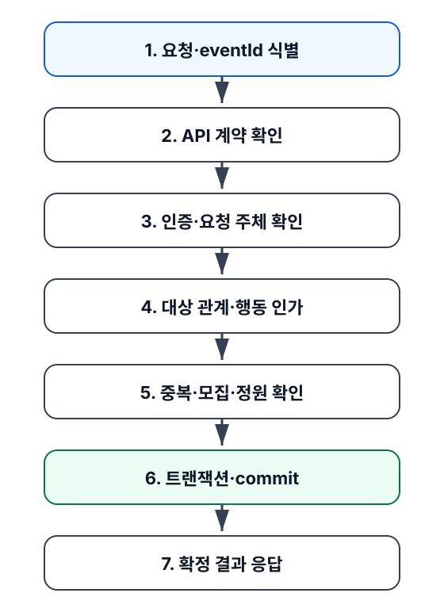
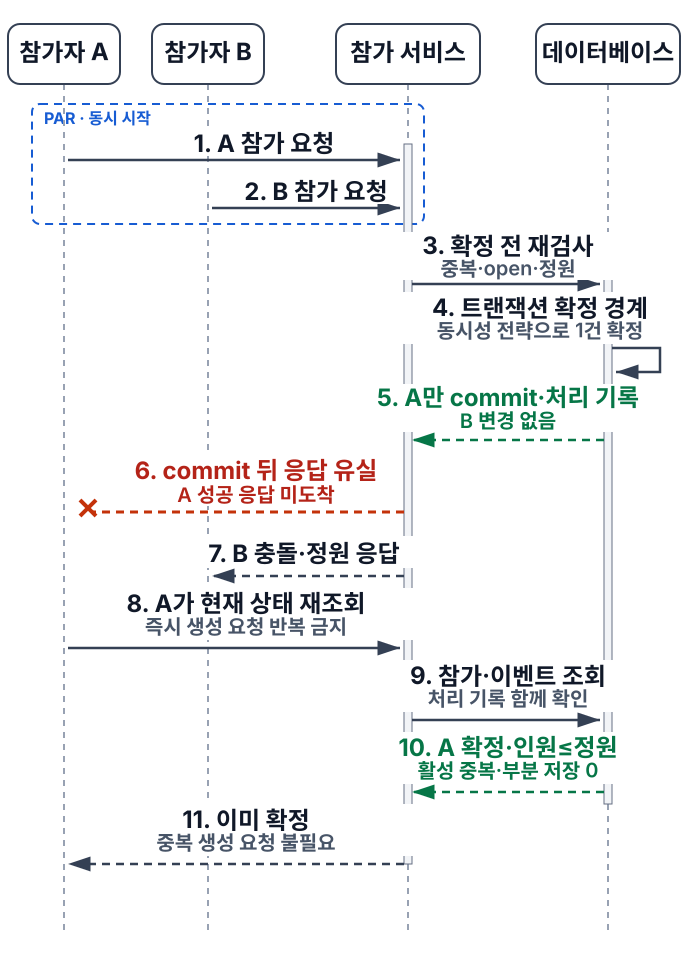

## 먼저 결론

사용자가 화면에서 **참가**를 눌렀다고 해서 자리가 안전하게 확정된 것은 아닙니다. [백엔드](../../03-full-stack/client-server-full-stack/)는 최소한 “어떤 모임에 대한 요청인가”, “누가 보냈는가”, “그 사람이 자신의 참가 관계를 바꾸는가”, “모집 상태·중복·정원 규칙을 만족하는가”, “동시에 들어온 요청 사이에서도 데이터가 일관되게 확정됐는가”를 구분해 처리해야 합니다.

이때 API는 구성요소가 주고받을 약속을 정하고, 인증은 요청 주체의 신원을 확인하며, 인가는 그 주체가 특정 대상에 특정 행동을 할 수 있는지 판단합니다. 애플리케이션은 한 업무 행동에서 함께 판단하고 바꿔야 할 범위를 트랜잭션으로 정하고, 데이터베이스는 그 단위의 변경을 함께 확정하거나 취소합니다. 서로 연결되지만 어느 하나가 나머지를 대신하지는 않습니다.

이 장에서는 인증된 참가자가 `eventId`로 식별한 모임에 참가하고 자신의 참가를 취소하는 흐름을 끝까지 따라갑니다. 참가자 자신의 행동 권한과 주최자의 이벤트 수정 권한, 중복·모집 상태·정원이라는 업무 규칙, 이벤트와 `registrations` 관계를 일관되게 보존하는 데이터 책임을 분리합니다.

이번 장은 특정 프레임워크의 로그인 구현, 비밀번호 저장, OAuth·OpenID Connect·SSO, 암호 키 관리, 특정 데이터베이스의 잠금 문법을 다루지 않습니다. 여기서는 구현을 맡기기 전에 확인할 책임·대안·증거까지만 다루며, 상세 설계에는 [성능과 보안](../../08-quality/performance-security/) 같은 관련 장과 선택한 제품의 공식 문서가 별도로 필요합니다.

## 왜 이 구분이 필요한가

비개발자가 “로그인과 참가 데이터베이스를 붙여 주세요”라고 요청하면 AI는 그럴듯한 화면과 파일을 빠르게 만들 수 있습니다. 그러나 로그인한 사용자가 다른 참가자의 신청을 취소할 수 있거나, 주최자가 아닌 사람이 모임을 마감할 수 있거나, 마지막 한 자리에 두 요청이 모두 확정되거나, 오류 로그에 접근 토큰이 그대로 남는다면 기능이 있다고 말하기 어렵습니다.

문제는 대부분 기술 이름의 부재보다 **책임 경계의 누락**에서 생깁니다. 화면에서 버튼을 숨긴 것은 서버의 권한 검사가 아니고, API 설명 파일이 존재하는 것은 실제 요청이 계약을 지킨다는 증거가 아니며, 참가 가능 여부를 미리 조회한 것은 자리를 예약한 증거가 아닙니다. 트랜잭션을 사용했다는 사실만으로 두 동시 요청 중 하나만 성공하도록 설계했다는 뜻도 아닙니다.

책임을 나누면 같은 “참가 실패” 화면에서도 확인할 경계가 달라집니다. 요청 형식이 틀렸는지, 인증이 끊겼는지, 자신의 행동이 아닌지, 이미 참가했는지, 모집이 닫혔는지, 정원이 찼는지, 트랜잭션이 `rollback`됐는지, `commit`은 성공했지만 응답만 유실됐는지를 서로 다른 증거로 좁힐 수 있습니다.

## 한 문장 정의

- **API(Application Programming Interface)**: 두 구성요소가 어떤 요청을 받고 어떤 결과와 오류를 돌려줄지 정한 인터페이스 계약입니다.
- **백엔드(backend)**: 신뢰할 수 있는 경계에서 업무 규칙·권한·데이터 처리·외부 연동을 담당하는 실행 책임입니다. API는 백엔드가 제공할 수 있는 경계 중 하나이지 백엔드 전체가 아닙니다.
- **엔드포인트(endpoint)**: 구체적인 HTTP 메서드와 경로로 API 기능에 접근하는 지점입니다. 엔드포인트 하나도 API 전체와 같은 뜻은 아닙니다.
- **데이터베이스(database)**: 프로세스가 끝난 뒤에도 남아야 하는 상태를 정해진 구조와 무결성 규칙 아래 저장·조회·변경하는 시스템입니다.
- **인증(authentication)**: 요청 주체가 주장하는 계정이나 신원과 실제로 연결돼 있는지 확인하는 절차입니다.
- **인가(authorization)**: 확인된 주체가 특정 대상에 특정 행동을 해도 되는지 정책에 따라 판단하는 절차입니다.

:::note[현재 관리형 도구 예시는 따로 읽습니다]
데이터 저장·인증·인가·서버 실행은 제품이 바뀌어도 남는 책임입니다. 2026-08-13에 확인한 관리형 기능이 이 책임 일부에 어떻게 대응하고 무엇을 여전히 사용자가 결정해야 하는지는 [현재 도구 매핑](../../reference/current-tool-mapping/)에서 확인하세요. 현재 도구 매핑은 날짜 있는 교체 가능한 참고편이며, 이 장의 영속 정의나 특정 제품의 채택·구성·실제 성공 증거를 대신하지 않습니다.
:::

## 모임 접수대로 비유해 보기

### 비유가 맞는 지점

모임 접수대에는 참가 신청 양식과 접수 규칙이 있습니다. 담당자는 신청자가 누구인지 확인하고, 운영 규칙은 그 사람이 자신의 신청을 바꾸는지 또는 주최자로서 모임을 수정할 수 있는지 판단합니다. 참가 장부는 누가 어느 모임에 참가 중인지와 모집 상태·정원을 보존하고, 취소 이력이 필요하면 이전 상태도 남깁니다.

이 비유에서 API는 접수 양식과 결과 통지 계약, 인증은 신청자 확인, 인가는 사람·모임·행동의 허용 판단, 데이터베이스는 참가 장부에 가깝습니다. “신원을 확인했다”, “자신의 참가를 취소할 수 있다”, “이벤트를 수정할 주최자다”가 서로 다른 질문이라는 점을 보여 줍니다.

### 비유가 깨지는 지점

현실의 담당자는 두 사람이 동시에 내민 신청서를 눈앞에서 순서대로 처리할 수 있지만 웹 요청은 여러 실행 경로에서 거의 동시에 도착할 수 있습니다. 화면에 남은 한 자리가 보였다는 사실만으로 자리를 보장할 수 없고, 데이터베이스는 단순 장부가 아니라 제약·트랜잭션·동시 접근을 처리합니다. 토큰 하나가 물리적 출입증처럼 모든 권한을 완전하게 담는 것도 아니며 캐시·큐·외부 서비스·여러 저장소가 흐름에 끼어들 수 있으므로, 비유는 책임을 구분하는 데까지만 사용해야 합니다.

## 전체 시스템에서의 위치

프런트엔드는 사용자의 참가 의도를 요청으로 만들고 응답을 화면 상태로 표현합니다. 백엔드는 API 계약에 따라 요청을 해석하고, 우회할 수 없는 신뢰 경계에서 인증·인가·업무 규칙을 집행하며, 데이터베이스를 통해 영속 상태를 읽거나 변경합니다. HTTP는 메시지를 교환하는 규칙이고 API 계약은 “이 서비스에서 특정 `eventId`에 참가하거나 취소한다는 것이 무엇을 뜻하는가”를 더 구체적으로 정합니다.

먼저 실패와 복구는 잠시 내려놓고, 정상적인 참가 요청이 어느 책임 경계를 어떤 순서로 통과하는지만 보세요.



이 개요는 **논리적으로 확인할 정상 책임 순서**를 보여 줍니다. 하나의 고정된 파일 구조나 프레임워크 실행 순서를 뜻하지 않으며, 실패 분기·마지막 한 자리 경쟁·`commit` 뒤 응답 유실은 뒤의 상세 시퀀스에서 따로 읽습니다. 이벤트·참가 관계 조회와 인가가 한 데이터 접근에서 함께 일어날 수도 있고, 인가가 서비스 계층이나 데이터베이스 정책에서 집행될 수도 있습니다. 구현 위치가 달라도 “누가, 어떤 모임에, 자신의 참가 또는 주최자 행동 중 무엇을 하는가”를 신뢰할 수 있는 경계에서 검증하는 책임은 사라지지 않습니다.

## 모임 참가 요청을 끝까지 따라가기

가상 모임 `event-example-001`의 `eventId`가 요청 경로에 있고 정원은 10명, 현재 활성 참가자는 9명이라고 가정하겠습니다. 인증된 참가자 A와 B가 거의 동시에 마지막 한 자리에 참가를 요청하더라도 확정되는 요청은 하나여야 합니다. 이미 참가한 사용자의 재시도, 모집 마감, 자기 취소와 주최자 전용 수정도 같은 책임 지도로 구분합니다.

### 1. 요청과 `eventId`를 식별합니다

브라우저는 참가 신청이라면 `POST /events/:eventId/registrations`, 자기 취소라면 `DELETE /events/:eventId/registrations/me`처럼 계약에 정한 메서드와 경로를 사용합니다. 서버는 경로의 `eventId`, 헤더와 본문을 계약에 맞게 읽을 수 있어야 합니다. 식별자 형식이 잘못됐거나 필수 필드가 없거나 JSON이 깨졌다면 권한이나 데이터 변경을 논하기 전에 형식 오류로 끝날 수 있습니다.

참가와 취소의 `participant_id`를 요청 본문에서 받아 믿지 않습니다. 현재 참가자 주체는 인증 결과에서 결정하고, `eventId`는 행동 대상 모임을 가리킵니다. 사용자가 보낸 식별자는 대상 선택에 쓰일 수 있지만 그 자체가 접근 권한은 아닙니다.

### 2. API 계약을 확인합니다

계약은 성공 경로만 적는 URL 목록이 아닙니다. 어떤 사용자가 어떤 모임에 어떤 행동을 요청할 수 있는지, 필수·선택 필드와 허용 범위, 성공 응답, 인증 실패·권한 거절·형식 오류·중복·마감·정원 충돌·서버 오류의 표현, 응답 유실 뒤 재조회와 재시도 조건까지 포함할 수 있습니다. 호환성을 검토한다는 것은 새 버전에서도 기존 화면과 오래된 클라이언트가 계속 동작하는지, 필드 삭제나 의미 변경처럼 기존 사용자를 깨뜨리는 변경인지 확인하는 일입니다. 이런 변경은 [breaking change와 backward compatibility](../../reference/development-glossary/)라는 용어로도 확인할 수 있습니다.

다음은 구현 코드가 아니라 검토용 계약의 축약 예시입니다.

```text
행동:
- 모임 참가 신청
- 자신의 참가 취소

대상:
- eventId로 식별한 모임

요청 주체:
- 인증 결과로 확인한 현재 참가자
- participant_id를 요청 본문에서 받지 않음

인가:
- 자신의 registrations 관계만 생성·취소
- 이벤트 수정·취소·마감은 별도의 주최자 소유권 규칙

참가 신청:
- event.status = open이고 confirmed 수가 capacity보다 작아야 함
- 신청자에게 이미 활성 참가가 있으면 중복 생성하지 않음

자기 취소:
- 인증된 참가자 자신의 confirmed 관계만 cancelled로 바꾸고 이력을 보존함
- 만석인 open 모임과 closed·cancelled 모임에서도 자기 취소는 가능함
- 취소로 모임의 모집 상태를 바꾸거나 다른 사람의 참가를 변경하지 않음

성공:
- 확정된 eventId와 registration.status
- 현재 모집 상태와 공개 가능한 정원 정보

실패:
- 인증 실패, 권한 거절, 형식 오류
- 중복·마감·정원 충돌
- 저장 실패, commit 뒤 응답 전달 실패

증거:
- 실제 요청·응답
- 참가자 A/B와 주최자 소유권 부정 테스트
- registrations·event.status·capacity·활성 참가 수·취소 이력 재조회
- 비밀을 제외한 요청 상관 식별자 로그
```

[OpenAPI Specification](https://spec.openapis.org/oas/v3.2.0.html) 같은 명세는 operation별 매개변수, 요청 본문, 응답과 보안 요구를 기술하는 수단입니다. 그러나 명세 파일의 존재만으로 실행 중인 서버가 계약을 지키거나 대상별 권한 검사와 정원 동시성 규칙을 수행한다고 증명할 수는 없습니다. 실제 요청·응답, 권한 테스트, 동시성 테스트와 데이터 재조회를 함께 확인해야 합니다.

### 3. 인증 상태로 요청 주체를 확인합니다

서버는 세션이나 토큰 같은 자격 증명을 검증해 요청을 계정과 연결합니다. 자격 증명이 없거나 유효하지 않거나 만료됐다면 일반적으로 인증 실패입니다. HTTP API에서는 `401 Unauthorized`를 사용할 수 있지만, 이름과 달리 RFC 9110에서 `401`은 유효한 인증 자격 증명이 부족한 상황과 연결됩니다. 외부 인증 실패 응답은 계정이 없는지, 비밀번호가 틀렸는지처럼 실패 요소를 불필요하게 구분해 계정 존재 여부를 노출하지 않도록 일반화하고, 상세 원인은 접근이 통제된 내부 로그에서 확인해야 합니다. 구체적인 오류 본문과 재인증 방식은 서비스 계약에 따라 정해야 합니다.

HTTP의 `Authorization` 헤더는 자격 증명을 전달하는 자리입니다. 이름에 authorization이 들어가도 헤더가 존재한다는 사실은 **인가 판단이 끝났다는 증거가 아닙니다**. 서버는 먼저 자격 증명의 유효성을 확인하고, 그다음 요청 대상과 행동에 대한 권한을 별도로 판단해야 합니다.

`401` 응답에는 적용 가능한 인증 요구(challenge)를 담은 `WWW-Authenticate` 헤더가 필요합니다. 어떤 자격 증명을 제시해야 하는지 알려 주는 이 헤더가 선택한 인증 방식과 맞는지도 API 계약과 실제 응답에서 확인해야 합니다. 상태 코드와 오류 본문만으로 인증 실패 응답의 구성이 완전하다고 판단하지 않습니다.

세션은 인증 사건과 이후 요청을 이어 주는 상태이고, 토큰은 그 상태나 접근 자격을 전달하는 수단이 될 수 있습니다. 세션 식별자나 토큰은 `Authorization` 헤더뿐 아니라 쿠키로 전송될 수도 있지만, 헤더나 쿠키가 존재한다는 사실 역시 자격 증명 검증과 대상별 인가가 끝났다는 증거는 아닙니다. 서버 저장 세션과 자체 포함 토큰 중 어느 하나가 모든 프로젝트의 정답은 아닙니다. 수명, 폐기, 탈취 대응, 저장 위치, 권한 변경 반영 방식과 운영 환경을 함께 설계해야 합니다. 토큰에 권한 관련 정보가 들어 있어도 현재 모임에 대한 최종 정책 집행을 자동으로 대신하지는 않습니다.

서명과 암호화도 구분해야 합니다. [JWS](https://www.rfc-editor.org/rfc/rfc7515)는 서명 또는 메시지 인증 코드(Message Authentication Code, MAC)로 메시지의 무결성을 보호하는 구조이고, [JWE](https://www.rfc-editor.org/rfc/rfc7516)는 암호화와 무결성 보호를 제공하는 구조입니다. 서명되거나 MAC으로 보호된 내용은 위조 탐지에 도움을 주지만 자동으로 비밀이 되지는 않습니다. 실제 형식을 확인하지 않은 채 “서명된 토큰이니 내용도 암호화돼 있다”고 가정해서는 안 됩니다.

### 4. 이벤트·참가 관계를 조회하고 인가합니다

인증으로 사용자 A라는 사실을 확인했더라도 A가 모든 참가 관계와 모임을 바꿀 수 있는 것은 아닙니다. 참가 신청은 현재 인증 주체를 새 참가 관계의 `participant_id`로 사용하고, 자기 취소는 대상 `eventId`와 현재 주체의 활성 `registrations` 관계만 바꿉니다. 다른 참가자의 식별자를 URL이나 본문에 넣어 취소하는 요청은 거절해야 합니다.

주최자 전용 이벤트 수정은 다른 인가 규칙입니다. `PATCH /events/:eventId` 같은 행동에서는 현재 주체와 대상 이벤트의 `host_id`가 일치하는지 확인해야 합니다. “자신의 참가를 취소할 수 있다”와 “이 모임의 `capacity`나 `event.status`를 바꿀 수 있다”를 하나의 로그인 여부나 역할 이름으로 합치지 않습니다.

화면에서 타인의 참가 취소 버튼이나 비주최자의 관리 버튼을 숨기는 것은 사용성 제어일 뿐 보안 경계가 아닙니다. 요청은 직접 바꾸거나 오래된 클라이언트에서 보낼 수 있으므로, 우회할 수 없는 서버·서비스·데이터 경계에서 요청마다 주체·대상·행동 관계를 확인해야 합니다. 본인이 소유하거나 명시적으로 테스트 권한을 받은 환경에서만 분리된 가상 계정과 가짜 모임을 사용해 타인의 참가 취소와 비소유 이벤트 수정을 부정 테스트합니다.

신원은 알지만 행동이 허용되지 않으면 `403 Forbidden`을 사용할 수 있습니다. 자원의 존재 자체를 숨기기 위해 `404 Not Found`로 응답하는 계약도 가능합니다. 따라서 상태 코드 하나만 보고 내부에 이벤트나 참가 관계가 없었는지, 권한이 거절됐는지 확정해서는 안 됩니다. 외부 응답은 필요한 정보만 안전하게 보여 주고 내부 원인은 접근이 통제된 로그와 테스트로 좁혀야 합니다.

### 5. 중복·모집 상태·정원 업무 규칙을 검증합니다

인가와 업무 규칙은 다른 질문입니다. “A가 자신의 참가를 신청하는가”가 인가라면, “이미 활성 참가 중인가”, “`event.status`가 `open`인가”, “현재 활성 `confirmed` 수가 `capacity`보다 작은가”는 업무 규칙입니다. 권한이 있어도 중복·마감·정원 초과라면 새 참가를 확정하지 않아야 하고, 자리가 남아도 타인의 참가를 바꾸려는 요청은 거절해야 합니다.

취소 이력이 필요하다면 활성 참가를 단순 삭제하지 않고 `registration.status = cancelled` 같은 상태 또는 별도 이력으로 보존할 수 있습니다. 이후 재참가를 같은 행의 상태 전환으로 처리할지 새 이력 행으로 처리할지는 외부 계약과 내부 스키마가 함께 답해야 할 설계 결정입니다. 어떤 구조를 택하든 활성 참가 중복 0건, 현재 확정 수 계산과 취소 이력 보존 요구가 동시에 맞아야 합니다.

사용자가 보낸 값은 데이터 명령의 **값**으로 전달하고 쿼리 구조와 분리해야 합니다. 문자열을 이어 붙여 쿼리를 만들면 입력이 명령 일부로 해석될 수 있습니다. 준비된 명령문(prepared statement)이나 매개변수화된 쿼리(parameterized query)는 구조와 값을 분리하는 대표 수단이지만, 그 자체가 인가·중복·모집 상태·정원 업무 규칙을 검증하지는 않습니다. 특정 ORM이 자동으로 모든 위험을 막는다고도 가정하지 말고 실제 드라이버와 쿼리 사용 방식을 확인해야 합니다.

중복·모집 상태·정원은 사용자가 이해할 업무 규칙입니다. 애플리케이션은 이 규칙을 명시적으로 판정해 안전한 오류를 만들고, 데이터베이스는 이벤트와 참가 관계의 고유성·참조·상태 일관성이 동시 요청에서도 깨지지 않도록 독립적으로 보호합니다. 두 책임을 “데이터베이스 오류가 알아서 처리한다” 또는 “서버가 미리 확인했으니 충분하다” 중 하나로 축소하지 않습니다.

### 6. `registrations`와 정원 판단을 트랜잭션으로 확정합니다

새 참가를 확정하려면 대상 이벤트의 현재 `event.status`, `capacity`, 활성 참가 수와 현재 주체의 활성 참가 여부를 일관된 경계에서 판단하고 `registrations`를 변경해야 합니다. 취소도 현재 주체의 활성 관계를 확인하고 상태와 취소 이력을 함께 남겨야 합니다. 중간에 한 단계만 반영되면 이벤트가 닫혔는데 참가가 생기거나, 취소됐는데 활성 수에 남거나, 같은 사용자의 활성 참가가 중복되는 모순이 생깁니다.

`commit`은 트랜잭션의 변경을 확정하는 동작이고, 전체 `rollback`은 해당 트랜잭션이 만든 미확정 변경을 취소하는 동작입니다. 다른 트랜잭션이 정상적으로 확정한 변경까지 되돌리거나 데이터베이스 전체를 과거 상태로 복원하는 것은 아닙니다. 예를 들어 A의 참가가 확정된 뒤 B의 저장이 실패했다면 A의 참가를 유지하면서 B의 부분 변경이 남지 않는지 확인해야 합니다. `rollback`은 과거 백업을 복원하는 운영 절차와 같지 않습니다. 또한 하나의 HTTP 요청이 언제나 정확히 하나의 데이터베이스 트랜잭션과 일치하는 것도 아닙니다. 외부 서비스 호출, 비동기 작업, 여러 저장소가 포함되면 경계가 달라질 수 있습니다.

스키마는 데이터베이스 내부의 필드·타입·관계·제약을 정의하지만 외부 API 계약과 항상 같지는 않습니다. 내부의 `event_id`, `participant_id`, 취소 시각이나 감사 필드를 그대로 응답에 노출하지 말고 클라이언트에 필요한 입력·출력과 공개해도 되는 필드를 별도 계약으로 검토해야 합니다. 활성 참가 고유성·참조 관계 같은 데이터베이스 제약은 애플리케이션 검증을 보완하는 독립적인 방어 계층이 될 수 있습니다. 화면과 서버에서 미리 검증해 이해하기 쉬운 오류를 주더라도 동시에 들어온 요청 사이의 경쟁 조건을 저장소 제약과 트랜잭션 경계가 다시 막아야 합니다.

마지막 한 자리에서는 사전 조회와 확정 판정을 구분해야 합니다. `capacity = 10`, 현재 `confirmed = 9`인 모임을 참가자 A와 B가 동시에 조회하면 둘 다 “참가 가능”을 볼 수 있습니다. 그러나 이 조회는 자리를 예약하지 않습니다. 두 요청이 거의 동시에 참가를 시작해도 확정 경계에서는 정확히 한 요청만 `commit`되고, 다른 요청은 활성 참가 행을 만들지 않은 채 안전한 중복·마감·정원 충돌 범주로 끝나야 합니다. 최종 데이터는 `confirmed = 10`, `confirmed <= capacity`, 활성 중복 0건, 부분 저장 0건이어야 합니다.

트랜잭션 격리, 조건부 갱신, 데이터베이스 제약과 유한한 재시도 정책은 가능한 설계 대안입니다. 어떤 조합이 맞는지는 사용 데이터베이스가 제공하는 격리 의미·제약 표현·충돌 신호, 요청량, 응답 지연과 업무 요구에 맞춰 직접 검증해야 합니다. PostgreSQL 18 같은 제품에서는 격리 수준에 따라 직렬화 실패가 발생해 전체 트랜잭션 재시도가 필요할 수 있지만, 이 세부 동작을 모든 데이터베이스의 보편 규칙으로 확대하면 안 됩니다. 무한 재시도나 충돌을 성공으로 바꾸는 재시도도 허용하지 않습니다.

같은 불변식에 영향을 주는 주최자의 마감·정원 변경도 참가 처리와 조정해야 합니다. 이 모임 사례에서는 새 정원이 같은 일관성 경계에서 확인한 현재 확정 인원 이상일 때만 정원 축소를 허용합니다. 정원 10명·확정 9명에서 9명으로 줄이는 요청과 새 참가 요청이 경쟁한다면, 축소가 먼저 확정되어 정원·인원이 `(9, 9)`가 되거나 참가가 먼저 확정되어 `(10, 10)`이 되는 결과를 구분해 검증합니다. 이 두 작업 외의 변경과 별도 장애가 없는 시험에서 두 요청을 모두 성공시켜 `(9, 10)`으로 만들면 안 됩니다. 충돌로 거절된 요청의 부분 변경이 없어야 하며, 저장 장애나 재시도 한도 도달은 별도의 실패 계약으로 확인합니다. 자세한 마감·정원 변경 계약은 [모임 웹앱의 W-04](../../12-case-studies/first-full-stack-project/#w-04-정원마감과-동시성)에서 이어집니다.

### 7. 확정된 결과를 응답하고 재조회·로그·동시성 테스트로 확인합니다

서버는 참가 상태가 실제로 확정된 뒤 공개해도 되는 성공 응답을 만들고, 프런트엔드는 그 응답을 화면에 반영합니다. 화면의 성공 문구는 사용자에게 필요한 신호지만 그 자체로 데이터베이스 `commit`의 독립 증거는 아닙니다. 응답과 권한 있는 상태 재조회, `registrations`·`event.status`·`capacity`·활성 참가 수와 취소 이력, 안전한 로그와 테스트 결과를 같은 요청 상관 식별자로 연결해야 합니다.

특히 `commit` 뒤 응답 전달이 실패하면 화면은 실패처럼 보여도 참가 관계는 이미 `confirmed`일 수 있습니다. 응답 유실을 곧 데이터 변경 실패나 `rollback`으로 단정하지 않습니다. 같은 생성 요청을 즉시 반복하기 전에 서비스가 실제로 제공하는 권한 있는 읽기 계약으로 자신의 현재 참가 상태와 최신 이벤트 상태를 재조회하고, 요청 상관 식별자나 처리 기록, 서버의 중복 방지 계약을 확인해야 합니다. 공개 이벤트 조회만으로 자신의 참가 관계를 알 수 없다면 존재하지 않는 조회 경로를 추측하지 말고 API 문서에서 권한 있는 확인 방법을 찾습니다.

이제 정상 책임 순서를 되풀이하지 않고, 마지막 한 자리에 동시 요청이 들어왔을 때 무엇을 한 번만 확정하고 `commit` 뒤 응답이 사라지면 무엇을 다시 확인해야 하는지에 집중하세요.



이 상세 시퀀스의 핵심은 사전 조회가 아니라 **트랜잭션 확정 경계와 사후 재확인**입니다. `PAR · 동시 시작` 프레임과 분리된 A·B lifeline은 두 요청이 순차 실행이라는 뜻이 아님을 보여 주고, 점선 응답과 `×` 표시는 전달 결과와 데이터 확정을 같은 상태로 오해하지 않도록 구분합니다. 그림은 특정 데이터베이스의 격리 수준·잠금 문법·재시도 구현을 정답으로 고정하지 않으며, 실제 서비스에서 한 건만 확정됐거나 복구가 성공했다는 증거도 아닙니다. 선택한 저장소와 계약에 맞춘 동시성 테스트와 권위 상태 재조회가 별도로 필요합니다.

**복구 오라클(recovery oracle)**: 실패 뒤 시스템이 실제로 어느 상태에 있는지 판정하는 독립 기준입니다. 이 참가 흐름에서는 권한 있는 현재 참가 상태와 `confirmed <= capacity`, 활성 중복 0건, 부분 저장 0건 같은 데이터 불변식이 핵심 오라클입니다. 화면 문구·전달 실패·로그 한 줄은 각각 단서일 뿐 이 오라클을 혼자 대신하지 못하며, 제품을 아직 구현하지 않은 이 교육 문서가 실제 복구 성공을 증명하는 것도 아닙니다.

## 성공과 실패를 무엇으로 구분할까

상태 코드는 출발점이지 내부 원인의 완전한 증명이 아닙니다. 다음 코드는 흔한 계약 예시이며 서비스마다 안전한 공개 범위와 오류 코드를 다르게 정할 수 있습니다.

브라우저에서 요청·응답을 보는 일처럼 독자가 직접 관찰할 수 있는 증거가 있는 반면 정책 집행 위치·내부 로그·데이터베이스 상태와 `rollback`은 읽기 권한이 있는 개발자나 운영자에게 요청하거나 AI가 가리킨 파일·명령을 직접 확인해야 합니다. 요청해서 받은 설명은 관찰 증거와 같지 않으므로 실행 환경·명령·결과와 대상 요청 상관 식별자를 함께 받아야 합니다.

| 관찰한 상황 | 가능한 응답 예시 | 확인할 독립 증거 |
|---|---|---|
| 자격 증명이 없거나 유효하지 않음 | `401`과 재인증 가능한 오류 코드 | 같은 자격 증명으로 재현, 인증 검증 로그의 요청 상관 식별자, 세션·토큰 수명 설정 |
| 다른 참가자의 관계를 취소하거나 비주최자가 이벤트를 수정함 | `403`, 또는 존재를 숨기는 `404` | 참가자 A/B와 주최자 A/B를 분리한 부정 테스트, 거절 뒤 대상 데이터 불변, 정책 집행 위치 |
| `eventId`나 요청 형식이 잘못됨 | `400` 계열과 안전한 필드 오류 | API 계약의 형식 규칙, 경계값 테스트, 데이터 변경 0건 |
| 이미 활성 참가 중이거나 이벤트가 마감·취소됨 | 충돌·업무 거절 범주의 계약 응답 | 현재 `registration.status`, `event.status`, 새 활성 행 0건, 취소 이력 유지 |
| 마지막 한 자리의 두 동시 요청 | 성공 1건과 충돌·정원 마감 1건 | 같은 시작 장벽 테스트, 최종 `confirmed = capacity`, 활성 중복·부분 저장 0건 |
| 트랜잭션 중 저장 실패 | `5xx` 계열의 안전한 오류 | 실패한 트랜잭션의 전체 `rollback`, 그 요청에 귀속되는 부분 변경 0건·다른 정상 확정 변경 유지·전체 불변식 유지, 요청 상관 식별자로 연결된 내부 오류 |
| 참가 또는 자기 취소 성공 | `2xx`와 확정된 안전한 필드 | 응답과 권한 있는 재조회, 참가 상태·활성 수·취소 이력 일치, 권한·동시성 테스트 |
| `commit` 뒤 응답 전달 실패 | 클라이언트의 전달 실패 상태 | 재조회한 권위 상태, 처리 기록·요청 상관 식별자, 중복 방지와 재시도 계약 |

개발자 도구의 `Network` 탭에서는 메서드·경로·상태·안전한 요청 필드와 응답을 확인할 수 있습니다. `Network`는 대표 명칭이고 브라우저에 따라 이름과 위치가 다를 수 있으므로 [HTTP 요청과 응답의 관찰 절차](../../03-full-stack/http-request-response/)와 [클라이언트·서버 장의 증거 구분](../../03-full-stack/client-server-full-stack/)을 함께 참고하세요. 그러나 토큰·쿠키·개인정보를 문서나 채팅에 복사하지 마세요.

서버 로그에는 요청 상관 식별자, 행동, 결과 범주, 안전하게 축약된 `eventId`와 처리 시간을 남길 수 있지만 세션 식별자·접근 토큰·비밀번호·데이터베이스 연결 문자열·암호화 키·민감한 개인정보를 그대로 기록해서는 안 됩니다. 로그는 서버가 기록한 판단 범위를 보여 줄 뿐 실제 데이터 재조회나 권한·동시성 테스트를 대신하지 않습니다.

## 판단 규칙

### 계약과 구현을 따로 확인합니다

API 명세, 타입과 문서가 있으면 합의를 읽기 쉬워지지만 실행 증거는 아닙니다. 계약에 적힌 정상·오류 사례를 실제 요청과 자동 테스트로 확인하고, 구현이 달라졌다면 계약 또는 구현 중 무엇을 고칠지 결정합니다.

### 권한은 주체·대상·행동으로 질문합니다

“로그인했나요?”에서 멈추지 말고 “이 참가자가 이 모임에 자신의 참가를 만들거나 취소하려 하나요?”, “이 주최자가 자신이 소유한 이벤트를 수정하려 하나요?”라고 묻습니다. 기본 거절, 최소 권한과 요청별 검증을 출발점으로 삼되 구체적인 역할·소유 정책은 제품 요구사항으로 명시합니다.

### 업무 규칙과 데이터 일관성을 분리합니다

중복·모집 상태·정원은 사용자가 이해할 업무 규칙이고, 이벤트·참가 관계의 고유성·참조·원자적 확정은 데이터 책임입니다. 애플리케이션의 친절한 사전 검사와 데이터베이스 제약·트랜잭션·동시성 전략을 서로 보완하는 계층으로 검토합니다.

### 사전 조회와 확정 경계를 구분합니다

화면과 트랜잭션 밖 조회는 사용자가 판단할 최신 사본을 제공할 수 있지만 자리를 예약하지 않습니다. 마지막 한 자리처럼 상태 변경이 경쟁하는 규칙은 확정 경계에서 다시 판정하고, 완료 뒤 데이터 불변식으로 검증합니다.

### 성공은 서로 다른 증거를 연결해 판정합니다

화면, HTTP 응답, 서버 로그, 데이터베이스 상태와 테스트는 서로 다른 사실을 보여 줍니다. 화면 하나만 보지 말고 같은 요청 상관 식별자·`eventId`·주체로 연결해 “누가 어떤 규칙을 통과해 어떤 참가 상태를 확정했는가”를 재구성합니다.

### 재시도 전에 실제 상태와 중복 위험을 확인합니다

응답을 받지 못했다고 서버가 실패한 것은 아닙니다. 권한 있는 현재 상태 재조회, 처리 기록과 중복 방지 계약을 먼저 확인하고, 재시도 허용 여부·요청 식별자 재사용·최대 횟수와 최종 실패 처리까지 계약에서 확인합니다. 자세한 메시지와 재시도 판단은 [HTTP 요청과 응답](../../03-full-stack/http-request-response/)에서 이어집니다.

### 복구 오라클을 요청 전에 정합니다

장애가 난 뒤 무엇을 보고 성공·실패·결과 불명을 판정할지 미리 정하지 않으면 화면·로그·응답 가운데 가장 편한 신호를 전체 성공으로 오해하기 쉽습니다. 정상·거절·저장 중 실패·`commit` 뒤 응답 유실마다 재조회할 권위 상태와 유지할 불변식, 처리 기록의 보존 기간과 사람이 개입할 중단 조건을 수용 기준에 연결하세요.

## 흔한 오해와 실패

- **API는 URL 목록이다**: 경로만 있고 입력·출력·오류·권한·호환성·재조회 조건이 없으면 검토 가능한 계약이 부족합니다.
- **API가 있으면 백엔드가 완성됐다**: 백엔드에는 업무 규칙, 권한 집행, 데이터 처리, 외부 연동과 운영 책임도 있습니다.
- **로그인했으니 인가도 끝났다**: 인증된 사용자가 다른 참가자의 관계를 취소하거나 다른 주최자의 모임을 수정할 수 있는지 부정 테스트가 필요합니다.
- **`/me` 경로면 자기 행동이 자동 보장된다**: 경로 이름이 아니라 서버가 인증 주체와 참가 관계를 연결해 집행하는지가 증거입니다.
- **`Authorization` 헤더가 있으니 권한이 있다**: 헤더는 자격 증명 전달 위치일 뿐 대상별 허용 판단은 아닙니다.
- **버튼을 숨겼으니 안전하다**: 클라이언트 요청은 직접 조작할 수 있으므로 신뢰 경계에서 다시 검사해야 합니다.
- **남은 자리를 조회했으니 자리를 확보했다**: 사전 조회는 확정이 아니며 동시 요청의 결과는 트랜잭션 확정 경계에서 다시 정해집니다.
- **prepared statement면 모든 입력이 안전하다**: 쿼리 구조와 값을 분리해 주지만 값의 업무 범위, 권한과 출력 노출을 판단하지는 않습니다.
- **서명된 토큰은 내용을 읽을 수 없다**: 서명·MAC과 암호화가 제공하는 보장은 다릅니다. 실제 토큰 형식과 민감 정보 포함 여부를 확인해야 합니다.
- **트랜잭션이면 정원 경쟁도 자동 해결된다**: 원자성과 동시 요청 정책은 다른 문제이며 격리·조건부 갱신·제약·재시도 중 실제 전략을 검증해야 합니다.
- **응답 실패면 `rollback`됐다**: `commit` 뒤 응답 유실일 수 있으므로 권위 있는 상태와 처리 기록을 확인해야 합니다.
- **오류를 자세히 출력할수록 디버깅이 쉽다**: 외부 응답과 로그에 비밀·개인정보·내부 구조를 과도하게 노출하면 새로운 보안 문제가 됩니다.

## AI와 작업할 때 사용할 계약

“로그인과 참가 DB를 붙여 주세요” 대신 다음처럼 책임과 증거를 요청하세요.

```text
기능:
- 인증된 현재 사용자의 모임 참가 신청
- 인증된 현재 사용자의 자기 참가 취소

대상:
- eventId로 식별한 모임

인가 경계:
- participant_id는 인증 주체에서 결정
- 자신의 registrations 관계만 생성·취소
- 이벤트 수정·취소·마감은 별도의 host_id 소유권 검사

먼저 구현 전에 다음을 제시하세요.
1. API 입력·성공 응답·오류 응답·권한·호환성·재조회 조건
2. 인증과 인가를 집행하는 우회할 수 없는 신뢰 경계
3. 이벤트와 현재 주체의 참가 관계·주최자 소유권을 확인하는 방식
4. 중복·event.status·capacity·활성 참가 수 업무 규칙
5. 쿼리 실행 지점과 명령문·값의 전달 방식
6. registrations와 정원 판단의 트랜잭션·commit·rollback 경계
7. 활성 참가 고유성 제약과 취소 이력 보존 방식
8. 동시 요청 전략과 유한한 재시도 조건
   - 주최자의 마감·정원 변경도 참가 처리와 같은 불변식을 지키도록 조정
   - 새 정원은 같은 일관성 경계에서 확인한 확정 인원 이상일 때만 허용
9. 토큰·세션·개인정보를 제외한 로그 필드
10. commit 뒤 응답 유실 시 권한 있는 재조회·처리 기록 확인 절차

실행 범위:
- 본인이 소유한 환경 또는 명시적으로 테스트 권한을 받은 환경
- 분리된 가상 계정과 가짜 모임 데이터만 사용
- 운영·개인용 자격 증명과 실제 개인정보를 사용하지 않음
- 인증·데이터베이스 경계 시험에 필요하면 승인된 격리 환경의 테스트 전용 자격 증명만 사용
- 테스트 전용 값도 토큰·세션 값·연결 문자열 등 비밀 원문을 출력·로그·보고서에 노출하지 않음
- 운영 데이터와 운영 설정은 변경하지 않음

구현 후에는 다음 테스트를 보여 주세요.
- 정상 참가와 자기 취소
- 미인증 참가·취소 거절
- 타인의 참가 취소 거절
- 비주최자의 이벤트 수정 거절
- 활성 참가 중복 거절
- closed·cancelled 이벤트 참가 거절
- 마지막 한 자리 동시 요청: 성공 1건, 안전한 실패 1건
- 주최자의 정원 축소와 참가 요청의 경쟁: 정원 10·확정 9에서 정원 9로 축소할 때 허용 최종 상태 (9, 9) 또는 (10, 10), 거절 요청의 부분 저장 0건
- 주최자의 마감과 참가 요청의 경쟁: 확정 경계의 모집 상태에 따라 처리하고 마감 후 새 참가를 허용하지 않음
- 저장 중 실패와 해당 트랜잭션의 전체 rollback: 다른 요청의 정상 확정 결과는 유지
- commit 뒤 응답 유실 후 재조회와 중복 0건

화면 성공만으로 완료라고 하지 마세요.
다음 실제 증거를 함께 제시하세요.
- 요청과 응답
- registrations·event.status·capacity·활성 참가 수·취소 이력 재조회
- 같은 시작 장벽을 사용한 동시성 테스트 결과
- 비밀 없는 요청 상관 식별자 로그
```

AI가 “완료했습니다”라고 답하면 파일 개수보다 다음 질문을 우선하세요. 계약과 실제 응답이 같은지, 타인의 참가 관계와 비소유 이벤트를 대상으로 한 부정 테스트가 있는지, 마지막 한 자리에서 정확히 한 요청만 성공했는지, 실패 뒤 부분 저장이 없는지, `commit` 뒤 응답 유실을 재조회로 복구하는지, 로그에 비밀이 없는지를 검증해야 합니다.

## 확인 체크리스트

### API 계약

- [ ] 행동과 `eventId`, 입력의 필수·선택 필드와 범위가 명시돼 있나요?
- [ ] 성공뿐 아니라 인증 실패·권한 거절·형식 오류·중복·마감·정원 충돌·서버 오류가 구분돼 있나요?
- [ ] 응답 유실 뒤 권한 있는 재조회와 재시도 조건이 계약에 있나요?
- [ ] 필드 삭제·의미 변경이 기존 화면과 오래된 클라이언트를 깨뜨리는지 확인했나요?
- [ ] 외부 응답에 내부 필드와 개인정보를 필요 이상으로 돌려주지 않나요?
- [ ] 계약 문서와 실제 요청·응답을 테스트로 대조했나요?

### 인증과 인가

- [ ] 인증과 인가를 서로 다른 책임으로 설명할 수 있나요?
- [ ] 참가 신청·자기 취소와 주최자 전용 이벤트 수정의 주체·대상·행동을 구분했나요?
- [ ] `participant_id`와 `host_id`를 신뢰할 수 있는 주체·관계에서 결정하나요?
- [ ] 허가받은 환경에서 분리된 가상 계정으로 타인의 참가 취소와 비소유 이벤트 수정 부정 테스트를 수행했나요?
- [ ] 버튼 숨김이 아니라 우회할 수 없는 신뢰 경계에서 권한을 집행하나요?
- [ ] 세션과 토큰의 수명·폐기·탈취 대응을 확인했나요?
- [ ] 외부 인증 실패 응답이 계정 존재나 실패 요소를 불필요하게 노출하지 않나요?
- [ ] `401` 응답의 `WWW-Authenticate` 헤더에 선택한 인증 방식에 맞는 challenge가 있나요?

### 데이터와 실패

- [ ] 사용자 입력이 쿼리 구조와 분리된 값으로 전달되나요?
- [ ] 중복·모집 상태·정원 업무 규칙과 이벤트·참가 관계의 데이터 일관성 책임을 구분했나요?
- [ ] 활성 참가 고유성·참조 관계와 취소 이력 보존 방식을 검증했나요?
- [ ] 중복·상태·정원 판정과 `registrations` 변경을 한 트랜잭션 경계에서 확정하나요?
- [ ] 트랜잭션 격리·조건부 갱신·제약·재시도 중 실제 선택을 데이터베이스와 요구에 맞춰 검증했나요?
- [ ] 마지막 한 자리 동시 요청에서 성공 1건·안전한 실패 1건·`confirmed <= capacity`·부분 저장 0건을 확인했나요?
- [ ] 주최자의 마감·정원 변경과 참가 요청도 조정하며, 정원 축소의 하한과 축소·참가 경쟁의 허용 최종 상태를 검증했나요?
- [ ] 실패한 트랜잭션의 부분 변경은 없고 다른 요청의 정상 확정 결과는 유지되는지 구별했나요?
- [ ] `commit` 뒤 응답 유실을 `rollback`으로 단정하지 않고 재조회·처리 기록으로 확인하나요?
- [ ] 정상·거절·저장 실패·응답 유실 뒤 판정할 복구 오라클과 데이터 불변식을 미리 정했나요?
- [ ] 로그와 오류에서 토큰·세션 식별자·비밀번호·연결 문자열·키·민감 개인정보를 제외했나요?

## 짧은 연습

### 연습 1: 책임 흐름 나누기

“인증된 참가자 A가 `event-example-001`에 참가한다”는 문장을 요청과 `eventId`, API 계약, 인증과 요청 주체, 이벤트·참가 관계 조회와 인가, 중복·모집 상태·정원 업무 규칙, `registrations` 트랜잭션과 `commit`, 응답·재조회·로그·동시성 테스트의 일곱 줄로 나눠 적어 보세요. 각 줄마다 실패하면 무엇이 보여야 하는지도 한 가지씩 붙이세요.

### 연습 2: 두 인가 규칙 분리하기

AI가 “로그인한 사용자에게만 참가·관리 버튼을 보여 주고 서명된 토큰을 보내므로 권한 처리가 끝났습니다”라고 답했다고 가정하세요. 자신의 참가 취소와 주최자 전용 이벤트 수정에서 각각 확인할 주체·대상·행동 관계, 버튼과 신뢰 경계, 자격 증명 전달과 인가 판단을 나눠 추가 테스트를 적어 보세요.

### 연습 3: 마지막 한 자리와 응답 유실 판단하기

정원이 10명이고 현재 `confirmed`가 9명인 모임에 A와 B가 동시에 참가를 요청했습니다. A는 응답을 받지 못했고 B는 정원 충돌 응답을 받았습니다. 화면에서 확인한 사실, 아직 모르는 데이터 상태, 재조회할 값, 성공·실패 수와 최종 불변식, 같은 요청을 곧바로 반복할 때의 위험을 적어 보세요.

## 관련 용어와 다음 장

- [클라이언트·서버·풀스택](../../03-full-stack/client-server-full-stack/): 참가 버튼에서 화면·요청·서버 판단·데이터·응답으로 이어지는 책임과 증거를 다룹니다.
- [HTTP 요청과 응답](../../03-full-stack/http-request-response/): 공개 조회·참가·자기 취소의 메서드·헤더·상태 코드·재시도 증거를 더 자세히 다룹니다.
- [데이터 모델·스키마·마이그레이션](../data-model-schema-migration/): 이벤트·사용자·참가 관계를 저장 구조로 옮기고 안전하게 바꾸는 법을 다룹니다.
- [상태·캐시·큐](../state-cache-queue/): 화면의 남은 자리 사본과 권위 있는 참가 상태, 비동기 작업의 관계를 다룹니다.
- [성능과 보안](../../08-quality/performance-security/): 신뢰 경계, 위협과 보안 검증을 더 넓게 다룹니다.
- [로그·모니터링·백업](../../10-deployment-operations/logs-monitoring-backup/): 안전한 운영 증거와 데이터 복구 책임을 다룹니다.
- [첫 풀스택 프로젝트: 모임 참가 웹앱](../../12-case-studies/first-full-stack-project/): 공개 조회부터 참가·취소·정원·마감·운영 인수까지 전체 캡스톤을 연결합니다.
- [개발 용어집](../../reference/development-glossary/): API, endpoint, transaction, authentication과 authorization 같은 용어를 짧게 다시 확인할 수 있습니다.

## 확인한 공식 출처와 적용 범위

이 장의 영속 정의와 보안·트랜잭션 경계는 2026년 8월 6일 확인한 공식 자료의 기존 적용 범위를 재사용했습니다. 표준, 미국 연방 디지털 신원 지침, OWASP 실무 지침, PostgreSQL 제품 문서와 MDN 설명 자료는 효력과 적용 범위가 서로 다릅니다. 모임 사례 전환에는 새 제품 기능 주장이 필요하지 않아 네트워크 조사를 수행하지 않았고 특정 프레임워크·세션 방식·토큰 형식·동시성 구현을 모든 프로젝트의 정답으로 일반화하지 않았습니다. 주장별 상세 판정과 일반화 금지선은 `research/meeting-api-database-auth-research-brief.md`와 `research/source-map.md`에 기록돼 있습니다.

- [OpenAPI Specification 3.2.0](https://spec.openapis.org/oas/v3.2.0.html): operation의 매개변수·요청 본문·응답·보안 요구를 기술하는 범위
- [NIST SP 800-63-4와 800-63B-4](https://pages.nist.gov/800-63-4/): 디지털 신원·인증·세션의 용어와 위험 판단 근거. 일반 서비스의 보편적 법적 의무로 사용하지 않음
- [OWASP Authentication Cheat Sheet](https://cheatsheetseries.owasp.org/cheatsheets/Authentication_Cheat_Sheet.html), [Authorization Cheat Sheet](https://cheatsheetseries.owasp.org/cheatsheets/Authorization_Cheat_Sheet.html), [Session Management Cheat Sheet](https://cheatsheetseries.owasp.org/cheatsheets/Session_Management_Cheat_Sheet.html): 인증·인가·세션의 실무 검토 기준
- [OWASP SQL Injection Prevention Cheat Sheet](https://cheatsheetseries.owasp.org/cheatsheets/SQL_Injection_Prevention_Cheat_Sheet.html), [Logging Cheat Sheet](https://cheatsheetseries.owasp.org/cheatsheets/Logging_Cheat_Sheet.html), [API Security Top 10 2023](https://owasp.org/API-Security/): 입력과 쿼리 분리, 안전한 로그, 객체·기능별 권한 위험
- [RFC 9110 HTTP Semantics](https://www.rfc-editor.org/rfc/rfc9110): `Authorization`, `401`, `403`의 HTTP 의미
- [RFC 7515 JWS](https://www.rfc-editor.org/rfc/rfc7515), [RFC 7516 JWE](https://www.rfc-editor.org/rfc/rfc7516): 서명·MAC 기반 무결성 보호와 암호화·무결성 보호의 구분
- [PostgreSQL 18 Transactions](https://www.postgresql.org/docs/18/tutorial-transactions.html), [Transaction Isolation](https://www.postgresql.org/docs/18/transaction-iso.html), [Constraints](https://www.postgresql.org/docs/18/ddl-constraints.html), [Database Access with libpq](https://www.postgresql.org/docs/18/libpq-exec.html): 트랜잭션·동시성·제약·명령과 값 분리의 제품 예시
- [MDN HTTP authentication guide](https://developer.mozilla.org/en-US/docs/Web/HTTP/Guides/Authentication), [`401 Unauthorized`](https://developer.mozilla.org/en-US/docs/Web/HTTP/Reference/Status/401), [`403 Forbidden`](https://developer.mozilla.org/en-US/docs/Web/HTTP/Reference/Status/403): HTTP 인증 흐름과 상태 코드를 비개발자 설명에 연결하는 보조 자료. 규범적 의미는 RFC 9110을 우선함

## 기억할 문장

**백엔드를 이해한다는 것은 기술 이름을 나열하는 일이 아니라, 누가 어떤 모임에 어떤 행동을 요청했고 권한·업무 규칙·동시성 경계를 통과해 어떤 참가 상태가 확정됐는지 증거로 재구성하는 일입니다.**
