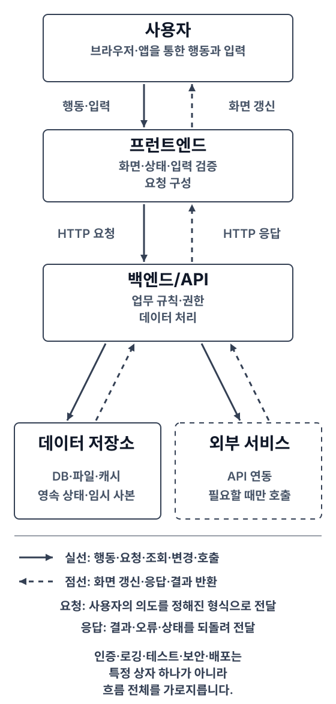

## 먼저 결론

브라우저는 서버가 보낸 내용을 그대로 사진처럼 보여주는 프로그램이 아닙니다. HTML을 문서 구조로 해석하고, 현재 DOM과 적용된 CSS를 바탕으로 배치와 화면 결과를 계산합니다. JavaScript 같은 프런트엔드 코드는 사용자 행동과 응답에 따라 상태를 바꾸고 그 결과를 DOM·속성·스타일에 반영할 수 있습니다.

따라서 서버가 정상 응답했다고 화면도 정상이라는 보장은 없습니다. 화면이 이상할 때는 “프런트엔드가 문제다”라고 뭉뚱그리지 말고, 요청·응답, 현재 DOM, JavaScript 오류, UI 상태와 실제 렌더링 결과를 나누어 확인해야 합니다.

## 왜 필요한가

분석 대시보드에서 기간을 선택했는데 차트가 비어 있다고 가정해 보겠습니다. 서버가 데이터를 보내지 않았을 수도 있지만, 데이터는 도착했는데 JavaScript가 다른 필드명을 찾았거나, 로딩 상태가 끝나지 않았거나, CSS가 차트 영역의 높이를 0으로 만들었을 수도 있습니다. 같은 빈 화면이라도 실패한 경계와 고치는 방법은 전혀 다릅니다.

AI가 “프런트엔드를 구현했습니다”라고 보고해도 파일 생성이나 빌드 성공만으로는 충분하지 않습니다. 개발자 도구로 확인한 현재 DOM과 사용자가 실제로 보는 화면, 키보드 조작, 로딩·빈 결과·오류 상태, 브라우저 Console과 Network 증거를 각각 확인해야 구현 주장을 검증할 수 있습니다.

## 한 문장 정의

**브라우저(browser)는 웹 문서와 자원을 해석하고 사용자 상호작용을 실행하는 클라이언트이며, DOM(Document Object Model)은 현재 문서 구조를 프로그램이 읽고 바꿀 수 있도록 표현한 모델이고, 렌더링(rendering)은 브라우저가 현재 DOM과 적용된 스타일을 사용자가 보는 화면 결과로 계산하는 과정입니다.**

HTML·CSS·JavaScript는 브라우저가 처리하는 자원 또는 언어이고, DOM은 실행 중인 문서의 모델이며, 렌더링은 브라우저의 계산 과정입니다. 같은 종류의 부품은 아니지만 실패한 책임을 찾기 위해 다음 표에서 함께 비교합니다.

| 개념 | 쉬운 뜻 | 주로 담당하는 질문 |
|---|---|---|
| HTML | 콘텐츠의 구조와 의미 | 이것은 제목인가, 표인가, 버튼인가? |
| CSS | 표현과 배치 규칙 | 어디에 어떤 크기와 모양으로 보이는가? |
| JavaScript | 동작과 상태 변화 | 클릭이나 응답 뒤에 무엇이 바뀌는가? |
| DOM | 코드가 읽고 바꿀 수 있는 현재 문서 모델 | 지금 어떤 요소와 속성과 내용이 존재하는가? |
| 렌더링 | 브라우저가 현재 DOM과 스타일을 화면으로 계산하는 과정 | 사용자가 실제로 무엇을 보고 조작할 수 있는가? |

이 구분은 책임을 찾기 위한 지도입니다. 실제 브라우저는 접근성 정보, 이미지, 글꼴, 네트워크 캐시와 여러 내부 최적화도 함께 다루므로 다섯 칸만으로 모든 동작을 설명할 수는 없습니다.

## 무대 공연으로 이해하기

웹 화면을 무대 공연에 비유할 수 있습니다. HTML은 무대 위에 어떤 인물과 소품과 장면이 있는지 적은 구성표이고, CSS는 배치·의상·조명 규칙이며, JavaScript는 관객의 행동이나 진행 신호에 따라 장면을 바꾸는 동작 규칙입니다. DOM은 동작 규칙이 읽고 바꿀 수 있는 현재 구성표이고, 렌더링 결과는 관객이 실제로 보는 공연입니다.

### 비유가 맞는 지점

- 구조, 표현과 동작은 서로 영향을 주지만 같은 책임은 아닙니다.
- 원래 계획과 현재 무대 상태가 다를 수 있듯이, 처음 받은 HTML과 현재 DOM은 JavaScript 실행 뒤 달라질 수 있습니다.
- 장면 전환이 끝나지 않으면 관객에게 빈 무대나 잘못된 상태가 보일 수 있습니다.
- 뒤에서 준비가 성공했어도 관객에게 결과가 전달되지 않으면 사용자 관점에서는 성공이 아닙니다.

### 비유가 깨지는 지점

브라우저는 사람처럼 대본을 자유롭게 해석하지 않고 웹 표준과 브라우저 구현 규칙에 따라 자원을 처리합니다. DOM도 종이에 고정된 배치도가 아니라 실행 중 계속 바뀔 수 있는 데이터 구조이며 화면 결과 자체와 같지 않습니다. 같은 자원이라도 브라우저·기기·화면 폭·글자 확대·입력 방식 같은 환경이 다르면 사용자가 얻는 결과가 달라질 수 있습니다. 또한 사용자가 보는 픽셀만이 결과의 전부는 아닙니다. 키보드와 스크린리더 같은 보조 기술이 이해할 수 있는 의미 구조와 포커스 상태도 함께 확인해야 합니다.

## 시스템에서의 위치

아래 지도에서 백엔드의 응답이 프런트엔드를 거쳐 사용자에게 보이는 화면 갱신으로 이어지는 경계를 확인해 보세요.



이 지도는 책임의 연결을 보여 줄 뿐, 모든 시스템의 고정 배치나 실제 권한 집행·저장·화면 갱신의 성공을 증명하지 않습니다.

[HTTP 요청과 응답](../../03-full-stack/http-request-response/) 장이 브라우저와 서버 사이의 메시지 교환을 다뤘다면, 이 장은 그 응답이 브라우저 안에서 사용자 화면으로 바뀌는 경계를 다룹니다.

```text
URL 탐색과 초기 표시
사용자가 URL로 이동
→ 브라우저가 필요한 네트워크 요청·응답 처리
→ 받은 HTML을 토큰화하고 파싱해 DOM 구성
→ 연결된 CSS를 가져와 파싱하고 적용 가능한 스타일 정보 구성
→ 현재 DOM과 스타일에서 배치·페인트 등 화면 결과 계산
→ 이벤트 처리와 JavaScript가 앱 상태·DOM·스타일을 바꿈
→ 필요한 화면 결과를 다시 계산하고 사용자가 결과 확인

같은 문서 안의 상호작용
사용자 행동
→ 로컬 상태 변경 또는 HTTP 요청·응답
→ 프런트엔드 코드가 상태를 DOM·속성·스타일에 반영
→ 브라우저가 필요한 화면 결과를 다시 계산
→ 사용자가 결과를 보고 다음 행동

새 문서를 받는 상호작용
링크 이동·폼 제출·새로고침
→ 새 URL의 문서 요청·응답
→ 파싱·DOM·스타일·렌더링 흐름으로 돌아감
```

한 사용자 행동이 반드시 HTTP 요청을 만드는 것은 아닙니다. 펼침 메뉴처럼 브라우저 안의 상태만 바꿀 수도 있고, 데이터를 조회하거나 저장할 때는 서버와 요청·응답을 주고받을 수도 있습니다. 반대로 링크 이동이나 새로고침처럼 새 문서를 받으면 같은 문서의 부분 갱신이 아니라 초기 표시 흐름을 다시 거칩니다. HTML Standard는 HTML 입력을 토큰화하고 트리를 구성해 DOM `Document`를 만드는 규칙을 정의하지만 언제 화면을 렌더할지는 그 파싱 절에서 정하지 않습니다. DOM Standard는 노드 트리와 이벤트 모델을, CSS 객체 모델(CSS Object Model, CSSOM)은 스타일 관련 상태에 접근·조작하는 API와 파싱·직렬화 규칙을 다룹니다. 따라서 `DOM을 만든 다음 CSSOM을 완성하고 마지막에 한 번 그린다`는 고정 직렬 구현으로 이해하면 안 됩니다.

위 순서는 원인을 찾기 위한 개념 지도이지 모든 브라우저 엔진의 내부 파이프라인이나 스레드 구조를 그대로 묘사한 것이 아닙니다. HTML 파싱 중에도 스크립트가 DOM을 바꿀 수 있고, 자원은 병렬로 도착하거나 늦게 요청될 수 있으며, 브라우저는 렌더링 기회와 성능 판단에 따라 작업을 합치고 미루고 일부만 다시 계산할 수 있습니다. 이 장에서 중요한 것은 내부 단계 이름을 암기하는 일이 아니라 **URL과 입력 자원 → 네트워크 사실 → 현재 DOM·스타일과 앱 상태 → 브라우저의 화면 계산 → 이벤트 뒤 사용자 작업 결과**의 연결을 증거로 확인하는 것입니다.

## 처음 받은 HTML과 현재 DOM은 다를 수 있습니다

서버가 보낸 HTML은 브라우저가 문서를 시작하는 입력입니다. 브라우저는 이를 해석해 DOM을 만들고, JavaScript는 이후 요소를 추가하거나 내용을 바꾸거나 속성을 갱신할 수 있습니다. 그래서 서버 응답의 원문과 개발자 도구 Elements 탭에서 보는 현재 구조가 항상 같지는 않습니다.

### View Source, Network, 현재 DOM과 픽셀을 구분하세요

| 증거 표면 | 현재 알려주는 것 | 알려주지 않는 것 |
|---|---|---|
| View Source 또는 문서 응답 원문 | 탐색에서 받은 HTML 소스의 내용 | JavaScript 실행 뒤 현재 DOM, 최종 계산 스타일, 사용자가 보는 픽셀 |
| Network의 문서·자원·API 기록 | 실제로 요청한 URL, 상태·헤더·응답·크기·시간과 initiator 단서 | 응답이 올바르게 파싱·상태 반영·렌더링됐는지 |
| Elements의 live DOM | 지금 문서 트리에 존재하는 노드·속성과 현재 적용 스타일 단서 | 저장소 원본이나 서버 응답 원문이 바뀌었는지, 화면에서 읽을 수 있는지 |
| Computed style과 layout 값 | Computed 패널의 해석된 CSS 값(resolved values)과 별도로 확인한 레이아웃·상자 크기 | 사용자의 전체 과업과 접근성 구조가 성공했는지 |
| 렌더링된 픽셀·스크린샷 | 그 브라우저·뷰포트·테마·상태에서 실제 보이는 결과 | 어떤 응답·코드·상태가 원인이었는지, 다른 환경에서도 같은지 |

Chrome의 Elements에서 DOM이나 스타일을 직접 편집하면 픽셀이 즉시 바뀔 수 있습니다. 이는 가설을 시험한 현재 탭의 임시 변경이지 View Source, 저장소 파일, 서버 응답이나 배포 자산을 수정한 증거가 아닙니다. 페이지 새로고침이나 앱의 다음 상태 반영으로 사라질 수 있으므로 실제 수정 뒤 같은 조건에서 다시 확인해야 합니다.

다음 다섯 가지를 구분하면 진단이 쉬워집니다.

| 확인 대상 | 알려주는 사실 | 알려주지 않는 사실 |
|---|---|---|
| 서버가 보낸 HTML 또는 데이터 | 네트워크 경계를 통과해 무엇이 도착했는가 | JavaScript가 이를 올바르게 사용했는가 |
| 현재 UI 상태 | 앱이 어떤 선택값·로딩·성공·오류 정보를 기준으로 화면을 만들려 하는가 | 그 상태가 DOM과 화면에 올바르게 반영됐는가 |
| 현재 DOM | 지금 브라우저 문서에 어떤 요소와 속성이 있는가 | 사용자가 모든 요소를 실제로 볼 수 있는가 |
| 렌더링된 화면 | 현재 크기와 스타일에서 사용자에게 무엇이 보이는가 | 데이터가 어떤 경로로 도착했고 왜 이 상태가 됐는가 |
| 사용자 작업 결과 | 사용자가 조회·입력·이동 같은 목표를 실제로 완료했는가 | 내부의 모든 경계와 예외가 항상 정상인가 |

DOM에 요소가 있어도 CSS 때문에 숨겨졌거나 화면 밖에 있을 수 있습니다. 반대로 화면에 보이는 장식이 의미 있는 HTML 구조를 갖추지 못해 키보드나 보조 기술에서 사용할 수 없을 수도 있습니다. “Elements에 있으니 정상” 또는 “눈으로 보이니 정상”이라는 한 가지 증거만으로 완료를 판단하지 않습니다.

## 화면은 상태가 바뀔 때 다시 만들어집니다

**UI 상태(state)**: 현재 선택값, 서버 응답, 로딩 여부와 오류처럼 화면이 무엇을 보여 줄지 결정하는 현재 정보입니다. 사용자가 버튼을 누르거나 응답이 도착하면 프런트엔드 코드가 상태를 바꾸고 그 결과를 DOM·속성·스타일에 반영할 수 있으며, 브라우저는 현재 DOM과 적용된 스타일을 바탕으로 화면 결과를 계산합니다.

분석 대시보드의 조회 흐름은 다음처럼 나눌 수 있습니다.

```text
초기 상태
→ 사용자가 기간 선택
→ 로딩 상태
→ 성공 / 빈 결과 / 입력 오류 / 권한 부족 / 네트워크 오류
→ 사용자가 결과 확인 또는 수정·재시도
```

성공 상태 하나만 구현하면 개발 환경의 대표 데이터에서는 그럴듯해 보이지만, 실제 사용자는 무한 로딩이나 흰 화면을 만날 수 있습니다. 같은 사실을 여러 상태에 따로 저장했다면 어느 값이 기준인지, 한쪽만 갱신돼 서로 어긋날 수 있는지도 확인합니다. [UI 상태와 사용자 경험](../ui-state-and-ux/) 장에서는 초기·로딩·성공·빈 결과·오류 상태와 전이를 설계할 때 던질 기본 질문을 이어서 다룹니다.

### 다시 렌더링된다는 말의 범위

`다시 렌더링한다`는 말은 도구마다 가리키는 경계가 다를 수 있습니다. 프레임워크나 앱 코드에서는 새 상태를 DOM 변경으로 반영하는 작업을 `render`라고 부를 수 있고, 브라우저에서는 현재 DOM과 스타일을 바탕으로 배치와 화면 결과를 다시 계산하는 과정을 뜻할 수 있습니다. 진단할 때는 이 두 경계를 분리해서 확인합니다. 어느 경우든 매번 화면 전체를 지우고 처음부터 그린다는 뜻으로만 이해하면 안 되며, 구체적인 갱신 범위와 최적화 방법은 브라우저와 사용한 도구에 따라 달라집니다.

프레임워크를 사용하는 프로젝트에서는 상태를 기준으로 DOM 변경을 관리하는 경우가 많습니다. 이때 프레임워크가 관리하는 요소를 다른 코드가 직접 바꾸면, 코드가 기억하는 상태와 현재 DOM이 어긋날 수 있습니다. 직접 조작이 항상 잘못은 아니지만 누가 해당 요소의 변경을 소유하는지 분명해야 합니다.

## 예: 응답은 성공했는데 차트가 비어 있습니다

사용자가 테스트용으로 준비한 교육용 가상 주가 자료(fixture)를 조회했고 Network 탭에서 `200` 응답과 데이터 배열을 확인했다고 가정해 보겠습니다. 이 증거는 서버가 해당 요청에 응답했다는 뜻이지만 화면 성공까지 증명하지는 않습니다.

다음 경계를 순서대로 확인합니다.

1. **응답 형식**: Network의 응답 본문에서 프런트엔드가 기대한 필드명과 실제 응답이 같은가?
2. **데이터 변환**: Console 메시지와 관련 변환 코드에서 숫자·날짜·빈 값 처리 중 오류가 발생하지 않았는가?
3. **상태 저장**: 화면의 상태 표시와 현재 DOM, 프로젝트에 상태 관찰 도구가 있다면 그 증거에서 응답이 현재 상태에 반영됐는가?
4. **조건 분기**: 빈 결과·오류 안내와 현재 DOM, 관련 조건 코드에서 성공 데이터를 다른 상태로 잘못 분류하지 않았는가?
5. **DOM 구조**: 차트나 표가 들어갈 요소가 실제로 만들어졌는가?
6. **스타일과 크기**: 요소의 너비·높이·표시 상태가 사용 가능한가?
7. **사용자 접근**: 키보드와 보조 기술로 같은 정보나 대안을 확인할 수 있는가?

차트 라이브러리가 화면을 그렸더라도 핵심 값을 표나 텍스트로 확인할 수 있는 대안을 제공하면 데이터 검증과 접근성이 함께 좋아질 수 있습니다. 최소한 Tab 키로 핵심 조작 요소에 이동할 수 있는지, 현재 포커스가 눈에 보이는지, 차트의 핵심 정보를 텍스트로도 확인할 수 있는지 살펴봅니다. [접근성과 반응형 설계](../accessibility-responsive-design/) 장에서는 키보드·레이블·색상·다양한 화면을 확인할 때 던질 기본 질문을 이어서 다룹니다.

## 지연 로딩과 렌더링 실패를 구분하세요

이미지나 `iframe`의 `loading="lazy"`, 화면 가까이 왔을 때 실행하는 관찰 코드, 경로별 코드 분할처럼 자원이나 작업을 나중으로 미루는 방식을 흔히 지연 로딩(lazy loading)이라고 부릅니다. HTML Standard의 `loading` 속성은 특정 `img`와 `iframe`의 지연 로딩 동작 범위를 정의하지만 모든 라이브러리·컴포넌트·API 요청의 지연 전략을 정하지는 않습니다. 어떤 자원이 언제 요청되는지는 사용한 기술과 코드 계약을 별도로 확인해야 합니다.

아래 네 상태는 픽셀만 보면 모두 빈 영역처럼 보일 수 있습니다.

| 상태 | Network | DOM·상태 | 화면 | 다음 확인 |
|---|---|---|---|---|
| 아직 지연 조건 전 | 자원 요청이 아직 없음 | placeholder·대기 상태가 의도대로 존재 | 예약 공간 또는 명시적 대기 UI | 스크롤·관찰 조건과 요청 발생 시점 |
| 요청 실패 | 요청은 있고 오류 상태 | 오류 분기나 대체 콘텐츠가 있어야 함 | 깨진 이미지·오류·빈 공간 가능 | URL·상태·정책·재시도와 사용자 대안 |
| 응답 성공, 상태 반영 실패 | 성공 응답 존재 | 변환 오류·오래된 선택·무한 로딩 | 빈 영역 또는 이전 결과 | Console, 응답 schema, 현재 선택과 요청 버전 |
| DOM 존재, 렌더링 실패 | 관련 요청·응답은 별도로 확인하며 노드 존재는 판단할 수 없음 | 필요한 노드가 존재하지만 스타일·배치를 더 확인해야 함 | 보이지 않거나 잘림 | Computed style, 상자 크기, 숨김·화면 밖·겹침·overflow, 실제 픽셀 |

지연 로딩은 그 자체로 오류가 아니지만 사용자는 이유 없는 빈 공간을 기다릴 수 없습니다. 로딩 중임을 알 수 있게 하고, 자원이 실패해도 핵심 정보·대체 텍스트·재시도 또는 다음 행동을 제공하세요. 스크롤해야 요청되는 자산을 브라우저 검증할 때는 실제로 해당 영역까지 이동해 요청·DOM·완료 상태와 픽셀을 다시 확인합니다. 자원을 아직 요청하지 않았다는 사실을 서버 장애로, Network 성공을 렌더링 성공으로 바꾸어 보고하지 않습니다.

## 개발자 도구는 서로 다른 증거를 보여줍니다

브라우저 개발자 도구의 탭은 같은 문제를 다른 경계에서 관찰합니다.

이 장은 많이 쓰는 `Elements`, `Console`, `Network`라는 이름을 사용하지만, 브라우저에 따라 `Elements` 대신 `Inspector`처럼 탭 이름과 위치가 다를 수 있습니다. 이름보다 현재 문서 구조, 코드 실행 메시지, 네트워크 교환이라는 증거의 종류를 기준으로 찾습니다.

| 도구 | 주로 확인하는 증거 | 대표 질문 |
|---|---|---|
| Elements 또는 Inspector | 현재 DOM, 요소 속성, 적용된 스타일과 크기 | 요소가 존재하는가? 숨겨졌거나 화면 밖에 있지 않은가? |
| Console | JavaScript 실행 오류, 경고, 브라우저 정책 메시지, 안전하게 남긴 진단 정보 | 코드 실행이 어느 지점에서 멈췄는가? 브라우저가 정책상 차단했는가? |
| Network | 문서·스크립트·스타일·API 요청과 응답, 상태와 시간 | 필요한 자원이 요청됐는가? 어떤 상태와 데이터가 돌아왔는가? |

가능하면 개발자 도구를 먼저 열고 오류를 재현한 뒤 여러 탭의 증거를 함께 봅니다. Network 기록이 비어 있다는 이유만으로 요청이 없었다고 단정하지 않습니다. 기록을 시작하기 전에 발생한 요청은 빠질 수 있으므로, 개발자 도구를 연 뒤 안전한 테스트 범위에서 같은 행동을 재현하고 기록을 확인합니다. 한 탭만 보고 원인을 단정하지 않습니다. 예를 들어 Network에서 API 요청이 성공했는데 Console에 데이터 변환 오류가 있다면 서버를 다시 만드는 것보다 프런트엔드의 응답 처리부터 확인해야 합니다. 반대로 Console에 오류가 없어도 요청 자체가 만들어지지 않았다면 클릭 이벤트와 조건 분기를 살펴봐야 합니다.

Console 메시지는 현재 앱뿐 아니라 브라우저, 확장 프로그램이나 제3자 스크립트에서 나올 수도 있습니다. 메시지가 가리키는 파일·출처와 같은 행동에서 다시 나타나는지를 확인한 뒤 현재 앱의 원인으로 판단합니다. Elements에서 DOM이나 스타일을 직접 바꾸는 일은 현재 탭에서 가설을 확인하는 임시 실험입니다. 소스 코드나 배포본이 바뀌었다는 증거가 아니며 앱이 상태를 다시 반영하거나 페이지를 새로 열면 사라질 수 있습니다. 실험 뒤 추가 행동은 요청 같은 다른 효과를 만들 수 있으므로 안전한 테스트 범위는 별도로 지킵니다.

개발자 도구에서 토큰, 쿠키, 개인정보가 보일 수 있으므로 화면 캡처나 이슈에 전체 내용을 그대로 붙이지 않습니다. 문제 재현에 필요한 필드만 남기고 민감한 값은 가립니다.

## 증상에서 다음 증거로 이동하기

| 보이는 증상 | 가능한 경계 | 먼저 볼 증거 |
|---|---|---|
| 페이지 전체가 비어 있음 | 필수 자원 로드, 초기 JavaScript 실행, 렌더링 분기 | Console 오류, 문서·스크립트 Network 상태, DOM 존재 여부 |
| 스타일이 적용되지 않음 | CSS 자원, 선택자, 우선순위, 빌드 경로 | CSS Network 상태, Elements의 적용 스타일 |
| 버튼을 눌러도 변화 없음 | 이벤트 연결, 비활성 조건, JavaScript 오류 | Elements의 버튼 상태, Console, 클릭 뒤 Network 요청 여부 |
| 요청은 성공했지만 값이 안 보임 | 응답 파싱, 상태 반영, 조건 분기, CSS | 응답 본문, Console, 현재 DOM, 요소 크기 |
| 이전 조회 결과가 뒤늦게 나타남 | 여러 비동기 요청의 순서와 현재 선택 상태 | 요청 시작·완료 순서, 취소 또는 최신 응답 판별 근거 |
| 데스크톱에서는 되지만 좁은 화면에서 깨짐 | viewport 폭, 콘텐츠 넘침, 입력 방식 | 좁은 viewport의 레이아웃과 가로 넘침, 가능하면 실제 기기의 터치·키보드 조작 |
| 배포 뒤에도 이전 화면이나 자산이 보임 | 배포 버전, 전달된 HTML·자산, 캐시 시차 | 화면의 버전 표시나 빌드 식별자, Network에서 실제로 받은 응답과 자산 경로 |

이 표는 가능한 원인을 좁히기 위한 출발점입니다. 데스크톱 창 축소나 브라우저 기기 모드는 좁은 viewport를 확인하는 증거이지 실제 기기의 브라우저·입력·성능까지 증명하지는 않습니다. 배포 버전과 캐시의 원인·복구는 [빌드·배포·도메인·DNS](../../10-deployment-operations/build-deploy-domain-dns/) 장으로 넘깁니다. 같은 증상이 여러 원인에서 나타날 수 있으므로 실제 증거 없이 특정 파일이나 프레임워크를 원인으로 지목하지 않습니다.

## 판단 규칙

1. 화면을 만들기 전에 초기·로딩·성공·빈 결과·오류·권한 부족 상태와 각 전이를 정합니다.
2. HTML에는 콘텐츠의 의미와 기본 구조를 두고, CSS와 JavaScript가 없어도 핵심 정보가 무엇인지 파악할 수 있는지 검토합니다.
3. 서버 응답 성공, UI 상태 반영, 현재 DOM, 화면 렌더링과 사용자 작업 성공을 별도 증거로 확인합니다.
4. 프레임워크나 앱 코드가 관리하는 상태를 우회해 DOM을 직접 바꿀 때는 변경 소유권과 앱의 다음 상태 반영 뒤 결과를 확인합니다.
5. 가능하면 개발자 도구를 먼저 열고 화면 오류를 재현한 뒤 Network, Console과 Elements를 함께 보고 실패 경계를 좁힙니다.
6. 대표 데스크톱 화면 한 장만 확인하지 말고 좁은 viewport·긴 콘텐츠·키보드 조작을 검증하며, 가능하면 실제 기기에서도 별도로 확인합니다.
7. 성능 문제는 “느리다”는 인상만으로 최적화하지 말고 어떤 상호작용과 자원에서 지연이 발생하는지 측정합니다.
8. 브라우저에서 관찰한 토큰, 쿠키와 개인정보를 로그·채팅·이슈에 복사하지 않습니다.

## 흔한 오해와 실패

- **서버가 `200`이면 화면도 성공**: 응답 파싱, 상태 반영과 렌더링이 실패할 수 있습니다. Network와 화면 상태를 따로 확인합니다.
- **DOM은 서버가 보낸 HTML 원문**: JavaScript 실행과 브라우저 해석 뒤 현재 DOM은 원문과 달라질 수 있습니다. 응답 원문과 Elements를 구분합니다.
- **DOM에 있으면 사용자에게 보임**: CSS, 화면 위치, 포커스와 의미 구조 때문에 실제 사용자는 접근하지 못할 수 있습니다.
- **앱의 `render`와 브라우저 렌더링은 항상 같은 일**: 도구가 상태를 DOM에 반영하는 경계와 브라우저가 화면을 계산하는 경계를 구분합니다. 어느 쪽도 항상 화면 전체를 처음부터 만든다고 단정하지 않습니다.
- **프레임워크가 브라우저 규칙을 대신함**: 프레임워크를 사용해도 네트워크, 보안, 접근성과 렌더링의 브라우저 경계는 남습니다.
- **행복 경로만 구현**: 로딩·빈 결과·오류·권한 부족 상태가 빠져 무한 로딩이나 흰 화면이 생깁니다.
- **Console 오류를 무시**: 눈에 보이는 대표 화면은 동작해도 일부 상호작용과 데이터 조건에서 코드가 중단될 수 있습니다.
- **자동 검사만으로 사용성 완료 판단**: 정적 검사와 빌드는 실제 화면의 의미, 포커스 순서와 이해 가능성을 전부 보증하지 않습니다.

## AI와 작업할 때

프런트엔드 문제를 AI에게 맡길 때는 “화면을 고쳐줘”보다 관찰한 상태와 검증 경계를 함께 전달합니다.

```text
교육용 주가 fixture 대시보드에서 조회 응답은 성공하지만 차트가 비어 있다.
먼저 수정하지 말고 요청부터 화면까지의 흐름을 추적하라.
Network 응답 형식, 데이터 변환, UI 상태 전이, 현재 DOM과 요소 크기를 각각 어떤 파일과 증거로 확인할지 정리하라.
추측한 원인과 관찰한 사실을 구분하고, 가장 작은 재현 조건을 제시하라.
수정한다면 로딩·성공·빈 결과·오류 상태의 수용 기준과 브라우저 검증 방법을 함께 작성하라.
토큰, 쿠키와 개인정보는 출력하지 마라.
```

AI가 특정 원인을 제시하면 언급한 파일과 실행 경로, 재현 단계와 브라우저 증거를 직접 확인합니다. 빌드 성공은 문법과 번들 생성의 증거일 수 있지만, 클릭·데이터·상태·레이아웃과 접근성까지 성공했다는 증거는 아닙니다.

## 확인 체크리스트

- [ ] HTML, CSS, JavaScript, DOM과 렌더링의 역할을 구분할 수 있나요?
- [ ] 처음 받은 HTML 또는 데이터와 현재 DOM과 화면 결과를 구분했나요?
- [ ] 서버 응답 성공과 사용자 화면 성공을 별도로 검증했나요?
- [ ] 초기·로딩·성공·빈 결과·오류·권한 부족 상태가 정의되어 있나요?
- [ ] 사용자 행동과 응답이 어떤 상태 변화를 만드는지 설명할 수 있나요?
- [ ] Elements, Console과 Network에서 서로 다른 증거를 확인했나요?
- [ ] 같은 사실을 여러 상태에 중복 저장해 서로 어긋나지 않나요?
- [ ] 프레임워크 상태와 직접 DOM 조작의 소유권이 충돌하지 않나요?
- [ ] 좁은 viewport와 긴 콘텐츠를 확인하고, 실제 기기를 확인하지 않았다면 그 증거 범위를 구분했나요?
- [ ] 키보드만으로 핵심 흐름을 완료하고 현재 포커스를 확인할 수 있나요?
- [ ] 브라우저 증거를 공유할 때 토큰·쿠키·개인정보를 제거했나요?
- [ ] 자동 검사·빌드와 실제 브라우저 검증의 범위를 구분했나요?

## 짧은 연습

자신의 프로젝트나 안전한 공개 사이트에서 버튼 또는 필터 하나를 고르세요. 공개 사이트에서는 로그인·저장·결제 없이 조회·필터처럼 되돌릴 수 있는 상호작용만 사용하고, 자신의 프로젝트에서도 안전한 테스트 데이터로 제한합니다. 다음 표를 채우되 토큰, 쿠키와 개인정보는 기록하지 않습니다.

| 단계 | 관찰한 증거 | 아직 증명되지 않은 것 |
|---|---|---|
| 사용자 행동 |  |  |
| Network 요청·응답 |  |  |
| Console 메시지 |  |  |
| 현재 DOM |  |  |
| 화면 상태 |  |  |
| 키보드·모바일 확인 |  |  |

관찰한 증상을 HTML·CSS·JavaScript·DOM·렌더링 중 어느 책임과 먼저 연결할지, 다른 책임의 증거가 더 필요한지도 적으세요. 마지막으로 문제가 있다면 “프런트엔드가 안 된다” 대신 `요청 없음`, `응답 오류`, `응답 변환 오류`, `상태 전이 오류`, `DOM 구조 오류`, `CSS 표현 오류`, `브라우저 렌더링·환경 오류`, `접근성 오류` 중 어떤 경계의 증거가 있는지 한 문장으로 정리합니다.

## 관련 용어와 출처

- [개발 용어집](../../reference/development-glossary/) — HTML, CSS, JavaScript, DOM, rendering, state
- [HTTP 요청과 응답](../../03-full-stack/http-request-response/) — 브라우저와 서버 사이의 메시지 교환
- [API·데이터베이스·인증](../../04-backend-data/api-database-auth/) — 응답을 만드는 서버와 데이터 책임
- [UI 상태와 사용자 경험](../ui-state-and-ux/) — 화면 상태와 전이 설계
- [접근성과 반응형 설계](../accessibility-responsive-design/) — 키보드, 의미 구조와 다양한 화면 검증
- [빌드·배포·도메인·DNS](../../10-deployment-operations/build-deploy-domain-dns/) — 배포 버전, 이전 자산과 캐시 시차의 진단 경계
- [MDN Curriculum](https://developer.mozilla.org/en-US/curriculum/) — 웹 표준, HTML·CSS·JavaScript와 브라우저 교육 범위
- [WHATWG HTML parsing](https://html.spec.whatwg.org/multipage/parsing.html) — HTML 입력의 토큰화·트리 구성과 DOM `Document` 생성 규칙
- [WHATWG HTML event loops](https://html.spec.whatwg.org/multipage/webappapis.html#event-loops) — task·event loop와 렌더링 기회의 표준 모델
- [WHATWG DOM Standard](https://dom.spec.whatwg.org/) — 노드 트리와 이벤트의 플랫폼 중립 모델
- [CSSWG CSSOM](https://drafts.csswg.org/cssom/) — CSS 관련 상태의 파싱·직렬화·접근 API를 정의하는 현행 Editor's Draft 범위
- [Chrome DevTools Network](https://developer.chrome.com/docs/devtools/network/) — 요청·응답·initiator·timing과 응답 원문을 확인하는 Chrome 공식 도구 범위
- [Chrome DevTools DOM](https://developer.chrome.com/docs/devtools/dom/) — 현재 DOM의 관찰·임시 편집과 소스 변경의 구분
- [Chrome DevTools CSS issues](https://developer.chrome.com/docs/devtools/css/issues/) — 선언 스타일과 렌더링에 사용되는 계산값을 구분하는 Chrome 공식 도구 범위
- [W3C WCAG 2.2](https://www.w3.org/TR/WCAG22/) — 의미 구조·키보드·확대·리플로·이름·역할·값 등 화면 결과의 접근성 경계

HTML·DOM 표준은 문서·트리·이벤트의 상호운용 모델을 정의하지만 모든 엔진의 내부 파이프라인·스레드·최적화를 규정하는 설명으로 확대하지 않습니다. CSSOM 링크는 변경될 수 있는 Editor's Draft이고 Chrome 문서는 한 브라우저 제품의 패널과 관찰 범위입니다. 한 브라우저·뷰포트·기기 확인을 전체 호환성이나 WCAG 적합 완료로 사용하지 않습니다.

출처의 확인일·문서 상태·적용 범위·일반화 금지선은 저장소의 `research/source-map.md`에서 관리합니다. PBSG-024는 이 장의 DOM·렌더링·도구·환경·접근성 주장 전체를 직접 자료에 대조해 `confirmed`로 전환했습니다. 2026-08-05 검토 파일은 변경 전 원고의 역사 기록으로 보존하며 현재 `draft`의 검토 증거로 재사용하지 않습니다.
