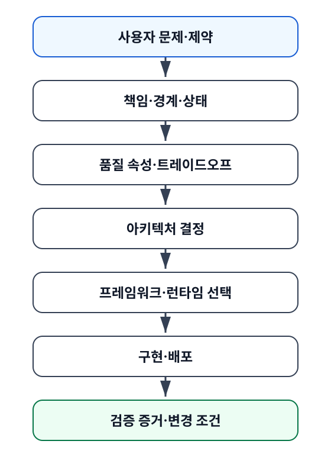

## 왜 필요한가

AI에게 “웹앱을 만들어 주세요”라고 하면 몇 초 안에 익숙한 프레임워크와 데이터베이스, 배포 구성을 제안할 수 있습니다. 하지만 제품 이름이 빨리 나왔다고 설계가 끝난 것은 아닙니다. 누가 어떤 상태를 바꾸는지, 어느 경계를 신뢰할 수 있는지, 실패가 어디까지 번지는지, 무엇을 증거로 성공을 판단할지가 빠져 있다면 기술은 많아도 시스템은 설명되지 않습니다.

아키텍처를 안다는 것은 거대한 그림을 멋지게 그리는 능력이 아닙니다. 현재 문제에 중요한 결정을 이유와 증거로 설명하고, 아직 필요하지 않은 복잡성을 거절하며, 조건이 바뀌면 어느 결정을 다시 볼지 아는 능력입니다. 비개발자에게 특히 중요한 이유는 AI가 제안한 구조를 코드 줄마다 읽지 않아도 책임·위험·검증 질문으로 검토할 수 있기 때문입니다.

## 한 문장 정의

**소프트웨어 아키텍처는 중요한 품질과 제약을 만족하도록 구성요소의 책임·경계·관계·상태·데이터·배치를 정한 구조적 결정이며, 프레임워크는 그 구조를 구현할 때 반복 골격과 기본 제어 흐름을 제공하는 기술입니다.**

좋은 아키텍처 설명은 상자 그림에서 끝나지 않습니다. `무엇을 결정했는가 + 왜 이 대안을 골랐는가 + 무엇으로 확인할 것인가 + 어떤 신호가 나오면 바꿀 것인가`를 함께 남깁니다. 반면 기술 스택은 언어·프레임워크·라이브러리·런타임·플랫폼·도구의 이름과 버전 목록입니다. 기술 스택은 구현 재료를 알려 주지만 그 재료를 고른 이유와 책임 배치를 스스로 설명하지는 못합니다.

2026-11-15에 확인한 ISO/IEC/IEEE 42010:2022 공개 소개는 시스템·소프트웨어·엔터프라이즈 등의 아키텍처 설명(architecture description)에 관한 요구를 다루며, 아키텍처 자체와 이를 표현한 설명을 구분합니다. 특정 개발 방법·표기법·도구나 기록 매체를 지정하지 않으므로 이 장의 일곱 단계 절차도 국제 표준의 의무 절차가 아닙니다. 아키텍처 설명이 존재한다는 사실은 현재 구현·품질·배포 성공의 증거가 아닙니다. 별도 conceptual model의 과거 확인과 이번 재확인 실패는 아래 출처에서 구분하며, 그 세부 관계를 이번에 다시 확인한 것으로 설명하지 않습니다.

## 도시 계획과 건축 공법에 비유하면

도시 계획은 주거·상업·도로·상하수도·전력·안전 구역이 어떤 책임을 맡고 어떻게 연결되는지 정합니다. 건축 공법은 건물을 반복 가능하게 세우는 뼈대와 시공 규칙을 제공합니다. 이 비유에서 아키텍처는 도시의 책임과 연결을 정하는 계획에, 프레임워크는 특정 종류의 건물을 만드는 공법과 부품 체계에, 라이브러리는 필요할 때 가져다 쓰는 부품 묶음에 가깝습니다.

### 비유가 맞는 지점

- 먼저 사람이 해결할 문제와 안전·비용·수용량 같은 조건을 정한 뒤 구조와 공법을 고릅니다.
- 한 구역의 실패가 다른 구역에 어떤 피해를 주는지, 연결 통로와 복구 경로가 무엇인지 생각해야 합니다.
- 공법이 편리해도 부지·용도·운영 능력과 맞지 않으면 좋은 선택이 아닙니다.

### 비유의 한계

소프트웨어 경계는 물리적 벽처럼 한 번 고정되지 않습니다. 같은 코드 묶음도 모듈·프로세스·네트워크·조직 경계에 따라 실패와 배포 영향이 달라지고, 실행 중 규모나 위치가 바뀔 수 있습니다. 또한 프레임워크는 단순한 건축 자재보다 강하게 애플리케이션의 진입점·수명 주기·파일 구조를 정할 수 있습니다. 따라서 비유만으로 보안·성능·가용성이나 실제 제어 관계가 증명되지는 않습니다.

## 결정 수준을 구분합니다

모든 기술 결정을 “아키텍처”라고 부르면 중요한 경계와 작은 구현 선택이 섞입니다. 다음 네 수준을 구분하면 지금 어떤 질문에 답하는지 선명해집니다.

| 수준 | 답하는 질문 | 대표 산출물 | 구분해야 할 오해 |
|---|---|---|---|
| 아키텍처 | 어떤 책임과 상태를 어느 경계와 배포 단위에 두고 중요한 품질·실패를 어떻게 다룰 것인가? | 책임 지도, 인터페이스·데이터 흐름, 결정 이유·대안·변경 조건 | 상자 그림이나 제품 목록만 있으면 아키텍처가 완성됐다는 오해 |
| 상세 설계 | 정한 경계 안에서 모듈·API·스키마·상태 전이·오류 처리를 어떻게 구체화할 것인가? | API·데이터 계약, 상태 전이, 모듈 설계, 테스트 오라클 | 모든 함수와 파일 선택이 되돌리기 어려운 아키텍처라는 오해 |
| 구현 | 설계를 코드·설정·마이그레이션·테스트·아티팩트로 어떻게 실현할 것인가? | 소스 diff, 테스트 결과, 빌드 아티팩트 | 코드가 만들어졌으니 사용자 목적과 운영 책임도 검증됐다는 오해 |
| 기술 스택 | 위 결정을 실현하는 데 어떤 언어·프레임워크·라이브러리·런타임·플랫폼·도구를 쓰는가? | 이름·버전·지원 범위·선택 근거 목록 | 인기 있는 이름을 나열하면 구조와 책임이 설명된다는 오해 |

이 수준은 완전히 분리된 순서표가 아닙니다. 상세 설계나 구현을 시험하다가 경계가 잘못됐다는 증거를 발견하면 아키텍처 결정을 다시 볼 수 있습니다. 중요한 것은 변경 범위와 되돌리기 비용을 알고, 작은 구현 선택 하나를 과장하거나 큰 구조 변경을 사소하게 숨기지 않는 것입니다.

## 구조를 묻는 일곱 가지 질문

아키텍처 그림을 보기 전에 “제품 이름은 어느 단계에서 처음 등장하며, 그보다 앞서 어떤 질문에 답해야 하는가?”를 생각해 보세요.



이 그림은 기술 선택이 사용자 문제보다 앞서지 않아야 하고, 구현 뒤에는 반드시 증거와 변경 조건이 남아야 한다는 읽기 순서를 보여 줍니다. 그러나 각 단계의 답이 옳다는 것, 선택한 구조가 안전하거나 빠르다는 것, 실제 배포가 성공했다는 것은 증명하지 않습니다. 그 주장은 요구사항·테스트·측정·운영 확인으로 별도 검증해야 합니다.

실제 구조를 설명할 때는 다음 질문에 답합니다.

1. **구성요소:** 시스템을 어떤 책임 단위로 나눠 생각할 수 있나요? 구성요소는 반드시 별도 서버일 필요가 없습니다.
2. **책임:** 각 부분이 무엇을 보장하고 어떤 실패를 처리하나요? 화면 표시와 권한 집행처럼 같은 흐름의 다른 책임을 섞지 않습니다.
3. **경계와 인터페이스:** 책임·신뢰·소유권·실행 환경은 어디서 바뀌고, 어떤 입력·출력·오류 계약으로 넘나요?
4. **상태와 데이터:** 무엇이 일시적 화면 상태이고 무엇이 권위 있는 원본인가요? 누가 저장·변경·동시 접근을 책임지나요?
5. **흐름:** 사용자 행동, 일정 작업, 데이터 갱신과 장애 복구가 어느 순서로 경계를 지나나요?
6. **배치:** 어떤 부분이 함께 실행·배포되며, 환경과 버전이 달라질 때 어떤 호환성이 필요한가요?
7. **실패와 복구:** 한 부분이 실패하면 영향이 어디까지 번지고, 무엇을 관찰해 어떻게 안정화·복구·재검증하나요?

## 품질 속성과 제약으로 대안을 비교합니다

기능 요구사항이 “사용자가 모임에 참가할 수 있다”라고 말한다면, 품질 속성은 “마지막 한 자리에 두 사람이 동시에 요청해도 정원을 넘지 않는다”처럼 그 기능이 얼마나 안전하고 신뢰 가능해야 하는지 말합니다. “빠르게”, “확장 가능하게”, “안전하게”만 쓰면 판정할 수 없으므로 사건·조건·기대 반응과 측정 증거를 붙입니다.

| 품질 질문 | 구체화한 예 | 확인할 증거 예 |
|---|---|---|
| 보안 | 참가자는 자신의 신청만 취소하고 주최자 작업은 주최자만 수행해야 한다 | 권한 거절 테스트, 안전한 감사 기록, 경계별 인가 확인 |
| 성능 | 교육용 데이터 1년치를 선택했을 때 목표 기기와 네트워크에서 표와 차트가 허용 시간 안에 나타나야 한다 | 정한 환경·데이터 크기의 측정값과 반복 조건 |
| 가용성·복구 | 데이터 갱신이 실패해도 마지막 정상 버전과 지연 이유를 제공하고 정한 절차로 복구해야 한다 | 실패 주입, 상태 표시, 백업·복원과 재검증 기록 |
| 변경 용이성 | 데이터 원천 필드가 바뀌어도 화면 전체가 아니라 계약·변환 경계에서 영향이 드러나야 한다 | 영향 범위 diff, 계약 테스트, 마이그레이션 계획 |
| 테스트·배포 용이성 | 핵심 규칙을 로컬에서 재현하고 어떤 입력 커밋이 어느 아티팩트에 배포됐는지 추적해야 한다 | 독립 fixture, 테스트 명령·종료 코드, 빌드·배포 식별자 |

제약은 선호보다 강한 경계입니다. 예산, 일정, 팀이 운영할 수 있는 기술, 허용된 배포 환경, 개인정보 금지, 데이터 이용 조건, 접근성 요구처럼 반드시 지켜야 할 조건을 따로 적습니다. 같은 대안도 품질 우선순위와 제약이 달라지면 평가가 달라집니다.

대안을 비교할 때는 정상 기능뿐 아니라 다음 네 비용을 함께 봅니다.

- **실패 영향:** 이 선택이 멈추거나 잘못되면 어떤 사용자·데이터·기능까지 영향을 받나요?
- **운영 표면:** 배포·설정·비밀·로그·경보·백업·복구해야 할 대상이 몇 개 늘어나나요?
- **유지 비용:** 팀이 학습하고 업데이트하며 보안 변경과 호환성을 따라갈 수 있나요?
- **되돌리기 비용:** 데이터 형식·공개 API·배포 단위처럼 나중에 바꾸기 어려운 결합이 무엇인가요?

## 프레임워크·라이브러리·런타임·플랫폼·도구

기술 이름 하나가 여러 역할을 겸할 수 있고 생태계마다 용어가 다릅니다. 아래 표는 보편 표준을 선언하려는 것이 아니라 AI의 제안을 역할별로 풀어 묻기 위한 실용적 구분입니다.

| 범주 | 쉬운 뜻 | 제어 관계와 검토 질문 |
|---|---|---|
| 프레임워크 | 반복되는 애플리케이션 골격과 기본 흐름 | 정해진 진입점과 수명 주기에서 우리 코드를 언제 호출하나요? 규칙을 벗어나면 비용이 얼마나 큰가요? |
| 라이브러리 | 필요할 때 호출해 쓰는 재사용 기능 묶음 | 우리 코드가 언제 어떤 기능을 호출하나요? 교체 경계와 오류 처리는 어디인가요? |
| 런타임 | 코드를 실제로 실행하는 엔진과 환경 | 어떤 언어·버전·프로세스·파일·네트워크 기능을 지원하며 배포 환경과 맞나요? |
| 플랫폼 | 만들고 실행·배포·운영할 기반과 제한 | 빌드·호스팅·데이터·권한·지역·관측·복구 중 실제로 무엇을 제공하고 무엇은 우리 책임인가요? |
| 도구 | 작성·검사·빌드·테스트·배포·관측을 돕는 수단 | 작업을 편하게 하는 것과 실행 시스템의 책임을 맡는 것을 구분했나요? 도구 성공이 결과 정확성을 대신하나요? |

프레임워크를 고를 때는 인기 순위보다 책임과 실행 조건을 먼저 봅니다. 화면을 서버에서 만들지 브라우저에서 만들지, 사용자별 상태를 어디에서 읽고 바꿀지, 권한을 어느 신뢰 경계에서 집행할지, 팀이 어떤 언어와 운영 모델을 이해하는지, 허용된 배포 환경에서 런타임이 지원되는지, 업데이트·테스트·관측·교체 비용을 감당할 수 있는지를 연결합니다.

## 선택 절차: 이름보다 질문이 먼저입니다

1. **사용자 문제와 비목표를 고정합니다.** 누가 어떤 결과를 얻어야 하고, 이번 범위에서 만들지 않을 것은 무엇인지 적습니다.
2. **현재 구조를 읽기 전용으로 조사합니다.** 저장소·설정·데이터·배포·테스트를 바꾸지 않고 구성요소, 책임, 경계, 상태 원본과 이미 검증된 증거를 목록화합니다.
3. **품질 시나리오와 제약의 우선순위를 정합니다.** “빠르게” 대신 어떤 조건에서 어떤 반응을 어떤 증거로 판정할지 적습니다.
4. **가장 단순한 선택을 포함한 대안 두 개를 만듭니다.** 대안이 해결하는 문제, 새로 생기는 실패와 운영 책임, 비목표를 나란히 놓습니다.
5. **프레임워크와 런타임의 역할 적합성을 봅니다.** 책임·렌더링·상태·팀 역량·배포 환경·유지 비용을 공식 지원 범위와 최소 시험으로 확인합니다.
6. **실패 영향과 가역성을 비교합니다.** 바꾸기 쉬운 선택은 늦추고, 데이터·공개 계약·배포 경계처럼 되돌리기 어려운 선택은 근거와 승인 경계를 더 엄격히 둡니다.
7. **결정과 변경 조건을 기록합니다.** 선택·이유·제외 대안·확인 증거·남은 위험·어떤 측정이나 요구가 생기면 다시 볼지를 한 묶음으로 남깁니다.

“나중에 커질 수 있다”는 말만으로 복잡한 구조를 선택하지 않습니다. 미래를 정확히 예측하는 대신 가장 가능성 높은 변화 지점에 명확한 경계를 두고, 실제 신호가 나타났을 때 비교할 수 있게 증거를 모읍니다.

## 모임 참가 웹앱: 단순 모놀리스부터 검증합니다

모임 참가 웹앱의 현재 핵심은 공개 일정 조회, 참가와 자기 취소, 주최자 권한, 모집 상태, 중복 방지와 마지막 한 자리 동시 요청입니다. 초기 아키텍처 가설은 화면·요청 처리·업무 규칙을 한 배포 단위 안에서 책임별 모듈로 나눈 **단순 모놀리스**와 하나의 **관계형 데이터베이스**입니다.

모놀리스는 “모든 코드를 한 파일에 섞는다”는 뜻이 아닙니다. 화면, API, 인증·인가, 참가 규칙, 데이터 접근을 모듈과 인터페이스로 구분하되 작은 팀이 한 번에 배포하고, 참가·정원·중복 상태를 한 데이터 경계와 트랜잭션에서 검증할 수 있게 시작한다는 가설입니다. 별도 서비스 사이 네트워크 실패·버전 호환·분산 추적·여러 배포와 복구 책임을 지금부터 만들지 않는 대신 내부 경계를 테스트로 지킵니다.

이 가설의 증거는 상자 수가 아니라 권한 거절, 활성 참가 중복 방지, 마지막 한 자리 동시 요청에서 성공 1건과 안전한 실패 1건, `commit` 뒤 응답 유실의 재조회, 입력 커밋과 아티팩트 추적, 안전한 로그와 복구 시험입니다. 자세한 요구·상태·테스트 계약은 [첫 풀스택 프로젝트: 모임 참가 웹앱](../../12-case-studies/first-full-stack-project/)에서 이어집니다.

다음 신호가 실제로 관찰되면 경계를 다시 검토합니다.

- 독립 팀이 서로 다른 출시 주기와 소유권으로 한 책임을 운영해야 합니다.
- 측정 결과 특정 책임의 부하가 전체 배포 단위를 반복적으로 압박하고 단순 최적화로 해결되지 않습니다.
- 법규·보안·장애 격리 요구 때문에 실행·데이터 경계를 분리해야 합니다.
- 한 부분의 변경과 장애가 무관한 부분을 계속 막아 분리 비용보다 결합 비용이 커졌습니다.

이 신호가 나타나도 마이크로서비스가 자동 정답은 아닙니다. 모듈 경계 강화, 별도 작업 프로세스, 독립 서비스 같은 두 대안을 새 실패·운영 비용과 함께 비교합니다.

## 주가 데이터 대시보드: 정적 전달부터 검증합니다

교육용 주가 데이터 대시보드의 현재 핵심은 `EDU-FIXTURE`라는 가상 데이터 계약, 변환 버전과 체크섬, 거래일·단위·가격 기준, 값과 신선도 상태, 같은 입력의 재현 가능한 표·차트·요약입니다. 사용자별 쓰기·로그인·서버 비밀·실시간 처리가 없으므로 초기 아키텍처 가설은 검증된 데이터와 화면 자산을 빌드해 **정적 파일로 전달**하는 구조입니다.

이 선택은 “대시보드에는 백엔드가 필요 없다”는 보편 규칙이 아닙니다. 현재 범위에서는 요청마다 서버를 운영하지 않고 데이터 계약·품질 게이트·접근 가능한 전달·실패 시 마지막 정상 버전과 지연 이유에 집중할 수 있다는 판단입니다. 증거는 fixture 체크섬과 변환·데이터셋 버전, 같은 입력의 재현 결과, 경고·차단·검토 대기 상태, 표와 차트의 일치, 정적 파일 로드 실패와 렌더링 실패의 분리, 빌드 아티팩트와 실제 소비 확인입니다. 자세한 계약은 [데이터 분석가의 주가 대시보드 사례](../../12-case-studies/analytics-dashboard-case-study/)에서 이어집니다.

다음 신호가 실제 요구가 되면 런타임·API·저장소 도입을 다시 비교합니다.

- 사용자별 비공개 상태, 쓰기, 권한 또는 감사 가능한 변경 이력이 필요합니다.
- 브라우저에 노출할 수 없는 자격 증명이나 서버에서 집행해야 할 데이터 이용 조건이 있습니다.
- 정적 갱신 주기로 맞출 수 없는 신선도 요구가 공식적으로 정해지고 지연 예산이 측정됩니다.
- 브라우저에 전달하기 어려운 계산량, 요청별 결과나 서버 측 품질 판정이 필요합니다.

이 신호가 없으면 큐·캐시·별도 검색 서버를 먼저 추가하지 않습니다. 추가 구성요소는 속도나 확장성이라는 이름만으로 이득이 되지 않으며 무효화·재시도·중복 처리·관측·복구라는 새 책임을 만듭니다.

## 실패와 과설계 신호

- **기술 이름이 문제보다 먼저 나옵니다.** “무엇을 해결하는가”보다 프레임워크·데이터베이스·호스팅 제품을 먼저 고르고 요구를 그 구조에 맞춥니다.
- **그림에 이유가 없습니다.** 상자와 화살표는 있지만 책임·권위 상태·품질 우선순위·실패 영향·변경 조건을 설명하지 못합니다.
- **모든 미래를 미리 구현합니다.** 입증된 요구 없이 마이크로서비스·메시지 큐·캐시·별도 검색 서버를 기본 구성으로 넣습니다.
- **배포 단위가 소유 책임보다 많습니다.** 작은 팀이 여러 런타임·설정·비밀·로그·경보·복구 절차를 관리하지만 각각을 분리해야 할 품질 근거가 없습니다.
- **권위 있는 상태가 불분명합니다.** 화면·캐시·데이터베이스가 서로 다른 값을 보이는데 충돌 해결 주체와 최신성 규칙이 없습니다.
- **프레임워크가 책임을 대신한다고 생각합니다.** 인증 기능이 있다는 이유로 대상별 인가와 부정 테스트를 생략하거나, 배포 버튼이 있다는 이유로 데이터 복구와 공개 흐름 검증이 끝났다고 봅니다.
- **되돌리기 어려운 선택을 조용히 합니다.** 공개 API, 데이터 형식, 마이그레이션, 배포 경계를 바꾸면서 대안·호환·복구·승인 기록이 없습니다.

반대로 단순함도 무조건 선은 아닙니다. 품질·보안·법규·격리 요구가 확인됐는데 “작으니까 한곳에 둔다”라고 버티면 필요한 경계를 놓칩니다. 목표는 구성요소 수를 최소화하는 것이 아니라 현재 증거로 설명할 수 있는 최소 복잡성을 선택하는 것입니다.

## AI에게 읽기 전용 아키텍처 검토를 요청합니다

AI가 곧바로 파일과 의존성을 바꾸지 않게 현황 조사와 결정 제안을 분리합니다. 다음 요청은 구현 승인이 아니라 판단 자료를 만드는 계약입니다.

```text wrap
PROJECT_CONTEXT, 요구사항, 현재 디렉터리·설정·데이터·테스트·배포 파일을 먼저 읽어라.
이번 단계는 읽기 전용 아키텍처 검토다. 파일 수정, 새 패키지, 마이그레이션, 외부 쓰기, 배포를 하지 마라.
현재 구성요소·책임·경계·인터페이스·권위 상태·데이터·배포 단위를 근거 경로와 함께 목록화하라.
사용자 문제와 제약, 우선 품질 시나리오를 분리하고 확인되지 않은 가정은 가정이라고 표시하라.
현재 구조를 유지하는 가장 단순한 대안을 포함해 정확히 두 대안을 제시하라.
각 대안의 해결 범위, 실패 영향, 운영 표면, 팀 역량, 배포 환경, 유지 비용, 되돌리기 비용과 변경 조건을 같은 표로 비교하라.
마이크로서비스, 큐, 캐시, 별도 검색 서버는 입증된 요구와 측정 증거가 없으면 기본값으로 넣지 마라.
공식 또는 1차 근거의 URL·확인일·적용 범위와 일반화 금지선을 기록하라.
비목표와 남은 불확실성, 추가로 필요한 최소 검증 증거를 적어라.
승인 전에는 하나를 채택하거나 구현하지 말고, 되돌리기 어려운 결정과 별도 승인 경계를 명시하라.
```

보고서를 받을 때 “권장안”만 보지 마세요. 현재 구조를 실제 파일에서 읽었는지, 두 대안의 비용을 같은 기준으로 비교했는지, 근거 없는 미래 규모를 사실처럼 썼는지, 구현·배포 권한을 넘지 않았는지 확인합니다.

## 확인 체크리스트

- [ ] 사용자 문제와 이번 비목표가 제품 이름보다 먼저 적혀 있나요?
- [ ] 아키텍처·상세 설계·구현·기술 스택을 같은 뜻으로 쓰지 않았나요?
- [ ] 구성요소마다 책임·경계·인터페이스·상태·데이터·배치 질문에 답했나요?
- [ ] 화면 사본과 권위 있는 상태 원본, 신뢰 경계와 인가 집행 위치가 분명한가요?
- [ ] 품질 속성을 사건·조건·기대 반응·증거로 구체화했나요?
- [ ] 예산·일정·팀 역량·법규·데이터 조건·배포 환경을 제약으로 분리했나요?
- [ ] 가장 단순한 선택을 포함한 대안 두 개의 실패 영향·운영 표면·유지 비용을 비교했나요?
- [ ] 프레임워크 선택을 책임·렌더링·상태·팀 역량·배포 환경·유지·교체 비용에 연결했나요?
- [ ] 마이크로서비스·큐·캐시·별도 검색 서버마다 현재 필요한 근거와 검증 증거가 있나요?
- [ ] 결정·이유·제외 대안·검증 증거·변경 조건을 함께 기록했나요?
- [ ] 테스트, 빌드, 배포와 실제 사용자·운영 성공을 서로 다른 증거로 구분했나요?
- [ ] 새 패키지·마이그레이션·외부 쓰기·배포처럼 되돌리기 어렵거나 영향이 큰 행동에 승인 경계가 있나요?

## 짧은 연습

“동네 독서 모임 참가 웹앱을 만들어 주세요. 나중에 사용자가 많아질 수 있으니 확장 가능하게 해 주세요.”라는 요청을 받았다고 가정합니다.

1. 사용자 문제 두 개, 현재 제약 두 개, 이번 비목표 두 개를 적습니다.
2. 구성요소 이름보다 먼저 책임·경계·권위 상태·실패를 한 줄씩 적습니다.
3. 단순 모놀리스와 관계형 데이터베이스 가설을 대안 A로 두고, 다른 대안 B를 하나만 만듭니다.
4. 두 대안을 권한, 마지막 한 자리 동시 요청, 배포·복구 수, 팀 역량, 되돌리기 비용으로 비교합니다.
5. “사용자가 많아진다”를 구조 변경 신호로 쓸 수 있도록 어떤 측정값과 임계 상황을 추가로 확인할지 적습니다.
6. 승인 전 AI가 해도 되는 읽기 전용 조사와 하면 안 되는 변경을 나눠 씁니다.

좋은 답은 복잡한 제품 이름을 많이 쓰지 않습니다. 현재 요구를 만족하는 가장 단순한 가설, 그것이 틀렸음을 알려 줄 증거, 그때 다시 비교할 대안을 설명합니다.

## 관련 장과 출처

- [PRD·두 종류의 SDD·TDD](../prd-sdd-tdd/)는 사용자 문제·요구·설계 설명·개발 접근·구현 규율을 구분하고 아키텍처 판단의 입력과 검증을 연결합니다.
- [ADR과 트레이드오프 기록](../adr-and-tradeoffs/)은 선택한 결정의 맥락·대안·결과와 재검토 조건을 남기는 형식을 다룹니다.
- [소프트웨어는 시스템입니다](../../01-mental-models/software-is-a-system/)는 화면이 아니라 책임·경계·상태·흐름·제약·증거로 시스템을 보는 기초를 제공합니다.
- CMU Software Engineering Institute의 [Software Architecture in Practice, 4th Edition](https://www.sei.cmu.edu/library/software-architecture-in-practice-fourth-edition/) 공식 소개는 아키텍처가 생명주기와 기술·프로젝트·비즈니스 맥락에 영향을 주고받으며 여러 품질 속성을 다루는 범위를 뒷받침합니다.
- [ISO/IEC/IEEE 42010:2022](https://www.iso.org/standard/74393.html) 공개 소개는 아키텍처와 architecture description의 경계 및 방법·도구 비강제 범위를 2026-11-15에 확인했습니다. 표준 전문을 읽은 것은 아닙니다. 표준 작업 그룹의 [conceptual model](https://www.iso-architecture.org/ieee-1471/cm/)은 2026-08-13 확인 기록이 있는 보조 자료이나 이번 재확인은 접근 실패로 미확인(not-confirmed)입니다. 세부 관계를 뒷받침하는 새 직접 근거로 사용하지 않으며, 과거 확인 기록도 현재 성공으로 바꾸지 않습니다.
- IEEE Computer Society의 [SWEBOK 세부 주제](https://www.computer.org/education/bodies-of-knowledge/software-engineering/topics)는 요구사항·설계·구현·테스트·운영을 연결해 학습하는 범위에 사용했습니다. 이 URL은 2026-08-04 기존 직접 확인 기록을 사용하며 2026-08-13 새 확인은 HTTP 403으로 실패했습니다.
- MDN의 [Introduction to client-side frameworks](https://developer.mozilla.org/en-US/docs/Learn_web_development/Core/Frameworks_libraries/Introduction)는 웹 프런트엔드에서 라이브러리와 프레임워크의 관계, 프레임워크의 구조적 의견과 선택 질문을 설명합니다. 이 표현을 모든 생태계의 엄격한 표준으로 일반화하지 않습니다.

구체적인 확인일, 적용 범위, 두 사례의 내부 근거와 일반화 금지선은 저장소의 `research/architecture-framework-research-brief.md`와 `research/source-map.md`에서 관리합니다. 이 장은 특정 제품의 현재 기능이나 실제 배포 성공을 주장하지 않으며, 후보 기술을 채택할 때는 해당 공식 문서와 실행 증거를 다시 확인해야 합니다.
