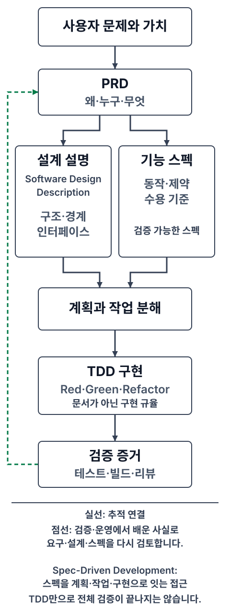

## 먼저 결론

- **PRD(Product Requirements Document)**: 누구의 어떤 문제를 왜 무엇으로 해결할지 합의하는 제품 요구 문서입니다.
- **Software Design Description**: 합의된 요구를 어떤 구조, 책임, 데이터와 인터페이스로 실현할지 설명하는 설계 문서입니다.
- **Spec-Driven Development**: 이 장에서는 명시적인 스펙을 계획·작업·구현으로 변환하고 각 단계에서 검토하는 대표적인 개발 접근을 뜻합니다. 하나의 보편 표준으로 고정된 약어는 아닙니다.
- **TDD(Test-Driven Development)**: 원하는 동작을 테스트로 먼저 표현하고, 올바른 실패를 확인한 뒤 최소 구현과 리팩터링을 반복하는 구현 규율입니다.

따라서 “PRD를 쓰고 SDD와 TDD 문서를 작성한다”는 표현은 범주를 섞을 수 있습니다. PRD와 설계 설명은 산출물이고, Spec-Driven Development는 여러 산출물을 연결하는 접근이며, TDD는 구현 순간의 피드백 순서입니다. 네 가지를 모두 별도 문서로 만들어야 좋은 개발이 되는 것도 아닙니다. 중요한 것은 **문제 → 요구 → 설계 → 작업 → 구현 → 검증** 사이에서 결정과 증거가 끊기지 않는 것입니다.

## 왜 필요한가

바이브 코딩을 시작하면 “먼저 PRD를 쓰고 SDD로 설계한 뒤 TDD로 개발하라”는 조언을 자주 만납니다. 방향은 유용하지만 이름만 따라 하면 긴 문서 세 개와 테스트 파일이 생겼는데도 정작 사용자 문제, 설계 선택, 작업 범위와 완료 증거가 서로 연결되지 않을 수 있습니다.

예를 들어 PRD에는 “빠른 대시보드”라고만 적고, 설계 문서에는 근거 없이 특정 프레임워크를 고정하고, 작업 목록에는 파일 이름만 나열하고, AI가 구현을 끝낸 뒤 기존 동작에 맞춘 테스트를 추가했다고 가정해 보겠습니다. 문서와 테스트는 모두 존재하지만 “어느 사용자의 어떤 작업이 얼마나 빨라야 하는가”, “그 요구가 어떤 설계 결정으로 이어졌는가”, “수정 전 테스트가 원래 의도를 보호했는가”에는 답하지 못합니다.

비개발자에게 필요한 능력은 방법론 이름을 외우는 것이 아니라 각 산출물과 활동이 **어떤 질문에 답하고, 무엇을 답하지 않으며, 다음 단계에 어떤 증거를 넘기는지** 구분하는 것입니다.

## 네 개념의 범주부터 구분하세요

- **PRD — 제품 요구 문서**
  - 핵심 질문: 누구의 어떤 문제를 왜 무엇으로 해결하나요?
  - 대표 결과: 사용자·문제·목표·범위·요구·성공 지표
  - 이것만으로 증명되지 않는 것: 기술 구조와 구현 가능성

- **Software Design Description — 설계 문서**
  - 핵심 질문: 요구를 어떤 책임·경계·데이터·인터페이스로 실현하나요?
  - 대표 결과: 구성도·계약·데이터·품질·운영·트레이드오프
  - 이것만으로 증명되지 않는 것: 구현 완료와 실제 운영 성공

- **Spec-Driven Development — 개발 접근**
  - 핵심 질문: 명시적 스펙을 어떻게 계획·작업·구현으로 변환하고 검토하나요?
  - 대표 결과: spec·plan·tasks·구현 및 검증 기록
  - 이것만으로 증명되지 않는 것: 스펙 자체의 정확성과 사용자 가치

- **TDD — 구현 규율**
  - 핵심 질문: 원하는 작은 동작을 테스트로 먼저 어떻게 표현하고 설계 피드백을 받나요?
  - 대표 결과: Red·Green·Refactor 반복
  - 이것만으로 증명되지 않는 것: 전체 테스트 전략, 보안·성능·배포 품질

같은 프로젝트에서 네 개념을 함께 사용할 수 있지만 반드시 일렬로 한 번씩만 거치는 단계는 아닙니다. 설계 중 구현 가능성 문제가 드러나면 요구 범위를 다시 협의할 수 있고, TDD 중 인터페이스가 지나치게 복잡하다는 신호를 발견하면 설계를 수정할 수 있습니다. 운영 피드백이 새로운 사용자 문제를 보여주면 PRD도 갱신됩니다.

### 입력·출력·순서·실패로 다시 구분하기

| 개념 | 입력 | 출력 | 순서와 피드백 | 대표 실패 |
|---|---|---|---|---|
| PRD | 사용자 조사·문제·제품 목표·제약·미확인 | 제품 요구·범위·비범위·수용 기준·성공 지표 | 설계의 입력이 되지만 설계·사용 결과로 다시 협의함 | 기능 목록이나 선호 기술을 사용자 문제 대신 고정함 |
| Software Design Description | 합의한 요구·현재 시스템·품질·제약·위험 | 책임·경계·인터페이스·데이터·실패·운영·트레이드오프 설명 | 요구를 구현 가능한 구조로 내리고 구현 발견을 반영함 | 기술 이름만 나열하거나 문서 존재를 구현 완료로 봄 |
| Spec-Driven Development | 검토 가능한 스펙·저장소 문맥·권한·검증 계약 | plan·tasks·구현 diff·단계별 검토 기록 | 이 장은 2026-08-13에 확인한 Spec Kit 사례의 Spec → Plan → Tasks → Implement 연결을 설명하며 필요하면 앞 산출물로 되돌아감 | 틀린 스펙을 정교하게 구현하거나 도구 흐름을 보편 표준으로 봄 |
| TDD | 다음 작은 동작과 테스트 목록·기대 결과 | 테스트 우선 Red·Green·Refactor 과정, 구현·테스트·개선된 구조 | 구현 작업 안에서 짧게 반복하고 발견한 인터페이스 문제를 설계에 되돌림 | 구현 뒤 테스트를 추가하고 TDD라고 부르거나 TDD를 문서 종류로 봄 |

출력은 반드시 별도 파일 하나씩을 뜻하지 않습니다. 작은 변경은 요구·설계 선택·작업·검증을 한 브리프에 합칠 수 있고, 큰 위험은 독립 검토 가능한 문서로 분리할 수 있습니다. 반대로 순서가 되먹임을 허용한다는 말은 요구·설계·테스트의 구분을 없애거나 구현 결과에 맞춰 원래 수용 기준을 조용히 바꿔도 된다는 뜻이 아닙니다.

## 한 장의 관계도

PRD에서 설계 설명과 기능 스펙으로 갈라진 연결은 어디서 합쳐지고, 검증·운영에서 배운 사실은 무엇을 다시 살펴보게 하나요?



1. 사용자 문제와 목표를 PRD의 요구와 수용 기준으로 연결합니다.
2. 요구는 두 갈래로 이어집니다. Software Design Description은 책임·경계·데이터·품질 결정을 설명하고, 기능 스펙은 구현할 행동과 확인 조건을 구체화합니다.
3. 설계 설명과 기능 스펙은 계획·작업 분해에서 만나며, 구현 작업 안에서는 TDD 반복과 다른 테스트를 적용합니다.
4. 테스트·빌드·리뷰와 필요한 배포·운영 증거를 요구에 연결하고, 배운 사실을 요구·설계·스펙에 다시 반영합니다.

이 그림에서 화살표는 문서를 넘겨주고 잊는 절차가 아니라 **추적 가능한 연결**입니다. 요구사항 ID가 설계 결정, 작업, 테스트와 연결돼야 변경할 때 무엇을 함께 확인할지 알 수 있습니다. 실제 개발에는 설계 중 요구를 다시 협의하거나 TDD에서 발견한 인터페이스 문제를 설계에 반영하는 더 많은 되먹임이 있으며, 그림은 이를 검증·운영 증거에서 요구로 돌아가는 한 화살표로 단순화했습니다.

## 집을 만드는 과정으로 이해하기

PRD는 “누가 어떤 생활 문제를 해결하려고 어떤 공간이 필요한가”를 합의하는 요구서, Software Design Description은 구조·동선·설비와 안전 조건을 설명하는 설계도, Spec-Driven Development는 승인된 요구와 설계를 공정과 작업 단위로 바꾸고 점검하는 진행 방식, TDD는 작은 부품을 만들 때 먼저 합격 조건을 정하고 실패를 확인한 뒤 맞추는 작업 규율에 비유할 수 있습니다.

### 비유가 맞는 지점

- 사용 목적과 성공 조건을 모르면 좋은 설계를 평가하기 어렵습니다.
- 설계는 요구를 구성요소와 인터페이스로 구체화합니다.
- 큰 계획은 검토 가능한 작은 작업으로 나눠야 합니다.
- 합격 조건을 먼저 정하면 만든 뒤 기준을 바꾸는 일을 줄일 수 있습니다.

### 비유가 깨지는 지점

소프트웨어는 배포 후에도 비교적 자주 바뀌고, 실제 사용에서 요구와 설계의 오류가 드러날 수 있습니다. 코드 테스트는 건축 검사와 달리 반복 실행 가능한 실행물이며, TDD의 테스트가 사용자 가치 전체를 직접 검증하지 않을 수도 있습니다. 또한 작은 소프트웨어 변경은 요구·설계·작업 내용을 한 페이지에 함께 기록하는 편이 더 명확할 수 있으므로 산출물 이름과 개수를 건축 공정처럼 고정하면 안 됩니다.

## 1. PRD: 제품의 문제와 성공을 정합니다

PRD의 형식과 상세도는 조직마다 다릅니다. 공통 목적은 이해관계자가 문제, 우선순위, 범위와 성공을 같은 언어로 검토하게 하는 것입니다. 좋은 PRD는 기능 목록으로 시작하기보다 다음 질문에 답합니다.

[ISO/IEC/IEEE 29148:2018](https://www.iso.org/standard/72089.html)은 요구공학 과정과 요구 관련 정보 항목을 다루는 현재 발행 표준입니다. 2024년에 확인됐지만 2026-08-13 기준 `to be revised` 단계이고 후속 DIS가 개발 중입니다. 이 자료는 요구가 생명주기 전체에서 관리되고 검토 가능한 정보로 남아야 한다는 범위를 뒷받침할 뿐, 이 장의 PRD 이름·구성·성공 지표 양식을 국제 표준으로 만들지는 않습니다. 개발 중인 DIS를 현재 발행 표준의 대체 근거로 사용하지도 않습니다.

- 누구의 어떤 문제를 해결하나요?
- 현재 사용자는 어떻게 해결하고 있으며 무엇이 불편하거나 위험한가요?
- 왜 지금 해결해야 하며 해결하지 않으면 어떤 비용이 있나요?
- 사용자가 끝내야 하는 핵심 작업과 정상·빈 결과·오류 흐름은 무엇인가요?
- 기능 요구와 성능·보안·접근성·개인정보 같은 품질 요구는 무엇인가요?
- 각 요구를 어떤 관찰 가능한 수용 기준으로 확인하나요?
- 성공 지표와 안전을 위한 가드레일은 무엇인가요?
- 무엇은 명시적으로 범위 밖인가요?
- 제약, 가정, 위험, 미확인 사항은 무엇인가요?

### 요구사항과 수용 기준을 구분하세요

요구사항은 시스템이 제공해야 할 능력이나 지켜야 할 조건입니다. 수용 기준은 그 요구가 충족됐는지 관찰할 수 있는 조건입니다.

```text
요구사항 FR-014
사용자는 각 지표의 원천과 기준 시점을 확인할 수 있어야 한다.

수용 기준
- 차트와 표에서 같은 지표 상세 화면으로 이동할 수 있다.
- 상세 화면에 지표 정의, 원천 기관, 원본 URL, 기준 시점과 수집 시점이 표시된다.
- 원천 시점이 허용된 갱신 주기를 넘으면 오래된 데이터 경고가 표시된다.
- 메타데이터가 없으면 빈 칸으로 숨기지 않고 확인 불가 상태를 표시한다.
```

이 `FR-014`는 원천 표시와 최신성 판단을 한 흐름으로 설명하기 위한 복합 교육 예시이며 사례의 요구사항 ID가 아닙니다. [데이터 분석가의 대시보드 사례](../../12-case-studies/analytics-dashboard-case-study/)에 적용할 때는 `D-01`의 가상 원천 표시, `D-02`의 거래일·단위·가격 기준, `D-03`의 버전·기준 시점, `D-04`의 오래됨과 이유 표시, `D-05`의 갱신 실패·마지막 정상 버전 보존을 나눠 추적합니다. 실제 시장 데이터의 최신성이나 원천 정확성을 검증한 예시는 아닙니다.

“보기 좋게”, “빠르게”, “안전하게”는 방향이지만 그대로는 수용 기준이 아닙니다. 어떤 사용자·조건·관찰 방법과 허용 범위를 말하는지 구체화해야 합니다. 반대로 CSS 클래스나 데이터베이스 테이블 이름을 수용 기준에 고정하면 사용자 결과보다 구현 세부를 요구로 착각할 수 있습니다.

### 기술 제약은 무조건 빼는 것이 아닙니다

PRD가 기술 설계 전체를 선결해서는 안 되지만 실제 제약은 기록해야 합니다. 기존 배포 환경, 개인정보 금지, 재배포 라이선스, 예산, 지원 브라우저와 규정 준수처럼 선택지를 제한하는 조건은 제품 범위와 성공에 영향을 줍니다. “익숙하니까 이 프레임워크를 쓴다”는 선호와 “현재 조직의 승인된 환경에서만 배포해야 한다”는 제약을 구분하세요.

### 좋은 PRD의 판정 기준

기능 목록이 길어서가 아니라 팀이 같은 문제와 우선순위를 이해하고, 애매한 요구와 위험을 발견하며, 설계와 검증으로 내려갈 수 있어야 합니다. PRD만 읽은 사람이 “이번 버전에서 누구에게 어떤 차이가 생기며 무엇을 하지 않는가?”를 자신의 말로 설명할 수 있어야 합니다.

## 2. Software Design Description: 시스템이 어떻게 나뉘는지 설명합니다

이 장에서 **Software Design Description**은 소프트웨어 설계를 설명하는 문서를 뜻합니다. 명칭과 형식은 조직마다 다를 수 있으며 `technical design`, `design spec`, `architecture design`처럼 다른 이름을 쓸 수도 있습니다. 중요한 것은 약어가 아니라 PRD의 요구와 제약을 어떤 구조적 결정으로 실현할지 검토 가능하게 만드는 역할입니다.

[IEEE 1016-2009](https://standards.ieee.org/ieee/1016/4502/)는 Software Design Description을 설계 정보를 기록하고 핵심 설계 이해관계자에게 전달하는 표현으로 정의하고, 특정 설계 방법론이나 설계 언어를 강제하지 않았습니다. 다만 IEEE의 2026-08-13 공식 상태는 `Inactive-Reserved Standard`이므로 용어와 역사적 범위를 뒷받침하는 자료로만 사용합니다. 현재 모든 프로젝트가 이 표준의 구성으로 별도 SDD 파일을 만들어야 한다는 근거로 확대하지 않습니다.

주요 내용은 다음과 같습니다.

- 설계 범위, 시스템 경계와 외부 주체
- 구성요소의 책임, 인터페이스와 신뢰 경계
- 데이터 모델, 권위 있는 상태, 흐름과 보존·삭제 정책
- 정상·경계·부분 실패와 오류 계약
- 보안·성능·가용성·접근성·관측 가능성 같은 품질 속성
- 고려한 대안, 선택 이유와 받아들인 트레이드오프
- 배포, 호환성, 마이그레이션, 관측, 롤백과 복구 전략
- 요구사항을 확인할 테스트·로그·지표와 미해결 위험

PRD가 “사용자가 보고서를 공유할 수 있어야 한다”고 말하면 설계 설명은 공유 링크의 권한 모델, 만료 정책, 데이터 접근 경계, API, 감사 로그를 구체화합니다.

### 설계 설명은 프레임워크 목록이 아닙니다

“프런트엔드는 A, 백엔드는 B, 데이터베이스는 C를 쓴다”는 목록만으로는 책임, 데이터와 실패가 보이지 않습니다. 같은 기술을 사용해도 권한 검사를 어디서 하고, 공유 링크가 어떤 상태를 가지며, 만료와 철회를 어떻게 처리하는지에 따라 설계가 달라집니다. 기술 이름을 적을 때는 해결하려는 요구와 품질 속성, 대안과 변경 비용을 함께 기록하세요.

### 모든 세부 결정을 한 문서에 넣지 마세요

설계 설명은 전체 구조와 중요한 경계를 연결합니다. 여러 기능에 영향을 주거나 되돌리기 비용이 크고 대안·선택 이유·결과를 오래 추적해야 하는 결정은 ADR(Architecture Decision Record, 아키텍처 결정 기록)로 분리할 수 있습니다. 사소하고 쉽게 되돌릴 수 있는 선택까지 모두 별도 기록으로 만들 필요는 없습니다. 세부 구현을 모두 미리 고정하면 탐색 과정에서 발견한 더 단순한 해법을 반영하기 어려워지고 문서가 코드와 빠르게 어긋납니다. 설계 문서는 필요한 결정과 미해결 위험을 구분하고 구현에서 배운 내용으로 갱신해야 합니다.

## 3. Spec-Driven Development: 스펙에서 구현으로 내려가는 흐름입니다

최근 AI 개발 문맥에서 SDD는 **Spec-Driven Development**를 뜻하기도 합니다. 이 표현은 Software Design Description과 다른 범주이며 하나의 보편 표준으로 고정된 약어도 아닙니다. 2026-08-13에 확인한 GitHub Spec Kit 공식 홈페이지는 핵심 흐름을 `Spec → Plan → Tasks → Implement`로 제시하고, 상세 명령 참조는 `/speckit.specify`의 앞뒤에 clarify·checklist·analyze 같은 선택적 품질 게이트와 구현 뒤 converge까지 설명합니다. 이 장은 네 핵심 연결을 대표 사례로 사용하며 선택 명령 전체를 모든 팀의 고정 순서로 만들지 않습니다. 도구 흐름은 바뀔 수 있으므로 실제 적용 전 공식 문서를 다시 확인하고, 다른 도구나 조직이 SDD라고 쓸 때는 첫 등장에 뜻을 풀어 씁니다.

핵심은 코딩 전에 모든 것을 완벽하게 예언하는 것이 아닙니다. 자연어 요청을 바로 코드로 점프시키지 않고, 검토 가능한 중간 산출물을 두어 의도 손실을 줄이는 것입니다.

- **Spec(`/speckit.specify`)**: 사용자 요구, 정상·경계·실패 동작, 수용 기준과 비목표를 명확히 합니다.
- **Plan**: 현재 저장소와 제약을 조사하고 기술 맥락, 설계 방향, 위험과 검증 전략을 정합니다.
- **Tasks**: 의존성과 쓰기 소유권, 독립 검토와 검증 단위에 따라 작업을 나눕니다.
- **Implement**: 작은 작업을 구현하고 수용 기준별 증거를 확인하며 새로 발견한 사실을 스펙에 되돌립니다.

네 단계 이름은 GitHub Spec Kit 사례에서 가져왔지만 위의 세부 설명과 아래 종료 질문·최소 증거는 이 핸드북이 비개발자의 검토를 돕기 위해 구성한 기준입니다. 또한 `Plan`이 항상 별도의 설계 문서를 새로 만든다는 뜻은 아닙니다. 기존 Software Design Description을 참조하거나 갱신할 수 있고, 작은 변경이라면 요구·설계 선택·작업·검증을 한 작업 명세에 합칠 수 있습니다. 별도 문서 분리는 이름이 아니라 변경 위험과 되돌리기 비용으로 결정합니다.

### 각 단계에는 종료 질문이 필요합니다

| 단계 | 검토 질문 | 다음 단계로 넘길 최소 증거 |
|---|---|---|
| Spec | 사용자 결과와 비목표가 관찰 가능한가? | 요구·예시·수용 기준·미확인 목록 |
| Plan | 현재 구조와 제약에 맞고 더 단순한 대안을 검토했는가? | 구성요소·데이터·인터페이스·위험·검증 방식 |
| Tasks | 한 작업을 독립적으로 구현·검토·되돌릴 수 있는가? | 변경 파일·의존성·수용 기준·검증 명령 |
| Implement | 설명이 아니라 실제 결과가 기준을 충족하는가? | diff·테스트·빌드·화면·로그와 남은 위험 |

### 오해하지 말아야 할 점

스펙이 길다고 정확한 것은 아닙니다. 불확실성을 숨긴 채 세부만 늘리면 “정교한 잘못”이 됩니다. 사실·결정·가정·미확인을 구분하고 변경될 가능성이 큰 부분은 작은 조사나 수직 기능 조각(vertical slice, 사용자가 확인할 결과까지 필요한 여러 경계를 세로로 잇는 작은 기능 단위)으로 검증해야 합니다.

또한 스펙이 코드보다 항상 최신이라고 가정하면 안 됩니다. 구현에서 계약이나 제약이 바뀌었는데 스펙을 갱신하지 않으면 다음 에이전트가 오래된 계약을 충실히 구현해 잘못된 결과를 만들 수 있습니다. 완료 시점에는 코드만 고치는 것이 아니라 요구·설계·작업 상태마다 권위 있는 원본(source of truth)으로 정한 문서도 함께 갱신해야 합니다. 모든 상태를 무조건 한 파일에 모으라는 뜻은 아닙니다.

## 4. TDD: 테스트가 설계 피드백을 앞당깁니다

TDD의 기본 반복은 다음과 같습니다. 세 단어를 구호로 외우기보다 각 단계의 증거를 확인해야 합니다.

1. **Red**: 아직 없는 원하는 동작을 표현하는 작은 테스트를 먼저 작성하고, 테스트 문법 오류나 환경 문제 대신 기대한 이유로 실패하는지 확인합니다.
2. **Green**: 현재 실패를 통과시키는 데 필요한 가장 단순한 구현을 작성하고 관련 테스트가 통과하는지 확인합니다. 한 예에만 맞춘 임시 구현에서 시작할 수 있지만 이를 요구 전체의 충족으로 보고하지 않습니다. 다음 사례와 경계 테스트를 추가하는 반복에서 필요한 일반화를 확인하고, 합의된 품질 조건도 계속 지켜야 합니다.
3. **Refactor**: 외부 동작을 유지하면서 Green에서 남은 임시 구조, 중복, 이름과 책임을 개선하고 전체 관련 테스트가 계속 통과하는지 확인합니다.

[Martin Fowler의 TDD 설명](https://martinfowler.com/bliki/TestDrivenDevelopment.html)은 먼저 테스트 목록을 만들고 다음 기능의 테스트 작성, 통과할 기능 코드 작성, 새 코드와 기존 코드 리팩터링을 반복하는 기법으로 설명합니다. Red·Green·Refactor는 이 반복을 요약하며, 테스트를 먼저 생각해 인터페이스를 구현보다 앞서 검토하게 하는 설계 피드백이 핵심입니다. 이는 방법론 실무자의 설명이지 모든 테스트 수준·제품 위험·팀 절차의 단일 표준은 아닙니다.

따라서 TDD는 테스트 계획서나 테스트 케이스 문서의 이름이 아닙니다. 테스트를 나중에 붙이는 것과 다른 이유는 구현을 보기 전에 “어떤 인터페이스와 동작을 원하나”를 먼저 결정하고 그 테스트가 구현 부재 때문에 실패하는 과정을 확인하기 때문입니다. 구현 뒤 현재 동작에 맞춘 테스트도 회귀 방지에 가치가 있지만, 최초의 올바른 실패와 테스트 우선 설계 피드백이 없었다면 그 변경을 사후에 TDD라고 부르지 않습니다.

### 대시보드 규칙에 적용하는 예

요구가 “시작일이 종료일보다 늦으면 데이터 조회를 실행하지 않고 사용자가 수정할 수 있는 오류를 보여준다”라고 해보겠습니다.

```text
Red
시작일 2026-08-05, 종료일 2026-08-01을 넣으면 잘못된 기간 결과가 나오고 외부 데이터 조회 요청은 발생하지 않아야 한다는 테스트를 작성한다.
테스트가 조회 차단 규칙이 아직 없어 실패하는지 확인한다.

Green
날짜 범위를 비교하고 잘못된 기간 결과를 반환하는 최소 검증을 추가한다.
테스트가 통과하는지 확인한다.

Refactor
날짜 해석과 범위 판단 책임을 분리하고 이름을 명확하게 바꾼다.
단위 테스트와 API·UI 관련 테스트가 계속 통과하는지 확인한다.
```

테스트 구현에서는 대역의 호출 횟수를 확인할 수 있지만, 여기서 보호하려는 요구는 특정 함수의 내부 순서가 아니라 잘못된 기간에 외부 조회라는 부작용이 발생하지 않는다는 것입니다.

최종 저장소에 테스트 파일이 있다는 사실만으로 이 Red → Green → Refactor 순서를 실제로 거쳤다고 증명할 수는 없습니다. 수정 전 실패 출력, 작업 기록이나 작은 변경 이력처럼 과정 증거가 있어야 TDD를 했다는 주장과 단순히 테스트를 보유했다는 사실을 구분할 수 있습니다.

### TDD가 모든 테스트를 대신하지는 않습니다

작은 책임을 TDD로 잘 설계해도 실제 데이터베이스, 브라우저, 배포 환경, 보안, 성능 문제는 별도 통합·종단 간·운영 검증이 필요합니다. TDD 반복은 단위 테스트에만 제한되지 않고 빠르게 실행하고 원인을 좁힐 수 있는 더 넓은 책임 경계에도 적용할 수 있지만, 경계가 넓어질수록 피드백 비용과 실패 진단 범위를 함께 판단해야 합니다.

TDD는 계산 규칙, 데이터 변환, 파서, 상태 전이와 API 계약처럼 입력과 기대 동작을 작게 표현할 수 있는 영역에서 특히 직접적인 피드백을 줍니다. 초기 사용자 경험, 시각적 품질, 접근성, 외부 서비스의 실제 동작, 부하와 복구도 규칙으로 표현할 수 있는 일부는 테스트 우선으로 다룰 수 있습니다. 다만 한 작은 테스트가 실제 사용과 환경의 전체 위험을 대표하지는 않으므로 프로토타입, 사용자 관찰, 통합·종단 간 테스트, 접근성 검사, 성능 측정과 운영 훈련이 함께 필요합니다.

불확실성을 알아보기 위한 짧은 기술 탐색에서는 먼저 코드를 실험할 수 있습니다. 다만 탐색 코드를 그대로 제품 구현으로 승격하기 전에 배운 계약과 실패 조건을 명시하고, 안정적으로 반복돼야 하는 규칙에는 회귀 테스트와 적절한 구현 규율을 적용해야 합니다. “TDD가 어려웠다”는 이유로 검증 전체를 생략하는 것과 다른 검증 방식을 선택하는 것은 다릅니다.

## 네 개념을 하나의 대시보드 요구에 연결하기

앞에서 사용한 교육용 주가 데이터 대시보드는 실제 기업·수치·원천을 주장하지 않는 교육용 가상 예시입니다. “사용자가 지표의 원천과 갱신 상태를 확인한다”는 복합 요구를 아래 추적 지점에 연결해 보겠습니다. 번호는 반드시 한 번씩 통과하는 순서가 아니라, 구현에서 발견한 사실에 따라 다시 오갈 수 있는 연결 지점입니다.

1. **PRD**
   - 결정: 사용자는 숫자를 해석하기 전에 정의·원천·시점을 확인해야 합니다.
   - 산출물: FR-014, 오래된 데이터 기준, 비범위와 성공 지표
   - 증거: 수용 기준 리뷰와 사용자 흐름
2. **Software Design Description**
   - 결정: 메타데이터 원본·스키마·API·캐시·오류 상태를 어디서 책임질지 정합니다.
   - 산출물: 데이터 계약, 구성요소 책임, 인터페이스와 실패·복구
   - 증거: 설계 리뷰와 요구 추적표
3. **Spec**
   - 질문: 정상·누락·오래된 데이터에서 사용자가 무엇을 보아야 하나요?
   - 산출물: 구체적인 예시, 수용 기준과 비목표
   - 증거: 이해관계자 확인
4. **Plan**
   - 질문: 정적 메타데이터와 동적 API 중 무엇이 현재 범위에 충분한가요?
   - 산출물: 선택 근거, 변경 파일, 테스트·배포 전략
   - 증거: 저장소 조사와 대안 비교
5. **Tasks**
   - 질문: 어느 수직 기능 조각을 먼저 독립 검증할 것인가요?
   - 산출물: 스키마 → 한 지표 → 상세 화면 → 경고 상태 작업
   - 증거: 작업별 수용 기준과 명령
6. **TDD**
   - 질문: 누락·오래됨 판단 규칙을 어떤 테스트로 먼저 표현할 것인가요?
   - 행동: Red → Green → Refactor
   - 증거: 올바른 실패와 통과 기록
7. **테스트 전략**
   - 질문: 구성요소 연결과 사용자 작업을 무엇으로 확인할 것인가요?
   - 산출물: 데이터 품질·계약·UI·종단 간·운영 검증
   - 증거: 실제 명령, 종료 코드와 화면·로그

연결의 핵심은 문서 이름이 아니라 추적성입니다. 예를 들어 FR-014를 바꾸면 데이터 계약, 오래됨 판단 테스트, 화면 경고와 운영 갱신 감시 중 무엇을 다시 확인해야 하는지 찾을 수 있어야 합니다.

## 수용 기준과 테스트를 같은 것으로 보지 마세요

수용 기준은 이해관계자가 요구 충족을 판단할 관찰 가능한 조건입니다. 테스트는 그 조건이나 일부 위험을 반복 확인하는 구체적인 수단입니다. 하나의 수용 기준이 여러 수준의 테스트와 사람 검토를 필요로 할 수 있고, 모든 수용 기준을 완전히 자동화할 수 있는 것도 아닙니다.

| 수용 기준 | 가능한 증거 | 자동 테스트 하나로 부족한 이유 |
|---|---|---|
| 원천과 시점이 표시됨 | 렌더링 테스트, 브라우저 확인 | 정보가 비개발자에게 이해되는지는 독자 확인 필요 |
| 오래된 데이터가 경고됨 | 날짜 규칙 단위 테스트, API·UI 통합 테스트 | 운영 수집 실패와 실제 시간이 연결되는지 별도 확인 필요 |
| 키보드로 상세 정보를 열 수 있음 | 접근성 자동 검사, 키보드 수동 탐색 | 자동 규칙이 실제 초점 순서와 이해 가능성을 모두 보장하지 못함 |
| 배포 후 데이터가 유지됨 | 저장소 통합 테스트, 배포 smoke test, 백업 복구 확인 | 로컬 테스트만으로 운영 설정과 복구 가능성을 증명하지 못함 |

테스트 케이스를 많이 적은 PRD가 좋은 PRD인 것도 아니고, 수용 기준을 테스트 코드에만 숨겨 둔다고 이해관계자 합의가 생기는 것도 아닙니다. 요구 언어와 실행 증거를 연결하되 서로의 역할을 유지하세요.

## 흔한 실패

### SDD가 어느 뜻인지 쓰지 않습니다

한 사람은 설계 문서를, 다른 사람은 스펙 주도 개발 절차를 기대해 검토 범위가 엇갈립니다. 첫 등장에 영문 전체 이름을 적고 문서인지 접근인지 분명히 하세요.

### 문서 이름과 양식부터 채웁니다

내용이 어떤 결정과 위험을 다루는지 불명확한데 템플릿 칸만 채우면 검토가 의식이 됩니다. 각 섹션이 없을 때 어떤 오해나 실패가 생기는지 설명할 수 없는 항목은 합치거나 줄이세요.

### PRD에서 구현을 근거 없이 고정합니다

문제와 대안 검토 전에 프레임워크를 정답으로 만들면 설계가 요구를 검토하지 못합니다. 실제 제약과 단순한 선호를 나누고, 기술 선택은 설계의 대안·트레이드오프와 연결하세요.

### 설계 없이 파일 작업만 나눕니다

파일 단위 할 일은 많지만 책임, 인터페이스와 데이터 흐름이 없으면 각 작업이 합쳐질 때 충돌합니다. 대표 사용자 흐름과 경계를 먼저 정하고 수직 기능 조각으로 분해하세요.

### 수용 기준이 관찰 불가능합니다

“깔끔하게”, “빠르게”, “잘 작동”만 적으면 AI와 사람 모두 서로 다른 완료를 상상합니다. 조건, 행동, 결과, 허용 범위와 확인 방법을 추가하세요.

### 구현 뒤 테스트를 붙이고 TDD라고 부릅니다

나중에 추가한 테스트도 회귀 방지에 가치가 있지만 구현 전에 인터페이스 피드백을 받은 TDD와 같은 과정은 아닙니다. 테스트 보유, 테스트 우선 작업과 전체 테스트 전략을 각각 정확히 보고하세요.

### 테스트가 구현 세부를 그대로 복사합니다

내부 함수 호출 순서와 변수 구조만 고정하면 안전한 리팩터링도 실패하고 사용자 동작 결함은 놓칠 수 있습니다. 책임 경계의 관찰 가능한 결과를 우선하고 내부 세부를 검증해야 하는 이유를 분명히 하세요.

### 구현이 바뀌었는데 스펙을 갱신하지 않습니다

오래된 문서는 다음 AI가 잘못된 계약을 충실히 구현하게 만듭니다. 완료 정의에 코드와 함께 요구·설계·작업 문맥 중 영향을 받은 상태별 권위 있는 원본의 갱신을 포함하세요.

### 모든 작업에 같은 절차를 강제합니다

문구 수정과 권한 체계 또는 데이터 마이그레이션은 실패 비용이 다릅니다. 문서 수와 회의 횟수가 아니라 변경의 불확실성, 되돌리기 비용, 사용자·데이터·보안 영향에 맞춰 명시성과 독립 검토 수준을 조절하세요.

## 규모에 맞게 사용하세요

| 변경 예 | 최소 기록 | 검증 수준의 예 |
|---|---|---|
| 오탈자·설명 보완 | 목표와 변경 파일 한 줄 | 링크·렌더링 확인 |
| 작은 계산 규칙 수정 | 문제·수용 기준·비목표·영향 범위 | 실패 테스트, 관련 회귀 테스트 |
| 사용자 기능 한 조각 | 짧은 요구 스펙, 설계 스케치, 작업 분해 | 단위·통합·핵심 화면 확인 |
| 새 권한·공유 기능 | PRD, 설계 설명, 위협·데이터 경계, 롤아웃 | 권한 부정 테스트, 감사·종단 간·운영 확인 |
| 데이터 마이그레이션 | 요구·설계, 전환·호환·백업·롤백 계획 | 사본 리허설, 원천 값과 결과를 맞춰 보는 대조(대사), 복구와 단계적 배포 |

작은 변경에는 한 페이지 작업 브리프 안에 요구, 설계 선택, 작업과 검증을 합쳐도 충분할 수 있습니다. 새로운 권한 체계나 대규모 데이터 마이그레이션에는 별도의 PRD, 설계 검토, 위협 모델, 롤아웃과 복구 계획이 필요할 수 있습니다. 핵심은 문서 수가 아니라 **변경 위험에 비례한 명시성과 검증**입니다.

## AI와 작업할 때

AI에게 “이 PRD대로 SDD와 TDD로 구현해”라고만 말하면 SDD의 뜻, 수정 권한, 작업 범위와 검증 증거가 불명확합니다. 먼저 읽기 전용으로 연결 상태를 점검하게 할 수 있습니다.

```text
PRD, Software Design Description, 기능 스펙, 작업 목록, 테스트와 현재 구현을 읽고 수정 없이 대조하라.
요구사항마다 연결된 설계 결정, 작업, 테스트와 운영 증거를 표로 작성하라.
Software Design Description과 Spec-Driven Development를 구분하고 SDD 약어만 사용된 위치를 표시하라.
수용 기준이 관찰 가능한지, 구현 세부를 부당하게 고정하는지, 테스트 하나의 통과 범위를 전체 완료로 확대하는지 검토하라.
TDD를 했다는 주장은 수정 전 올바른 실패와 Red → Green → Refactor 과정 증거가 있을 때만 인정하고, 최종 테스트 파일만 있으면 테스트 보유로만 기록하라.
사실, 결정, 가정과 미확인을 구분하고 저장소 근거가 없는 내용은 추측하지 마라.
읽은 파일과 근거, 확인하지 못한 범위와 실행하지 않은 검증을 구분해 보고하라.
파일을 수정하거나 새 의존성을 설치하거나 네트워크에 접근하지 마라.
```

검토 결과를 받은 뒤에는 누락된 문서를 모두 자동 생성하게 하기보다 실제 위험이 큰 연결부터 고치세요. 예를 들어 권한 요구와 서버 검증이 끊겼다면 문서 분량보다 그 계약과 부정 테스트를 먼저 고정하는 편이 중요합니다.

## 확인 체크리스트

- [ ] SDD를 처음 쓸 때 `Software Design Description`인지 `Spec-Driven Development`인지 풀어 썼습니다.
- [ ] PRD가 사용자·문제·목표·범위·비범위·성공과 실제 제약을 설명합니다.
- [ ] 추적이 필요한 기능·품질 요구에는 관찰 가능한 수용 기준과 식별자가 있습니다.
- [ ] 설계 설명이 요구를 구성요소·책임·인터페이스·데이터·품질·실패·운영 결정으로 연결합니다.
- [ ] Spec-Driven Development의 스펙·계획·작업·구현 사이에 검토 기준과 피드백 경로가 있습니다.
- [ ] 작업이 독립적으로 구현·검토·되돌릴 수 있는 크기이며 변경 파일과 검증 명령이 보입니다.
- [ ] TDD를 주장한다면 테스트가 구현 전에 기대한 이유로 실패한 증거가 있습니다.
- [ ] TDD와 전체 테스트 전략, 수용 기준과 테스트 케이스를 같은 것으로 취급하지 않습니다.
- [ ] 단위 테스트 밖의 통합·브라우저·보안·성능·배포·운영 위험을 별도로 확인합니다.
- [ ] 구현에서 바뀐 계약과 결정이 요구·설계·스펙 상태별 권위 있는 원본(source of truth)에 반영됐습니다.
- [ ] 작은 변경에 과한 문서 절차를 강제하지 않고 큰 위험에 필요한 검토와 복구 계획을 줄이지 않습니다.
- [ ] AI의 완료 설명이 아니라 실제 diff, 명령, 종료 코드, 화면과 로그의 증거 범위를 확인했습니다.

## 짧은 연습

“사용자가 분석 결과를 즐겨찾기할 수 있다”는 요청을 아래 표로 바꾸세요. 모르는 부분은 AI에게 임의로 채우게 하지 말고 `미확인`으로 표시합니다. 작성한 뒤 PRD와 Software Design Description은 산출물, Spec·Plan·Tasks는 개발 접근의 연결 지점, TDD는 구현 규율, 넓은 검증은 전체 위험을 확인하는 테스트와 보완 증거라고 분류해 보세요.

| 연결 지점 | 작성할 내용 |
|---|---|
| PRD | 사용자 문제, 기대 결과, 비범위와 관찰 가능한 수용 기준 2개 |
| Software Design Description | 상태의 권위 있는 원본, 사용자 소유권, 생성·조회 인터페이스와 실패 상태 |
| Spec | 정상·중복·권한 없음·저장 실패 예시와 변경하지 않을 범위 |
| Plan | 정적 로컬 상태와 서버 저장 대안, 선택 근거와 검증 전략 |
| Tasks | 독립 검토 가능한 첫 수직 기능 조각과 변경 파일 |
| TDD | 구현 전에 실패시킬 가장 작은 업무 규칙과 기대한 실패 이유 |
| 넓은 검증 | 통합·화면·배포·운영에서 추가로 필요한 증거 |

마지막으로 다음 질문에 답하세요.

1. 요구가 바뀌면 어떤 설계·작업·테스트를 함께 다시 확인해야 하나요?
2. 최종 테스트 파일만 보고는 TDD 여부를 왜 확정할 수 없나요?
3. 이 변경에서 별도 문서로 분리할 필요 없이 한 작업 브리프에 합쳐도 되는 내용은 무엇인가요?
4. 이 연습에서 `SDD`라고만 쓴다면 `Software Design Description`과 `Spec-Driven Development` 중 어느 뜻인지 어떻게 풀어 쓸 건가요?

## 관련 용어·템플릿과 출처

- [방법론 관계 지도](../../reference/methodology-map/)
- [테스트 전략](../../08-quality/testing-strategy/)
- [ADR과 트레이드오프 기록](../adr-and-tradeoffs/)
- [데이터 분석가의 대시보드 사례](../../12-case-studies/analytics-dashboard-case-study/)
- [첫 풀스택 프로젝트](../../12-case-studies/first-full-stack-project/)
- [SWEBOK 세부 주제](https://www.computer.org/education/bodies-of-knowledge/software-engineering/topics)
- [ISO/IEC/IEEE 29148:2018 요구공학](https://www.iso.org/standard/72089.html)
- [IEEE 1016-2009 Software Design Descriptions](https://standards.ieee.org/ieee/1016/4502/)
- [GitHub Spec Kit](https://github.github.com/spec-kit/)
- [GitHub Spec Kit Agentic SDD reference](https://github.github.com/spec-kit/reference/agentic-sdd.html)
- [Martin Fowler, Test Driven Development](https://martinfowler.com/bliki/TestDrivenDevelopment.html)

저장소의 `templates/`에는 PRD, Software Design Description, Spec-Driven Development 작업 명세와 에이전트 작업 브리프 템플릿이 있습니다. ISO/IEC/IEEE 29148:2018은 현재 발행본이지만 개정 예정이고, IEEE 1016-2009는 inactive-reserved이며, 이 장의 Spec Kit 네 연결 설명은 2026-08-13에 확인한 제품 사례를 바탕으로 합니다. 2026-11-15에 다시 확인한 [공식 홈페이지](https://github.github.com/spec-kit/)는 `Specify → Plan → Tasks → Implement → Converge`를 핵심 흐름으로 표시합니다. 이 장의 교육용 네 연결과 현재 도구의 전체 흐름을 구분하고, 적용 전 공식 문서를 확인하세요. 과거 출처의 확인일·상태·적용 범위는 `research/source-map.md`에 보존하고 이번 현재성 보충은 별도 검토 출처 기록에 남깁니다.
