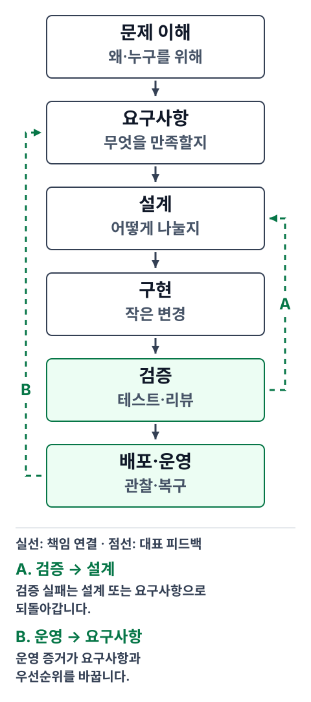

아래 여섯 묶음에서 각 단계가 줄이는 불확실성은 무엇이고, 검증·운영의 증거는 어느 앞선 결정을 다시 살펴보게 하나요?



이 그림은 본문의 발견을 ‘문제 이해’로, 배포·운영을 한 묶음으로, 학습을 피드백으로 요약한 책임 지도이며 대표적인 두 귀환만 보여 주므로, 여덟 단계의 고정 순서나 모든 피드백 경로를 증명하지 않고 배포와 운영의 완료 증거도 하나로 합치지 않습니다.

## 왜 필요한가

AI가 몇 분 만에 화면과 코드를 만들면 발견·요구사항·설계가 사라진 것처럼 보일 수 있습니다. 실제로는 AI가 생략한 결정을 추측해 구현했을 뿐입니다. 그 추측이 틀리면 작동하는 화면을 만든 뒤에야 잘못된 문제, 빠진 권한, 보존할 수 없는 데이터, 배포할 수 없는 구조를 발견합니다.

소프트웨어 개발 생명주기(Software Development Life Cycle, SDLC)는 일을 느리게 만드는 순차 결재표가 아닙니다. 문제에서 운영 결과까지 서로 다른 불확실성을 관리하고, 새 증거가 생기면 어느 결정으로 돌아갈지 찾는 지도입니다.

## 한 문장 정의

SDLC는 발견, 요구사항, 설계, 구현, 검증, 배포, 운영과 학습에 걸쳐 소프트웨어를 만들고 유지하며, 각 단계의 증거로 다음 행동을 정하거나 이전 결정을 수정하는 전체 생명주기입니다.

단계 이름과 묶는 방식은 조직마다 다릅니다. 이 장의 여덟 단계도 독자의 판단을 돕기 위한 편집 지도이지 ISO/IEC/IEEE 12207이 강제하는 고정 순서나 문서 목록이 아닙니다.

## 항해 비유와 한계

SDLC는 목적지를 정하고 항로를 계획해 출항한 뒤 날씨와 계기 신호에 따라 항로를 수정하는 항해와 비슷합니다. 발견은 왜 어디로 가는지, 요구사항은 도착 조건과 제약, 설계는 배와 항로, 구현은 실제 준비, 검증은 출항 전·중 점검, 운영은 운항, 학습은 다음 항로 조정에 대응합니다.

이 비유는 **단계마다 다른 질문이 있고 관측 결과가 계획을 바꾼다**는 점에서만 맞습니다. 소프트웨어는 한 번 출항하면 끝나는 여행이 아니고 여러 기능과 버전이 동시에 다른 단계에 있을 수 있습니다. 요구사항·설계·테스트도 병렬로 발전하며, 운영 중 긴급 완화가 근본 원인 분석보다 먼저 올 수 있습니다. 따라서 이 비유로 한 방향의 고정 순서나 각 단계의 단 한 번 승인을 정당화해서는 안 됩니다.

## 여덟 단계는 서로 다른 불확실성을 줄입니다

| 단계 | 핵심 질문 | 대표 산출물 | 다음으로 가기 전 증거 | 되돌아가는 신호 |
|---|---|---|---|---|
| 발견(discovery) | 누구의 어떤 문제가 왜 중요한가? | 관찰, 문제 진술, 가설, 비목표 | 실제 사용자·업무 맥락과 손실을 확인한 기록 | 문제보다 해결책이 먼저 정해짐, 사용자 근거가 없음 |
| 요구사항(requirements) | 어떤 결과와 제약을 만족해야 하는가? | 사용자 흐름, 수용 기준, 품질 조건, 범위 | 모호한 문장을 관찰 가능한 결과와 실패로 판정 가능 | 이해관계자 해석 충돌, 성공을 측정할 수 없음 |
| 설계(design) | 책임·경계·데이터·실패를 어떻게 배치할 것인가? | 구조 결정, API·데이터 계약, ADR, 복구 계획 | 중요한 위험과 대안, 검증 방법, 변경 신호가 연결됨 | 구현이 불가능하거나 품질·제약을 만족하지 못함 |
| 구현(implementation) | 설계를 검토 가능한 실행 결과로 어떻게 만들 것인가? | 코드, 설정, 마이그레이션, 테스트, 아티팩트 | 작은 변경의 diff와 로컬·자동 검증, 추적 가능한 커밋 | 설계 가정이 코드·제품 제약과 맞지 않음 |
| 검증(verification·validation) | 정한 요구·계약·위험과 실제 사용 목적을 어떤 증거로 판정하는가? | 테스트 결과, 리뷰, 빌드, 접근성·보안·사용 확인 | 대상·환경·범위·결과와 미검증 범위를 재현 가능 | 요구 누락, 오라클 오류, 회귀, 사용자 목적 불일치 |
| 배포(deployment) | 검증한 결과를 어느 환경에 어떻게 안전하게 활성화하는가? | 배포 이력, 환경 설정, 아티팩트·버전, 승인 | 대상 환경에서 상태·스모크·중단 조건·복구 경로 확인 | 환경 차이, 마이그레이션 실패, 보호 게이트 실패 |
| 운영(operations) | 실제 사용자·데이터·서비스 상태는 어떠한가? | 로그·지표·트레이스, 인시던트·복구 기록, 지원 피드백 | 사용자 흐름·권위 상태·서비스 목표와 복구 결과 확인 | 오류·지연·보안·비용·지원 문제가 목표를 벗어남 |
| 학습(learning) | 어떤 가정이 맞거나 틀렸고 다음 결정을 어떻게 바꿀 것인가? | 근거 있는 회고, 우선순위·요구·설계 갱신 | 관찰 기간·대상 버전·반례와 결정 변경을 추적 가능 | 증거 없이 기존 계획을 반복하거나 성공만 선택 보고 |

산출물은 증거를 담는 그릇이지 그 자체가 완료 증거는 아닙니다. PRD 파일이 있다고 요구사항이 검증된 것도, 아키텍처 그림이 있다고 설계가 실행 가능한 것도, 테스트 파일이 있다고 테스트가 실행된 것도 아닙니다.

## 1. 발견: 해결책 전에 문제를 확인합니다

발견은 아이디어를 예쁘게 설명하는 단계가 아닙니다. 실제 사용자, 현재 행동, 손실, 빈도, 기존 대안과 제약을 확인해 “이 문제를 소프트웨어로 풀 가치가 있는가?”를 묻습니다.

모임 앱이라면 “참가 버튼이 필요하다”보다 다음 사실을 봅니다.

- 주최자는 참가자 수를 어디에서 어떻게 관리하나요?
- 참가자는 참가가 확정됐는지 언제 불확실해지나요?
- 중복 신청과 정원 초과가 어떤 피해를 만드나요?
- 수동 목록이나 기존 도구로 해결할 수 없는 이유는 무엇인가요?

인터뷰 문서와 회의 화면이 존재해도 대표 사용자·맥락·반례를 확인하지 않았다면 발견 완료가 아닙니다. 해결책을 먼저 제시한 질문만 하면 사용자가 그 틀 안에서 답하는 편향도 남습니다.

## 2. 요구사항: 목표를 판정 가능한 결과로 바꿉니다

요구사항은 “빠르고 안전하게”, “사용하기 쉽게” 같은 희망을 그대로 적는 일이 아닙니다. 기능 결과, 거절·오류, 품질 조건, 제약, 비목표와 수용 기준으로 바꿉니다.

```text wrap
요구: 인증한 사용자는 모집 중이고 정원이 남은 모임에 한 번 참가할 수 있다.

수용 기준:
- 정상 요청은 권위 데이터에 참가 관계 한 건을 만든다.
- 같은 사용자와 모임의 중복 요청은 두 번째 관계를 만들지 않는다.
- 정원 마감·미인증·권한 없음은 서로 판정 가능한 결과를 돌려준다.
- 응답 손실 뒤 현재 참가 상태를 다시 조회할 수 있다.
- 동시 요청에서도 정원을 넘는 확정 관계가 생기지 않는다.
```

문장을 작성했다는 사실보다 이해관계자들이 같은 예시와 반례를 같은 결과로 판정하는지가 중요합니다. 요구가 구현 세부만 말하거나 실패·제약을 말하지 못하면 발견이나 요구사항으로 돌아갑니다.

## 3. 설계: 책임과 실패를 구현 전에 배치합니다

설계는 프레임워크 목록이나 화면 시안만 뜻하지 않습니다. 구성요소의 책임, 신뢰 경계, 데이터 권위, 인터페이스, 상태 전이, 품질 속성, 실패 영향, 관측과 복구를 결정합니다.

모임 참가에서 중요한 설계 질문은 다음과 같습니다.

- 브라우저 표시와 서버의 참가 승인 중 누가 권위 판단을 맡나요?
- 중복·정원·모집 상태를 어떤 원자적 경계에서 검증하나요?
- 결과가 불명확하면 어떤 식별자로 현재 상태를 재조회하나요?
- 이전 코드와 새 스키마가 함께 실행되는 전환 기간이 있나요?
- 장애 때 신규 참가만 끌 수 있나요, 이미 확정된 데이터는 어떻게 보존하나요?

다이어그램의 상자와 화살표가 있다고 이 질문의 답이 자동으로 생기지 않습니다. 결정 이유, 대안, 가정, 검증 방법과 재검토 신호가 실제 계약에 연결돼야 합니다.

## 4. 구현: 작은 변경으로 결정을 실행합니다

구현은 코드만 작성하는 단계가 아닙니다. 설정·스키마 변경·마이그레이션·테스트·문서·관측 계측과 빌드 아티팩트를 함께 만들어 설계를 실행 가능한 상태로 옮깁니다.

좋은 구현 단위는 독립적인 수용 기준을 가진 수직 조각입니다. diff가 작아도 실제 경계를 연결하지 않으면 통합 위험을 미룹니다. 반대로 여러 파일을 바꾸더라도 한 사용자 결과를 끝까지 구현하고 검토·복구할 수 있다면 하나의 작은 단위일 수 있습니다.

AI의 “구현 완료” 설명은 증거가 아닙니다. 실제 diff, 실행된 명령, 변경한 데이터와 설정, 새 의존성, 테스트 결과와 미검증 범위를 확인합니다.

## 5. 검증: 요구·설계·사용 목적을 서로 다른 증거로 봅니다

검증은 한 번의 테스트 명령이 아닙니다. 정적 분석, 단위·통합·계약·E2E 테스트, 사람 코드 리뷰, 보안·접근성·성능 검사, 사용자 관찰을 위험에 맞게 배치합니다.

이 장의 검증 단계는 정한 명세·계약에 맞는지를 확인하는 verification과 실제 사용 목적을 충족하는지를 확인하는 validation을 포괄하는 편집상 묶음입니다. 둘은 판정 대상의 차이이며 자동화와 사람의 역할로 나누는 구분이 아닙니다.

검증 결과에는 다음이 연결돼야 합니다.

1. 어떤 커밋·아티팩트·환경을 보았는가?
2. 어떤 요구와 위험을 확인했는가?
3. 어떤 명령·시나리오·오라클을 사용했는가?
4. 실행·통과·실패·건너뜀 수와 종료 코드는 무엇인가?
5. 자동화가 확인하지 못해 사람이 본 범위는 무엇인가?
6. 아직 확인하지 못한 범위와 승인할 잔여 위험은 무엇인가?

테스트 코드나 스크린샷이 있다는 사실만으로 대상 버전에서 실행됐다고 말할 수 없습니다. 화면 한 장은 그 순간 보인 픽셀을 보여 줄 뿐 키보드 흐름, 다른 상태, 권위 데이터, 서버 권한과 운영 복구까지 증명하지 않습니다.

## 6. 배포: 검증한 결과를 대상 환경에 활성화합니다

빌드와 배포, 공개와 사용자 성공은 다른 상태입니다. 배포 단계는 검증한 커밋에서 만든 식별 가능한 아티팩트를 올바른 환경과 설정에 전달하고 활성화합니다.

배포 전후에는 다음을 구분합니다.

- 소스 검증이 통과했나요?
- 어느 커밋과 설정으로 어떤 아티팩트를 만들었나요?
- 어느 환경·리전에 어느 버전이 활성화됐나요?
- 스키마·환경 변수·외부 서비스와 호환되나요?
- 배포 작업의 종료와 실제 URL의 응답을 각각 확인했나요?
- 핵심 사용자 흐름과 권위 데이터가 맞나요?
- 중단 기준과 롤백·롤포워드 권한이 준비됐나요?

배포 대시보드의 성공 표시나 URL 존재는 운영 성공의 일부 증거일 뿐입니다. 검증 뒤 아티팩트를 다시 만들었다면 이전 테스트가 새 바이트에 그대로 적용되는지도 확인해야 합니다.

## 7. 운영: 실제 환경에서 사용자 결과와 복구를 책임집니다

운영은 “서버가 켜져 있다”는 상태가 아닙니다. 오류·지연·용량·보안·비용·데이터 최신성, 사용자 지원과 인시던트 대응, 백업과 복원, 변경과 지원 종료를 관리합니다.

로그·지표·트레이스는 서로 다른 신호를 제공하지만 세 종류를 수집했다는 사실로 원인이 규명되지는 않습니다. 모임 참가라면 요청 성공률뿐 아니라 중복·정원 거절의 분모, 결과 불명 후 재조회, 권위 데이터의 불변식과 실제 사용자 영향까지 봅니다.

장애 때는 근본 원인 분석보다 사용자·데이터 손상을 멈추는 완화가 먼저일 수 있습니다. 기능 플래그를 끄거나 트래픽을 제한한 뒤 증거를 보존하고, 수정·복구 뒤 같은 사용자 흐름과 데이터 오라클로 회복을 확인합니다.

## 8. 학습: 운영 증거를 이전 결정에 반영합니다

학습은 회고 회의를 열었다는 사실이 아닙니다. 어떤 가정이 어떤 증거로 지지되거나 반박됐는지, 요구·설계·우선순위·운영 기준 중 무엇을 바꿀지 기록하는 단계입니다.

예를 들어 참가 요청의 오류율은 낮지만 사용자가 확정 여부를 반복 문의한다면 구현 결함보다 요구사항의 결과 불명 상태와 UI 설계가 부족할 수 있습니다. 설계에 재조회 경로가 없다면 운영 문구만 고칠 일이 아니라 요구사항과 인터페이스로 돌아갑니다.

학습 기록에는 대상 버전, 관찰 기간, 사용자 범위, 예상·실제 결과, 반례, 바꿀 결정, 담당자와 다시 확인할 조건이 있어야 합니다. 좋은 결과만 선택해 적으면 다음 판단을 왜곡합니다.

## 피드백과 되돌아가기는 예외가 아니라 정상 흐름입니다

```text
발견 → 요구사항 → 설계 → 구현 → 검증 → 배포 → 운영 → 학습
  ↑        ↑         ↑       ↑       ↑       ↑       ↑       │
  └────────┴─────────┴───────┴───────┴───────┴───────┴───────┘
                     새 증거가 이전 결정을 바꿉니다
```

대표적인 되돌아가기 신호는 다음과 같습니다.

- 구현 중 API가 필요한 업무 상태를 표현하지 못함 → 설계·요구사항
- 테스트는 통과하지만 사용자가 오류를 이해하지 못함 → 요구사항·UI 설계
- 배포 환경에서만 성능 예산을 넘음 → 설계·구현·검증 환경
- 운영에서 인가 우회가 발견됨 → 즉시 완화 후 요구·설계·구현·보안 검증
- 사용자가 기능을 쓰지 않음 → 발견의 문제 가설과 제품 우선순위
- 복구 시험에서 데이터가 돌아오지 않음 → 운영·설계·배포 절차

되돌아갔다고 실패한 프로젝트가 되는 것은 아닙니다. 불확실성을 더 싼 시점에 발견해 결정을 바꾸는 것이 생명주기의 목적입니다.

## 워터폴과 애자일을 단순 대립시키지 않습니다

한 번의 큰 순차 흐름과 짧은 반복 흐름은 이분법이 아닙니다. 규제·안전·하드웨어·대규모 데이터 전환처럼 사전 분석과 승인이 큰 영역이 있고, 사용자 문구·탐색 흐름처럼 빠른 실험이 유리한 영역이 한 시스템 안에 공존합니다.

ISO/IEC/IEEE 12207:2026도 생명주기 과정이 병행·반복·재귀·점진적으로 적용될 수 있으며 특정 생명주기 모델이나 방법론을 요구하지 않는 범위를 밝힙니다. 따라서 “SDLC를 따른다”는 말보다 위험별 피드백 주기, 승인, 산출물과 증거를 설명해야 합니다.

## 위험이 큰 곳에는 더 분명한 게이트가 필요합니다

모든 작업에 같은 문서와 승인 수를 요구하면 가벼운 변경은 느려지고 중요한 위험은 형식 속에 숨습니다. 다음처럼 피해가 큰 경계에는 명시적인 사람 판단과 복구 증거를 강화합니다.

- 결제·재무·의료·법적 결과
- 개인정보·인증·인가·비밀
- 대량 데이터 삭제·변환·마이그레이션
- 공개 API와 외부 소비자 계약
- 운영 접근 권한과 공급망 변경
- 되돌리기 어렵거나 사용자에게 넓게 영향을 주는 배포

게이트는 “문서 제출”이 아니라 다음 상태로 가도 되는지 판단하는 질문과 권한입니다. 실패 조건, 승인 대상, 잔여 위험, 우회·만료와 복구를 기록해야 합니다.

## 흔한 오해와 실패

- **“화면이 동작하니 요구사항이 맞다”**: 구현된 한 경로를 사용자 문제와 수용 전체의 증거로 확대합니다.
- **“PRD가 있으니 발견과 요구사항이 끝났다”**: 실제 사용자 근거와 해석 일치, 반례를 확인하지 않습니다.
- **“다이어그램이 있으니 설계됐다”**: 책임·권위 데이터·실패·복구와 결정 이유가 없습니다.
- **“테스트 파일이 있으니 검증됐다”**: 대상 버전에서 실행한 결과와 오라클을 확인하지 않습니다.
- **“배포 성공이 운영 성공이다”**: 실제 URL, 사용자 흐름, 권위 데이터와 복구를 보지 않습니다.
- **“애자일이면 문서·설계가 필요 없다”**: 결정을 더 자주 내리면서 그 근거와 계약을 잃습니다.
- **“단계로 돌아가면 일정 실패다”**: 틀린 가정을 유지해 나중 비용을 키웁니다.
- **“AI가 생략한 단계는 사라졌다”**: AI의 암묵적 추측을 승인된 결정으로 착각합니다.

## AI와 작업할 때의 요청 계약

```text wrap
이 작업을 발견 → 요구사항 → 설계 → 구현 → 검증 → 배포 → 운영 → 학습의 생명주기 지도로 정리해 주세요.

각 단계마다 다음을 작성해 주세요.
- 줄이려는 불확실성과 핵심 질문
- 입력 사실과 아직 가정인 내용
- 필요한 최소 산출물
- 다음 상태로 가기 위한 증거와 승인 주체
- 문서·코드·화면 존재만으로는 증명되지 않는 범위
- 실패·반례가 나오면 돌아갈 단계
- 안전한 중단·복구 조건

현재 단계라고 주장하는 근거를 실제 파일·diff·명령·종료 코드·테스트 수·아티팩트·환경·사용자 흐름·운영 신호에 연결해 주세요. 누락된 정보는 추측해 완료 처리하지 말고 결정 대기로 표시해 주세요.
```

AI가 “요구사항 완료”, “검증 완료”, “운영 준비 완료”라고 답하면 산출물 이름보다 어떤 반례를 어떤 증거로 배제했는지 물어야 합니다.

## 확인 체크리스트

- [ ] 해결책 전에 실제 문제와 기존 대안을 확인했나요?
- [ ] 요구사항을 정상·거절·결과 불명·품질·비목표로 판정할 수 있나요?
- [ ] 설계가 책임·신뢰 경계·권위 데이터·실패·관측·복구를 다루나요?
- [ ] 구현 변경이 수용 기준과 설계 결정에 추적되나요?
- [ ] 검증 증거가 대상 버전·환경·범위·오라클과 연결되나요?
- [ ] 문서·코드·테스트·화면 존재를 실행·수용 증거와 구분했나요?
- [ ] 아티팩트가 검증한 소스 커밋·빌드 설정·의존성에서 생성됐나요?
- [ ] 검증한 아티팩트와 실제 배포한 아티팩트의 식별자·체크섬이 일치하나요?
- [ ] 운영에서 사용자 흐름·데이터·서비스·복구를 확인했나요?
- [ ] 새 증거가 어느 이전 결정과 우선순위를 바꾸는지 기록했나요?
- [ ] 위험에 맞춰 피드백 주기와 사람 승인 게이트를 조정했나요?

## 짧은 연습

최근 AI에게 맡긴 기능 하나를 여덟 단계 표에 배치하세요. 각 단계에 산출물 하나와 실제 증거 하나를 따로 적고, “파일이나 화면은 있지만 증명되지 않은 것”을 한 줄씩 찾으세요. 마지막으로 검증·배포·운영에서 반례가 발견됐을 때 각각 어느 단계로 돌아갈지 화살표를 그려 보세요.

## 관련 용어

- [개발 용어집](../../reference/development-glossary/)의 `SDLC`, `requirement`, `acceptance criterion`, `architecture`, `implementation`, `verification`, `validation`, `deploy`, `operations evidence`
- [방법론 관계 지도](../../reference/methodology-map/)에서 SDLC와 Agile·팀·흐름·운영 방식의 포함·중첩 관계를 구분합니다.
- [PRD·두 종류의 SDD·TDD](../../06-requirements-design/prd-sdd-tdd/)
- [아키텍처·기술 스택·프레임워크](../../06-requirements-design/architecture-and-frameworks/)
- [점진적 전달](../incremental-delivery/)
- [코드 리뷰와 CI/CD](../code-review-ci-cd/)
- [테스트 전략](../../08-quality/testing-strategy/)

## 출처와 적용 범위

- [ISO/IEC/IEEE 12207:2026 공식 소개](https://www.iso.org/standard/90219.html)는 2026년 4월 발행된 Edition 2 국제 표준으로 소프트웨어의 conception·development·operation·support·retirement에 걸친 생명주기 과정과 병행·반복·재귀·점진 적용 가능성을 다룹니다. 이 장의 여덟 단계, 산출물 표와 완료 증거를 표준이 강제한다고 확대하지 않습니다.
- [NIST SP 800-218 SSDF 1.1](https://csrc.nist.gov/pubs/sp/800/218/final)은 2022년 2월 Final 권고로 보안 실무를 특정 SDLC 모델과 무관하게 생명주기 전체에 통합하는 범위를 뒷받침합니다. NIST의 고수준 결과 지침을 특정 구현 도구나 모든 조직의 법적 의무로 일반화하지 않습니다.
- [Agile Manifesto 원칙](https://agilemanifesto.org/principles)은 작동하는 소프트웨어의 빈번한 전달과 정기적인 성찰·조정을 설명하는 2001년 원문입니다. 특정 단계 이름·스프린트 길이·승인 구조를 정하는 표준으로 사용하지 않습니다.

## 기억할 문장

**생명주기의 단계는 문서 폴더가 아니라 서로 다른 불확실성을 줄이는 질문이며, 완료는 산출물의 존재가 아니라 다음 결정을 지지하는 증거로 판정합니다.**
