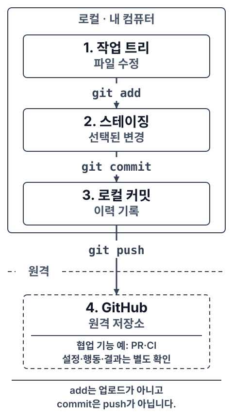

## 먼저 결론

- **Git**: 파일 변경 이력과 브랜치를 주로 로컬 저장소에서 관리하는 분산 버전 관리 시스템입니다.
- **GitHub**: Git 저장소를 네트워크의 원격 공간에 보관하고 Pull Request, 리뷰, Issue, Actions와 권한 관리 같은 협업 기능을 제공하는 서비스입니다.
- **안전한 변경 관리**: 파일을 저장하는 일, 스테이징, 커밋, push, Pull Request, 병합과 배포를 서로 다른 상태와 승인 단계로 확인하는 일입니다.

GitHub에 로그인하지 않아도 Git으로 로컬 커밋과 브랜치를 만들 수 있습니다. Git 저장소가 GitHub에 있다고 해서 변경이 자동으로 커밋·push·검토·배포되는 것도 아닙니다.

## 왜 필요한가

AI 코딩 도구는 짧은 시간에 여러 파일을 만들고 수정하고 삭제할 수 있습니다. 결과 화면만 보면 의도한 기능이 동작하는 것처럼 보여도, diff에는 무관한 포맷 변경, 설정 파일 삭제, 생성물, 대용량 데이터나 비밀정보가 섞일 수 있습니다. Git을 모르면 AI의 “변경을 저장했습니다”, “커밋할 준비가 됐습니다”, “브랜치가 깨끗합니다”라는 말을 어떤 상태와 명령으로 확인해야 하는지 판단하기 어렵습니다.

Git은 이러한 위험을 자동으로 없애는 안전장치가 아닙니다. 변경을 비교하고 의미 있는 지점을 남기며 다른 작업선과 합칠 수 있는 도구입니다. 잘못된 범위를 그대로 커밋하거나 비밀을 원격에 push하면 Git은 그 실수도 충실하게 기록하고 공유합니다.

이 장의 목표는 명령을 많이 외우는 것이 아니라 다음 질문에 답하는 것입니다.

1. 지금 보고 있는 파일은 어느 저장소와 브랜치의 상태인가요?
2. 변경은 작업 트리, 스테이징, 로컬 커밋과 원격 중 어디까지 갔나요?
3. `git diff`가 보여주지 않는 새 파일이나 이미 스테이징된 변경은 없나요?
4. 커밋 후보가 한 가지 목적과 검증 증거로 설명되나요?
5. commit·push·Pull Request·merge·deploy 중 사용자가 승인한 단계는 어디까지인가요?

## 한 문장 정의

**버전 관리(version control)**: 파일의 변화와 그 변화 사이의 관계를 기록해 특정 시점의 상태를 비교하고, 작업을 나누고, 검토하고, 필요한 경우 복구할 수 있게 만드는 방식입니다.

Git은 이 역할을 수행하는 도구이고 GitHub는 Git 저장소를 중심으로 협업하는 하나의 호스팅 서비스입니다. GitHub 외의 원격 서비스를 쓸 수도 있고, 하나의 로컬 저장소에 여러 원격을 등록할 수도 있습니다.

## 편집실에 비유하기

한 권의 핸드북을 여러 사람이 편집한다고 생각해 보겠습니다.

- 작업 트리는 지금 책상 위에서 고치는 원고입니다.
- 스테이징 영역은 다음 판본에 넣기로 골라 둔 원고 묶음입니다.
- 커밋은 선택한 원고 묶음에 설명과 이전 판본의 관계를 붙인 이력 지점입니다.
- 브랜치는 특정 판본에서 갈라져 이어지는 편집 작업선입니다.
- 원격 저장소는 다른 사람과 이력을 주고받는 공유 보관소입니다.
- Pull Request는 내 작업선을 기준 작업선에 합치기 전에 내용과 증거를 검토해 달라는 요청입니다.
- 배포는 승인된 판본을 실제 독자가 읽는 장소에 전달하는 별도 과정입니다.

이 비유가 맞는 지점은 “현재 편집 중인 것”, “다음 이력에 넣기로 고른 것”, “이미 기록된 것”과 “다른 사람에게 공유한 것”이 서로 다른 상태라는 점입니다.

### 비유가 깨지는 지점

Git은 단순히 날짜별 폴더 사본을 쌓는 도구가 아닙니다. 각 커밋은 프로젝트 상태와 부모 커밋의 관계를 가진 그래프를 만들고, 브랜치는 폴더 복사본보다 특정 커밋을 가리키며 이동하는 이름에 가깝습니다. 분산 버전 관리이므로 clone한 저장소는 일반적으로 자체 커밋 이력을 가지며, 네트워크의 한 중앙 서버가 항상 있어야만 작업할 수 있는 것도 아닙니다.

또한 커밋은 자동 백업·검토·테스트가 아닙니다. 잘못된 내용도 커밋할 수 있고, 로컬 저장 장치가 손상되면 아직 다른 위치에 공유하지 않은 이력을 잃을 수 있습니다.

## Git이 관리하는 주요 상태

### 저장소와 작업 트리

**저장소(repository)**: Git이 커밋과 브랜치·태그 같은 이력 정보를 관리하는 범위입니다. **작업 트리(working tree)**: 현재 체크아웃해 화면에서 읽고 수정하는 파일 상태입니다.

명령을 실행하는 폴더가 저장소 안인지, 저장소의 최상위 경계가 어디인지 먼저 확인해야 합니다. 상위 프로젝트 안에 다른 저장소가 중첩돼 있거나 엉뚱한 폴더에서 명령을 실행하면 예상과 다른 파일을 보거나 놓칠 수 있습니다.

`git rev-parse --show-toplevel`은 현재 위치가 속한 저장소의 최상위 경로를 확인하는 데 쓸 수 있습니다. 이 출력에는 사용자 컴퓨터의 절대 경로가 포함될 수 있으므로 공개 로그나 문서에 그대로 복사할 때는 개인정보가 없는지 확인합니다.

### 추적됨·추적되지 않음·무시됨

- **tracked**: Git 이력이나 스테이징 영역이 알고 있는 파일입니다.
- **untracked**: 작업 폴더에는 있지만 아직 Git이 이력 대상으로 등록하지 않은 파일입니다. 짧은 상태에서 `??`로 보일 수 있습니다.
- **ignored**: `.gitignore` 같은 규칙에 따라 기본 상태 목록과 추가 대상에서 제외되는 파일입니다.

untracked는 “안전한 임시 파일”이라는 뜻이 아닙니다. 새 소스 파일일 수도 있고, 비밀·대용량 데이터·개인 설정일 수도 있습니다. 반대로 `.gitignore`는 보안 금고가 아니며 이미 추적 중인 파일을 이력에서 자동 제거하지 않습니다. 비밀이 한 번 커밋됐다면 ignore 규칙만 추가해도 과거 이력의 비밀은 사라지지 않습니다.

### 스테이징 영역

**스테이징 영역(staging area, index)**: 다음 커밋에 들어갈 스냅샷을 준비하는 중간 상태입니다. `git add`는 파일을 GitHub에 업로드하는 명령이 아니라 그 시점의 선택한 내용을 스테이징합니다.

한 파일을 스테이징한 뒤 다시 수정하면 같은 파일에 스테이징된 변경과 아직 스테이징되지 않은 변경이 동시에 존재할 수 있습니다. 따라서 “이 파일을 add했다”보다 `git diff --staged`에 실제로 어떤 내용이 들어 있는지 확인해야 합니다.

### 커밋·브랜치·HEAD

**커밋(commit)**: 스테이징된 프로젝트 상태, 작성 정보, 설명과 부모 관계를 로컬 이력에 기록한 지점입니다. 커밋 ID는 그 커밋을 식별하지만, 커밋이 옳고 안전하다는 인증 마크는 아닙니다.

**브랜치(branch)**: 보통 특정 커밋을 가리키는 이동 가능한 작업선 이름입니다. **HEAD**: 현재 체크아웃한 브랜치 또는 커밋을 가리키는 현재 위치입니다. 브랜치를 만든다고 파일 폴더가 자동으로 복제되는 것은 아니며, 일반 작업 폴더에서 브랜치를 전환하면 같은 위치의 파일 상태가 달라집니다.

동시에 여러 브랜치를 별도 폴더에서 작업하려면 [권한·샌드박스·worktree](../../11-ai-native/permissions-sandbox-worktrees/)에서 설명한 Git worktree를 사용할 수 있습니다. worktree도 데이터베이스·포트·캐시와 외부 서비스를 자동 격리하지는 않습니다.

## 작업 트리에서 GitHub까지의 흐름

어디까지가 내 컴퓨터 안의 상태이고 어떤 행동이 원격으로 보내는지, 아래 그림의 로컬·원격 경계와 세 명령을 따라 확인해 보세요.



이 그림의 화살표는 모두 별도의 행동입니다.

1. 파일 저장은 작업 트리를 바꿉니다.
2. `git add`는 선택한 현재 내용을 스테이징합니다.
3. `git commit`은 스테이징된 상태를 로컬 이력에 기록합니다.
4. `git push`는 로컬 커밋과 브랜치 정보를 원격으로 보냅니다.
5. Pull Request는 원격의 작업 브랜치를 기준 브랜치와 비교해 검토를 요청합니다.
6. merge는 변경 이력을 기준 브랜치에 통합합니다. 로컬 `git merge`는 로컬 상태를 바꾸고, GitHub의 PR 병합은 원격 기준 브랜치를 바꿉니다.
7. build와 deploy는 해당 소스에서 산출물을 만들고 대상 환경에 전달합니다.

앞 단계가 끝났다고 다음 단계가 자동으로 증명되지는 않습니다. 커밋됐지만 push되지 않을 수 있고, push됐지만 Pull Request가 없을 수 있으며, PR이 승인됐지만 병합되지 않았을 수 있습니다. 병합됐어도 배포되지 않았거나, 배포됐어도 실제 사용자 흐름이 실패할 수 있습니다.

## GitHub가 추가하는 협업 계층

Git 자체에는 GitHub의 Pull Request, Issue와 Actions라는 개념이 없습니다. GitHub는 Git 이력 위에 다음 협업 기능을 더합니다.

- **원격 저장소**: 팀이 커밋과 브랜치를 주고받는 네트워크상의 저장소입니다.
- **Pull Request**: 두 브랜치의 차이, 설명, 리뷰와 자동 검증을 한 검토 단위로 모읍니다.
- **리뷰와 보호 규칙**: 승인 수, 담당자, 병합 가능 조건과 기준 브랜치 보호를 관리합니다.
- **Actions와 checks**: push나 Pull Request 같은 이벤트에서 테스트·빌드·정적 검사를 실행할 수 있습니다.
- **Issue와 프로젝트 기능**: 문제, 요구와 작업 상태를 코드 변경과 연결합니다.
- **release와 배포 연동**: 태그·변경 기록·아티팩트를 공개하거나 외부 배포 시스템을 촉발할 수 있습니다.

이 기능이 설정돼 있다는 사실과 실제로 실행·통과·승인됐다는 사실을 구분해야 합니다. 녹색 check도 실행한 워크플로 범위만 증명하며, 사람 리뷰도 독립성과 검토 범위가 부족하면 중요한 위험을 놓칠 수 있습니다.

## 로컬 브랜치와 원격 상태를 구분하세요

`origin`은 GitHub 자체를 뜻하는 예약어가 아니라 clone하거나 원격을 추가할 때 흔히 쓰는 원격 이름입니다. 다른 이름을 쓸 수도 있고 원격이 여러 개일 수도 있습니다.

로컬 `main`과 `origin/main`은 같은 이름처럼 보여도 다른 참조입니다. `origin/main`은 마지막으로 원격과 통신했을 때 로컬 Git이 알고 있던 원격 브랜치 상태를 나타내므로 오래됐을 수 있습니다.

- `git fetch`: 원격의 새 이력과 참조 정보를 가져오지만 일반적으로 현재 작업 트리에 자동 병합하지는 않습니다. 네트워크와 원격 접근 권한이 필요하고 로컬의 원격 추적 상태는 바뀝니다.
- `git pull`: fetch한 뒤 설치 버전·옵션·설정에 따라 fast-forward만 허용하거나 merge·rebase·squash 방식으로 변경을 반영합니다. 이력이 갈라졌을 때 통합을 거절할 수도 있고, squash는 결과를 준비하되 그 자체로 새 커밋을 만들지는 않습니다. 작업 파일과 이력이 달라질 수 있으므로 현재 버전과 설정을 확인하며 단순한 “새로고침”으로 취급하지 않습니다.
- `git push`: 로컬의 커밋과 참조를 원격에 보냅니다. 공유 이력, CI, 알림 또는 배포 자동화를 촉발할 수 있으므로 별도 승인 경계로 둡니다.

GitHub 웹 화면이 최신이라고 해서 로컬 작업 트리가 최신인 것은 아니고, 로컬 `git status`가 깨끗하다고 해서 원격과 같은 상태라는 뜻도 아닙니다.

## `status`와 `diff`가 각각 보여주는 증거

### `git status --short --branch --untracked-files=all`

현재 브랜치, upstream과의 차이, tracked 파일의 변경, 스테이징 여부와 untracked 파일을 요약합니다. 안전 점검에서는 `--untracked-files=all`을 명시해 새 디렉터리 내부의 파일도 열거합니다. 기본 status는 설정에 따라 untracked 파일을 숨기거나 디렉터리로 묶을 수 있습니다. 이 옵션도 ignored 파일을 포함하지 않으므로 무시 규칙과 필요한 제외 파일은 별도로 확인합니다.

`working tree clean`은 Git이 현재 기준에서 커밋되지 않은 tracked·untracked 변경을 보고하지 않는다는 뜻입니다. ignore된 파일, 원격의 최신 상태, 테스트 성공과 운영 상태까지 증명하지는 않습니다.

### `git diff`

기본적으로 작업 트리의 tracked 변경과 스테이징 영역을 비교합니다. 아직 스테이징하지 않은 변경을 읽는 데 유용하지만 새 untracked 파일의 내용과 이미 스테이징된 변경은 기본 출력에 나타나지 않습니다.

따라서 출력이 비었다고 작업 전체가 깨끗하다고 결론 내리지 말고 `git status`와 함께 봅니다. 이름 변경, 파일 모드, 큰 삭제와 바이너리 파일은 본문 줄 차이만으로 의도를 이해하기 어려울 수 있습니다.

### `git diff --staged`

스테이징 영역과 현재 커밋을 비교해 다음 커밋에 들어갈 tracked 변경을 보여줍니다. 첫 커밋 전처럼 비교할 HEAD 커밋이 없으면 스테이징한 내용 전체를 보여줍니다. 커밋 직전 가장 직접적인 내용 증거이지만 스테이징되지 않은 수정과 untracked 파일은 별도로 남아 있을 수 있습니다.

### `git diff HEAD`

현재 커밋인 HEAD와 최종 tracked 작업 트리 사이의 순변화를 보여줍니다. staged·unstaged 변경을 각각 나열한 합집합이 아닙니다. HEAD의 내용 A를 B로 바꿔 스테이징한 뒤 작업 파일만 A로 돌려놓으면 `git diff HEAD`는 비어도 index에는 B가 남습니다. 따라서 `git diff --staged`와 기본 diff를 별도로 읽어야 합니다. untracked 파일 내용은 자동으로 포함하지 않으며 첫 커밋 전에는 HEAD 커밋이 없어 이 명령이 실패합니다.

세 diff는 이름이 비슷하지만 비교 기준이 다릅니다.

| 명령 | 비교하는 두 상태 | 직접 확인하는 질문 | 이 명령만으로 확인하지 못하는 것 |
|---|---|---|---|
| `git diff` | 작업 트리 ↔ 스테이징 영역 | 아직 스테이징하지 않은 tracked 변경은 무엇인가요? | 이미 스테이징된 변경, untracked 파일 내용 |
| `git diff --staged` | 스테이징 영역 ↔ `HEAD` | 다음 커밋에 들어갈 tracked 변경은 무엇인가요? | 스테이징하지 않은 변경, untracked 파일 내용 |
| `git diff HEAD` | 작업 트리의 tracked 상태 ↔ `HEAD` | HEAD와 최종 작업 파일 사이의 순변화는 무엇인가요? | 서로 상쇄된 staged·unstaged의 별도 상태, untracked 파일 내용, 원격의 최신 상태 |

따라서 `git status --short --branch --untracked-files=all`로 표시 범위를 명시한 상태 지도를 먼저 보고 세 비교 중 필요한 것을 고릅니다. 첫 커밋 전에는 status·새 파일 내용·`git diff --staged`를 사용하고 `git diff HEAD`를 정상 비교로 기대하지 않습니다. 명령 이름을 외우기보다 “어느 두 상태를 비교하는가?”를 말할 수 있어야 빈 출력을 변경 없음으로 잘못 해석하지 않습니다.

### 이력과 위치를 보는 읽기 명령

- `git log --oneline --decorate -n 10`: 최근 커밋과 브랜치·태그 위치를 요약합니다.
- `git branch --show-current`: 현재 브랜치 이름을 확인합니다. 특정 커밋을 직접 체크아웃한 상태에서는 빈 결과일 수 있습니다.
- `git remote -v`: 등록된 원격 이름과 가져오기·보내기 주소를 확인합니다. URL에 민감한 사용자명이나 토큰이 포함되지 않았는지 공개 전에 점검합니다.

읽기 명령의 출력도 대상 저장소와 시점이 맞아야 증거가 됩니다. 다른 worktree나 오래된 터미널 출력은 현재 작업의 상태를 대신하지 않습니다.

## “변경 없음”과 “커밋 준비 완료”를 혼동하지 마세요

다음과 같은 상태를 생각해 보겠습니다.

```text
## No commits yet on main
?? README.md
?? src/
?? package.json
```

이 저장소에는 아직 기준 커밋이 없고 모든 표시 파일이 untracked입니다. 이때 `git diff`가 비어 있을 수 있지만 변경이 없다는 뜻은 아닙니다. 비교할 tracked 기준이 없기 때문입니다. 각 새 파일의 내용, 생성물·비밀·대용량 파일 포함 여부와 저장소 경계를 먼저 검토해야 합니다.

반대로 tracked 파일을 모두 스테이징했다면 기본 `git diff`가 비어도 `git diff --staged`에는 변경이 있을 수 있습니다. 하나의 명령 출력만으로 “깨끗함”이나 “커밋 준비”를 판정하지 않는 이유입니다.

## 커밋은 저장 버튼보다 검토 가능한 변경 단위입니다

좋은 커밋 후보는 다음 질문에 답할 수 있습니다.

- 한 가지 사용자 동작, 결함 수정 또는 문서 결정으로 설명되나요?
- 요구와 실제 diff가 일치하나요?
- 필요한 테스트·문서·스키마가 같은 변화와 함께 맞춰졌나요?
- 무관한 포맷·이름 변경·의존성·생성물이 섞이지 않았나요?
- 이 커밋만 취소할 때 다른 독립 동작을 불필요하게 잃지 않나요?

파일 하나씩 억지로 나누는 것이 작은 커밋은 아닙니다. 동작을 바꾼 코드와 그 동작을 확인하는 테스트를 서로 다른 불완전한 커밋으로 나누면 독립 검토와 복구가 어려워질 수 있습니다. 자세한 작업선·커밋·PR 분할은 [브랜치·커밋·Pull Request](../branch-commit-pull-request/)에서 다룹니다.

## 개발 사례: 모임 참가 웹앱

### W-03 참가·중복 신청 방지의 Git 안전 경계

모임 참가 웹앱의 W-03은 자신의 참가·취소 흐름이며, 이 가운데 중복 신청 방지 요구는 같은 사용자가 같은 모임에 활성 참가를 두 번 만들 수 없게 하는 것입니다. 이 요구를 다음처럼 하나의 검토 가능한 작업 단위로 묶으면 코드 한 줄이 아니라 동작·데이터·증거가 함께 바뀌었는지 확인할 수 있습니다.

- **요구:** 동일 사용자·동일 모임의 활성 참가는 한 건만 존재해야 합니다.
- **예상 변경:** 참가 서비스, 활성 참가를 보호하는 데이터 제약, 정상 참가와 중복 신청 테스트, 관련 문서입니다.
- **검토:** `git status`로 전체 변경 지도를 보고, unstaged diff인 `git diff`와 staged diff인 `git diff --staged`를 각각 읽어 요구 밖의 파일·삭제·설정 변경이 없는지 확인합니다. 테스트에는 실제 계정·개인정보·비밀·운영 데이터가 아니라 가상임을 명시한 fixture만 사용하고, 비밀이나 개인 설정이 커밋 후보에 섞이지 않았는지도 확인합니다.
- **커밋:** 첫 참가 성공, 중복 신청의 안전한 거절과 데이터 불변이라는 수용 기준 및 관련 테스트를 통과한 파일만 로컬 commit으로 기록합니다.
- **별도 승인:** push, Pull Request 생성, GitHub에서의 PR 병합과 배포는 원격 이력·협업자·운영 환경을 바꾸는 서로 다른 외부 상태 변경이므로 각각 승인과 직접 증거가 필요합니다. 로컬 `git merge`는 로컬 브랜치·index·작업 트리를 바꿀 수 있는 별도 로컬 변경이며 그 승인 범위를 확인합니다.

예를 들어 참가 서비스와 테스트 변경 옆에 요구와 무관한 UI 포맷 변경이 보인다면 모두 한꺼번에 스테이징하지 않습니다. `git status`로 관련 경로를 나누고 `git diff`에서 변경 조각별 목적을 확인한 뒤, 독립적으로 검증하고 되돌릴 수 있는 참가 서비스·데이터 제약·테스트·문서만 경로나 변경 조각 단위로 스테이징합니다. 한 파일 안에서 관련 변경과 UI 포맷 변경을 안전하게 나눌 수 없다면 파일 전체를 커밋 후보로 넣지 말고, 보존할 사용자 작업과 분리 방법을 먼저 확인합니다. 스테이징 뒤에는 `git diff --staged`에 UI 포맷 변경이 없고 `git status`가 의도적으로 남겨 둔 unstaged 변경을 정확히 보여 주는지 다시 확인합니다.

부분 스테이징 뒤에는 테스트한 작업 트리와 커밋할 스냅샷이 다를 수 있습니다. 예를 들어 테스트는 통과했어도 필요한 데이터 제약을 index에서 제외했다면 그 결과는 후보의 성공 증거가 아닙니다. 제외한 변경의 의존성과 영향을 확인하고, 필요하면 사용자 작업을 그대로 보존한 별도 환경에서 후보 스냅샷을 검증합니다.

실패를 복구할 때는 명령보다 먼저 “어떤 작업과 상태를 반드시 보존해야 하나요?”라고 묻습니다.

| 현재 상태 | 먼저 확인할 보존 질문 | 복구 판단 |
|---|---|---|
| 아직 커밋하지 않은 사용자 작업 | 어느 파일과 변경 조각이 사용자의 기존 작업이며 이번 중복 방지 변경과 무관한가요? | 기존 작업을 덮어쓰지 않도록 범위를 분리하고, 이번 변경만 수정하거나 제외합니다. |
| 로컬에만 있는 커밋 | 이 커밋이 정말 공유되지 않았고 이후 로컬 작업이 의존하지 않나요? | 새 수정 커밋을 만들지 로컬 이력을 조정할지는 브랜치·의존 관계·보존 지점을 확인한 뒤 결정합니다. |
| 이미 공유된 커밋 | 누가 이 커밋을 받았고 어떤 PR·CI·후속 작업이 의존하나요? | 공유 이력을 임의로 다시 쓰지 않고 협업자와 영향 범위를 확인해 이력이 남는 교정 방식을 선택합니다. |
| 이미 바뀐 운영 상태 | 어떤 Git commit과 배포가 적용됐고 스키마·데이터베이스에서 이미 `commit`된 참가 상태·백업과 복원 증거는 어떤 상태인가요? | 코드 이력과 배포·데이터 복구를 분리하고, 운영 쓰기 제한·마이그레이션·복원·사용자 상태 재확인이 필요한지 판단합니다. |

이 네 상태는 보존 대상과 영향 범위가 다르므로 한 명령으로 모두 되돌릴 수 있다고 가정하지 않습니다. 현재 상태를 분류하기 전에 파괴적 명령을 실행하지 않고, 특히 운영 데이터는 Git만으로 복구할 수 없다는 기존 경계를 유지합니다.

## AI 변경을 검토하는 최소 안전 루프

1. **시작 상태 확인**: 저장소 최상위, 현재 브랜치, `git status --short --branch --untracked-files=all`과 기존 사용자 변경을 확인합니다. ignored 파일은 별도입니다.
2. **목표와 경계 고정**: 수정할 파일, 건드리지 않을 파일, 새 의존성·네트워크·데이터·Git 권한을 정합니다.
3. **작은 변경 수행**: 한 번에 독립적으로 검토하고 되돌릴 수 있는 목표 하나만 맡깁니다.
4. **실제 파일 검토**: untracked 전체 표시를 명시한 status로 새 파일·삭제·이름 변경을 보고, diff와 untracked 파일 내용을 요구와 대조합니다.
5. **검증 실행**: 변경 위험에 맞는 테스트·정적 검사·빌드·브라우저·데이터 검증의 정확한 명령과 결과를 확인합니다.
6. **스테이징 후보 선택**: 경로와 변경 조각을 명시적으로 고르고 생성물·비밀·개인 설정·대용량 데이터가 없는지 봅니다.
7. **스테이징 diff와 검증 대상 재검토**: `git diff --staged`가 한 목적과 검증 증거로 설명되는지 확인합니다. 일부 조각만 스테이징했거나 검증 이후 변경됐다면, 테스트한 작업 트리와 후보 스냅샷의 차이·의존성을 확인합니다. 제외한 코드나 설정 때문에만 통과했을 가능성이 있으면 기존 결과를 후보의 성공 증거로 쓰지 않고, 기존 사용자 작업을 보존한 별도 환경에서 필요한 후보 검증을 수행합니다. 자동 stash나 변경 삭제로 상태를 맞추지 않습니다.
8. **로컬 커밋 승인**: 메시지와 범위가 사용자의 승인 또는 명시적인 상시 승인 정책 안에 있는지 확인한 뒤 커밋합니다.
9. **외부 공유 별도 승인**: push, Pull Request 생성, GitHub에서의 PR 병합과 deploy는 각각 외부 상태와 다른 사람에게 영향을 주는 별도 단계로 승인합니다.

이 승인 절차는 Git 명령의 내장 조건이 아니라 핸드북의 작업 안전 정책입니다. 이미 승인된 범위와 상시 정책은 따르되 로컬 변경 승인을 원격 쓰기 승인으로 확대하지 않습니다.

테스트가 통과해도 diff를 읽어야 하고, diff가 의도대로 보여도 테스트·빌드·실제 화면이 필요할 수 있습니다. 서로 다른 증거가 서로의 빈틈을 보완합니다.

### 읽기 전용 점검 지시 예

```text
다음을 읽고 수정 없이 점검하라.
- 저장소 규칙과 요구사항
- 현재 브랜치와 git status
- 변경 파일과 최근 검증 출력

변경 상태를 다음처럼 구분하라.
- tracked·untracked·ignored 가능성
- 사용자 기존 변경과 이번 작업 변경
- 생성물·개인 설정·비밀·대용량 데이터

git diff와 git diff --staged, 새 파일이 각각 보여주지 않는 범위를 표시하라.

각 변경을 수용 기준과 연결하라.
무관한 변경·삭제·권한·이름 변경을 표시하라.

테스트·빌드 명령의 범위와 종료 코드를 확인하라.
미실행과 실행 불가를 성공으로 쓰지 마라.

다음을 별도 승인 단계로 보라.
- commit과 push
- Pull Request와 merge
- build와 deploy
어느 단계도 실행하지 마라.

되돌리기 명령을 실행하지 마라.
보존할 작업과 안전한 복구 후보만 설명하라.
```

## 저장소에 넣지 말아야 할 것

Git은 텍스트 소스와 작은 재현 자료를 추적하는 데 강하지만 모든 파일의 기본 저장소는 아닙니다.

- `.env`, 토큰, 개인 키와 인증서 같은 비밀
- 개인정보와 회사 내부 원본 데이터
- 라이선스나 재배포 권한이 불명확한 자료
- 다시 만들 수 있는 거대한 빌드 산출물과 캐시
- 저장소 크기와 리뷰를 방해하는 대용량 데이터·모델·바이너리
- 편집기·운영체제의 개인 설정과 임시 파일

데이터 분석 프로젝트에서는 수집·변환 코드, 스키마, 작은 합성 fixture, 원천 목록, 버전·체크섬과 재현 명령을 Git에 두고 대용량 데이터는 크기·권한·보존 정책에 맞는 별도 저장소를 검토합니다. `.gitignore`만 믿지 말고 커밋 직전 status와 스테이징 diff, 파일 크기와 비밀 검사를 함께 확인합니다.

## Git과 백업을 같은 것으로 보지 마세요

원격 저장소는 로컬 장치 손실에 대한 복사본 역할을 일부 할 수 있지만 완전한 백업 전략은 아닙니다. 잘못된 push, 계정·권한 문제, 저장소 삭제, Git 밖의 데이터베이스와 업로드 파일, 대용량 외부 데이터는 별도 보존과 복구가 필요합니다.

Git 커밋으로 애플리케이션 데이터를 이전 상태로 돌릴 수 있다고 가정해서도 안 됩니다. 코드, 데이터 스키마, 실제 데이터와 외부 서비스의 상태는 서로 다른 복구 절차가 필요할 수 있습니다.

## 흔한 오해와 실패

### Git과 GitHub를 같은 제품으로 봅니다

Git 오류인지 GitHub 인증·권한·네트워크 오류인지 구분하지 못해 원인을 잘못 고칩니다. 문제가 로컬 이력과 작업 트리인지, 원격 서비스와 협업 설정인지 먼저 나누세요.

### `git add`를 업로드로 이해합니다

파일이 이미 공유됐다고 생각하거나 스테이징된 내용을 확인하지 않습니다. add는 로컬의 다음 커밋 후보를 준비하며, push가 원격 공유 단계입니다.

### `git diff`가 비면 변경이 없다고 결론 냅니다

스테이징된 변경과 untracked 파일이 빠질 수 있습니다. status, 기본 diff, 스테이징 diff와 새 파일 내용을 함께 봅니다.

### 커밋이 테스트와 백업을 보장한다고 생각합니다

잘못된 코드와 비밀도 커밋할 수 있고 로컬 커밋은 다른 장치에 없을 수 있습니다. 검증 증거와 외부 보존 정책을 별도로 확인하세요.

### push를 저장 버튼처럼 승인합니다

원격 이력, CI, 알림과 배포가 바뀔 수 있습니다. 로컬 커밋과 외부 push 권한을 분리하고 대상 원격·브랜치·보호 규칙을 확인하세요.

### pull을 무해한 새로고침으로 사용합니다

버전·옵션·설정에 따라 fast-forward만 허용하거나 merge·rebase·squash 방식으로 반영하며 통합을 거절할 수도 있습니다. 시작 상태와 로컬 변경을 확인하고 fetch와 통합을 구분하세요.

### `.gitignore`를 비밀 삭제 기능으로 봅니다

이미 커밋된 비밀은 이력에 남을 수 있습니다. 노출된 자격 증명은 폐기·교체하고 이력 정리는 영향과 협업자를 고려한 별도 보안 절차로 다뤄야 합니다.

### AI 요약만 읽고 실제 diff를 건너뜁니다

요약은 의도에 대한 주장이고 diff는 실제 파일 변화의 증거입니다. 삭제, 권한·이름 변경, 설정과 데이터 경계를 요구사항과 직접 대조하세요.

### 복구 명령을 상태 분류 없이 실행합니다

restore, revert와 reset은 보존하는 이력과 바꾸는 상태가 다릅니다. 파괴 가능성이 있는 명령을 추측으로 실행하지 말고 [되돌리기·충돌·릴리스](../undo-merge-conflict-release/)에서 현재 상태와 보존 대상을 먼저 분류하세요.

## 확인 체크리스트

- [ ] 현재 명령 위치가 의도한 저장소의 최상위 경계 안인지 확인했습니다.
- [ ] 현재 브랜치·HEAD와 기준 브랜치를 구분했습니다.
- [ ] 시작 전 사용자 기존 변경과 이번 작업 변경을 분리했습니다.
- [ ] tracked·untracked·ignored 파일의 차이를 이해하고 새 파일 내용을 확인했습니다.
- [ ] `git diff`, `git diff --staged`와 `git diff HEAD`가 각각 보여주지 않는 범위를 확인했습니다.
- [ ] 삭제·이름 변경·파일 모드·바이너리·대용량 파일을 별도로 점검했습니다.
- [ ] 생성물·개인 설정·비밀·개인정보·회사 데이터가 커밋 후보에서 제외됐습니다.
- [ ] 커밋 후보가 한 가지 목적과 수용 기준으로 설명됩니다.
- [ ] 테스트·빌드·브라우저·데이터 검증 결과가 현재 커밋 후보 스냅샷과 연결됩니다. 부분 스테이징이나 검증 이후 변경이 있으면 작업 트리와 후보의 차이·의존성을 확인하고 필요한 재검증을 했습니다.
- [ ] 로컬 커밋과 push·PR·merge·deploy의 권한을 별도로 확인했습니다.
- [ ] 원격 이름, 대상 브랜치와 원격 추적 상태의 최신성을 확인했습니다.
- [ ] 실패 시 보존할 작업과 복구 경로를 정했으며 파괴적 명령을 추측으로 실행하지 않습니다.

## 짧은 연습

AI가 다음과 같이 보고했다고 가정하세요.

```text
기능 구현과 테스트를 완료했습니다.
git diff는 비어 있고 변경 사항은 안전합니다.
아직 커밋하거나 push하지 않았습니다.
```

다음 질문에 답하세요.

1. 변경이 모두 스테이징됐거나 새 파일만 있다면 `git diff`가 왜 비어 있을 수 있나요?
2. 어떤 명령과 파일 검토로 tracked·staged·untracked 변경을 나눌 수 있나요?
3. “테스트 완료”를 확인하려면 정확한 명령·범위·종료 코드 외에 무엇이 필요한가요?
4. 로컬 커밋은 허용하지만 push는 금지하려면 에이전트 권한을 어떻게 적어야 하나요?
5. PR이 병합됐어도 배포와 사용자 성공을 별도로 확인해야 하는 이유는 무엇인가요?

마지막으로 자신의 프로젝트 변경 하나를 `작업 트리 → 스테이징 → 로컬 커밋 → 원격 브랜치 → Pull Request → 병합 → 배포` 상태에 놓고, 현재 상태를 직접 증명하는 증거와 다음 단계의 승인자를 한 줄씩 적어보세요.

## 관련 용어와 출처

- [브랜치·커밋·Pull Request](../branch-commit-pull-request/)
- [되돌리기·충돌·릴리스](../undo-merge-conflict-release/)
- [권한·샌드박스·worktree](../../11-ai-native/permissions-sandbox-worktrees/)
- [AI 결과의 독립 검토](../../11-ai-native/agent-review-and-verification/)
- [실전 체크리스트](../../reference/checklists/)
- [에이전트 출력 용어집](../../reference/agent-output-glossary/)
- [Pro Git 한국어판](https://git-scm.com/book/ko/v2)
- [Git `status` 공식 문서](https://git-scm.com/docs/git-status)
- [Git `diff` 공식 문서](https://git-scm.com/docs/git-diff)
- [Git `fetch` 공식 문서](https://git-scm.com/docs/git-fetch)
- [Git `push` 공식 문서](https://git-scm.com/docs/git-push)
- [GitHub Pull Request 공식 문서](https://docs.github.com/en/pull-requests/reference/pull-requests)

출처의 확인일과 적용 범위는 `research/source-map.md`에서 관리합니다. Git 명령 문서는 각 비교·전송 동작의 범위에, GitHub 문서는 현재 Pull Request 제품 경계에만 적용합니다. GitHub의 화면·규칙·요금제나 다른 호스팅 제품의 동작으로 일반화하지 않고, 제품별 세부 기능이 필요할 때는 작업 시점의 공식 문서를 다시 확인합니다.
