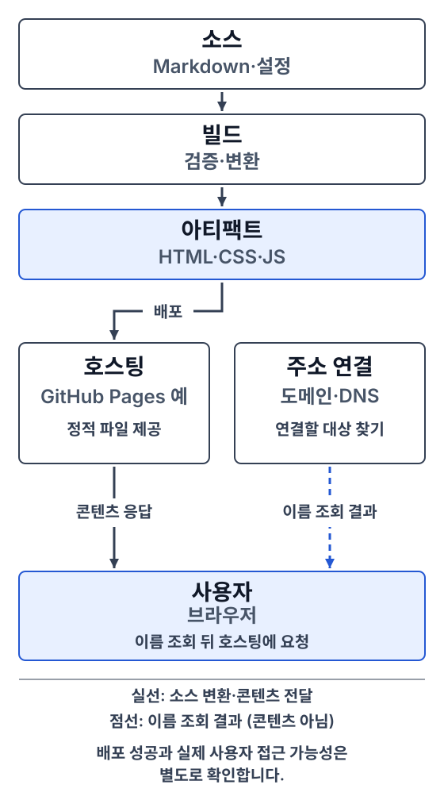

## 먼저 결론

코드가 완성됐다는 말과 사용자가 실제 주소에서 서비스를 쓸 수 있다는 말 사이에는 여러 단계가 있습니다.

```text
소스와 콘텐츠
→ 테스트·검증·빌드
→ 버전이 식별된 아티팩트
→ 대상 환경에 배포
→ 호스팅에서 제공
→ DNS가 도메인을 대상으로 연결
→ HTTPS와 HTTP 요청
→ 실제 사용자 흐름 확인
→ 관측·복구·학습
```

빌드 성공은 아티팩트를 만들었다는 증거, 배포 작업 성공은 그 아티팩트를 대상 환경에 전달했다는 증거입니다. 도메인·DNS·HTTPS와 실제 페이지·API·데이터를 확인하기 전에는 사용자가 성공했다고 말할 수 없습니다.

## 왜 필요한가

AI가 “배포가 완료됐습니다”라고 보고해도 실제로는 로컬 빌드만 성공했거나, 호스팅 서비스의 업로드 단계만 끝났거나, 임시 주소만 열리는 상태일 수 있습니다. 잘못된 base path 때문에 첫 화면은 보이지만 CSS와 검색이 깨지고, DNS는 새 대상을 가리키지만 인증서가 준비되지 않았거나, 페이지는 열리지만 운영 API 주소가 잘못돼 핵심 기능이 실패할 수도 있습니다.

반대로 배포 실패를 모두 코드 문제로 보면 DNS 레코드, 인증서, 권한과 환경 설정을 고치지 못합니다. 도메인 문제를 해결한다며 애플리케이션 코드를 무작위로 바꾸거나, 빌드를 다시 반복해도 원인이 다른 계층에 있으면 상황은 달라지지 않습니다.

필요한 것은 서비스 이름을 외우는 일이 아니라 다음 질문에 답하는 것입니다.

1. 어떤 소스 커밋과 설정으로 어떤 아티팩트를 만들었나요?
2. 그 아티팩트를 어느 환경에 누가 어떤 권한으로 배포했나요?
3. 사용자가 입력한 URL은 어떤 DNS·호스팅·HTTPS 경로를 지나나요?
4. 배포 작업의 성공과 실제 사용자 흐름의 성공을 각각 무엇으로 확인했나요?
5. 문제가 생기면 어느 버전으로 어떻게 되돌리거나 수정 배포하나요?

## 핵심 용어를 먼저 구분하세요

- **소스(source)**: 사람이 수정하고 검토하는 코드·콘텐츠·설정과 빌드 입력입니다.
- **빌드(build)**: 소스와 의존성·설정을 실행 또는 배포 가능한 결과로 변환하는 과정입니다.
- **아티팩트(artifact)**: 특정 빌드에서 생성돼 배포 대상으로 삼는 파일 묶음, 패키지 또는 이미지입니다.
- **배포(deploy)**: 선택한 아티팩트를 대상 환경에 전달하고 서비스 가능 상태로 활성화하는 과정입니다.
- **호스팅(hosting)**: 파일이나 애플리케이션을 네트워크에서 사용자의 요청에 응답하도록 제공하는 환경입니다.
- **릴리스(release)**: 검증된 변경을 특정 사용자나 전체 사용자에게 제품 버전으로 제공하는 결정과 절차입니다.
- **도메인(domain)**: 사람이 기억하고 관리하는 서비스 이름입니다.
- **DNS(Domain Name System)**: 도메인 이름을 서비스가 사용하는 네트워크 대상 정보로 찾게 하는 분산 이름 체계입니다.
- **HTTPS**: HTTP 통신을 TLS로 보호해 전송 중 도청과 변조 위험을 줄이고 접속한 호스트의 인증서 정보를 확인하게 하는 방식입니다.

도구에 따라 “deploy”가 업로드만 뜻하거나 트래픽 전환까지 포함할 수 있고, “release”와 같은 뜻으로 쓰이기도 합니다. 단어만 믿지 말고 어떤 아티팩트가 어느 환경에서 어느 사용자에게 활성화됐는지 확인해야 합니다.

## 택배와 주소 체계에 비유하기

소프트웨어 배포를 책 배송에 비유해 보겠습니다.

- 소스는 편집 중인 원고입니다.
- 빌드는 원고를 인쇄 가능한 판본으로 만드는 과정입니다.
- 아티팩트는 판본과 제작 정보를 가진 실제 인쇄물 묶음입니다.
- 배포는 인쇄물을 지정된 서점이나 창고로 보내 진열하는 과정입니다.
- 호스팅은 독자가 책을 받을 수 있게 보관하고 제공하는 서점입니다.
- 도메인은 독자가 기억하는 서점 이름입니다.
- DNS는 그 이름으로 실제 위치를 찾는 주소 안내 체계입니다.
- HTTPS 인증서는 독자가 접속한 장소가 해당 이름을 사용할 권한이 있는 대상인지 확인하는 신분 확인에 비유할 수 있습니다.

이 비유가 맞는 지점은 완성된 원고와 전달 가능한 판본, 실제 제공 장소와 사용자가 기억하는 주소가 서로 다른 책임이라는 점입니다.

### 비유가 깨지는 지점

소프트웨어 아티팩트는 동일한 바이트를 여러 환경에 복제할 수 있고, DNS 응답과 CDN·브라우저 캐시 때문에 서로 다른 사용자가 잠시 다른 상태를 볼 수 있습니다. 동적 서비스는 코드만 배송하는 것이 아니라 런타임 설정, 데이터베이스·큐·비밀과 외부 서비스의 상태를 함께 맞춰야 합니다. HTTPS 인증서도 종이 신분증처럼 애플리케이션의 내용과 권한 규칙까지 안전하다고 보증하지 않습니다.

## 소스에서 사용자까지의 시스템 흐름

소스·빌드·아티팩트·호스팅·이름 연결·사용자의 책임을 구분하고, 콘텐츠 응답과 이름 조회 결과가 어떤 선으로 이어지는지 확인해 보세요.



DNS는 콘텐츠를 운반하지 않고 연결할 대상을 찾게 하며, 이 그림은 책임 관계를 보여 줄 뿐 실제 배포·DNS·HTTPS·사용자 접근 성공을 증명하지 않습니다.

각 경계에는 서로 다른 입력·출력·실패와 증거가 있습니다.

1. **소스 경계**: 요구사항, 코드, 콘텐츠, 잠금 파일과 설정이 현재 커밋에 맞나요?
2. **검증 경계**: 테스트·정적 검사·콘텐츠 검사와 보안 검토가 필요한 위험을 덮나요?
3. **빌드 경계**: 지정 런타임과 의존성으로 아티팩트가 재현 가능하게 생성되나요?
4. **배포 경계**: 올바른 아티팩트를 올바른 환경에 필요한 권한으로 전달했나요?
5. **호스팅 경계**: 대상 환경이 실제 요청에 올바른 파일·응답·상태 코드를 제공하나요?
6. **이름·전송 경계**: DNS와 HTTPS가 의도한 호스트와 인증서를 사용하나요?
7. **사용자 경계**: 실제 공개 URL에서 핵심 페이지·상호작용·데이터가 작동하나요?
8. **운영 경계**: 오류와 성능 저하를 발견하고 중지·복구할 신호와 책임자가 있나요?

한 경계의 성공 로그로 다음 경계를 추정하지 않습니다. 빌드 시스템의 녹색 표시가 DNS와 사용자 화면을 직접 확인한 것은 아니고, 브라우저에서 홈 한 번이 열렸다고 백업과 복구가 준비된 것도 아닙니다.

### 증거는 같은 버전을 다음 경계로 넘겨야 합니다

| 경계 | 넘길 식별자 | 직접 확인할 증거 | 다음 경계로 확대할 수 없는 주장 |
|---|---|---|---|
| 소스 → 빌드 | source commit·lockfile·공개 설정 schema | 검사 명령·종료 코드·실제 입력 | artifact 생성·배포 성공 |
| 빌드 → artifact | build ID·artifact ID·checksum | 생성 경로·파일·크기·버전 메타데이터 | 대상 환경 활성화 |
| artifact → hosting | artifact ID·deployment ID·environment | 배포 작업 결과·대상 환경의 실제 응답 | DNS·HTTPS·사용자 흐름 성공 |
| DNS → HTTPS | hostname·권위 응답·인증서 대상 | DNS query 결과·인증서의 host·유효 범위 | 애플리케이션 권한·데이터 정확성 |
| HTTPS → 사용자 | public URL·deployment version | 실제 상태 코드·핵심 페이지와 상호작용 | 알림·백업·복구 준비 완료 |
| 사용자 → 운영 | version·environment·correlation ID | 사용자 영향 신호·안전한 로그·runbook·복원 시험 | 미실행 장애 복구 성공 |

CI가 같은 명령을 실행했다는 사실만으로 로컬에서 만든 artifact와 같은 바이트를 배포했다고 볼 수 없습니다. 파이프라인이 다시 빌드한다면 그 실행의 source commit·설정·artifact를 새 증거로 연결하고, 기존 artifact를 승격한다면 checksum과 deployment ID로 동일성을 확인합니다.

## 빌드가 실제로 하는 일

프로젝트에 따라 빌드는 다음 작업 일부를 수행합니다.

- TypeScript·CSS·콘텐츠 같은 소스를 배포 형식으로 변환합니다.
- 여러 파일을 묶고 압축하거나 사용하지 않는 코드를 줄입니다.
- 정적 페이지, 검색 인덱스, 이미지와 메타데이터를 생성합니다.
- 타입·문법·링크·스키마 같은 빌드 시점 오류를 발견합니다.
- 공개 가능한 빌드 설정을 결과물에 포함할 수 있습니다.

빌드가 테스트 전체를 대신하지는 않습니다. 빌드에 포함되지 않은 사용자 흐름, 운영 데이터, 권한, 성능과 복구 문제는 별도 증거가 필요합니다. 반대로 테스트가 통과해도 배포 형식 생성과 경로 결합이 실패할 수 있으므로 실제 빌드도 실행해야 합니다.

### 재현 가능한 빌드의 질문

- 어떤 소스 커밋을 입력으로 사용했나요?
- 런타임과 패키지 관리자 버전은 무엇인가요?
- 잠금 파일로 실제 의존성 버전을 고정했나요?
- 빌드에 영향을 주는 공개 설정과 비밀은 어디서 오나요?
- 같은 입력에서 같은 기능의 아티팩트를 다시 만들 수 있나요?
- 아티팩트에 버전·커밋·체크섬 같은 출처를 연결할 수 있나요?

완전히 같은 바이트를 재현하는 수준이 필요한지는 프로젝트 위험에 따라 다르지만, 최소한 어떤 소스와 도구·설정에서 결과가 나왔는지는 추적할 수 있어야 합니다.

## 아티팩트를 배포 단위로 고정하세요

검증한 아티팩트와 배포한 아티팩트가 같아야 검증 증거가 이어집니다. 테스트 환경에서 빌드한 뒤 운영 배포 단계에서 소스나 의존성을 다시 받아 새로 빌드하면 결과가 달라질 수 있습니다.

가능한 경우 한 번 생성하고 식별한 아티팩트를 환경별로 승격합니다. 환경별 값이 반드시 빌드 결과에 포함되는 정적 사이트라면 어떤 환경 변수로 별도 빌드했는지 기록하고, 각 결과를 다른 아티팩트로 취급합니다.

아티팩트를 보관할 때는 다음 정보를 연결합니다.

- 소스 커밋 또는 태그
- 빌드 명령과 실행 환경
- 공개 설정과 비밀의 참조 위치
- 테스트·검증 결과
- 생성 시각과 아티팩트 식별자
- 배포한 환경과 배포 시각

비밀값 자체를 아티팩트 메타데이터나 로그에 복사하지 않습니다.

## 환경은 주소만 다른 복사본이 아닙니다

일반적인 프로젝트는 다음 환경을 구분할 수 있습니다.

- **local**: 개발자 컴퓨터에서 빠르게 수정하고 검증하는 환경
- **preview**: Pull Request나 브랜치별 결과를 검토하는 임시 환경
- **staging**: 운영과 비슷한 구성에서 통합·배포 절차를 확인하는 환경
- **production**: 실제 사용자가 접근하고 운영 책임이 적용되는 환경

모든 작은 프로젝트에 네 환경이 필요한 것은 아닙니다. 정적 개인 사이트는 로컬과 production만으로 충분할 수 있습니다. 결제·권한·데이터 마이그레이션 위험이 크면 실제 사용자에게 영향을 주기 전 별도 검증 환경과 승인 게이트가 필요합니다.

환경은 설정·권한·데이터·외부 서비스·도메인과 관측 방식이 다를 수 있습니다. staging이 존재한다는 사실만으로 production과 같다고 가정하지 말고 중요한 차이를 문서화합니다.

## 빌드 시점 설정과 실행 시점 설정

정적 사이트의 공개 설정은 빌드할 때 HTML·JavaScript·링크에 포함될 수 있습니다. 브라우저에 전달된 값은 사용자가 볼 수 있으므로 비밀로 취급할 수 없습니다.

서버 애플리케이션은 실행 시 환경 변수와 비밀 관리 기능에서 값을 읽을 수 있지만, 로그·오류·클라이언트 응답으로 노출하지 않도록 해야 합니다. 자세한 경계는 [환경 변수와 설정](../environment-variables-config/)에서 다룹니다.

설정 오류는 가능한 한 시작이나 빌드 초기에 명확히 실패하도록 검증합니다. 누락된 API 주소를 조용히 기본값으로 바꿔 잘못된 운영 대상에 연결하는 것보다, 어떤 설정이 없고 왜 필요한지 명확하게 실패하는 편이 안전합니다.

## 정적 사이트와 동적 서비스의 배포 책임

### 정적 사이트

빌드 결과가 HTML·CSS·JavaScript·이미지 같은 파일이고 호스팅이 이 파일을 그대로 제공합니다. 서버 런타임과 데이터베이스가 없어 운영 표면이 작지만 다음 책임은 남습니다.

- 올바른 base path와 자산·링크 경로
- 검색 인덱스와 sitemap·메타데이터
- 캐시와 이전 파일 정리
- 도메인·DNS·HTTPS
- 원본 저장소와 빌드·배포 권한
- 외부 링크와 클라이언트에서 호출하는 API의 상태

### 동적 서비스

요청마다 서버 코드가 실행되고 데이터베이스·캐시·큐·외부 서비스와 상호작용할 수 있습니다. 정적 파일 배포 책임에 더해 다음이 필요합니다.

- 런타임과 프로세스 기동·종료
- 서버 비밀과 네트워크 권한
- 데이터 스키마·마이그레이션과 하위 호환성
- 자원 용량·확장·성능
- 로그·지표·알림
- 장애 격리와 데이터 포함 복구

“풀스택을 배포한다”는 이유만으로 서버를 추가하지 않습니다. 사용자별 상태, 비밀 연산, 동적 권한과 서버 책임이 실제 요구일 때 추가합니다.

:::note[현재 호스팅 예시는 책임 판정 뒤에 읽습니다]
정적 파일 전달만 필요한지, 요청마다 서버 코드를 실행하고 외부 상태를 다뤄야 하는지 먼저 판정하세요. 제품별 마지막 확인일·재확인 실패·명칭·적용 한계는 [현재 도구 매핑](../../reference/current-tool-mapping/)에서 확인합니다. 이 참고편은 2026-08-20 확인 당시 Vercel 재확인 실패를 `not-confirmed`로 남기고, 당시 Sites – ChatGPT의 public beta 조건을 구분합니다. 과거 Codex Sites 명칭이나 날짜가 붙은 설명을 현재 기능·계정 사용 가능성의 확인으로 재사용하지 않습니다.
:::

## 개발 사례: 모임 참가 웹앱

### 모임 참가 웹앱을 공개한다면

이 핸드북은 사용자별 서버 상태와 애플리케이션 데이터베이스가 없는 정적 문서 사이트입니다. 그래도 아티팩트 배포, base path와 캐시, 도메인·DNS·HTTPS, 검색 인덱스, 이전 정적 아티팩트로의 복구 책임은 남습니다. 반면 모임 참가 웹앱은 로그인한 사용자의 참가 상태를 서버와 데이터베이스에서 바꾸므로 인증과 인가, 서버 런타임, 데이터베이스 연결, 스키마 마이그레이션과 데이터 복구 책임이 추가됩니다.

다음 표는 새로운 배포 정의가 아니라 앞에서 구분한 소스·빌드·아티팩트·설정·배포·호스팅·사용자 흐름을 모임 웹앱의 W-05 운영 인수에 적용한 것입니다.

| 단계 | 확인할 책임 | 직접 증거 |
|---|---|---|
| 소스와 잠금 | 승인된 소스와 재현 가능한 의존성을 기준으로 삼음 | commit ID·lockfile·깨끗한 작업 트리 |
| 빌드 | 클라이언트 자산과 서버 런타임이 대상 환경에 맞음 | 종료 코드·아티팩트·버전 |
| 설정과 비밀 | 테스트·운영 값이 분리되고 브라우저 번들에 서버 비밀이 없음 | 환경별 키 목록·빌드 산출물 검사 |
| 데이터 변경 | 스키마 마이그레이션의 순서·호환성과 실패 시 복구 경로가 있음 | dry-run 또는 운영과 격리된 테스트 DB 결과·백업·복원 시험 |
| 호스팅·DNS·HTTPS | 실제 공개 주소가 의도한 배포를 가리키고 올바른 응답을 제공함 | DNS 응답·인증서·실제 URL 응답 |
| 사용자 흐름 | 공개 조회·로그인·참가·취소·정원 충돌이 의도한 계약대로 동작함 | 승인된 smoke 결과·권한 있는 데이터 재조회·비밀과 개인정보를 제외한 안전한 로그 |

여기서 smoke 흐름과 정원 충돌 확인은 실제 운영 성공 기록이 아니라, 격리된 가상 계정·데이터와 합의된 영향 범위에서 수행할 검증 계약입니다. 새 배포와 참가·취소처럼 상태를 바꾸는 검증에는 각각 해당 변경 승인이 필요합니다. 기존 환경의 읽기 검증은 별도로 허용된 접근 범위에서만 수행하며 배포 승인과 같은 권한으로 취급하지 않습니다. 이 저장소에서는 승인된 설정의 정적 검토와 로컬 빌드 증거만 사용하고 실제 공개 URL·운영 계정·데이터·비밀을 만들거나 확인했다고 주장하지 않습니다. 구체적인 배포 제품 선택은 별도 범위입니다.

## 이 저장소의 GitHub Pages 사례

이 핸드북은 Astro Starlight가 Markdown을 정적 사이트로 빌드하고 GitHub Actions가 `dist/` 아티팩트를 GitHub Pages에 전달하도록 설계돼 있습니다. 이 구조의 결정 근거는 저장소의 `docs/adr/0001-use-starlight-and-github-pages.md`에 기록돼 있습니다.

현재 저장소 설정은 다음 책임을 나눕니다.

- `npm run check`: 테스트·콘텐츠·참조 검사와 실제 빌드를 실행합니다.
- `dist/`: 배포할 정적 아티팩트가 생성되는 로컬 경로입니다.
- `PUBLIC_SITE_URL`: 공개 사이트의 기준 URL을 빌드 설정에 전달합니다.
- `PUBLIC_BASE_PATH`: 프로젝트 페이지의 하위 경로를 링크·자산에 반영합니다.
- GitHub Actions: 기준 브랜치 변경에서 검증·빌드·아티팩트 업로드·Pages 배포를 실행하도록 선언합니다.

GitHub 사용자·조직 사이트는 루트 경로를, 일반 프로젝트 페이지는 저장소 이름의 하위 경로를 사용할 수 있어 base path가 중요합니다. 예를 들어 사이트가 다음 주소에 배포된다면:

```text
https://account-name.github.io/project-name/
```

이 예시의 base는 `/project-name/`입니다. `/logo.svg` 같은 루트 기준 경로와 `/project-name/logo.svg` 같은 프로젝트 기준 경로가 다릅니다. 설정이 틀리면 HTML은 열려도 CSS·이미지·검색·이전·다음 링크가 404가 될 수 있습니다.

이 저장소는 로컬 기본 빌드와 가상의 GitHub Pages 하위 경로 빌드를 검증했지만 실제 원격 저장소·CI·Pages URL은 아직 없습니다. 따라서 배포 설정이 존재하고 로컬 아티팩트가 생성된다는 사실만 확인됐으며 실제 공개 배포 성공을 주장하지 않습니다.

## URL·도메인·DNS를 구분하세요

다음 주소를 보겠습니다.

```text
https://docs.example.com/handbook/start/
```

- `https`: 통신 방식인 scheme입니다.
- `docs.example.com`: 호스트 이름입니다.
- `example.com`: 등록·관리하는 도메인 범위의 한 예입니다.
- `/handbook/start/`: 호스트 안의 경로입니다.
- 전체 문자열: 특정 자원의 URL입니다.

도메인을 구매하거나 등록했다고 웹사이트가 자동으로 생기지 않습니다. 호스팅 대상을 준비하고, 권위 있는 DNS 설정에서 도메인·하위 도메인이 그 대상을 찾도록 연결해야 합니다.

## DNS 요청의 개념 흐름

1. 사용자가 브라우저에 호스트 이름을 입력합니다.
2. 운영체제·브라우저 또는 네트워크의 재귀 resolver가 캐시를 확인합니다.
3. 필요한 경우 권위 있는 nameserver에 도메인의 레코드 정보를 묻습니다.
4. DNS 응답이 IP 주소나 다른 호스트 이름 같은 대상을 알려줍니다.
5. 브라우저가 해당 네트워크 대상으로 연결합니다.
6. HTTPS라면 인증서와 호스트 이름을 확인하고 보호된 연결을 만듭니다.
7. 그 뒤에야 HTTP 요청을 보내고 애플리케이션 응답을 받습니다.

DNS는 웹페이지 내용을 전달하지 않고 연결할 대상 정보를 찾게 합니다. DNS가 정상이어도 호스팅 서비스가 요청한 호스트를 모르면 오류가 날 수 있고, 서버가 정상이어도 DNS가 잘못된 대상을 가리키면 사용자는 도달하지 못합니다.

DNS는 분산된 query-response 이름 체계이므로 resolver 캐시와 권위 있는 zone의 현재 데이터를 구분해야 합니다. 한 resolver의 응답이나 관리 화면만 보고 전체 인터넷의 상태를 확정하지 말고, 의도한 hostname·record type·권위 응답·TTL과 실제 호스팅 대상의 host 등록을 함께 대조합니다.

### 자주 보는 DNS 개념

- **권위 있는 네임서버(authoritative nameserver)**: 자신이 담당하는 DNS 관리 구역인 zone의 정보를 제공하는 서버입니다. 다른 서버를 조회해 답을 찾는 재귀 resolver와 역할을 구분합니다.
- **record**: 이름에 연결된 IP 주소·별칭·메일 처리 정보 같은 값을 표현합니다.
- **A·AAAA record**: 이름을 IPv4·IPv6 주소와 연결하는 데 사용됩니다.
- **CNAME record**: 한 호스트 이름을 다른 호스트 이름의 별칭으로 연결하는 데 사용됩니다.
- **TTL(Time To Live)**: resolver가 DNS 응답을 얼마 동안 캐시할 수 있는지 나타내는 값입니다.

루트 도메인에서 허용되는 레코드 형태와 호스팅 공급자의 권장 설정은 DNS 제공자·플랫폼에 따라 달라질 수 있습니다. 값을 추측해 입력하지 말고 도메인과 호스팅 공급자의 현재 공식 지침을 함께 확인합니다.

## “DNS 전파”를 기다리기만 하면 안 됩니다

DNS 변경 뒤 일부 사용자가 이전 값을 보는 현상은 여러 resolver와 장치의 캐시가 서로 다른 시점에 갱신되면서 나타날 수 있습니다. 그러나 연결 실패를 모두 전파 시간 탓으로 돌리면 잘못된 레코드, nameserver 위임과 호스트 설정을 놓칩니다.

다음 사실을 분리해 확인합니다.

- 권위 있는 nameserver가 의도한 곳인가요?
- 권위 있는 응답에 새 레코드가 있나요?
- 서로 다른 resolver가 어떤 값을 반환하나요?
- 호스팅 환경에 해당 도메인이 등록돼 있나요?
- 이전·중복 레코드가 남아 있나요?
- HTTPS 인증서가 정확한 호스트 이름을 포함하나요?

TTL은 정확한 전 세계 완료 시각을 보장하는 카운트다운이 아닙니다. 기존 캐시 시점, resolver 정책과 장치 캐시가 다를 수 있으므로 실제 관찰값으로 확인합니다.

## HTTPS는 DNS 다음의 별도 경계입니다

DNS가 올바른 네트워크 대상을 알려줘도 HTTPS 인증서가 아직 발급되지 않았거나 요청한 호스트 이름과 맞지 않으면 브라우저가 경고하거나 연결을 거부할 수 있습니다. 반대로 유효한 HTTPS 연결은 전송 경로 보호와 호스트 인증에 관한 증거이지 애플리케이션의 로그인·인가·입력 검증과 데이터 정확성을 보장하지 않습니다.

인증서의 발급·갱신 자동화, 대상 호스트와 만료 경고의 책임자가 누구인지 확인합니다. `www`와 루트 도메인, 다른 하위 도메인은 이름과 리디렉션·인증서 범위를 각각 검토해야 합니다.

## CI와 CD를 구분하세요

**CI(Continuous Integration)**: 변경을 자주 통합하며 테스트·정적 검사·빌드 같은 빠른 피드백을 자동 실행하는 관행입니다.

**CD**: 문맥에 따라 다음 두 의미로 쓰입니다.

- **Continuous Delivery**: 검증된 아티팩트를 언제든 배포 가능한 상태로 준비하되 운영 배포에 사람 승인이 있을 수 있습니다.
- **Continuous Deployment**: 자동 검증을 통과한 변경을 운영 환경까지 자동 배포합니다.

약어만 보고 운영 자동 배포라고 가정하지 않습니다. 어느 이벤트가 파이프라인을 시작하고, 어떤 환경까지 자동으로 가며, 어디에 사람 승인과 중지 조건이 있는지 확인합니다.

### 배포 파이프라인의 증거

1. 기준이 되는 소스 커밋
2. 잠금 파일 기반 설치와 검증 명령
3. 테스트 수·실패·건너뜀과 빌드 종료 코드
4. 생성된 아티팩트와 식별자
5. 배포 대상 환경과 권한
6. 배포 작업의 상태와 로그
7. 실제 URL의 smoke test와 핵심 사용자 흐름
8. 오류·성능·데이터 상태와 중지·복구 기준

CI의 성공과 CD의 성공, 실제 운영 검증을 각각 기록합니다.

## 완료를 여섯 층으로 나누세요

| 완료 주장 | 직접 확인할 증거 |
|---|---|
| 코드 완료 | diff, 요구사항 대조와 관련 테스트 |
| 빌드 완료 | 실제 빌드 명령·종료 코드와 아티팩트 |
| 배포 작업 완료 | 대상 환경·아티팩트 ID와 배포 시스템 결과 |
| 네트워크 연결 완료 | DNS 응답, 호스트 설정과 HTTPS 인증서 |
| 사용자 흐름 완료 | 실제 공개 URL의 페이지·API·데이터·접근성 확인 |
| 운영 인수 완료 | 로그·지표·알림·소유자와 복구 증거 |

AI가 “배포 성공”이라고 말하면 여섯 층 중 어디까지 직접 확인했는지 물어야 합니다. CLI의 성공 메시지나 대시보드의 녹색 아이콘 하나로 나머지 층을 추정하지 않습니다.

## 증상으로 실패 경계를 좁히기

### 로컬에서는 되지만 빌드가 실패합니다

잠금 파일, 런타임 버전, 운영체제 차이, 누락된 파일·환경 변수, 대소문자 경로와 빌드 시점 검사를 확인합니다. 개발 서버의 성공은 배포 아티팩트 생성을 보장하지 않습니다.

### 빌드는 되지만 배포 작업이 실패합니다

배포 권한, 대상 프로젝트·환경, 아티팩트 경로·형식, 할당량과 파이프라인 설정을 확인합니다. 소스를 무작위로 수정하기 전에 배포 시스템의 실패 단계와 로그를 봅니다.

### 배포는 성공했지만 페이지나 자산이 404입니다

실제 공개 URL, base path, 라우팅·호스팅 설정, 자산의 절대·상대 경로와 업로드된 아티팩트 내용을 확인합니다. 이전 배포의 캐시나 잘못된 아티팩트가 제공되는지도 봅니다.

### 도메인이 열리지 않습니다

등록 상태, nameserver 위임, 권위 있는 DNS 응답, 레코드 대상과 호스팅 도메인 등록을 순서대로 확인합니다. “전파 중”이라는 가설과 설정 오류를 관찰값으로 구분합니다.

### HTTPS 경고가 납니다

현재 인증서의 호스트 이름·유효기간·발급 상태와 중간 프록시·CDN의 TLS 설정을 확인합니다. 경고를 무시하게 안내하지 않습니다.

### 화면은 열리지만 핵심 기능이 실패합니다

운영 API 주소·권한·CORS·비밀·데이터베이스 마이그레이션과 브라우저 Network·Console, 서버 로그를 함께 확인합니다. 정적 셸의 성공과 전체 시스템 성공을 구분합니다.

### 일부 사용자만 이전 화면을 봅니다

DNS·CDN·브라우저·서비스 워커 캐시, 트래픽 분할과 배포 버전을 확인합니다. 캐시 삭제만 요구하기 전에 어떤 계층이 어떤 아티팩트를 제공하는지 증거를 모읍니다.

## 롤백과 수정 배포의 경계

정적 사이트는 이전에 검증한 아티팩트를 다시 활성화해 비교적 단순하게 복구할 수 있습니다. 동적 서비스는 이전 코드가 새 데이터 스키마와 호환되지 않거나 외부 부작용을 되돌릴 수 없어 코드만 롤백하면 더 큰 문제가 생길 수 있습니다.

배포 전에 다음을 정합니다.

- 중지하거나 되돌릴 사용자 영향 기준
- 이전 아티팩트와 설정의 보존 위치
- 데이터 마이그레이션의 전후 호환성과 백업
- 롤백 또는 수정 배포를 실행할 사람과 권한
- 복구 후 다시 확인할 핵심 흐름과 데이터

문제가 작고 수정이 빠르며 이전 버전 복원이 위험하면 roll-forward가 나을 수 있습니다. 어느 쪽이든 실행 전에 복구 범위와 남는 부작용을 확인합니다.

## AI의 배포 보고를 검증하는 읽기 전용 지시

```text wrap
배포 관련 파일과 최근 결과를 읽고 수정 없이 점검하라.
새 빌드를 실행하지 말고 기존 빌드 로그·아티팩트를 읽어 확인하라.
원격 자료는 명시적으로 허용된 대상과 읽기 접근 범위에서만 확인하라.

다음을 서로 다른 상태로 구분하라.
- 소스와 검증 완료
- 빌드와 아티팩트 생성 완료
- 대상 환경 배포 작업 완료
- DNS와 HTTPS 연결 완료
- 실제 사용자 흐름 완료
- 운영 인수와 복구 준비 완료

각 주장에 직접 증거를 연결하라.
- 커밋과 빌드 명령·종료 코드
- 아티팩트 ID와 대상 환경
- 배포 로그와 실제 공개 URL
- DNS 응답과 인증서 호스트
- 페이지·자산·API·데이터 확인
- 관측 신호와 복구 기준

미실행과 실행 불가를 성공으로 쓰지 마라.
로컬 URL을 공개 URL 증거로 쓰지 마라.
비밀값과 계정 식별 정보를 출력하지 마라.
배포·DNS·도메인·인증서 설정을 변경하지 마라.
```

새 배포·DNS·도메인·인증서 설정 변경의 승인과 기존 환경을 읽어 검증할 권한은 별개입니다. 배포 권한이 없어도 기존 CI 결과·공개 URL·DNS·HTTPS의 읽기 접근이 허용됐다면 실제로 확인한 대상·시점·결과를 보고할 수 있습니다. 원격 접근 자체가 허용되지 않았다면 기존 로컬 자료만 읽고 해당 원격 항목은 미검증으로 남깁니다. 배포 작업만 성공하고 사용자 검증을 하지 않았다면 배포 성공과 사용자 흐름 미검증을 따로 기록합니다. 어느 경우에도 이 지시가 새 네트워크 접근이나 외부 쓰기의 포괄 승인은 아닙니다. 새 로컬 빌드는 산출물을 만드는 실행이므로 위 읽기 전용 점검과 분리하여 허용된 작업 범위에서 수행합니다.

## 흔한 오해와 실패

### 로컬 개발 서버를 배포라고 부릅니다

개발 서버는 로컬 피드백 환경입니다. 외부 사용자의 네트워크·권한·도메인·운영 설정과 다르므로 공개 배포 증거가 아닙니다.

### 빌드 성공을 사용자 성공으로 확대합니다

아티팩트가 만들어졌다는 사실만 확인한 것입니다. 대상 환경 배포, DNS·HTTPS와 실제 핵심 흐름을 별도로 확인하세요.

### 배포 단계에서 소스를 다시 빌드합니다

검증한 결과와 다른 아티팩트가 운영에 갈 수 있습니다. 아티팩트 출처와 환경별 빌드 설정을 식별하고 같은 결과를 승격하는 원칙을 검토하세요.

### 프런트엔드 빌드에 비밀을 넣습니다

브라우저에 전달된 HTML·JavaScript와 source map의 값은 사용자가 확인할 수 있습니다. 공개 설정과 서버 비밀을 분리하고 실제 아티팩트도 점검하세요.

### DNS 문제를 모두 전파 시간으로 설명합니다

잘못된 nameserver·레코드·호스팅 등록과 인증서 문제를 놓칩니다. 권위 있는 응답부터 실제 호스트 연결까지 단계별로 확인하세요.

### 도메인과 URL을 같은 것으로 봅니다

scheme·호스트·포트·경로가 달라도 동작과 보안 정책이 달라질 수 있습니다. 실제 전체 URL과 base path를 검증하세요.

### HTTPS가 애플리케이션을 안전하게 만든다고 생각합니다

HTTPS는 전송 중 보호와 호스트 인증의 한 경계입니다. 로그인·인가·입력 검증·데이터 보호와 백업을 대신하지 않습니다.

### `main` 병합을 곧 운영 릴리스로 봅니다

파이프라인과 승인 정책에 따라 병합 뒤 자동 배포될 수도, 배포 가능한 상태만 준비할 수도 있습니다. 실제 트리거·대상 환경·아티팩트와 공개 URL을 확인하세요.

### 롤백을 “이전 커밋으로 이동”으로만 봅니다

데이터·외부 메시지·스키마와 설정이 이전 코드와 맞지 않을 수 있습니다. 코드와 아티팩트, 데이터와 외부 부작용의 복구를 나눠 계획하세요.

## 배포 전 체크리스트

- [ ] 배포 대상 소스 커밋과 승인된 변경 범위를 확인했습니다.
- [ ] 런타임·패키지 관리자·잠금 파일과 빌드 설정을 확인했습니다.
- [ ] 테스트·정적 검사·빌드 명령의 종료 코드와 범위를 확인했습니다.
- [ ] 아티팩트에 소스·명령·환경과 식별자가 연결됩니다.
- [ ] 공개 설정과 비밀, 빌드 시점과 실행 시점 설정을 구분했습니다.
- [ ] 대상 환경·호스팅 프로젝트·배포 권한과 영향 범위를 확인했습니다.
- [ ] 정적 사이트의 base path, 링크·자산·검색·메타데이터를 확인했습니다.
- [ ] 데이터 마이그레이션·하위 호환성·백업과 복구가 필요한지 판단했습니다.
- [ ] 롤백 또는 수정 배포 기준, 실행 주체와 이전 아티팩트가 준비됐습니다.
- [ ] 배포가 외부 쓰기와 사용자 영향을 만드는 별도 승인 단계임을 확인했습니다.

## 배포 후 체크리스트

- [ ] 배포 시스템의 대상 환경·아티팩트 ID와 결과를 확인했습니다.
- [ ] 실제 공개 URL에서 홈과 핵심 사용자 흐름을 확인했습니다.
- [ ] CSS·JavaScript·이미지·검색 같은 정적 자산이 정상입니다.
- [ ] API·데이터·권한·오류 상태가 운영 설정에서 정상입니다.
- [ ] DNS 응답이 의도한 대상이고 오래된·중복 레코드를 확인했습니다.
- [ ] HTTPS 인증서가 요청 호스트에 유효하고 경고가 없습니다.
- [ ] 오류율·지연·핵심 성공률과 배포 버전을 관찰할 수 있습니다.
- [ ] 이상이 기준을 넘을 때 알림·중지·복구 책임자가 행동할 수 있습니다.
- [ ] 실제 결과와 남은 위험을 요구·문맥·변경 기록에 반영했습니다.

## 짧은 연습

자신의 프로젝트를 다음 아홉 칸으로 연결하세요.

| 질문 | 작성할 내용 |
|---|---|
| 소스 | 기준 저장소·브랜치·커밋 |
| 검증 | 테스트·정적 검사와 남은 위험 |
| 빌드 | 명령·런타임·잠금 파일·공개 설정 |
| 아티팩트 | 형식·경로·식별자·보존 위치 |
| 배포 | 대상 환경·권한·트리거·승인자 |
| 호스팅 | 정적 파일 또는 서버 런타임 책임 |
| 주소 | 실제 URL·도메인·base path |
| 연결 | DNS·HTTPS와 확인할 관찰값 |
| 운영 | 핵심 흐름·신호·복구 기준과 담당자 |

모르는 칸에 서비스 이름을 추측해 넣지 말고 “누가 어떤 화면·파일·명령으로 확인해야 하는가”라는 질문을 적으세요. 그다음 AI의 “배포 성공” 보고가 어느 칸까지 증명하고 어느 칸을 건너뛰었는지 표시해 보세요.

## 관련 용어와 출처

- [Git과 GitHub는 다릅니다](../../09-git-github/git-and-github/)
- [테스트 전략](../../08-quality/testing-strategy/)
- [HTTP 요청과 응답](../../03-full-stack/http-request-response/)
- [브라우저·DOM·렌더링](../../05-frontend/browser-dom-rendering/)
- [환경 변수와 설정](../environment-variables-config/)
- [로그·모니터링·백업](../logs-monitoring-backup/)
- [실전 체크리스트](../../reference/checklists/)
- [RFC 1034: Domain Names—Concepts and Facilities](https://www.rfc-editor.org/rfc/rfc1034.html)
- [RFC 9499: DNS Terminology — 현재 용어 기준](https://www.rfc-editor.org/info/rfc9499/)
- [RFC 8499: DNS Terminology — RFC 9499로 대체된 역사적 참고](https://www.rfc-editor.org/info/rfc8499/)
- [RFC 9110: HTTP Semantics](https://www.rfc-editor.org/info/rfc9110/)
- [Astro의 GitHub Pages 배포 가이드](https://docs.astro.build/en/guides/deploy/github/)

2026-08-13에는 RFC 1034·8499, HTTP·HTTPS URI와 service identity 경계를 정의하는 Standards Track RFC 9110, Astro의 GitHub Pages 배포 가이드를 확인했습니다. 이 기록은 당시 확인 이력으로 보존합니다. 2026-11-15에는 RFC 8499가 RFC 9499로 대체된 상태와 후속 용어 문서의 TTL·recursive resolver·authoritative server 범위를 다시 확인했습니다. 현재 DNS 용어는 RFC 9499에 연결하며 TTL을 모든 사용자의 캐시가 동시에 갱신된다는 보장으로 해석하지 않습니다. RFC 9110의 HTTPS 경계와 Astro·GitHub Pages의 정적 배포·site/base·환경 변수 관련 공식 본문도 이 날짜에 확인했으나 실제 원격 실행을 검증한 것은 아닙니다.

초기 DNS 설계 RFC의 오래된 예시 값·특정 전송 세부를 현재 공급자 설정으로 사용하지 않습니다. DNS 레코드 값, 도메인 연결·인증서 방식과 호스팅 서비스 기능은 공급자와 시점에 따라 달라질 수 있으므로 실제 변경 전 대상 제공자의 현재 공식 문서를 다시 확인해야 합니다. 이 원고의 로컬 기록과 workflow 존재는 실제 원격 CI·배포·도메인·공개 URL 성공 증거가 아닙니다.
