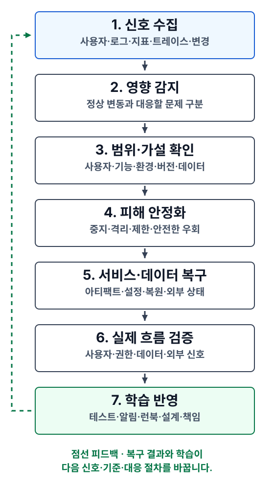

## 먼저 결론

배포 뒤의 핵심 질문은 “서버가 켜져 있나요?”가 아닙니다. 운영의 핵심 질문은 다음과 같습니다: **사용자가 중요한 일을 할 수 있는가? 문제가 생기면 우리가 먼저 알아차리고 안전하게 복구할 수 있는가?**

로그·지표·트레이스는 상태를 추론할 증거이고, 모니터링과 알림은 그 증거에서 행동할 조건을 찾는 장치입니다. 백업은 복구에 사용할 입력일 뿐이며 실제 복원 시험과 사용자 흐름 재검증까지 성공해야 복구 준비가 됐다고 말할 수 있습니다.

```text
운영 준비 완료
= 사용자 영향에 연결된 신호
+ 행동 조건과 담당자
+ 피해를 줄이는 대응 절차
+ 검증된 복원 수단
+ 복구 뒤 실제 흐름 확인
```

그래프가 많거나 백업 파일이 존재한다는 사실만으로 이 조건을 충족하지는 않습니다.

## 왜 필요한가

AI가 “모니터링을 추가했습니다”라고 보고해도 실제로는 로그 한 줄을 넣었거나 대시보드 파일만 만들었을 수 있습니다. 반대로 모든 오류를 즉시 알리게 하면 담당자가 중요한 경고까지 무시하는 알림 피로가 생깁니다. 서비스가 열려 있어도 데이터 갱신이 멈추거나 권한 판단이 틀리면 사용자에게는 장애인데, CPU와 메모리 그래프만 보면 정상처럼 보일 수도 있습니다.

“매일 백업합니다”라는 말도 충분하지 않습니다. 잘못된 데이터가 동기화 대상과 복제본에 함께 퍼질 수 있고, 암호화 키나 복원 권한이 없어 백업을 읽지 못할 수 있으며, 새 데이터 스키마와 맞지 않아 애플리케이션을 시작하지 못할 수도 있습니다. 백업 작업의 녹색 표시와 실제 복구 가능성은 다른 증거입니다.

운영 기본기를 안다는 것은 특정 관측 제품의 메뉴를 외우는 일이 아닙니다. 다음 질문에 답할 수 있다는 뜻입니다.

1. 어떤 사용자 실패를 어떤 신호로 발견하나요?
2. 그 신호가 정상 범위를 벗어나면 누가 언제 무엇을 하나요?
3. 진단 중에도 사용자 피해를 줄일 수 있는 안전한 조치는 무엇인가요?
4. 어떤 상태를 어느 시점까지 되돌릴 수 있나요?
5. 복구됐다는 주장을 실제 사용자 흐름과 데이터로 어떻게 확인하나요?

## 핵심 용어를 먼저 구분하세요

- **이벤트(event)**: 시스템에서 관찰할 가치가 있는 한 번의 사건입니다. 요청, 로그인 실패, 배포, 데이터 갱신과 백업 실행 등이 예입니다.
- **로그(log)**: 개별 이벤트와 그 문맥을 시간 순서로 남긴 기록입니다.
- **지표(metric)**: 요청 수·오류율·지연 시간·데이터 최신성처럼 수치를 시간에 따라 집계한 신호입니다.
- **트레이스(trace)**: 한 요청이나 작업이 여러 구성요소를 지나간 경로와 각 구간의 시간을 연결한 기록입니다.
- **모니터링(monitoring)**: 미리 정한 상태와 조건을 계속 관찰해 이상을 발견하는 활동입니다.
- **관측 가능성(observability)**: 외부 신호를 이용해 예상하지 못한 내부 상태와 실패 원인을 추론할 수 있는 능력입니다.
- **대시보드(dashboard)**: 여러 신호를 특정 질문에 답할 수 있도록 한 화면에 배치한 보기입니다.
- **알림(alert)**: 신호가 정한 조건을 충족했을 때 사람이나 자동화가 행동하도록 전달하는 통지입니다.
- **인시던트(incident)**: 실제 사용자·데이터·보안·운영 목표에 의미 있는 영향을 주어 조정된 대응이 필요한 사건입니다.
- **백업(backup)**: 손실·손상·삭제 뒤 복구하는 데 사용할 목적으로 원본과 분리해 보존한 사본입니다.
- **복원(restore)**: 백업에서 데이터나 설정을 다시 꺼내 사용 가능한 상태로 만드는 작업입니다.
- **복구(recovery)**: 복원된 데이터·설정·애플리케이션을 연결하고 검증해 필요한 서비스를 다시 제공하는 더 넓은 과정입니다.

모니터링과 관측 가능성의 경계는 조직과 도구마다 조금 다르게 사용됩니다. 이 장에서는 모니터링을 “알고 있는 질문을 지속적으로 확인하는 활동”, 관측 가능성을 “새로운 질문에도 답할 수 있도록 충분한 신호와 연결 문맥을 설계하는 능력”으로 구분합니다. 둘 중 하나가 다른 하나를 대신하지 않습니다.

## 가게 운영 장부와 비상벨에 비유하기

작은 식당을 운영한다고 생각해 보겠습니다.

- 주문별 영수증과 조리 기록은 개별 사건의 문맥을 남기는 로그와 비슷합니다.
- 시간대별 주문 수·대기 시간·취소율을 모은 계기판은 지표와 대시보드에 가깝습니다.
- 한 주문이 접수·결제·조리·전달 중 어디에서 멈췄는지 연결한 기록은 트레이스와 닮았습니다.
- 대기 시간이 기준을 넘을 때 책임자에게 알려 주는 비상벨은 알림입니다.
- 매출 장부의 분리 보관 사본은 백업이고, 그 사본으로 장부를 다시 열어 합계가 맞는지 확인하는 과정은 복원과 복구입니다.

이 비유가 맞는 지점은 사건 기록, 전체 추세, 한 작업의 경로, 행동 조건과 복구 사본이 서로 다른 책임이라는 점입니다. 영수증이 많다고 매장 전체가 건강한지 바로 알 수 없고, 비상벨이 울렸다고 원인이 자동으로 밝혀지지 않으며, 장부 사본이 있다고 영업이 재개된 것도 아닙니다.

### 비유가 깨지는 지점

소프트웨어는 짧은 시간에 매우 많은 이벤트를 만들고 여러 서비스·지역·캐시와 비동기 작업을 통과할 수 있습니다. 일부 트레이스와 로그는 비용 때문에 표본만 보존하며, 시계 오차와 누락된 계측 때문에 순서가 완전하지 않을 수도 있습니다. 복제와 동기화는 잘못된 변경까지 빠르게 전파하고, 암호화된 백업은 키와 권한을 함께 복구하지 못하면 사용할 수 없습니다. 종이 장부처럼 눈으로 몇 장 확인하는 것만으로 전체 정확성을 증명하기 어렵습니다.

## 운영은 발견에서 학습까지의 순환입니다

실선으로 이어지는 대응 단계와 학습에서 신호 수집으로 돌아가는 점선을 함께 보세요. 실제 대응의 고정된 실행 순서가 아니라 단계 사이의 책임과 피드백을 보여 줍니다.



운영 대응은 다음 순서로 흐릅니다.

1. **신호 수집**: 사용자 실패, 로그·지표·트레이스, 배포와 데이터 갱신 결과를 모읍니다.
2. **감지**: 정상 변동과 실제 사용자 영향을 구분하고 대응이 필요한지 판단합니다.
3. **범위 확인**: 어떤 사용자·기능·환경·버전·데이터가 영향을 받는지 사실과 가설을 분리합니다.
4. **안정화**: 원인 규명 전이라도 위험한 배포 중지, 기능 격리, 트래픽 제한과 안전한 우회로 피해를 줄입니다.
5. **복구**: 검증된 아티팩트·설정·데이터와 절차를 사용해 필요한 상태를 되찾습니다.
6. **검증**: 내부 그래프뿐 아니라 실제 사용자 흐름·데이터 정확성·권한과 외부 관찰 신호를 확인합니다.
7. **학습**: 테스트·알림·런북·설계와 책임을 보완해 같은 실패를 더 빨리 발견하고 안전하게 대응합니다.

이 그림은 대응할 때 확인할 흐름을 요약한 것으로, 실제 상황에서는 단계가 겹치거나 되돌아갈 수 있으며 그림 자체가 실제 장애 복구의 성공을 증명하지는 않습니다.

원인 분석이 중요하지만 사용자가 계속 피해를 보는 동안 완벽한 원인을 찾는 일만 고집하지 않습니다. 먼저 안전하게 영향을 줄일 수 있는지 판단하고, 조사 증거를 보존하면서 복구와 원인 규명을 병행합니다.

## 로그는 사건을 설명할 만큼 구조화하세요

유용한 로그는 “오류 발생” 한 줄보다 사건을 다른 증거와 연결할 문맥을 가집니다. 프로젝트에 따라 다음 필드를 선택합니다.

- 표준 시간대가 분명한 시각
- 심각도 또는 로그 수준
- 서비스·환경·배포 버전
- 이벤트 이름과 결과
- 요청·작업·트레이스 상관 식별자
- 관련 기능과 안전하게 축약한 오류 종류
- 처리 시간과 재시도 횟수

사람이 읽는 문장만 남기면 검색과 집계가 어렵고, 필드만 남기면 사건의 의미를 해석하기 어렵습니다. 안정된 이벤트 이름과 구조화 필드, 짧고 명확한 설명을 함께 사용합니다. 로그 수준의 이름과 의미는 제품마다 다를 수 있으므로 `error`, `warn`, `info`, `debug`라는 단어만 보고 심각도를 단정하지 말고 실제 운영 규칙을 확인합니다.

### 로그에 남기지 말아야 할 것

비밀번호, API 키, 세션 쿠키, 인증 토큰, 전체 `Authorization` 헤더와 복구 코드 같은 비밀은 로그에 남기지 않습니다. 개인정보와 원본 요청·응답 본문도 목적·접근 권한·보존 기간을 정하지 않은 채 수집하지 않습니다. 오류 분석에 식별자가 필요하면 최소 범위와 가명화·마스킹 정책을 정하고, 누가 조회했는지 감사할 수 있어야 합니다.

로그가 많을수록 항상 좋은 것은 아닙니다. 비용과 검색 지연이 커지고 중요한 사건이 묻히며 민감정보 노출 면적이 넓어집니다. 어떤 질문에 답하려는지, 어느 기간이 필요한지, 누가 볼 수 있는지부터 정합니다.

## 지표는 사용자 결과와 시스템 원인을 함께 보세요

운영 지표는 보통 다음 네 관점을 함께 봅니다.

- **수요**: 요청·작업·활성 사용자와 데이터 처리량이 얼마나 들어오나요?
- **결과**: 성공·실패·부분 성공과 업무 규칙 오류가 얼마나 발생하나요?
- **시간**: 사용자가 기다린 시간과 각 처리 구간의 지연 분포는 어떤가요?
- **여유**: CPU·메모리·연결·큐·저장 공간 같은 제한에 얼마나 가까운가요?

시스템 자원 지표만 보면 사용자 실패를 놓치고, 사용자 결과만 보면 원인을 좁히기 어렵습니다. 예를 들어 대시보드 페이지가 빠르게 열려도 데이터가 하루 전 값이면 사용자 결과는 실패일 수 있습니다. 화면 로딩 성공률과 함께 데이터 최신성·완전성·핵심 필터 결과 같은 업무 지표를 봐야 합니다.

평균값은 일부 사용자의 심한 지연을 숨길 수 있습니다. 시간 구간, 환경, 버전, 기능과 사용자 집단을 구분하고 지연 분포의 상위 구간도 확인합니다. 그러나 구분 기준을 지나치게 많이 추가하면 지표 조합 수와 비용이 급증할 수 있으므로 실제 판단에 필요한 차원만 선택합니다.

## 트레이스는 한 작업의 경로를 연결합니다

분산된 웹 서비스에서는 브라우저 요청이 API, 인증, 데이터베이스, 캐시와 큐를 차례로 지날 수 있습니다. 트레이스는 한 요청이나 작업의 구간을 연결해 어디에서 시간이 들고 실패했는지 좁히는 데 도움을 줍니다.

트레이스가 있다고 전체 요청을 모두 본 것은 아닙니다. 샘플링으로 일부 요청만 기록할 수 있고, 계측되지 않은 서비스나 비동기 작업은 경로에서 빠질 수 있습니다. 트레이스 성공은 데이터 의미와 사용자 화면의 정확성을 보장하지도 않습니다. 지표에서 영향 범위를 보고, 트레이스로 경로를 좁히고, 필요한 로그와 실제 입력·출력으로 원인을 확인하는 식으로 신호를 연결합니다.

## 내부 건강과 실제 사용자 흐름을 분리하세요

프로세스가 살아 있다는 신호는 최소한의 시작 상태를 보여줄 뿐입니다. 의존 서비스·데이터·권한과 핵심 흐름이 정상이라는 뜻은 아닙니다.

- 내부 건강 확인은 프로세스와 필수 의존성의 준비 상태를 빠르게 봅니다.
- smoke test는 새 배포가 최소 기능을 수행하는지 확인합니다.
- 외부 합성 확인은 실제 사용자와 비슷하게 공개 주소에서 중요한 흐름을 주기적으로 실행할 수 있습니다.
- 실제 사용자 신호는 브라우저 오류, 업무 성공률과 문의처럼 합성 확인이 놓친 환경 차이를 보여줄 수 있습니다.

한 확인이 실패했을 때 자동으로 재시작하거나 트래픽을 끊는 정책은 별도 위험을 만듭니다. 일시적 외부 의존성 실패가 모든 정상 인스턴스를 동시에 제거하지 않도록 확인 범위와 자동 조치의 영향을 검토합니다.

## SLI·SLO·SLA는 측정·목표·약속입니다

- **SLI(Service Level Indicator)**: 사용자가 중요하게 여기는 서비스 수준을 실제로 측정한 값입니다. 예를 들어 최근 30일의 정상 조회 비율이나 최신 데이터 제공 비율이 될 수 있습니다.
- **SLO(Service Level Objective)**: 선택한 SLI가 특정 기간에 달성해야 하는 내부 목표입니다.
- **SLA(Service Level Agreement)**: 서비스 수준과 미달 시 책임을 외부 당사자와 약속한 계약입니다. 모든 프로젝트에 SLA가 필요한 것은 아닙니다.

SLI를 먼저 정의하지 않고 “가용성 99.9%”라고 쓰면 무엇을 성공으로 세고 어떤 기간과 사용자를 포함하는지 알 수 없습니다. 홈 페이지의 HTTP 200만 측정하면 로그인·조회·데이터 정확성 실패를 숨길 수 있습니다. 사용자 여정에서 중요한 결과를 고르고 측정 가능한 분자·분모, 시간 구간, 제외 조건과 데이터 출처를 명시합니다.

SLO와 SLA의 구체적인 정의·계산·계약 범위는 조직과 제공자마다 달라질 수 있습니다. 이 장에서는 세 용어의 역할을 구분하는 데 집중하며 실제 수치를 정할 때는 사업 영향과 현재 공식 정책을 확인합니다.

Google SRE Book은 조직 실무 자료로서 SLI를 정량 측정, SLO를 그 지표의 목표 범위로 설명합니다. **오류 예산(error budget)**: 목표에서 허용한 실패 범위를 운영 판단에 사용하는 접근입니다. 예를 들어 한 기간의 성공률 SLO가 99.9%라면 단순 계산상 허용 실패 범위는 0.1%이지만, 어떤 이벤트를 분자·분모와 제외 조건에 넣는지는 먼저 합의해야 합니다. 이 계산은 내부 정책 도구이지 그 자체가 고객 계약이나 모든 조직의 유일한 운영 방식은 아닙니다.

## 대시보드는 질문마다 설계하세요

하나의 거대한 대시보드에 모든 신호를 넣으면 어디부터 봐야 할지 알기 어렵습니다. 다음처럼 질문별로 나누는 편이 낫습니다.

- 지금 사용자가 실패하고 있나요?
- 어떤 기능·환경·버전에서 영향이 큰가요?
- 최근 배포나 설정 변경과 시점이 겹치나요?
- 병목은 브라우저·네트워크·서버·데이터·외부 서비스 중 어디인가요?
- 백업은 최근 목표 시점 안에 생성됐고 복원 시험은 유효한가요?

그래프에는 단위·시간대·집계 구간·환경·데이터 출처를 표시하고 배포·설정·데이터 갱신 시점을 함께 볼 수 있게 합니다. 그래프가 비어 있을 때 “문제 없음”인지 “수집 중단”인지 구분할 신호도 필요합니다.

## 알림은 사람이 행동할 수 있어야 합니다

좋은 알림은 단순히 수치가 높다고 말하지 않고 다음 질문에 답합니다.

1. 어떤 사용자 또는 데이터가 영향을 받나요?
2. 어느 환경·기능·버전에서 언제부터 발생했나요?
3. 즉시 행동해야 하나요, 업무 시간에 조사해도 되나요?
4. 누가 첫 대응 책임자인가요?
5. 첫 확인 대시보드·로그·런북은 어디인가요?
6. 자동으로 할 수 있는 안전한 완화와 사람 승인이 필요한 조치는 무엇인가요?

사용자 영향에 가까운 증상 기반 알림은 실제 문제를 놓칠 가능성을 줄입니다. 원인으로 추정한 CPU·큐·연결 수 알림은 진단에 도움을 주지만 사용자 영향 없이 흔들릴 수 있습니다. 둘을 연결하되 원인 후보 하나를 장애 전체와 동일시하지 않습니다.

모든 오류를 호출 알림으로 만들지 않습니다. 즉시 행동하면 피해를 줄일 수 있는 사건은 호출하고, 누적 추세나 개선 과제는 티켓·정기 검토로 보낼 수 있습니다. 임계값, 지속 시간, 중복 억제, 점검 시간과 자동 복구 여부를 함께 설계합니다. 거짓 양성이 많으면 알림 피로가 생기고, 거짓 음성이 많으면 사용자가 먼저 장애를 발견하므로 실제 발생 기록으로 규칙을 조정합니다.

Google SRE Book의 모니터링 장도 호출 알림은 긴급하고 행동 가능하며 실제 또는 임박한 사용자 증상을 나타내야 한다는 조직 사례를 제공합니다. 이는 알림 제품의 기본 임계값이나 보편 표준이 아니므로, 자신의 사용자 영향·담당자·런북·업무 시간 조건으로 다시 판정합니다.

## 개발 사례: 모임 참가 웹앱

### 모집 중인 모임의 운영 신호

모임 참가 웹앱의 W-03 참가·취소, W-04 정원·동시성, W-05 운영 인수를 앞의 신호와 행동 조건에 적용해 보겠습니다. 다음 표는 실제 모니터링·백업·배포가 설정됐다는 주장이 아니라, 운영 전에 정의하고 실제 환경에서 별도 검증해야 할 관찰 계약입니다.

| 확인할 질문 | 서로 분리할 신호 | 판단과 행동 |
|---|---|---|
| 방문자가 모집 중인 모임을 볼 수 있나요? | 공개 모임 상세 조회의 성공률·지연·응답 결과 | 사용자 영향에 가까운 증상 신호로 보고 환경·배포 버전별 이상을 좁힙니다. |
| 참가 요청은 왜 끝났나요? | 성공·활성 참가 중복·closed(모집 마감)·full(정원 가득 참)·미인증·인가 거절·서버 또는 인증 의존성 오류의 결과 분포 | 업무·보안상 거절과 시스템 실패를 합산하지 않고 각 결과의 문맥·비율·시간대별 변화를 봅니다. |
| 정원 규칙이 보존되나요? | `confirmed > capacity`인 모임 수와 정의된 인가 밖에서 다른 사용자의 참가가 취소된 건수 | 두 불변식 위반의 기대값은 정확히 0건이며 한 건이라도 확인되면 즉시 대응합니다. |
| 데이터 경계가 요청을 처리하나요? | 데이터베이스 연결 실패 수·비율·지속 시간과 관련 요청 결과 | 연결 실패를 사용자 결과·환경·버전과 연결하되 원인 후보 하나를 장애 전체와 동일시하지 않습니다. |
| 데이터 복구 입력과 절차가 유효한가요? | 마지막 정상 백업 시각과 마지막 성공한 복원 시험 시각 | 두 시각을 따로 보고 백업 생성 성공을 복원 가능성으로 대신하지 않습니다. |

### 운영 증거의 불변식

| 보이는 상태 | 아직 주장할 수 없는 상태 | 추가로 필요한 직접 증거 |
|---|---|---|
| 신호 이름·schema가 정의됨 | 실제 환경에서 신호가 수집됨 | 환경·배포 버전이 있는 실제 표본과 수집 누락 감지 |
| 알림 규칙이 저장됨 | 알림이 전달되고 담당자가 대응함 | 전달 기록·수신자·첫 조치·중지 조건 |
| 백업 작업이 성공함 | 백업이 읽히고 서비스가 복구됨 | 격리 복원·무결성·호환성·사용자 흐름 결과 |
| 복원 명령이 종료 코드 0으로 끝남 | 권한·데이터·외부 상태가 정확함 | 핵심 관계·인가 부정 테스트·외부 상태 대조 |
| RPO·RTO가 문서화됨 | 실제 복구가 목표를 충족함 | 복구 시점과 시작·종료 시각을 측정한 시험 기록 |

이 불변식은 실제 모니터링, 알림, 백업과 복구를 실행했다는 기록이 아니라 다음 상태를 추정하지 않기 위한 검토 계약입니다.

중복, 모집 마감, 정원 가득 참, 미인증 요청의 거절과 인가 거절은 단일 요청만 보면 의도된 업무 규칙 또는 보안 거절일 수 있으므로 자동으로 인시던트가 되지는 않습니다. 그렇다고 모든 인가 거절을 정상으로 분류해서도 안 됩니다. 결과 비율이 평소보다 급증했는지, 정상 성공을 서버 오류나 권한 거절로 잘못 분류했는지, 권한 있는 사용자의 자기 참가 취소가 거절됐는지처럼 요청 문맥·분포·변화를 함께 확인해야 합니다.

안전한 구조화 로그는 예를 들어 가짜 `event_id=event-example-001`, `request_correlation_id=request-example-7f2c`, 환경, 배포 버전, 작업 종류와 결과 코드만 연결합니다. 이름·이메일·세션·토큰·전체 인증 헤더·원본 요청 본문·그 밖의 개인정보나 비밀은 넣지 않습니다. 상관 식별자는 참가 요청, 데이터베이스 처리와 응답을 연결하는 데 쓰되 그 자체에 사용자 정보를 담지 않습니다.

`confirmed > capacity` 또는 정의된 인가 밖에서 다른 사용자의 참가 취소가 확인되면 다음 순서로 대응합니다.

1. **가장 작은 범위로 안정화합니다.** 사전에 승인된 긴급 대응 권한과 런북 범위에서 담당자가 영향을 받은 가짜 `event_id=event-example-001`의 참가·취소처럼 위험한 쓰기를 가장 작은 안전한 범위로 제한합니다. 실행 권한이 없으면 지정 담당자에게 즉시 이관하며, 읽기 전용 AI 점검에 변경 권한이 생기는 것은 아닙니다. 전체 서비스를 내려야 하는지는 확인된 영향과 추가 확산 위험을 근거로 별도 판단합니다.
2. **되돌릴 수 없는 데이터 변경 전에 증거를 보존합니다.** 최초 탐지 시각, 환경, 배포 버전, 안전한 `request_correlation_id`, 영향받은 기능과 결과를 기록하고 확인된 사실·미확인 범위·가설을 분리합니다.
3. **원인과 복구 수단을 분기합니다.** 권위 있는 데이터 재조회와 변경 이력으로 데이터 손상인지, 인가 정책·구현 오류인지, 코드·설정·배포 문제인지 좁힌 뒤 데이터 복구·인가 수정·코드 또는 설정 수정 중 필요한 조치를 선택합니다. 불변식 위반만 보고 백업을 자동 복원하지 않습니다.
4. **재개 전에 서로 다른 증거를 확인합니다.** 권위 데이터에서 현재 `confirmed <= capacity`, 활성 참가 중복 0건과 피해 정정 결과를 확인합니다. 이미 확인된 무권한 취소 사건의 이력은 보존하고, 당시 주체·권한·대상·변경 기록과 조치 이후 명시한 관찰 구간의 추가 위반 여부를 따로 봅니다. 현재 행 조회만으로 과거 인가를 증명하지 않습니다. 원인에 맞는 승인된 격리 회귀 시험에서 타인 취소의 거절·데이터 불변을 확인하고, 정원 경쟁 결함이면 같은 시작 장벽의 성공 1건·안전한 실패 1건·정원 불변식·부분 저장 0건을 재확인합니다. 그 뒤 승인된 가상 값으로 공개 조회·참가·자기 취소 smoke와 안전한 로그를 확인하고, 지정 담당자가 재개 권한·런북의 종료 기준에 따라 제한 해제를 결정합니다. 정상 smoke만으로 인가·동시성 회귀를 대신하지 않습니다.

## 이 저장소에서는 무엇을 관찰할 수 있나요

이 핸드북은 Markdown을 Astro Starlight 정적 사이트로 빌드하도록 설계돼 있습니다. 데이터베이스와 장기 실행 서버가 없으므로 서버 CPU·쿼리 지연 같은 런타임 신호를 억지로 추가할 이유는 없습니다. 대신 다음 경계가 중요합니다.

- `npm run check`의 테스트·콘텐츠·참조·빌드 종료 코드와 수량
- 생성된 페이지·검색 인덱스·SVG와 아티팩트 경로
- GitHub Actions의 기준 커밋·워크플로 단계·아티팩트·Pages 배포 결과
- 실제 공개 URL의 홈·핵심 장·검색·이전·다음·404와 모바일 렌더링
- 도메인·DNS·HTTPS 인증서와 외부 링크 상태
- 의존성·권한·도메인 소유자와 변경 시점

로컬 빌드 로그는 원격 CI와 공개 URL을 관찰하지 못합니다. GitHub Actions 설정 파일이 존재한다는 사실도 실제 실행 성공 증거가 아닙니다. 원격 배포 전에는 로컬 검증까지만 완료로 기록하고 원격 워크플로·Pages·DNS·실제 사용자 흐름은 미검증으로 남깁니다.

정적 아티팩트인 `dist/`는 소스·잠금 파일·설정에서 재현할 수 있다면 장기 백업의 우선 대상이 아닐 수 있습니다. 반면 원본 콘텐츠·다이어그램·조사 기록·설정·도메인 관리 정보와 접근 권한은 잃으면 다시 만들기 어렵습니다. Git 이력도 원격 또는 독립 사본이 없고 파일이 커밋되지 않았다면 백업 역할을 하지 못합니다.

## 인시던트 대응은 사용자 피해부터 줄입니다

인시던트의 심각도는 오류 메시지 수보다 사용자·데이터·보안·업무 영향으로 정합니다. 대응 중에는 다음 역할을 한 사람이 모두 맡을 수도 있지만 책임은 구분합니다.

- 상황을 조정하고 다음 결정을 내리는 책임
- 로그·지표·변경 이력으로 기술 원인을 조사하는 책임
- 사용자와 이해관계자에게 확인된 사실을 전달하는 책임
- 복구 뒤 데이터와 사용자 흐름을 검증하는 책임

대응 순서는 다음과 같습니다.

1. 실제 증상·시작 시각·영향 범위와 현재 버전을 기록합니다.
2. 확인된 사실, 아직 확인하지 못한 범위와 가설을 구분합니다.
3. 진행 중인 배포·데이터 작업을 중지할지 판단하고 증거를 보존합니다.
4. 기능 차단·우회·이전 아티팩트·용량 조정처럼 가장 작은 안전한 완화책을 선택합니다.
5. 복원과 설정·코드 복구를 실행하고 남는 데이터·외부 부작용을 추적합니다.
6. 실제 사용자 흐름·권한·데이터와 관측 신호로 복구를 확인합니다.
7. 시간 순서, 결정 근거, 효과가 없던 조치와 후속 작업을 기록합니다.

여러 설정과 파일을 동시에 바꾸면 어떤 조치가 효과가 있었는지 잃습니다. 긴급 상황에서도 변경 단위를 작게 하고 실행자·시각·대상·예상 효과·되돌리기 방법을 남깁니다. 비밀과 개인정보를 상황 공유 문서에 복사하지 않습니다.

NIST SP 800-61 Rev. 3은 2025년 4월 최종본으로, 인시던트 대응을 별도 순간 작업이 아니라 조직의 사이버보안 위험 관리 활동에 통합하고 탐지·대응·복구와 지속 개선을 연결합니다. 분야·규모와 관계없이 대부분의 조직이 활용하도록 작성된 사이버보안 인시던트 대응 지침입니다. 모든 일반 장애의 강제 절차나 자동 법적 의무로 일반화하지 않으며, 이 장에서는 사실·가설 분리, 영향 안정화, 복구 검증과 학습의 근거로 사용합니다.

### 런북과 사후 검토

런북(runbook)은 반복 가능한 확인·완화·복구 절차와 권한 경계를 기록한 문서입니다. 명령만 나열하지 말고 언제 실행하는지, 예상 결과와 중지 조건, 실패했을 때 다음 단계, 데이터 영향과 승인자를 적습니다.

사후 검토는 사람을 탓하는 문서가 아니라 실패가 사용자에게 도달한 경로와 탐지·완화·복구가 늦어진 조건을 개선하는 작업입니다. 타임라인, 영향, 직접 원인과 기여 조건, 잘 작동한 통제, 후속 작업의 소유자와 기한을 남깁니다. 후속 작업이 테스트·알림·런북·설계에 실제 반영됐는지도 나중에 확인합니다.

## 백업·동기화·복제·버전 관리는 같은 것이 아닙니다

- **동기화(sync)**: 여러 위치의 현재 상태를 맞춥니다. 삭제와 손상이 빠르게 함께 퍼질 수 있습니다.
- **복제(replication)**: 가용성과 읽기·장애 전환을 위해 상태를 다른 위치에 계속 복사할 수 있습니다. 논리적 오류와 공격도 복제될 수 있습니다.
- **스냅샷(snapshot)**: 특정 시점의 저장소나 디스크 상태를 빠르게 보존합니다. 일관성·보관·격리 범위는 기술마다 다릅니다.
- **버전 관리(version control)**: 소스 변경 이력과 협업을 관리합니다. 커밋되지 않은 파일, 데이터베이스, 비밀·외부 설정과 계정 접근을 자동 보호하지 않습니다.
- **내보내기(export)**: 다른 형식으로 데이터를 꺼냅니다. 전체 제약·권한·관계와 복원 절차가 포함되는지는 확인해야 합니다.

이 수단들은 백업 전략의 일부가 될 수 있지만 하나만 존재한다고 복구가 증명되지는 않습니다. 원본과 같은 계정·권한·지역·삭제 경로에만 있는 사본은 같은 사고로 함께 사라질 수 있습니다. 중요한 백업은 원본 실패와 공격에서 분리되고, 보존 기간과 삭제 정책이 있으며, 접근 통제·암호화·무결성 확인과 복원 시험을 갖춰야 합니다.

## RPO와 RTO는 목표이지 보장 결과가 아닙니다

- **RPO(Recovery Point Objective)**: 장애 뒤 어느 시점까지의 데이터 손실을 사업이 받아들일 수 있는지 나타내는 복구 시점 목표입니다.
- **RTO(Recovery Time Objective)**: 장애 뒤 필요한 서비스를 어느 시간 안에 복구해야 하는지 나타내는 복구 시간 목표입니다.

예를 들어 데이터 분석 대시보드의 RPO가 1시간이면 장애 발생 직전을 기준으로 최대 1시간 전 시점의 허용 가능한 데이터까지 복구할 수 있어야 한다는 목표입니다. RTO가 4시간이면 장애 발생부터 필요한 서비스 복구까지 4시간 안에 끝내는 것을 목표로 합니다. 조직이 다른 기준점을 사용한다면 그 기준점과 탐지 지연을 RTO에 포함하는지를 명시해야 합니다. 이 숫자를 문서에 썼다고 달성되는 것은 아닙니다. 실제 백업 간격, 전송 지연, 복원 시험의 측정 시간과 장애 시 가용 인력이 목표를 뒷받침해야 합니다.

모든 데이터에 같은 목표를 적용할 필요는 없습니다. 다시 수집할 수 있는 공개 원천 데이터, 사람이 작성한 원고, 결제 기록, 계정 권한과 파생 캐시는 손실 비용과 재생성 가능성이 다릅니다. 자산별 중요도·변경 빈도·법적 보존·재생성 비용을 기준으로 목표를 정합니다.

NIST SP 800-34 Rev. 1은 2010년 최종본으로, 비상 계획을 사업 영향 분석·복구 우선순위·복구 전략·시험과 연결하고 복구 시간·시점 요구를 설계 입력으로 다룹니다. 이 문서도 미국 연방 정보 시스템을 위한 지침이므로 예시 분류·수치·절차를 모든 서비스의 표준값으로 사용하지 않습니다.

## 백업 계획은 복원 질문에서 시작하세요

백업할 대상을 정하기 전에 “무엇을 어느 순서로 되살려야 사용자가 다시 일할 수 있는가?”를 묻습니다.

1. 소유 계정·권한과 도메인·인증서 관리 접근
2. 애플리케이션 소스·잠금 파일·빌드와 인프라 설정
3. 비밀 관리 위치, 재발급 가능한 자격의 회전·폐기·사용 주체 전환 절차와 과거 암호문에 필요한 키·버전의 보호·복구 체계
4. 데이터베이스·객체 파일·검색 인덱스와 외부 시스템 상태
5. 데이터 스키마·마이그레이션 버전과 애플리케이션 호환성
6. 배포 아티팩트 또는 재현 가능한 빌드 입력
7. 실제 사용자 흐름과 데이터 정확성을 확인할 검증 절차

백업 범위에는 데이터뿐 아니라 복구에 필요한 메타데이터·설정·스키마와 권한이 포함될 수 있습니다. 비밀값을 편의를 위해 일반 문서·무차별 백업·Git 저장소에 복사하지 않습니다. API 토큰처럼 재발급 가능한 접근 자격은 새 값으로 전환한 사용 주체의 동작과 이전 값의 폐기를 검증합니다.

기존 백업의 암호문을 해독하는 키는 새 키 발급만으로 대체할 수 없습니다. 필요한 키·키 버전·복구 재료를 승인된 전용 보관·복구 체계에서 보호하고, 보존해야 할 이전 백업을 실제로 해독할 수 있는지 격리 시험합니다. 비밀 관리 서비스나 주 접근 계정을 잃는 상황도 복구 절차에 포함합니다. 관리형 키의 내보내기·복구 가능 여부는 제품·계정별 공식 조건과 시험으로 확인하며, 키를 임의로 추출하거나 일반 백업에 복사하라는 뜻은 아닙니다.

## 복원 시험이 백업의 증거입니다

복원 시험은 운영 데이터를 덮어쓰지 않는 격리된 환경에서 수행합니다. 다음을 순서대로 직접 확인합니다.

1. **백업 선택**: 목표 시점·버전·보존 상태와 접근 권한을 확인합니다.
2. **무결성 확인**: 파일·체크섬·크기·암호화 해제와 손상 여부를 확인합니다.
3. **데이터 복원**: 스키마·행 수·핵심 관계와 중요 쿼리 결과를 확인합니다.
4. **서비스 연결**: 애플리케이션 버전·설정·권한과 외부 의존성을 연결합니다.
5. **사용자 검증**: 로그인·조회·수정·데이터 최신성 같은 핵심 흐름을 실행합니다.
6. **목표 판정**: 실제 복구 시점·소요 시간을 RPO·RTO와 비교합니다.

최신 백업 하나만 시험하지 말고 보존 정책에서 필요한 이전 시점도 읽을 수 있는지 확인합니다. 시험에 사용한 절차·권한·도구 버전·소요 시간과 실패를 기록하고 런북을 갱신합니다. 시험 데이터는 접근을 제한하고 종료 뒤 안전하게 정리합니다.

백업 작업 자체도 관찰해야 합니다. 마지막 성공 시각, 예상보다 작은 크기, 누락된 파티션, 암호화 키 만료, 보관 정책과 복원 시험의 오래됨을 알릴 신호가 필요합니다. 백업 성공률만 보고 실제 복원 가능성을 추정하지 않습니다.

CISA의 StopRansomware Guide는 백업을 오프라인으로 보호하고 암호화하며 정기적으로 가용성·무결성과 복원 절차를 시험하는 방어를 권고합니다. 이는 랜섬웨어 대응 지침의 범위이며 특정 공급자의 보존·격리·복원 성공을 보장하지 않습니다. 실제 저장소·데이터베이스·아티팩트 저장소를 선택하면 그 제품의 현재 공식 문서와 승인된 격리 복원 시험으로 다시 확인해야 합니다.

## 정적 사이트와 데이터 서비스의 복구는 다릅니다

### 정적 사이트

원본 저장소·잠금 파일·빌드 설정과 이전 검증 아티팩트가 있으면 사이트 파일을 다시 만들거나 이전 버전을 활성화할 수 있습니다. 그러나 저장소 소유권, 배포 권한, 도메인·DNS와 인증서 관리 접근을 잃으면 파일만으로 공개 서비스를 복구하지 못합니다. 외부 링크와 검색 인덱스도 다시 검증해야 합니다.

### 데이터가 있는 동적 서비스

애플리케이션 코드와 데이터 스키마·백업 시점·외부 부작용의 호환성을 함께 봐야 합니다. 이전 데이터로 복원하면 이후 주문·메시지·파일과 불일치할 수 있고, 데이터베이스만 복원해도 객체 저장소나 검색 인덱스가 다른 시점을 가리킬 수 있습니다. 쓰기를 잠시 중지할지, 어떤 구성요소를 기준 상태로 삼을지, 빠진 변경을 재처리할지 사전에 정합니다.

모든 시스템에 복잡한 재해 복구 구조가 필요한 것은 아닙니다. 작은 정적 사이트는 원본의 독립 사본과 재현 가능한 빌드·도메인 접근·이전 아티팩트만으로 충분할 수 있습니다. 손실 비용과 목표가 낮은 프로젝트에 다중 지역 데이터베이스를 먼저 추가하지 않습니다.

## AI의 운영 준비 보고를 검증하는 읽기 전용 지시

```text
운영 관련 파일과 최근 증거를 읽어라.
파일과 외부 상태를 수정하지 말고 점검하라.

다음을 서로 다른 상태로 구분하라.
- 신호가 정의됨
- 신호가 실제 수집됨
- 알림 조건과 담당자가 있음
- 대응 절차가 실행 가능함
- 백업 작업이 성공함
- 복원 시험이 성공함
- 실제 사용자 흐름이 복구됨

각 주장에 직접 증거를 연결하라.
- 대상 환경과 배포 버전
- 로그·지표·트레이스의 실제 표본
- 사용자 영향과 알림 조건
- 담당자·런북·중지 조건
- 백업 시점·범위·보존 상태
- 복원 결과와 실제 소요 시간
- 복구 뒤 사용자·데이터 확인

비밀과 개인정보를 출력하지 마라.
성공 로그만으로 다음 단계를 추정하지 마라.
설정·알림·백업·운영 데이터를 변경하지 마라.
미실행과 실행 불가를 성공으로 쓰지 마라.
```

AI가 파일에서 설정을 찾았다는 사실은 외부 관측 시스템과 백업 저장소가 실제로 동작한다는 증거가 아닙니다. 실제 환경 접근이 승인되지 않았다면 정적 검토 범위와 미검증 항목을 분명히 남겨야 합니다.

## 흔한 오해와 실패

### 대시보드가 초록색이면 사용자가 성공한다고 생각합니다

내부 건강 확인이 실제 사용자 기능과 데이터 정확성을 덮지 못할 수 있습니다. 공개 주소의 핵심 흐름과 사용자 영향에 가까운 지표를 함께 확인하세요.

### 로그를 많이 남기면 관측 가능성이 생긴다고 생각합니다

질문·상관 식별자·버전·환경이 연결되지 않은 로그는 사건을 재구성하기 어렵습니다. 필요한 문맥을 구조화하고 보존·접근·비용을 관리하세요.

### 오류 전체를 호출 알림으로 만듭니다

행동할 수 없는 알림은 피로를 만들고 중요한 경고를 묻습니다. 영향·긴급성·담당자·첫 조치와 연결하고 나머지는 티켓이나 추세 검토로 분리하세요.

### 비밀과 원본 요청을 로그에 복사합니다

진단 편의가 새로운 보안·개인정보 사고가 될 수 있습니다. 수집 전에 목적과 최소 필드, 마스킹·접근·보존 정책을 정하세요.

### 복제나 동기화를 백업이라고 부릅니다

삭제·손상·공격이 사본에도 전파될 수 있습니다. 시점별 보존과 원본 실패에서의 격리, 복원 시험을 확인하세요.

### 백업 작업 성공을 복구 성공으로 봅니다

파일을 만들었다는 증거일 뿐입니다. 격리된 환경에서 암호화 해제·스키마·데이터·애플리케이션과 사용자 흐름을 복원하고 시간을 측정하세요.

### RPO·RTO를 도구 기본값으로 정합니다

목표는 사업 영향과 재생성 비용에서 나와야 합니다. 실제 백업 간격과 복원 능력이 목표를 충족하는지도 시험해야 합니다.

### 원인 규명 전에는 아무 조치도 하지 않습니다

사용자 피해가 계속될 수 있습니다. 증거를 보존하면서 변경 중지·기능 격리·안전한 우회처럼 되돌릴 수 있는 완화책을 검토하세요.

### 복원 시험을 운영 환경에서 바로 실행합니다

현재 데이터를 덮거나 새로운 장애를 만들 수 있습니다. 격리된 대상·권한·정리 절차와 중지 조건을 먼저 준비하세요.

### AI에게 “모니터링과 백업을 알아서 설정하라”고 합니다

외부 비용·권한·데이터 보존·알림 수신자와 파괴적 복원 범위가 임의로 바뀔 수 있습니다. 먼저 읽기 전용으로 현재 상태와 빈틈을 확인하고 변경마다 영향·승인·되돌리기와 검증 기준을 정하세요.

## 운영 신호 체크리스트

- [ ] 핵심 사용자 흐름과 실패의 사업 영향을 정의했습니다.
- [ ] 각 흐름에 사용자 결과와 시스템 원인을 보여 줄 신호가 있습니다.
- [ ] 로그에 환경·버전·시간과 안전한 상관 식별자가 연결됩니다.
- [ ] 비밀·개인정보·원본 본문의 수집·마스킹·접근·보존 정책이 있습니다.
- [ ] 평균뿐 아니라 중요한 지연 분포와 데이터 최신성을 봅니다.
- [ ] 그래프의 빈 값과 수집 중단을 정상 상태와 구분할 수 있습니다.
- [ ] 배포·설정·데이터 갱신 시점을 신호와 대조할 수 있습니다.
- [ ] 알림에 영향·긴급성·담당자·첫 확인 위치와 중지 조건이 있습니다.
- [ ] 내부 건강 확인과 실제 공개 사용자 흐름을 별도로 확인합니다.

## 백업·복구 체크리스트

- [ ] 복구해야 할 자산과 원본·파생·재생성 가능 상태를 분류했습니다.
- [ ] 자산별 RPO·RTO와 그 사업 근거를 정했습니다.
- [ ] 백업이 원본의 계정·권한·삭제·공격 경계에서 적절히 분리됩니다.
- [ ] 암호화·접근 통제·보존·만료와 개인정보 삭제 정책을 확인했습니다.
- [ ] 데이터·스키마·설정·권한과 외부 상태의 복구 순서를 정했습니다.
- [ ] 재발급 가능한 자격은 회전·사용 주체 전환·이전 값 폐기를 검증하며 일반 문서·Git·무차별 백업에 복사하지 않습니다.
- [ ] 과거 암호문에 필요한 키·버전·복구 재료를 승인된 전용 체계에서 보호하고, 비밀 관리 서비스나 주 접근 계정 상실을 가정해 필요한 이전 백업의 해독 가능성을 시험합니다.
- [ ] 격리된 환경에서 최신 및 필요한 이전 시점의 복원을 시험했습니다.
- [ ] 복구 뒤 핵심 사용자 흐름·권한·데이터 정확성을 확인했습니다.
- [ ] 실제 복구 시점과 소요 시간이 RPO·RTO를 충족하는지 측정했습니다.
- [ ] 마지막 백업과 복원 시험이 오래되거나 실패했을 때 알 수 있습니다.

## 인시던트·인수인계 체크리스트

- [ ] 서비스 소유자와 첫 연락·대체 연락 경로가 있습니다.
- [ ] 저장소·배포 환경·도메인·관측·백업의 관리 주체가 분명합니다.
- [ ] 심각도를 사용자·데이터·보안 영향으로 판정합니다.
- [ ] 사실·가설·미확인 범위와 시간 순서를 분리해 기록합니다.
- [ ] 안전한 완화·롤백·수정 배포와 승인·중지 조건이 있습니다.
- [ ] 런북에 예상 결과·실패 시 다음 단계·데이터 영향이 있습니다.
- [ ] 복구 완료를 내부 그래프가 아닌 실제 사용자·데이터로 확인합니다.
- [ ] 사후 작업에 소유자·기한·검증 방법이 연결됩니다.

## 짧은 연습

자신의 프로젝트에서 가장 중요한 사용자 흐름 하나를 다음 표로 채우세요. 실제 운영 환경이 없다면 계획과 미검증 항목을 구분해 적습니다.

| 질문 | 작성할 내용 |
|---|---|
| 사용자 결과 | 사용자가 끝내야 하는 한 가지 행동 |
| 실패 신호 | 오류·지연·데이터 정확성 중 직접 관찰값 |
| 원인 신호 | 관련 로그·지표·트레이스와 버전·환경 |
| 행동 조건 | 언제 호출하고 언제 티켓으로 남길지 |
| 첫 대응 | 피해를 줄일 가장 작은 되돌릴 수 있는 조치 |
| 복구 자산 | 소스·설정·데이터·권한·외부 상태 |
| 목표 | 자산별 RPO·RTO와 사업 근거 |
| 복원 증거 | 격리된 시험 결과와 실제 소요 시간 |
| 완료 증거 | 복구 뒤 사용자 흐름·권한·데이터 확인 |

이 표를 채운 뒤 AI에게 읽기 전용 점검을 요청하고, “설정 파일이 있다”와 “실제 환경에서 작동했다”를 서로 다른 칸으로 다시 분류해 보세요.

## 관련 용어와 출처

- [빌드·배포·도메인·DNS](../build-deploy-domain-dns/)
- [환경 변수와 설정](../environment-variables-config/)
- [디버깅과 관측 가능성](../../08-quality/debugging-observability/)
- [테스트 전략](../../08-quality/testing-strategy/)
- [성능과 보안](../../08-quality/performance-security/)
- [개발 용어집](../../reference/development-glossary/)
- [에이전트 출력 용어집](../../reference/agent-output-glossary/)
- [Google SRE Book: Service Level Objectives](https://sre.google/sre-book/service-level-objectives/)
- [Google SRE Book: Monitoring Distributed Systems](https://sre.google/sre-book/monitoring-distributed-systems/)
- [NIST SP 800-61 Rev. 3 최종본](https://csrc.nist.gov/pubs/sp/800/61/r3/final)
- [NIST SP 800-34 Rev. 1 최종본](https://csrc.nist.gov/pubs/sp/800/34/r1/upd1/final)
- [CISA StopRansomware Guide](https://www.cisa.gov/resources-tools/resources/stopransomware-guide)
- [OWASP Cryptographic Storage Cheat Sheet](https://cheatsheetseries.owasp.org/cheatsheets/Cryptographic_Storage_Cheat_Sheet.html)

2026-08-13에는 Google SRE Book, NIST SP 800-61 Rev. 3, SP 800-34 Rev. 1과 CISA 지침을 확인했습니다. 2026-11-15에는 이 장에 적용한 공식 본문을 다시 대조하고 적용 대상을 정정했습니다. SP 800-61r3는 대부분의 조직을 위한 사이버보안 인시던트 지침, SP 800-34r1은 미국 연방 정보 시스템의 비상 계획 지침, CISA 자료는 랜섬웨어 대응 지침입니다. Google의 조직 실무를 업계 표준이나 고객 SLA로, 이 지침들을 모든 장애의 법적 의무나 실제 복구 성공으로 확대하지 않습니다. OWASP의 같은 날 확인한 키 회전·보관 설명은 과거 백업 해독에 필요한 키의 보호 근거로 추가했으며 특정 제품의 키 복구 기능을 확인한 것은 아닙니다. 실제 계약·공급자·저장소·데이터베이스·배포 환경을 선택할 때는 해당 현재 공식 정책과 승인된 복원 증거를 다시 확인해야 합니다. 과거 적용 범위 설명은 출처 지도의 역사 기록과 R10 최초 검토에 보존합니다.
