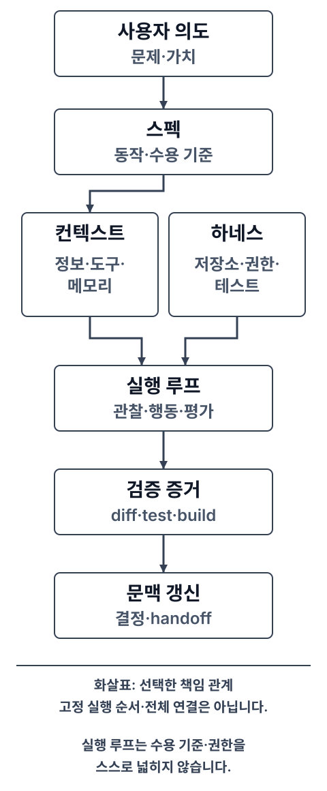

## 먼저 결론

컨텍스트·스펙·하네스·루프는 경쟁하는 네 방법론도, 반드시 차례대로 도입하는 네 단계도 아닙니다. 각각 **이번 판단에 무엇을 보여 줄지**, **어떤 결과를 요구할지**, **어떤 환경에서 행동하고 검증할지**, **실패와 증거를 어떻게 다음 시도에 반영할지**라는 서로 다른 책임을 설명합니다.

잘 만든 스펙도 오래된 파일을 컨텍스트로 주면 잘못 구현될 수 있습니다. 좋은 컨텍스트도 에이전트가 운영 비밀과 외부 쓰기에 무제한 접근하면 안전하지 않습니다. 테스트가 많은 하네스도 결과를 맞다고 판단하는 기준인 오라클이 틀리면 오류를 통과시키고, 빠른 루프도 같은 잘못을 반복하면 낭비를 가속합니다. 네 책임은 함께 설계하고 각각 따로 검증해야 합니다.

## 한 문장씩 정의

- **컨텍스트 엔지니어링(context engineering)**: 모델이 현재 판단에 사용할 정보·지시·도구 설명·검색 결과·작업 기억을 선택하고 최신성·우선순위·노출 범위를 관리하는 실무입니다.
- **스펙 주도 개발(spec-driven development)**: 사용자 의도를 검토 가능한 동작·제약·수용 기준과 작업 산출물로 바꾸고 구현과 추적하는 접근입니다.
- **하네스 엔지니어링(harness engineering)**: 에이전트가 저장소에서 행동하고 결과를 관찰·검증하도록 구조·도구·권한·테스트·운영 신호·게이트를 설계하는 실무 표현입니다.
- **루프 엔지니어링(loop engineering)**: 관찰·행동·평가·수정·handoff가 반복되는 조건과 중단·예산·복구 규칙을 의도적으로 설계한다는 신생 표현입니다.

이 정의는 이 핸드북에서 책임을 구분하기 위한 편집 기준입니다. `context engineering`과 `harness engineering`은 여러 조직이 쓰는 현재 실무 표현이지만 단일 표준 정의가 아니며, `loop engineering`은 특히 합의된 방법론이나 보편 성숙도 모델로 취급하지 않습니다.

## 비유와 비유의 한계

작은 공방을 생각해 보세요. 컨텍스트는 작업자가 펼쳐 둔 최신 도면·재료 표·주의사항이고, 스펙은 완성품의 치수·허용 오차·검수 조건이며, 하네스는 작업대·공구·보호 장치·측정기이고, 루프는 만들고 재고 측정하고 조정하는 반복입니다.

이 비유는 정보·목표·환경·피드백 책임을 나누는 데 맞습니다. 하지만 AI 작업은 공방보다 경계가 흐립니다. 스펙도 컨텍스트에 포함되고, 테스트 결과는 다음 컨텍스트가 되며, 하네스가 평가자를 실행할 수 있습니다. 또한 측정기가 틀리거나 작업자가 권한 밖 시스템을 건드리면 반복 자체가 안전을 보장하지 않습니다.

## 성숙도를 어떻게 읽어야 하나요?

용어의 유행 정도와 실제 시스템의 성숙도를 섞지 마세요. 다음 네 상태는 업계 표준 등급이 아니라 현재 프로젝트를 진단하기 위한 질문 틀입니다.

| 진단 상태 | 보이는 신호 | 다음에 보강할 것 |
|---|---|---|
| 암묵적 | 긴 대화와 사람 기억에 목표·규칙·완료 조건이 흩어짐 | 정본 위치·작은 작업·비목표·수용 기준 |
| 명시적 | context·spec·명령은 있으나 최신성·권한·실행 결과가 불분명함 | 기준 commit·허용 파일·실행 환경·종료 코드 |
| 재현 가능 | 같은 입력·fixture·명령으로 결과와 실패를 다시 확인할 수 있음 | 실제 browser·data·security·운영 신호와 독립 검토 |
| 학습 가능 | 회귀·오탐·비용·실패 원인이 다음 context·spec·harness에 반영됨 | 기준 드리프트·평가 과적합·권한 확대를 주기적으로 재감사 |

프로젝트 전체가 한 상태에만 있는 것도 아닙니다. 정적 검사는 재현 가능하지만 배포 복구는 암묵적일 수 있습니다. 제품이 새 기능을 제공한다고 자동으로 다음 상태가 되지 않으며, 실제 산출물과 증거로 책임별 상태를 판정합니다.

## 1. 컨텍스트: 지금 무엇을 사실로 보게 할 것인가

컨텍스트 후보에는 다음이 포함됩니다.

- 사용자 목표·비목표·결정이 필요한 질문
- 현재 branch·commit·dirty 상태와 허용 파일
- 관련 코드·문서·스키마·아키텍처 결정
- 도구 설명·권한·샌드박스·실행 환경
- 테스트·로그·브라우저·데이터의 새 증거
- 검색으로 찾은 자료를 생성의 근거로 넣는 검색 증강 생성(RAG) 결과와 출처·확인일
- 이전 작업의 결정·미검증·handoff

핵심은 양이 아니라 **선택·출처·시점**입니다. 모든 파일을 넣으면 오래된 지시와 긴 로그가 중요한 신호를 가립니다. 너무 적게 넣으면 모델이 공백을 추측합니다. 따라서 각 입력에 “왜 필요한가, 어느 commit·환경의 사실인가, 무엇보다 우선하는가, 비밀이나 개인정보를 포함하는가”를 묻습니다.

### 컨텍스트 실패와 복구

오래된 파일을 최신 정본으로 쓰거나 대화 요약이 결정 근거를 잃으면 먼저 행동을 멈춥니다. 저장소의 현재 HEAD·diff·규칙과 권위 있는 데이터 상태를 다시 읽고, 충돌한 정보는 최신성·소유자·적용 범위로 판정합니다. 긴 로그는 원본을 보존한 채 오류·명령·시점·상관 식별자를 구조화하고, 모델에 필요 없는 비밀은 마스킹이 아니라 애초에 접근 범위에서 제외합니다.

Anthropic은 2025년 9월 29일 조직 글에서 context를 유한한 자원으로 보고 지시·도구·MCP·외부 데이터·메시지 이력을 선택·유지하는 실무를 `context engineering`으로 설명했습니다. 이는 한 회사의 현재 실무 관점이며, 단일 최적 구성이나 정확성 보장이 아닙니다.

## 2. 스펙: 무엇을 만들고 무엇으로 수용할 것인가

스펙은 긴 프롬프트나 구현 설명이 아닙니다. 사용자 결과, 관찰 가능한 동작, 제약, 비목표, 실패 상태와 수용 기준을 사람이 검토할 수 있는 산출물입니다.

좋은 스펙은 다음 질문에 답합니다.

- 누구의 어떤 문제가 현재 범위인가요?
- 정상·빈 상태·오류·권한 거절에서 무엇이 보여야 하나요?
- 어떤 상태와 불변식이 끝까지 보존돼야 하나요?
- 어떤 파일·데이터·외부 시스템은 바꾸지 않나요?
- 어떤 직접 증거가 각 수용 기준을 판정하나요?

GitHub Spec Kit는 2026년 8월 13일 확인한 공식 site와 current main 저장소에서 specification-driven development toolkit과 스펙·계획·작업·구현 산출물의 현재 사례를 제공합니다. 이 흐름은 사용할 수 있는 조직 도구 사례이지 Software Design Description 표준, 모든 팀의 유일한 개발 순서, 구현 성공 보장이 아닙니다.

### 스펙 실패와 복구

세부가 많아도 “빠르게”, “안전하게”, “잘 동작하게”처럼 판정할 수 없는 말만 있으면 형식만 갖춘 명세(spec theater)에 머뭅니다. 모호한 형용사를 사용자 관찰·데이터 불변식·시간 또는 환경 경계·부정 테스트로 바꿉니다. 구현 중 새 사실이 나오면 몰래 범위를 넓히지 않고 질문·결정·변경된 수용 기준을 먼저 기록합니다. 스펙이 틀렸다면 구현을 억지로 맞추기보다 사용자의 현재 의도와 운영 사실로 스펙을 수정하고 영향받는 테스트를 다시 판정합니다.

## 3. 하네스: 어떤 행동과 피드백을 가능하게 할 것인가

하네스는 에이전트 주변의 작업 시스템입니다.

- 찾기 쉬운 저장소 구조와 정본 문서
- 파일 검색·편집·테스트·브라우저·데이터 조회 도구
- read·write·network·exec·approval·sandbox 경계
- 아키텍처 의존 방향·정적 검사·테스트 오라클
- 안전한 로그·실패 분류·실행 수·종료 코드
- diff·commit·리뷰·배포·복구 게이트
- 작업 상태·결정·미검증·handoff 기록

OpenAI의 2026년 2월 11일 Harness Engineering 글은 내부 beta를 만든 한 팀이 저장소 지식·아키텍처 경계·CI·관측·여러 review feedback을 에이전트가 읽고 집행할 수 있게 만든 조직 사례입니다. 성과 수치와 “harness engineering” 표현을 모든 조직의 표준이나 Codex의 보편 성능으로 일반화하지 않습니다.

### 하네스 실패와 복구

검사가 너무 느리면 에이전트가 건너뛰고, 너무 좁으면 실제 위험을 못 봅니다. 실패 이유를 분류해 빠른 local check와 넓은 full check를 나누고 둘의 통과 조건을 기록합니다. 테스트가 내부 구현만 확인하면 data·browser·security·운영 증거를 보완합니다. 샌드박스 안의 파일만 격리하고 같은 database·port·cache·remote branch를 공유하면 충돌할 수 있으므로 외부 자원 소유권과 고유 fixture를 별도로 둡니다. 하네스 자체가 바뀌면 제품 코드와 마찬가지로 diff·회귀·권한 감사를 수행합니다.

## 4. 루프: 언제 반복하고 멈추며 넘길 것인가

에이전트 루프는 대체로 `관찰 → 판단 → 한 행동 → 결과 평가 → 상태 갱신`을 반복합니다. 장시간 작업에서는 초기화, 작은 작업 선택, 구현, 자동 평가, 독립 리뷰, handoff가 세션을 넘어 이어집니다.

루프 계약에는 다음이 필요합니다.

- 목표·비목표와 현재 한 단위
- 성공·실패·중단·사람 질문 조건
- 시간·비용·시도 횟수·권한 한도
- 재시도 전에 새로 확인할 증거
- 같은 실패가 반복될 때 복구·rollback·handoff 방법
- 다음 세션이 읽을 기준 commit·완료·미완료·결정 기록

Anthropic의 2025년 11월 26일과 2026년 3월 24일 장시간 하네스 글은 큰 작업을 작은 단위로 나누고 명시적 진척·상태·handoff artifact와 planner·generator·evaluator를 조합한 실험을 설명합니다. 이 agent 수와 구조는 현재 조직 사례이지 장시간 자율 실행의 보편 최적 구조나 사람 수용의 대체물이 아닙니다.

### 루프 실패와 복구

같은 명령을 반복하며 새 증거가 없으면 재시도가 아니라 정체입니다. 실패 유형과 이전 시도를 기록하고 가설·입력·환경 중 하나를 바꾸거나 사람에게 질문합니다. 평가 점수만 올리도록 구현이 오라클을 우회하면 실제 사용자 결과·권위 데이터·보안 부정 경로를 추가하고 transcript와 diff를 표본 검토합니다. 컨텍스트 한계가 가까워지면 요약만 남기지 말고 정본 파일·commit·명령·결과·남은 위험을 handoff artifact에 연결합니다.

## 네 책임의 관계를 읽는 법

다음 그림은 의도·스펙·컨텍스트·하네스·실행 루프·증거·문맥 갱신이 서로 다른 책임이라는 질문 지도입니다.

- 사용자 의도는 해결할 문제와 가치를 제공하고 스펙은 관찰 가능한 동작·제약·수용 기준으로 바꿉니다.
- 컨텍스트는 스펙·현재 상태·도구 결과를 이번 판단에 맞게 선택합니다.
- 하네스는 에이전트가 행동하고 증거를 만들 수 있는 도구·권한·검사·관측 환경을 제공합니다.
- 실행 루프는 한 단위를 바꾸고 평가하지만, 수용 기준이나 권한을 스스로 확대하지 않습니다.
- 검증 증거는 완료 선언의 장식이 아니라 스펙·컨텍스트·하네스의 잘못을 발견하는 입력입니다.
- 문맥 갱신은 성공뿐 아니라 실패·오탐·미검증·다음 중단 조건을 다음 작업에 넘깁니다.

그림은 책임 지도를 단순화한 것이며 완전한 topology나 고정 실행 순서를 증명하지 않습니다. 예를 들어 스펙은 컨텍스트의 일부이고, 검증 실패가 즉시 스펙이나 하네스를 바꿀 수 있으며, 보안 사고에서는 구현보다 안정화와 권한 회수가 먼저일 수 있습니다.

## 관찰·평가·회귀를 분리합니다

| 구분 | 묻는 질문 | 대표 증거 |
|---|---|---|
| 관찰 | 실제로 무엇이 일어났나요? | 파일·diff·명령 출력·trace·data·DOM·픽셀 |
| 평가 | 그 결과가 수용 기준과 위험을 충족하나요? | 오라클·grader·독립 리뷰·도메인 판단 |
| 회귀 | 이전에 되던 중요한 동작이 여전히 되나요? | 고정 fixture·반복 가능한 suite·기준선 비교 |

관찰값이 많아도 평가 기준이 틀릴 수 있고, 한 번 PASS해도 다음 변경에서 회귀할 수 있습니다. 평가를 수행하는 코드·모델·사람을 평가자(grader)라고 합니다. 모델 평가자는 열린 결과를 다루는 데 유용하지만 같은 입력에도 판정이 달라질 수 있어 사람의 교정이 필요합니다. 코드 기반 검사도 빠르고 재현 가능하지만 유효한 변형을 오답으로 만들 수 있습니다. 따라서 위험에 따라 결정적 검사·모델 검토·실제 데이터·브라우저·사람 판단을 조합하고 어떤 층도 단독 완성 보장으로 쓰지 않습니다.

## 모임 W-03에 적용해 보기

모임 참가·취소 조각에 네 책임을 적용하면 다음처럼 나뉩니다.

| 책임 | W-03 입력 |
|---|---|
| 컨텍스트 | 현재 스키마·API·인증 주체·활성 참가 제약·branch·fixture·최근 테스트 결과 |
| 스펙 | 자기 참가·자기 취소, 활성 중복 0, commit 뒤 응답 실패의 재조회·중복 방지, 미인증·타인 취소 거절 |
| 하네스 | 격리된 가상 사용자·database fixture, API·제약·동시성·부정 테스트, diff·secret 검사, 승인된 명령 |
| 루프 | 한 실패 재현→한 단위 변경→같은 오라클→전체 W-03 회귀→독립 검토→수용 또는 handoff |

이 매핑은 실제 모임 앱 구현이나 특정 데이터베이스 동작을 주장하지 않습니다. 고유성 표현·격리 수준·재시도·배포 환경은 제품을 선택할 때 공식 문서와 실행 증거로 다시 확인해야 합니다. [현재 도구 매핑](../../reference/current-tool-mapping/)의 날짜 있는 제품 예시도 이 지속 책임을 대신하지 않습니다.

## 도입 순서보다 먼저 할 최소 계약

1. 저장소 상태·정본·현재 작업의 목표와 비목표를 고정합니다.
2. 한 사용자 결과의 수용 기준과 실패 오라클을 씁니다.
3. 필요한 파일·명령·data·network·external effect 권한만 허용합니다.
4. 한 단위 변경 뒤 빠른 검사와 실제 위험 증거를 확인합니다.
5. fresh context의 독립 검토와 finding 재판정을 거칩니다.
6. 수용된 결정·실패·미검증·다음 기준 commit을 갱신합니다.

처음부터 검색·메모리·멀티에이전트·복잡한 evaluator를 모두 추가하지 않습니다. 현재 실패가 정보 부족인지, 요구 모호성인지, 도구·권한·오라클 부족인지 먼저 분류하고 그 책임만 좁게 보강합니다.

## 확인 체크리스트

- [ ] 네 용어를 선형 단계·제품 기능·업계 표준으로 설명하지 않았나요?
- [ ] context 입력마다 출처·시점·우선순위·비밀 노출 범위를 확인했나요?
- [ ] spec에 사용자 결과·비목표·실패 상태·수용 기준이 있나요?
- [ ] harness가 read·write·network·exec·approval과 외부 자원 경계를 집행하나요?
- [ ] loop에 중단·예산·반복 실패·rollback·handoff 조건이 있나요?
- [ ] 관찰·평가·회귀와 deterministic·model·human evidence를 구분했나요?
- [ ] 현재 조직 사례의 발표일·문서 상태·직접 적용·일반화 금지선을 기록했나요?
- [ ] 실패가 다음 context·spec·harness에 실제 diff로 반영됐나요?
- [ ] 제품 이름을 지워도 남는 책임과 실제 성공 증거를 설명할 수 있나요?

## 짧은 연습

“에이전트가 긴 작업을 자꾸 잊으니 멀티에이전트 하네스와 vector memory를 도입하자”는 제안을 네 책임으로 다시 써 보세요.

1. 잊었다고 판단한 관찰 증거와 기준 commit을 적습니다.
2. 누락된 정보가 context, 모호한 완료 조건이 spec, 도구·검사 부족이 harness, handoff·중단 실패가 loop 중 어디에 속하는지 분류합니다.
3. 새 제품 없이 시도할 가장 작은 복구와 성공 오라클을 적습니다.
4. 새 도구가 꼭 필요하다면 read·write·network·비밀·보존 데이터·비용 경계를 적습니다.
5. 한 번의 성공이 회귀 부재나 보편 성숙도를 증명하지 않는 이유를 적습니다.

## 관련 장과 공식 자료

- [방법론 관계 지도](../../reference/methodology-map/)에서 컨텍스트·스펙·하네스·루프를 문서·개발 규율·팀 운영 방식과 구분합니다.
- [AI 코딩 에이전트와 일하는 법](../working-with-coding-agents/)은 네 책임을 한 작업 계약과 수용 루프로 연결합니다.
- [에이전트 결과 리뷰와 검증](../agent-review-and-verification/)은 관찰·평가·독립 검토·재판정의 증거 경계를 설명합니다.
- [권한·샌드박스·worktree](../permissions-sandbox-worktrees/)는 하네스가 제한해야 할 파일·명령·네트워크·외부 부작용을 구체화합니다.
- GitHub Spec Kit 공식 site: https://github.github.com/spec-kit/
- OpenAI Harness Engineering: https://openai.com/index/harness-engineering/
- Anthropic Context Engineering: https://www.anthropic.com/engineering/effective-context-engineering-for-ai-agents
- Anthropic Effective Harnesses: https://www.anthropic.com/engineering/effective-harnesses-for-long-running-agents
- Anthropic Harness Design: https://www.anthropic.com/engineering/harness-design-long-running-apps

위 자료는 2026년 8월 13일 확인한 현재 프로젝트·조직 사례입니다. 정확한 발표일·문서 상태·적용 범위·일반화 금지선은 저장소의 `research/source-map.md`에서 관리하며, 제품 조작법이나 실제 계정·배포 성공을 주장하지 않습니다.
