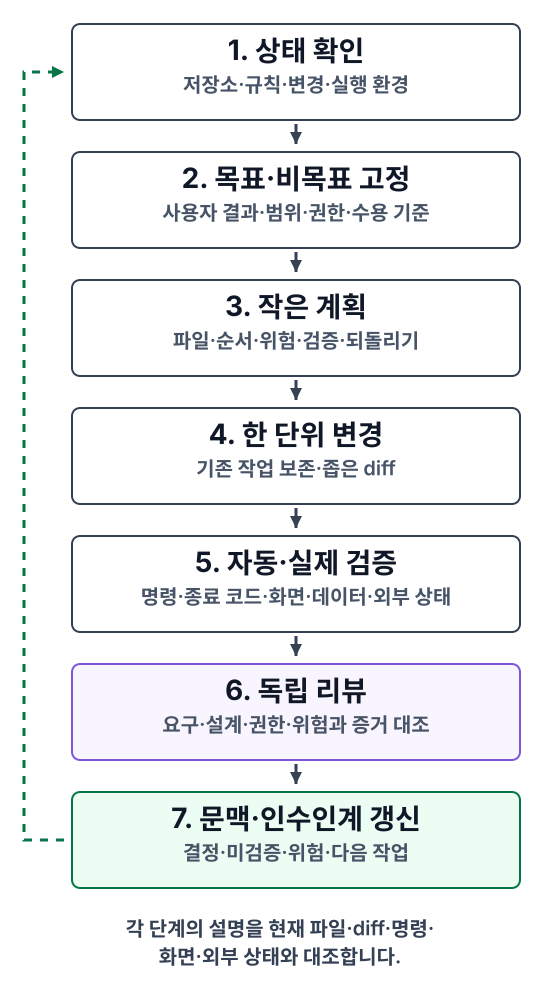

## 먼저 결론

코딩 에이전트는 “원하는 것을 알아서 완성하는 개발자”가 아닙니다. 이 장에서는 주어진 작업 환경에서 파일을 읽고 바꾸고 도구를 실행하며 결과를 보고하는 작업자를 뜻합니다. 목표가 모호하면 제품 결정을 추측하고, 권한이 넓으면 작은 판단 오류가 파일·데이터·원격 서비스까지 영향을 줄 수 있으며, 검증 범위가 좁으면 실패한 시스템을 성공했다고 보고할 수 있습니다.

좋은 협업은 멋진 한 문장 프롬프트보다 다음 네 가지를 갖춥니다.

```text
작업 계약 =
  목표와 비목표
  + 범위와 권한
  + 수용 기준
  + 검증 증거
```

에이전트의 설명은 검토할 주장입니다. 현재 파일, diff, 명령의 종료 코드, 실제 화면과 외부 상태가 그 주장을 직접 뒷받침할 때만 완료로 받아들입니다.

## 왜 필요한가

“대시보드를 완성해 줘”라고 말하면 에이전트는 무엇을 완성으로 볼지 스스로 채워야 합니다. 화면만 만들지, 데이터 정확성까지 볼지, 새 프레임워크를 설치해도 되는지, 실제 배포·도메인 변경과 커밋·푸시까지 허용되는지 알 수 없습니다. 그 결과 겉보기에는 많은 파일과 기능이 생겨도 원래 문제와 다른 제품이 되거나, 사용자의 기존 변경을 덮거나, 테스트하지 않은 결과를 “완료”라고 부를 수 있습니다.

반대로 모든 세부 구현을 사용자가 미리 정할 필요도 없습니다. 비개발자가 책임져야 할 것은 코드 문법이 아니라 사용자 결과, 바꾸지 않을 경계, 받아들일 위험과 확인할 증거입니다. 에이전트는 그 안에서 저장소 패턴을 조사하고 작은 구현 대안을 제안하며 반복 작업을 수행할 수 있습니다.

핵심은 “AI를 얼마나 믿을까?”가 아니라 다음 질문입니다.

1. 지금 요청은 답변·진단·변경·외부 실행 중 무엇인가요?
2. 어떤 파일·데이터·환경·사람에게 영향이 갈 수 있나요?
3. 에이전트가 스스로 결정해도 되는 범위와 승인이 필요한 범위는 어디인가요?
4. 성공·실패·미실행을 어떤 직접 증거로 구분하나요?
5. 다음 세션이나 리뷰어가 대화 없이도 현재 상태를 이어받을 수 있나요?

## 코딩 에이전트란 무엇인가요

**코딩 에이전트(coding agent)**: 저장소 파일과 규칙을 읽고, 허용된 도구로 검색·편집·명령 실행·테스트·브라우저 확인 같은 여러 단계를 이어서 수행하는 AI 시스템입니다. Claude Code와 Codex는 이런 작업 방식의 예이지만 제품별 도구 이름·권한 모드·현재 기능은 달라질 수 있습니다.

코딩 에이전트는 다음 세 층에서 일합니다.

- **모델**: 주어진 컨텍스트에서 다음 판단과 행동을 제안합니다.
- **도구**: 파일 읽기·쓰기, 터미널, 브라우저, 외부 서비스 같은 실제 행동을 수행합니다.
- **하네스**: 저장소 구조·규칙·권한·테스트·관측·승인·인수인계로 행동을 제한하고 실패를 드러냅니다.

모델이 같은 이름이어도 어떤 파일과 도구를 볼 수 있는지, 샌드박스와 승인 규칙이 무엇인지, 테스트가 얼마나 현실적인지에 따라 결과가 달라집니다. 모델 이름만으로 작업 품질과 안전을 판단하지 않습니다.

## 공동 작업실의 외부 작업자에 비유하기

코딩 에이전트를 여러 사람이 함께 쓰는 작업실에 들어온 외부 작업자라고 생각해 보겠습니다.

- 저장소는 작업실과 현재 제작물입니다.
- `AGENTS.md`와 규칙 문서는 작업실 안전 수칙입니다.
- 작업 브리프는 이번 의뢰서입니다.
- 샌드박스와 권한은 사용할 수 있는 방·도구·열쇠의 범위입니다.
- 테스트와 빌드는 측정 도구와 검사대입니다.
- diff는 작업 전후에 무엇이 달라졌는지 보여 주는 기록입니다.
- 리뷰와 승인은 결과물을 인수하는 검사입니다.
- 커밋과 handoff는 다음 작업자가 기준 상태를 찾게 하는 인계 기록입니다.

이 비유가 맞는 지점은 숙련된 작업자도 작업실 사정과 제품 목적을 자동으로 알지 못하며, 작업 범위·도구·검사 기준·인수 절차가 필요하다는 점입니다. “경험이 많아 보인다”는 이유로 금고·운영 시스템·고객 데이터의 열쇠까지 맡기지 않는다는 점도 같습니다.

### 비유가 깨지는 지점

에이전트는 물리적 작업자처럼 작업실 전체를 자연스럽게 보지 못합니다. 컨텍스트에 들어온 파일과 도구 출력만 사용하며 긴 대화가 압축되면 결정 근거가 요약에서 빠질 수 있습니다. 명령은 몇 초 안에 수천 파일이나 외부 시스템을 바꿀 수 있고, 그럴듯한 설명을 실제 실행으로 오인할 수도 있습니다. 에이전트의 자신감·정중함·응답 길이는 정확성 증거가 아닙니다.

## 요청 동사는 권한을 뜻합니다

사용자가 쓴 동사를 에이전트가 어디까지 행동해도 된다는 뜻으로 해석할지 먼저 구분합니다.

### 답변·설명

개념을 설명하거나 선택지를 비교하는 요청입니다. 관련 자료를 읽을 수는 있지만 파일 수정·외부 메시지·배포까지 허용한 것은 아닙니다.

### 검토·상태 보고

실제 파일·규칙·테스트 결과를 확인해 문제와 현재 상태를 보고하는 요청입니다. 읽기 전용 조사와 비파괴 진단은 가능하지만 지적한 문제를 자동으로 고쳐도 된다는 뜻은 아닙니다.

### 진단

증상과 원인을 재현·분류하는 요청입니다. 로그·diff·테스트를 읽고 안전한 확인 명령을 실행할 수 있지만 “원인을 찾아라”와 “수정해서 배포하라”는 다른 요청입니다.

### 변경·구현

요청 범위 안의 로컬 파일을 수정하고 필요한 비파괴 검증을 실행하는 요청입니다. 새 의존성·네트워크·대량 이동·데이터 변경·커밋·푸시·배포는 프로젝트 정책에서 별도 승인으로 둘 수 있습니다.

### 외부 실행·공개

원격 저장소, 이슈·PR, 메시지, 클라우드, 운영 데이터, 도메인과 배포처럼 다른 사람이나 실제 서비스에 영향을 주는 행동입니다. 로컬 구현 요청만으로 자동 허용하지 않고 정확한 대상·영향·승인·되돌리기 경로를 확인합니다.

에이전트가 “다음으로 배포할까요?”라고 제안하는 것은 실행했다는 뜻이 아닙니다. 사용자가 “전체를 끝내라”고 말했더라도 그 표현이 비밀 접근·결제·데이터 삭제 같은 별도 권한까지 넓히지는 않습니다.

진단 계약과 변경 계약은 결과물도 다릅니다. 진단은 상태를 보존한 채 재현 절차·관찰 사실·원인 후보·반대 증거·미확인 범위를 남기며, 수정 권한이 없으면 변경 제안에서 멈춥니다. 변경은 허용된 파일과 외부 효과 안에서 diff를 만들고 정상·경계·실패 수용 기준을 검증하며 되돌리기와 남은 위험을 보고합니다. 진단에서 변경이 필요해 보여도 계약이 자동으로 변경 계약으로 바뀌지는 않습니다.

## 증거 기반 작업 루프

전체 순서는 `상태 → 목표 → 비목표 → 계획 → 한 단위 변경 → 검증 → 독립 리뷰 → finding 재판정 → 수용 → 문맥·인수인계`입니다. 아래 그림은 목표와 비목표, 리뷰와 재판정·수용처럼 밀접한 책임을 일곱 노드로 묶어 보여 주는 질문 지도이며, 모든 작업이 한 번씩만 통과하는 고정 실행 순서나 완전한 시스템 토폴로지는 아닙니다.



### 1. 상태 확인

에이전트가 저장소 경계, 현재 브랜치와 기준 커밋, tracked·untracked·ignored 파일, 기존 사용자 변경, 규칙 문서, 관련 구현과 테스트를 먼저 확인하게 합니다. 파일을 찾지 못했거나 Git 이력이 없는 상태도 중요한 사실입니다.

### 2. 목표와 비목표 고정

사용자 관점에서 무엇이 달라져야 하는지, 이번에 바꾸지 않을 기능·구조·환경을 정합니다. “로그인 구현”보다 “만료된 이메일 로그인 링크를 사용하면 데이터 변경 없이 같은 오류 안내를 보여 준다”가 관찰 가능합니다.

### 3. 작은 계획

수정 파일과 이유, 인터페이스·데이터 영향, 수용 기준, 검증 명령, 위험과 되돌리기 방법을 제시하게 합니다. 계획을 검토하는 요청이면 승인 전 파일을 바꾸지 않도록 명시합니다.

### 4. 한 단위 변경

리뷰어가 독립적으로 승인하거나 거절할 수 있는 한 작업만 구현합니다. 기존 스타일과 패턴을 따르고 무관한 리팩터링·포맷 변경·추상화를 섞지 않습니다.

### 5. 자동·실제 검증

테스트·정적 검사·빌드를 실제로 실행하고 명령·환경·종료 코드·통과·실패·건너뜀 수를 확인합니다. 위험에 따라 브라우저, 데이터, 외부 계약과 운영 환경의 직접 증거를 추가합니다.

### 6. 독립 리뷰

요구사항 누락, 권한·보안·데이터·호환성·과설계를 작성 과정과 다른 관점에서 검토합니다. 같은 세션의 자체 검토는 유용하지만 기존 가정을 공유하므로 완전한 독립 검토로 부르지 않습니다. 리뷰 finding은 곧바로 모두 적용하지 않고 현재 요구·재현·직접 증거와 대조해 `confirmed defect`, `design decision`, `needs context`, `out of scope`, `false positive`로 재판정합니다. confirmed defect를 고쳤다면 원래 오라클과 전체 게이트를 다시 실행하며, 리뷰의 `PASS`도 수용 결정을 대신하지 않습니다.

### 7. 문맥·인수인계 갱신

권한 있는 수용자는 각 수용 기준의 직접 증거, 재판정된 finding, 미검증 범위와 남은 위험을 보고 `수용`, `조건부 수용`, `거절`을 결정합니다. 거절이나 조건 미충족이면 증거를 성공으로 덮어쓰지 않고 목표·계획 또는 한 단위 변경으로 돌아갑니다. 수용 상태가 분명해진 뒤 결정, 바뀐 파일, 검증 결과, 미검증 범위, 남은 위험과 다음 작업을 저장소 문서와 이력에 남깁니다. 다음 세션은 대화 요약보다 현재 파일과 실제 상태를 다시 확인해야 합니다.

루프는 항상 한 방향으로 끝나지 않습니다. 테스트 실패는 계획이나 요구 해석으로 돌아가고, 리뷰에서 범위가 틀렸다면 구현을 더 늘리기보다 목표를 다시 고정해야 합니다.

## 시작 전에 확인할 기준 상태

변경 전 상태를 모르면 어떤 문제가 원래 있었고 무엇이 이번 변경 때문인지 구분하기 어렵습니다.

- 현재 작업 폴더가 의도한 저장소 안인가요?
- 저장소 최상위 경계와 적용되는 규칙 파일은 무엇인가요?
- 현재 브랜치·HEAD·원격 정보는 실제로 존재하고 최신인가요?
- 기존 tracked 변경과 untracked 파일은 누구의 작업인가요?
- ignore된 생성물·비밀·데이터가 검증 범위에서 빠지지 않나요?
- 관련 테스트는 수정 전 어떤 결과를 냈나요?
- 필요한 런타임·패키지·환경 설정은 무엇인가요?
- 현재 실행 중인 서버·포트·데이터베이스 writer가 있나요?

`git diff`가 비어 있다고 작업 폴더가 깨끗한 것은 아닙니다. 최초 커밋 전 저장소나 새 파일은 기본 diff에 내용이 나타나지 않을 수 있으므로 `git status`와 실제 파일을 함께 확인합니다. 반대로 dirty 상태라고 에이전트가 임의로 초기화하거나 사용자의 변경을 삭제해서는 안 됩니다.

## 작업 브리프의 여덟 요소

### 1. 현재 상태와 근거

읽어야 할 규칙·설계·대상 파일, 재현 절차, 확인한 오류와 최근 결정이 무엇인지 적습니다. 기억이나 화면 인상과 실제 파일·명령 증거를 구분합니다.

### 2. 목표

사용자 또는 시스템에서 바뀌어야 할 결과를 한 문장으로 씁니다. 구현 수단보다 완료 뒤 관찰할 행동을 우선합니다.

### 3. 비목표

이번 작업에서 바꾸지 않을 기능·정보 구조·프레임워크·데이터·배포를 적습니다. 비목표는 미래에 절대 하지 않는다는 뜻이 아니라 현재 diff를 작게 유지하는 경계입니다.

### 4. 수정 범위

수정 가능한 파일·구성요소와 읽기만 할 영역을 정합니다. 경계가 불확실하면 구현 전에 영향 파일 후보를 보고하게 합니다.

### 5. 권한과 제약

로컬 쓰기·테스트·브라우저, 네트워크·의존성, Git, 외부 서비스, 데이터와 비밀의 허용·승인·금지 범위를 정합니다. 호환성·성능·접근성·법적 제약도 여기에 포함합니다.

### 6. 수용 기준

정상·경계·실패 상황을 관찰 가능한 입력·행동·출력으로 씁니다. “깔끔하고 빠르게”보다 “390px 화면에서 페이지 전체 가로 스크롤이 없고 핵심 버튼을 키보드로 사용할 수 있다”가 검증 가능합니다.

### 7. 검증과 증거

실행할 명령, 필요한 브라우저·데이터·외부 확인, 기대하는 종료 코드와 수량을 적습니다. 실행 불가 시 성공으로 쓰지 않고 이유와 남은 위험을 보고하게 합니다.

### 8. 보고와 인수인계

변경 파일, 핵심 판단, 수용 기준별 결과, 미실행 검증, 남은 위험, 되돌리기와 갱신할 문맥 문서를 정합니다.

이 저장소의 내부 파일 `templates/agent-task-brief-template.md`는 이 구조를 반복 사용하기 위한 작업 브리프 템플릿입니다. 공개 프로젝트에서는 자신의 저장소 규칙과 위험에 맞게 조정합니다.

## 개발 사례: 모임 참가 웹앱

앞의 여덟 요소를 모임 참가 웹앱에 적용해 보겠습니다. 먼저 W-01 공개 조회의 빈 화면은 변경 권한 없이 증거를 모으는 진단으로 좁히고, W-03 중복 참가 방지는 한 사용자 결과를 관통하는 변경 작업으로 고정합니다.

### 빈 상세 화면은 읽기 전용으로 먼저 진단하기

공개 모임 상세 화면이 비어 보인다는 증상만으로 endpoint, 데이터 부재 또는 렌더링 오류를 먼저 결론 내리면 잘못된 층을 수정할 수 있습니다. 다음 요청은 실제 구현과 관찰 결과를 따라가되 원인을 고치지는 않는 읽기 전용 진단 계약입니다.

```text
저장소 규칙, W-01 공개 조회 계약과 현재 구현·테스트를 먼저 읽어라.
증상은 공개 모임 상세 화면이 비어 보이는 것이다. 원인 수정이나 새 endpoint 설계가 아니라 읽기 전용 진단만 수행하라.

다음을 순서대로 수집하고 확인한 사실, 해석과 미확인 범위를 구분해 보고하라.
- 현재 상태: 작업 위치·기준 버전·기존 변경과 관련 화면·요청·서버·데이터·렌더링 파일을 확인한다.
- 재현: 시작 URL·입력·행동·기대 상태·실제 상태와 재현 여부를 기록한다.
- Network 요청·응답: 관찰된 실제 요청의 메서드·URL·상태 코드·안전하게 공개 가능한 응답 형태를 기록한다.
- 서버 응답: 같은 요청을 처리한 실제 경로에서 확인할 수 있는 상태·응답 계약·안전한 진단 기록을 Network 결과와 대조한다.
- 권위 있는 데이터 존재: 허용된 읽기 전용 범위에서 해당 모임이 권위 있는 데이터 원본에 존재하는지와 조회 조건을 확인한다.
- 렌더링 상태: 응답이 화면 상태로 변환됐는지, 로딩·없음·취소·전달 실패 중 어느 상태가 선택됐는지와 실제 DOM·화면 증거를 기록한다.

파일을 수정하지 말고 비밀·토큰·세션·개인정보를 출력하지 말며 운영 데이터를 변경하지 마라. 소스·계약·관찰된 요청에 없는 endpoint를 근거 없이 추측하지 마라.
권위 있는 데이터나 서버 상태를 안전하게 확인할 권한·도구가 없으면 우회하지 말고 미확인으로 표시하라.
완료 보고에는 원인 후보별 직접 증거와 반대 증거, 아직 확인하지 못한 범위, 수정이 필요하다면 별도 승인을 받아야 할 최소 변경 후보만 포함하라.
```

이 진단에서 Network 응답과 화면이 비었다는 사실은 데이터가 없다는 증거가 아닙니다. 반대로 데이터 행의 존재도 공개 응답과 렌더링 성공을 보장하지 않으므로 각 경계를 따로 확인합니다.

### W-03 중복 참가 방지를 한 수직 조각으로 고정하기

진단에서 변경 필요성이 확인됐더라도 “참가 기능을 완성하라”로 넓히지 않습니다. 다음 요청은 W-03의 활성 참가 고유성만을 기존 여덟 요소에 맞춰 독립적으로 검토하고 되돌릴 수 있는 변경 작업으로 제한합니다.

```text
현재 상태와 근거:
- 저장소 규칙, 모임 웹앱 W-03 계약, 현재 참가 계약·데이터 제약·서비스·테스트·관련 문서와 기존 변경을 먼저 읽고 기준 상태를 보고하라.

목표:
- 같은 사용자의 같은 모임 활성 참가가 한 건만 존재하게 하라.

비목표:
- 대기 명단·알림·결제·UI 전면 개편은 하지 마라.

수정 범위:
- 참가 계약·데이터 제약·서비스·테스트·관련 문서만 변경하라.

권한과 제약:
- 로컬 파일 수정과 비파괴 테스트를 허용하며, 검증 통과 뒤 관련 파일의 로컬 commit만 허용한다.
- 금지: 새 의존성·네트워크·실제 계정·실제 개인정보·push·배포를 사용하지 마라.

수용 기준:
- 첫 참가가 성공하고 동일 (event_id, participant_id)의 활성 행은 한 건이다.
- 중복 참가는 안전하게 거절되고 실패 뒤 업무 데이터는 불변이다.
- 같은 가상 참가자의 같은 모임 요청 두 개를 같은 시작 장벽에서 실행하면 한 건만 확정되고 다른 요청은 계약대로 안전하게 거절된다. 최종 활성 행은 한 건이며 실패 요청으로 인한 부분 저장은 없다.
- 같은 참가자의 다른 모임 참가에는 영향이 없다.

검증과 증거:
- 가상 fixture와 격리된 데이터 경계에서 순차 중복과 위 동시 요청을 각각 시험하고, 권위 데이터의 최종 활성 행 수와 실패 요청의 부분 저장 0건을 직접 확인하라.
- 애플리케이션의 사전 조회와 독립적으로 실제 데이터 고유성 보호가 중복 저장을 막는지 검증하라. mock 결과만으로 데이터 경계의 보장을 대신하지 마라.
- 관련 대상 테스트와 전체 테스트를 실행하라.
- git status와 staged diff로 변경·스테이징 범위를 확인하라.
- 각 명령의 실행 위치·종료 코드·실행 수·실패 0건을 보고하고, 수용 기준별 테스트와 데이터 오라클을 연결하라.

보고와 인수인계:
- 변경 파일·핵심 diff·수용 기준별 직접 증거·미실행 검증·남은 위험·되돌리기 방법을 보고하라.
- 로컬 commit을 만들었다면 식별자를 보고하고 push와 배포는 미실행 상태로 따로 표시하라.
```

이 계약은 중복 확인 코드를 한 줄 추가하는 수단이 아니라, 첫 성공·순차 및 동시 중복 거절·다른 모임 비영향·실패 요청의 부분 저장 없음이라는 사용자 결과를 애플리케이션과 데이터 경계에서 함께 증명하는 단위입니다. 같은 참가자의 동시 중복을 다루며, 서로 다른 참가자가 마지막 자리를 경쟁하는 W-04 전체로 범위를 넓히지 않습니다. 구체적인 제약이나 트랜잭션 수단은 현재 데이터베이스와 저장소 패턴을 읽은 뒤 선택하고, 특정 구현을 근거 없이 가정하지 않습니다.

### 완료 주장을 별도 증거로 인수하기

에이전트가 “완료”라고 말하면 다음 질문으로 서로 다른 상태를 다시 판정합니다.

- 실제 diff에는 허용된 참가 계약·데이터 제약·서비스·테스트·관련 문서 변경만 있으며 무관한 변경과 비목표가 섞이지 않았나요?
- 대상 테스트와 전체 테스트의 정확한 명령·실행 위치·종료 코드·실행 수·실패 0건을 원문 요약으로 확인했나요?
- 첫 참가 뒤 동일 `(event_id, participant_id)`의 활성 행이 정확히 한 건이고, 중복 시도 거절 뒤에도 한 건이며 실패 뒤 업무 데이터가 불변이라는 오라클을 직접 조회했나요?
- 같은 가상 참가자의 동시 요청 두 개에서 성공 한 건·안전한 거절 한 건·최종 활성 행 한 건·실패 요청의 부분 저장 0건을 확인했나요? 사전 조회와 독립된 실제 데이터 고유성 보호의 검증 증거도 있나요?
- 같은 참가자의 다른 모임 참가가 그대로 유지된다는 부정 영향 증거가 있나요?
- 브라우저 상태를 실제로 확인했다면 URL·시작 상태·행동·응답 뒤 화면 상태와 확인 범위가 있으며, 확인하지 않았다면 미검증으로 표시했나요?
- 독립 리뷰 finding을 요구·재현·직접 증거로 재판정하고 confirmed defect를 같은 오라클로 다시 검증했으며, 권한 있는 수용자의 결정과 남은 조건을 구분했나요?
- 관련 변경을 담은 로컬 `commit`이 실제로 존재한다면 식별자와 포함 파일을 확인했나요?
- `push`가 실제로 실행되어 원격에 반영됐는지, 아니면 미실행인지 별도 증거로 확인했나요?
- 배포가 실제 환경에 반영되고 그 환경에서 검증됐는지, 아니면 미실행·미검증인지 로컬 빌드와 분리했나요?
- 공개가 승인된 대상에게 실제로 열렸는지, 아니면 배포됐어도 비공개·미공개 상태인지 URL·접근 범위·확인 시점으로 구분했나요?

이 질문은 사례 서비스가 실제로 구현·배포·공개됐다고 주장하지 않습니다. 작업 계약을 받은 에이전트의 보고를 저장소·명령·데이터·브라우저·로컬 이력·원격·환경·공개 범위의 서로 다른 증거로 인수하는 기준입니다.

## 계획은 실행 결과가 아닙니다

계획 단계는 변경 후보와 순서를 검토하는 과정입니다. 제품이 제공하는 계획 모드의 이름이나 명령, 읽기·쓰기·네트워크 권한은 제품·버전·실행 환경의 공식 문서와 실제 설정에서 별도로 확인해야 합니다. 에이전트가 파일 목록과 명령을 구체적으로 썼다고 실제 파일이 바뀌거나 테스트가 실행된 것은 아닙니다.

좋은 계획에는 다음이 있어야 합니다.

1. 현재 상태에서 확인한 사실과 아직 모르는 점
2. 이번 목표와 비목표
3. 변경 파일과 각 파일을 바꾸는 이유
4. 수용 기준과 검증 명령
5. 데이터·권한·호환성·되돌리기 위험
6. 사용자 결정이 필요한 지점

계획 승인 뒤에는 현재 상태가 달라졌는지 다시 확인할 수 있습니다. 다른 사람이나 에이전트가 같은 파일을 수정했다면 오래된 계획을 그대로 실행하지 않습니다.

## 가장 작은 독립 작업으로 나누세요

작은 작업은 단순히 파일 수가 적다는 뜻이 아닙니다. 하나의 사용자 결과와 수용 기준으로 독립적으로 검증하고 되돌릴 수 있어야 합니다.

- 문서 한 장의 개념 보완과 사이트 전체 정보 구조 변경을 섞지 않습니다.
- 버그 재현·수정·회귀 검증을 무관한 리팩터링과 분리합니다.
- 데이터 스키마 변경과 UI 표현 변경은 호환성·배포 순서를 별도로 검토합니다.
- 새 프레임워크 도입은 실제 요구와 ADR 없이 작은 기능 작업에 끼워 넣지 않습니다.
- 여러 장을 병렬 집필해도 공통 용어집과 목차의 쓰기 소유자는 한 곳으로 정합니다.

작업이 작으면 실패가 쉬워지는 것이 아니라 실패 원인과 영향 범위를 좁힐 수 있습니다. 큰 목표는 유지하되 검토 가능한 단위로 순서를 나눕니다.

## 증거의 강도를 구분하세요

모든 “확인”이 같은 범위를 증명하지 않습니다.

1. **정적 읽기**: 설정·코드·문서가 존재하고 의도한 구조인지 보여 줍니다. 실행 성공은 증명하지 않습니다.
2. **단위·정적 검사**: 작은 규칙과 계약 일부를 빠르게 확인합니다. 실제 통합·브라우저·운영 데이터는 보지 못할 수 있습니다.
3. **빌드·통합 검사**: 구성요소가 함께 산출물을 만드는지 확인합니다. 실제 사용자 흐름과 외부 환경까지 보장하지 않습니다.
4. **실제 렌더링·런타임 확인**: 브라우저·프로세스·데이터 경계의 동작을 직접 봅니다. 확인하지 않은 사용자·환경·시간까지 일반화하지 않습니다.
5. **외부·운영 검증**: 실제 공개 URL·원격 CI·권한·데이터·모니터링을 확인합니다. 명시적 권한과 안전한 대상이 필요합니다.
6. **사람 검토·사용자 관찰**: 기술적으로 작동하는 결과가 실제 목적과 이해 가능성을 충족하는지 봅니다.

낮은 층의 성공으로 높은 층을 추정하지 않습니다. 로컬 빌드 성공은 원격 배포 성공이 아니고, 페이지가 열린다는 사실은 데이터 정확성과 접근성을 모두 증명하지 않습니다.

## 테스트 보고를 다시 판정하는 법

“모든 테스트가 통과했습니다”라는 문장만으로는 부족합니다. 다음을 확인합니다.

- 정확히 어떤 명령을 어느 폴더와 환경에서 실행했나요?
- 종료 코드는 무엇인가요?
- 통과·실패·건너뜀·취소 수는 몇 개인가요?
- 출력이 잘리거나 경고가 성공 메시지 사이에 묻히지 않았나요?
- 변경 전에는 올바른 이유로 실패했고 변경 뒤 통과했나요?
- 테스트가 수용 기준의 정상·경계·실패 경로를 실제로 덮나요?
- mock·fixture·snapshot이 실제 계약과 달라질 가능성은 없나요?
- 전체 스위트와 관련 테스트 중 무엇을 실행했나요?

테스트를 실행하지 못했다면 `실패`와 `미실행`을 구분합니다. 도구가 없거나 권한이 막힌 상황을 성공으로 바꾸지 않고, 실행 가능한 대체 검증이 같은 범위를 증명하는지 따로 판단합니다.

## 에이전트 상태 메시지를 읽는 법

작업 중 보이는 메시지는 대부분 완료 판정이 아니라 현재 행동과 가설을 알려 주는 중간 신호입니다.

- **status update**: 지금 확인한 사실과 다음 행동의 요약입니다. 최종 검증을 대신하지 않습니다.
- **tool call**: 파일·명령·브라우저·외부 API 같은 도구를 사용하려는 행동입니다. 입력 대상과 권한을 확인합니다.
- **snapshot**: 파일·UI·데이터·환경 등의 특정 시점 상태입니다. 비교용인지 실제 복구용인지 묻습니다.
- **checkpoint**: 다시 시작하거나 검토하기 위한 중간 지점입니다. Git 커밋인지 문서 기록인지 자동 저장인지 확인합니다.
- **dry-run**: 실제 적용 대신 예상 행동을 보여 주는 모드입니다. 어떤 파일·네트워크·외부 부작용을 막는지는 도구마다 다릅니다.
- **fallback**: 주 경로가 실패했을 때 쓰는 대체 경로입니다. 정확도·기능·데이터 최신성·보안이 낮아지는지 확인합니다.
- **retry**: 실패한 행동을 다시 실행합니다. 일시 오류인지, 중복 저장·결제·메시지가 생기지 않는지, 중단 조건이 있는지 봅니다.
- **timeout**: 정한 시간 안에 결과를 받지 못한 상태입니다. 뒤의 작업이 실제로 중지됐는지 알 수 없으므로 무조건 재실행하지 않습니다.
- **blocked**: 필요한 입력·권한·외부 상태가 없어 현재 범위에서 진행할 수 없다는 주장입니다. 에이전트가 안전한 읽기·대안·부분 검증을 충분히 했는지 확인합니다. 한 작업의 차단을 전체 목표의 중단이나 완료로 확대하지 않습니다.
- **compaction**: 긴 대화와 도구 출력을 요약해 컨텍스트를 줄이는 과정입니다. 목표·결정 근거·미완성·사용자 변경이 빠지지 않았는지 파일에서 다시 확인합니다.
- **handoff**: 다음 세션이나 작업자에게 현재 상태를 넘기는 기록입니다. 저장소 상태·검증·미해결 위험·다음 행동이 있어야 합니다.

낯선 용어는 [에이전트 출력 용어집](../../reference/agent-output-glossary/)에서 `대상 → 보장 → 부작용 → 증거` 네 질문으로 확인합니다.

## 종료 코드와 출력도 증거 범위가 있습니다

- **exit code**: 명령 프로세스가 성공·실패 상태를 숫자로 돌려준 값입니다. 일반적으로 `0`은 그 명령이 정의한 성공이지만 제품 전체의 성공은 아닙니다.
- **stdout**: 프로그램이 일반 결과를 쓰는 표준 출력입니다.
- **stderr**: 오류·경고·진단을 쓰는 표준 오류 출력입니다. 프로그램에 따라 성공 실행에서도 경고가 나올 수 있습니다.
- **passed**: 해당 검사 기준을 통과했다는 뜻입니다. 검사하지 않은 범위를 포함하지 않습니다.
- **failed**: 기대 기준을 충족하지 못했거나 명령 자체가 실패했다는 뜻입니다. 제품 결함과 환경·테스트 결함을 구분해야 합니다.
- **skipped**: 조건·설정·필터 때문에 실행하지 않은 검사입니다. 통과 수에 포함해 완료로 보면 안 됩니다.

출력 한 줄만 복사하지 말고 명령·실행 위치·환경·전체 요약과 종료 코드를 함께 보존합니다. 경고 수와 건너뜀 수가 완료 조건에 영향을 주는지도 정합니다.

## 권한은 피해 반경에 맞춰 단계화하세요

### 기본적으로 허용하기 쉬운 범위

- 저장소 내부 파일 읽기와 검색
- 승인된 작업 폴더의 작은 로컬 수정
- 기존 테스트·정적 검사·빌드
- 로컬 미리보기와 비파괴 브라우저 확인

### 작업마다 확인할 범위

- 새 의존성 설치와 외부 다운로드
- 저장소 밖 파일과 다른 프로젝트 접근
- 대량 파일 이동·삭제·이름 변경
- 장시간·고비용 작업과 공유 포트·데이터베이스 사용
- Git commit·push·PR·이슈 생성
- 외부 메시지와 공개 게시

### 별도 보안·사업 승인이 필요한 범위

- 운영 환경·클라우드·도메인·DNS 변경
- 실제 사용자 데이터·회사 내부 데이터·비밀
- 결제·권한·인증 정책
- 데이터 마이그레이션·삭제·복원
- 보호 브랜치 병합과 공개 릴리스

승인 대화상자에서 명령 앞부분만 보지 말고 전체 대상 경로·옵션·환경과 예상 부작용을 봅니다. 반복 승인을 줄이기 위한 영구 허용 규칙은 범위를 좁혀야 하며, 임의 스크립트 실행이나 광범위한 삭제 권한을 상시 허용하지 않습니다.

자세한 샌드박스·worktree·dry-run 경계는 [권한·샌드박스·worktree](../permissions-sandbox-worktrees/)에서 다룹니다.

## 이 저장소의 작업 하네스를 읽어 보세요

이 핸드북 저장소는 에이전트 작업을 다음 파일과 도구로 제한합니다.

- `AGENTS.md`: 작업 시작 순서·안전·콘텐츠 원칙·품질 게이트
- `PROJECT_CONTEXT.md`: 목적·비목표·현재 결정과 검증된 상태
- `ROADMAP.md`: 단계별 우선순위와 종료 조건
- `RULES.md`: 흔들리지 않는 핵심 규칙
- `WORKSPACE_MAP.md`: 폴더별 책임과 단일 진실 공급원
- `docs/project/`: 콘텐츠 생명주기·품질 루브릭·편집 정책
- `research/source-map.md`: 공식 출처·확인일·적용 범위
- `npm run check`: 테스트·콘텐츠·참조 검사와 실제 정적 빌드
- `VERIFICATION_REPORT.md`: 실행한 검증과 아직 확인하지 못한 외부 상태

파일이 존재하는 것만으로 에이전트가 정확히 따랐다는 증거는 아닙니다. 시작 보고의 목표·비목표·변경 파일·수용 기준·검증 명령이 실제 작업과 일치했는지, 최종 보고가 각 항목의 직접 증거를 제시하는지 대조합니다.

최초 커밋 전의 새 저장소에서는 전체 파일이 untracked일 수 있어 일반 `git diff`만으로 변경 범위를 볼 수 없습니다. 그런 경우에는 파일 내용·콘텐츠 지도·검증 보고와 `git status`를 함께 확인해야 합니다. 원격 저장소가 없으면 로컬 CI 설정을 읽고 빌드할 수는 있어도 원격 CI·PR·배포 성공을 주장할 수 없습니다.

## 세션과 컨텍스트를 파일로 이어 가세요

긴 세션은 초기 목표와 현재 행동의 거리가 멀어지고 도구 출력이 잘리며 오래된 가정이 누적될 수 있습니다. 새 세션을 시작할 시점은 다음과 같습니다.

- 목표나 승인 범위가 달라졌습니다.
- 다른 하위 시스템이나 독립 작업으로 넘어갑니다.
- 작성과 리뷰 관점을 분리해야 합니다.
- 컨텍스트 압축으로 핵심 근거가 사라질 위험이 있습니다.
- 장시간 작업을 명시적 handoff로 넘길 수 있습니다.

새 세션에 긴 대화 전문을 그대로 복사하는 대신 다음을 저장소에서 읽게 합니다.

1. 현재 목표·비목표와 결정 문서
2. 실제 브랜치·커밋·dirty·untracked 상태
3. 변경 파일과 남아 있는 사용자 변경
4. 실행한 명령·환경·종료 코드와 실패 수
5. 수용 기준별 달성·미달·미검증
6. 알려진 위험·승인 대기·다음 가장 작은 행동

handoff는 과거 설명이 아니라 다음 작업자가 검증 가능한 현재 상태여야 합니다. 외부 URL·DB·프로세스 같은 변하기 쉬운 상태는 다음 세션에서 다시 확인합니다.

## 병렬 에이전트는 소유권과 통합이 먼저입니다

병렬 작업은 서로 독립된 읽기·조사·파일 범위가 있을 때 유용합니다. 같은 파일과 공통 용어집을 여러 에이전트가 동시에 고치면 빠르기보다 충돌과 중복 판단이 늘 수 있습니다.

병렬화 전에 다음을 정합니다.

- 각 작업의 입력·산출물·수용 기준
- 파일과 데이터의 단일 쓰기 소유자
- 공유 포트·DB·캐시·외부 계정의 사용 규칙
- 중복 조사와 상충 결과를 판정할 통합 책임자
- 하위 결과에 다시 실행할 공통 검증
- 실패·중단·시간 초과 때 남길 상태

하위 에이전트가 “완료”라고 보고해도 루트 작업자는 실제 파일과 검증 결과를 통합한 뒤 전체 수용 기준을 다시 확인해야 합니다. 여러 에이전트의 동의는 같은 잘못된 스펙·컨텍스트·테스트를 공유했다면 독립 증거가 아닙니다.

## 읽기 전용 상태 점검 요청 예시

```text
저장소 규칙과 현재 상태를 먼저 읽어라.
파일과 외부 상태는 수정하지 마라.

다음을 구분해 한국어로 보고하라.
- 확인한 사실과 직접 증거
- 추정과 확인하지 못한 범위
- 현재 목표와 비목표
- 변경이 필요할 파일과 이유
- 수용 기준
- 검증 명령
- 권한·데이터·되돌리기 위험

계획만 작성하고 구현하지 마라.
새 의존성·네트워크·커밋·push는 금지한다.
```

이 요청은 현재 상태와 계획을 검토하기 위한 것입니다. 계획이 좋아 보여도 구현 승인과 외부 작업 승인은 별도로 판단합니다.

## 구현 요청 예시

```text
승인된 계획의 한 작업만 구현하라.
기존 사용자 변경과 비범위를 보존하라.

작업 중에는 다음을 지켜라.
- 필요한 줄만 좁게 수정
- 새 의존성과 네트워크 사용 금지
- 외부 데이터와 비밀 접근 금지
- commit·push·배포 금지
- 관련 테스트와 전체 품질 게이트 실행

완료 보고에는 다음을 포함하라.
- 변경 파일과 실제 동작
- 수용 기준별 증거
- 명령·종료 코드·통과·실패·건너뜀 수
- 미실행 검증과 이유
- 남은 위험과 되돌리기
- 갱신한 문맥 문서
```

실제 프로젝트에서는 파일·사용자 흐름·정상·경계·실패 조건과 명령을 구체적으로 채웁니다.

## 완료 보고의 표준 형식

1. 목표와 실제 변경
2. 비목표와 보존한 사용자 변경
3. 변경 파일과 핵심 diff
4. 수용 기준별 직접 증거
5. 실행한 명령·환경·종료 코드·수량
6. 독립 리뷰 finding의 재판정·재검증과 수용 결정
7. 실행하지 못한 검증과 이유
8. 남은 위험·외부 상태·승인 대기
9. 로컬 commit·push·PR·배포·공개 상태
10. 되돌리기와 복구 방법
11. 갱신한 결정·컨텍스트·handoff

보고가 길어도 각 주장에 증거가 없으면 완료 판정은 약합니다. 반대로 짧아도 수용 기준과 명령·화면·외부 상태가 정확히 연결되면 검토할 수 있습니다.

## 흔한 오해와 실패

### “잘 만들어 줘”가 목표라고 생각합니다

에이전트가 제품 범위와 품질 기준을 임의로 채웁니다. 사용자 결과·비목표·수용 기준을 먼저 적으세요.

### 분석 요청 뒤 파일이 바뀌어도 괜찮다고 생각합니다

검토·진단과 수정 권한은 다릅니다. 계획만 필요한지 구현까지 허용하는지 동사와 금지 사항으로 분명히 합니다.

### 계획이 구체적이면 이미 검증됐다고 생각합니다

파일 경로와 명령을 잘 쓴 계획도 현재 코드와 맞지 않을 수 있습니다. 구현 전 상태를 확인하고 실행 뒤 직접 증거를 새로 모으세요.

### 테스트 한 개 통과로 기능 전체를 완료합니다

테스트 범위 밖의 브라우저·데이터·권한·배포 실패를 놓칩니다. 수용 기준의 위험마다 필요한 증거 층을 선택하세요.

### `git diff`가 비면 변경이 없다고 생각합니다

untracked·ignored 파일과 외부 데이터·설정은 보이지 않을 수 있습니다. status·실제 파일·외부 상태를 함께 확인하세요.

### fallback을 정상 성공처럼 숨깁니다

주 경로가 실패한 사실과 기능·정확도·최신성 저하를 사용자와 운영자가 알 수 있어야 합니다. 언제 제거하거나 복구할지도 정하세요.

### timeout 뒤 같은 작업을 바로 재실행합니다

첫 작업이 뒤에서 계속돼 중복 저장·배포·결제가 발생할 수 있습니다. 실제 프로세스·외부 요청 상태와 멱등성·중단 조건을 확인하세요.

### 같은 세션의 자체 리뷰를 독립 검토라고 부릅니다

작성 가정과 놓친 범위를 공유합니다. 별도 리뷰 브리프·새 세션·사람 검토로 관점을 분리하고 결과를 다시 판정하세요.

### 리뷰 finding을 모두 적용하거나 `PASS`를 곧바로 수용으로 읽습니다

리뷰도 잘못된 전제·범위 초과·false positive를 포함할 수 있고, `PASS`는 검토 범위 안에서 발견된 문제가 없다는 증거일 뿐 사용자 수용이나 공개 승인이 아닙니다. finding마다 요구와 직접 증거로 분류하고 confirmed defect만 고친 뒤 같은 오라클로 다시 검증하며, 권한 있는 수용자의 결정을 별도 기록하세요.

### 진행 업데이트를 완료 보고로 읽습니다

“이제 테스트하겠습니다”와 “실제 명령이 종료 코드 0으로 통과했습니다”는 다릅니다. 최종 증거와 종료 상태를 확인하세요.

### 컨텍스트가 길수록 정확하다고 생각합니다

오래된 지시와 불필요한 로그가 핵심 규칙을 가릴 수 있습니다. 필요한 최신 파일을 선택하고 결정은 저장소에 남기세요.

### 여러 에이전트가 동의하면 맞다고 생각합니다

같은 잘못된 요구·출처·테스트를 공유할 수 있습니다. 독립 관점과 실제 시스템 증거가 있는지 봅니다.

### commit·push·배포·공개를 하나의 마무리 단계로 묶습니다

로컬 이력 기록, 원격 공유, CI 실행, 환경 반영과 승인된 대상에게 공개하는 일은 영향이 다른 게이트입니다. 각각 대상·승인·검증·복구를 확인하세요.

## 작업 전 체크리스트

- [ ] 요청이 답변·검토·진단·변경·외부 실행 중 무엇인지 정했습니다.
- [ ] 저장소 경계·규칙·브랜치·HEAD·원격과 기존 변경을 확인했습니다.
- [ ] 목표와 비목표를 사용자 결과로 적었습니다.
- [ ] 수정 가능 파일·읽기 전용 영역과 외부 상태를 정했습니다.
- [ ] 새 의존성·네트워크·Git·운영·데이터 권한을 구분했습니다.
- [ ] 정상·경계·실패 상황의 수용 기준이 관찰 가능합니다.
- [ ] 관련 테스트와 전체 품질 게이트를 정했습니다.
- [ ] 브라우저·데이터·외부 환경의 추가 증거가 필요한지 판단했습니다.
- [ ] 작업 단위가 독립적으로 검토·되돌리기 가능한지 확인했습니다.
- [ ] 사용자 결정이 필요한 지점을 구현 전에 표시했습니다.

## 작업 인수 체크리스트

- [ ] 실제 변경 파일과 계획 파일이 일치합니다.
- [ ] 비범위와 기존 사용자 변경이 보존됐습니다.
- [ ] diff뿐 아니라 untracked·ignored·생성물 범위를 확인했습니다.
- [ ] 명령·실행 위치·환경·종료 코드와 전체 요약이 있습니다.
- [ ] 통과·실패·건너뜀·취소 수를 확인했습니다.
- [ ] 수용 기준마다 직접 증거 또는 미검증 표시가 있습니다.
- [ ] 낮은 층의 검증을 외부·운영 성공으로 확대하지 않았습니다.
- [ ] 경고·fallback·retry·timeout과 기능 저하를 숨기지 않았습니다.
- [ ] 비밀·개인정보·외부 쓰기와 파괴적 변경이 없거나 승인됐습니다.
- [ ] 독립 리뷰 finding을 요구·직접 증거로 분류하고 confirmed defect를 재검증한 뒤 수용 결정을 별도로 기록했습니다.
- [ ] 남은 위험·승인 대기·되돌리기·다음 작업을 기록했습니다.
- [ ] 로컬 commit·push·PR·배포·공개 상태를 각각 구분했습니다.

## 짧은 연습

최근 사용한 “해줘”형 요청 하나를 다음 표로 다시 작성하세요.

| 질문 | 작성할 내용 |
|---|---|
| 요청 유형 | 답변·검토·진단·변경·외부 실행 중 하나 |
| 현재 근거 | 읽을 파일·재현 절차·현재 상태 |
| 목표 | 사용자가 관찰할 한 가지 결과 |
| 비목표 | 이번에 바꾸지 않을 기능·구조·환경 |
| 범위 | 수정 가능 파일과 읽기 전용 영역 |
| 권한 | 로컬·네트워크·Git·데이터·운영 경계 |
| 수용 기준 | 정상·경계·실패 조건 |
| 검증 | 명령·브라우저·데이터·외부 증거 |
| 보고 | 변경·미검증·위험·되돌리기·handoff |

작성한 요청을 다른 세션에 읽기 전용으로 주고 “어떤 행동까지 허용됐는가”를 다시 설명하게 해 보세요. 의도와 해석이 다르면 구현 전에 작업 계약을 고칩니다.

## 관련 용어와 출처

- [컨텍스트·스펙·하네스·루프](../context-spec-harness-loop/)
- [권한·샌드박스·worktree](../permissions-sandbox-worktrees/)
- [에이전트 결과 리뷰와 검증](../agent-review-and-verification/)
- [Git과 GitHub는 다릅니다](../../09-git-github/git-and-github/)
- [테스트 전략](../../08-quality/testing-strategy/)
- [빌드·배포·도메인·DNS](../../10-deployment-operations/build-deploy-domain-dns/)
- [로그·모니터링·백업](../../10-deployment-operations/logs-monitoring-backup/)
- [에이전트 출력 용어집](../../reference/agent-output-glossary/)

저장소 지식·제약·테스트·관측을 강화해 에이전트가 안전하게 일하는 하네스 범위는 OpenAI Harness Engineering 사례를, 초기화·작업 선택·검증·진행 상태·handoff를 포함한 장시간 루프 범위는 Anthropic의 공개 장시간 에이전트 하네스 사례를 참고합니다. 두 사례는 특정 조직의 실무 사례이며 모든 프로젝트의 단일 표준이나 제품 기능 목록으로 일반화하지 않습니다. 제품별 권한·도구·모델 기능은 작업 시점의 공식 문서를 별도로 확인해야 합니다.
