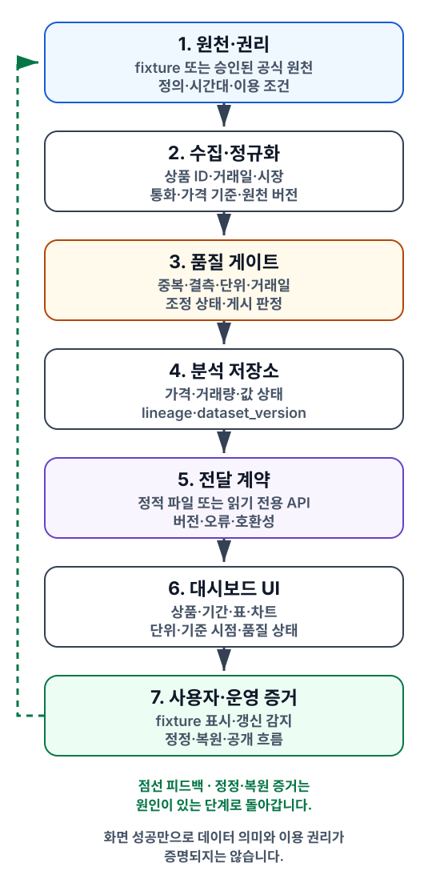

## 먼저 결론

주가 데이터 대시보드의 완성은 선 차트가 화면에 나타나는 순간이 아닙니다. 사용자가 상품·기간을 고르고 거래일·가격 기준·단위·원천·갱신 상태를 함께 확인하며, 결측·차단·오래됨이 정상 값처럼 보이지 않고, 같은 입력에서 같은 결과를 재현하고, 문제가 생겼을 때 공개를 중지하거나 마지막 정상 버전으로 돌아갈 수 있어야 합니다.

이 장은 실제 주가나 시장 데이터를 사용하지 않습니다. `IDX-X`, `STK-A`, `STK-B`는 실제 지수·종목·상품이 아니고, 아래의 시장명·날짜·가격·거래량·상태와 `EDU-FIXTURE`도 모두 교육용 가상 값입니다. `EDU-FIXTURE`는 실제 제공자나 원천을 뜻하지 않으며, 이 값으로 현재 시세·수익률·시장 일정·권리·투자 결론을 주장할 수 없습니다.

```csv
instrument_id,instrument_type,market,trading_date,value_type,value,unit,volume,price_basis,source_id,source_version,transform_version,value_status,missing_reason
IDX-X,index,MARKET-X,2026-01-05,close,2500,point,,not_applicable,EDU-FIXTURE,v1,tf-v1,valid,
STK-A,stock,MARKET-X,2026-01-05,close,10000,KRW,1000000,unadjusted,EDU-FIXTURE,v1,tf-v1,valid,
STK-B,stock,MARKET-X,2026-01-05,close,20000,KRW,700000,unadjusted,EDU-FIXTURE,v1,tf-v1,warning,late_source
IDX-X,index,MARKET-X,2026-01-06,close,2510,point,,not_applicable,EDU-FIXTURE,v1,tf-v1,valid,
STK-A,stock,MARKET-X,2026-01-06,close,10100,KRW,1100000,unadjusted,EDU-FIXTURE,v1,tf-v1,valid,
STK-B,stock,MARKET-X,2026-01-06,close,,KRW,,unadjusted,EDU-FIXTURE,v1,tf-v1,blocked,source_missing
```

위 여섯 행은 화면·계약·품질·운영 오라클을 함께 설명하기 위한 고정 fixture입니다. 날짜도 실제 거래일을 확인한 결과가 아니며, `KRW`, `point`, `unadjusted`, `not_applicable`은 이 가상 계약 안의 표시 값일 뿐 실제 시장의 통화·지수 산정·권리 조정 방식을 증명하지 않습니다.

## 사용자 요구와 비목표

- **D-01**: 사용자는 IDX-X·STK-A·STK-B가 실제 종목이 아닌 교육용 fixture임을 첫 화면에서 확인합니다.
- **D-02**: 사용자는 기간과 상품을 선택하고 가격 기준·단위·거래일·값 상태를 함께 확인합니다.
- **D-03**: 같은 fixture와 `transform_version`으로 같은 표·차트·요약을 재현합니다.
- **D-04**: 표와 차트는 같은 선택 결과를 사용하며 값 0·결측·경고·차단·오래됨을 구분합니다.
- **D-05**: 갱신 실패 시 차단된 후보를 게시하지 않고 마지막 정상 `dataset_version`과 지연 이유를 표시합니다.
- **비목표**: 실제 투자 결론, 추천, 수익률 우열, 실시간 시세, 주문, 개인 포트폴리오를 다루지 않습니다.

첫 화면의 fixture 표시는 작은 면책 문구로 숨기지 않습니다. 제목 또는 데이터 상태 영역에서 “교육용 가상 데이터”를 읽을 수 있어야 하고, 출처 패널은 `EDU-FIXTURE`가 실제 원천이 아니라는 설명과 `source_version`, `transform_version`, `dataset_version`을 함께 보여 줍니다.

## 왜 이 사례가 필요한가

데이터 분석가는 쿼리, 변환, 검정과 시각화에는 익숙할 수 있습니다. 그러나 노트북을 다른 사람이 사용하는 제품으로 바꾸면 브라우저 상태, 데이터 전달 계약, 접근성, 배포 버전, 갱신 실패, 정정과 복구라는 책임이 생깁니다.

노트북 작성자는 셀 실행 순서, 파일 위치, 빈 값 처리와 그래프의 전제를 기억합니다. 대시보드 사용자는 그 기억을 공유하지 않습니다. 사용자는 상품과 기간을 임의 순서로 바꾸고, 값이 없는 날짜를 만나고, 예전 링크나 캐시된 화면을 열 수 있습니다. 제품은 작성자의 암묵적인 맥락을 계약과 관찰 가능한 상태로 바꿔야 합니다.

차트를 먼저 만든 뒤 의미와 운영을 붙이면 다음 문제가 생기기 쉽습니다.

- 지수의 `point`와 주식의 `KRW`를 하나의 축에서 직접 비교합니다.
- 값 `0`, 결측, 거래량 비적용과 수집 실패를 모두 빈 칸으로 보여 줍니다.
- `warning`과 `stale`을 하나의 노란 배지로 합쳐 값 품질과 갱신 지연을 구분할 수 없습니다.
- 차단된 새 후보가 마지막 정상 값을 덮어쓰거나, 마지막 정상 값이 최신 값처럼 보입니다.
- 표와 차트가 필터·반올림을 따로 적용해 같은 화면에서 값이 어긋납니다.
- 로컬 데이터 검사, 사이트 빌드, 공개 URL과 사용자 작업 완료를 모두 “배포 성공”이라고 부릅니다.
- 실제 원천의 정의·권리·조정 방식을 확인하지 않고 fixture를 실제 시세처럼 확장합니다.

따라서 이 사례의 목표는 차트 모양을 완성하는 것이 아니라 한 사용자 요구를 원천과 권리, 데이터 계약, 품질, 전달, 화면, 검증, 공개와 운영 인수까지 추적하는 것입니다.

## 분석 노트북은 개인 실험 노트에 가깝습니다

분석 노트북을 연구자의 개인 실험 노트, 운영 대시보드를 여러 사람이 쓰는 측정 장비에 비유할 수 있습니다.

- 실험 노트 작성자는 앞선 계산과 제외 조건을 기억합니다.
- 측정 장비 사용자는 설명서와 화면에 드러난 단위·상태만 볼 수 있습니다.
- 장비가 숫자를 표시했다는 사실과 올바른 대상을 올바른 기준으로 측정했다는 사실은 다릅니다.
- 장비의 경고와 교정 이력이 필요하듯 대시보드도 품질 상태·버전·정정 이력이 필요합니다.

이 비유가 맞는 지점은 암묵적 지식을 명시적인 계약과 검증으로 바꿔야 한다는 점입니다. 그러나 대시보드는 시장을 직접 측정하는 장비가 아닙니다. 실제 제품이라면 외부 원천의 정의와 권리에 의존하고, 이 장에서는 그 원천조차 채택하지 않은 가상 fixture만 사용합니다. 품질 게이트 통과는 작성한 규칙의 통과일 뿐 원천의 사실성, 권리 또는 투자 유용성을 교정했다는 뜻이 아닙니다. 소프트웨어·데이터·배포·브라우저가 바뀌므로 한 번 확인한 결과를 영구한 보증으로 볼 수도 없습니다.

## 교육용 시나리오와 경계

사용자는 `IDX-X`, `STK-A`, `STK-B` 중 하나 이상의 상품과 fixture가 제공하는 기간을 선택합니다. 대시보드는 같은 선택 결과로 표·차트·텍스트 요약을 만들고, 거래일·값·단위·가격 기준·거래량·값 상태·신선도 상태·버전을 확인하게 합니다.

첫 번째 수직 기능 조각은 다음처럼 좁게 잡습니다.

- 위의 여섯 fixture 행과 명시적인 전달·신선도 메타데이터만 사용합니다.
- 표와 차트는 하나의 선택 결과를 공유합니다.
- 지수 `point`와 주식 `KRW`는 별도 척도 또는 별도 보기로 표시합니다.
- 읽기 전용이고 사용자별 저장 상태나 비밀이 없습니다.
- 작은 공개용 fixture이므로 첫 버전은 버전이 붙은 정적 파일로 전달합니다.
- 값 품질, 갱신 적시성, 파일 로드와 렌더링 실패를 서로 다른 상태로 보여 줍니다.
- 정정·철회·복원은 절차와 시험 오라클을 정의하지만 실제 운영 완료를 주장하지 않습니다.

첫 범위 밖은 다음과 같습니다.

- 실제 거래소·정보 제공자·상품·시세·시장 달력의 채택 또는 검증
- 조정주가 계산, 배당·분할·권리락 등 corporate action의 실제 처리 규칙
- 수익률·성과 비교, 상승·하락 원인 단정, 추천과 주문
- 사용자 계정·개인 포트폴리오·쓰기 API·인증·결제
- 실시간 또는 지연 시세 제공과 데이터 재배포 권리 주장
- 로컬 설계 문서만으로 실제 배포·정정 통지·복구 완료를 주장하는 것

비목표는 중요도가 낮다는 뜻이 아니라 이번 작업에서 검증하지 않은 사실과 책임을 명확히 막는 경계입니다.

## D-01~D-05 요구에서 복구까지 추적합니다

아래 다섯 묶음은 한 요구를 사용자 행동에서 복구까지 독립적으로 따라갑니다. `Git 작업 단위`는 구현할 때 한 변경 집합으로 묶을 범위이고, `배포·운영 증거`는 실제 승인된 환경에서 별도로 모아야 할 증거입니다. 이 원고와 로컬 문서 커밋은 대시보드 구현·실제 시장 데이터 권리·배포·복원 성공을 증명하지 않습니다.

### D-01 fixture 표시 추적

- **사용자 행동:** 사용자가 첫 화면과 출처 패널에서 교육용 가상 데이터임을 확인합니다.
- **상태 전이·데이터 변환:** 모든 행의 `source_id: EDU-FIXTURE`와 가상 식별자를 화면의 fixture 상태·원천 미채택 설명으로 변환합니다.
- **인터페이스:** 제목·데이터 상태·출처 패널의 텍스트와 접근 가능한 이름
- **인증·인가·권리:** 공개 읽기에 인증은 없지만 실제 원천의 수집·가공·재배포 권리는 부여되지 않았고 실제 투자 판단 사용도 금지합니다.
- **실패 위험:** 가짜 값이 실제 종목·현재 시세·권리 확보 데이터로 보이거나 면책 문구가 화면 밖에 숨습니다.
- **테스트 오라클:** 첫 viewport와 출처 패널에서 fixture 문구·버전·실제 원천 미채택을 읽고, 실제 종목명·티커·현재 시세·추천 문구가 0건입니다.
- **Git 작업 단위:** fixture 상수·표시 컴포넌트·출처 설명·부정 문구 테스트만 한 diff와 로컬 `commit`에 묶습니다.
- **배포·운영 증거:** 입력 `commit`·아티팩트·배포 버전·실제 URL의 fixture 배지와 출처 smoke를 연결하고 외부 시장 요청 0건을 확인합니다.
- **복구:** 오표시 배포를 중지하거나 이전 검증 아티팩트로 되돌린 뒤 fixture 문구·원천 미채택·외부 요청 부재를 다시 확인합니다.

### D-02 선택과 문맥 추적

- **사용자 행동:** 사용자가 가상 상품과 기간을 선택하고 값의 거래일·단위·가격 기준·상태를 함께 읽습니다.
- **상태 전이·데이터 변환:** 복합 키 `(instrument_id, instrument_type, market)` 세 필드와 기간을 한 번 적용하고 `trading_date`·`unit`·`price_basis`·상태가 붙은 표시 모델을 만듭니다.
- **인터페이스:** 키보드·포인터 선택, 표·차트·요약·문맥 텍스트
- **인증·인가·권리:** 공개 fixture만 읽으며 쓰기·계정 권한은 없고, 정적 전달은 실제 데이터 재배포 허가를 뜻하지 않습니다.
- **실패 위험:** `instrument_id`만으로 다른 종류·시장을 합치거나 point와 KRW, 거래일과 실제 시간대, 조정·비조정 값을 혼합합니다.
- **테스트 오라클:** 세 필드 중 하나가 다른 fixture에서 선택 결과가 분리되고, 표·차트·요약의 행·정렬·단위·가격 기준·거래일·상태가 정확히 같습니다.
- **Git 작업 단위:** 복합 선택 책임·표시 모델·필터 UI·단위/가격 문맥과 키 충돌 fixture·테스트를 한 수직 커밋으로 묶습니다.
- **배포·운영 증거:** 배포 manifest의 데이터·변환·사이트 버전과 desktop/mobile 선택 smoke, 표·차트 동일 결과를 같은 아티팩트에 연결합니다.
- **복구:** 잘못 합친 후보를 게시하지 않고 마지막 정상 데이터·사이트 조합으로 복원한 뒤 충돌 fixture와 사용자 선택 흐름을 재실행합니다.

### D-03 재현성 추적

- **사용자 행동:** 사용자가 출처 패널의 데이터·변환·데이터셋 버전을 보고 같은 선택 결과를 다시 확인합니다.
- **상태 전이·데이터 변환:** fixture 입력→변환→품질 판정→표시 모델→전달 파일의 lineage를 버전·체크섬·기준 시점과 연결합니다.
- **인터페이스:** 출처·버전 패널, build manifest, 정적 파일 또는 읽기 전용 응답
- **인증·인가·권리:** fixture를 저장소·빌드에서 읽을 권한과 산출물 공개 권리를 구분하며 비밀·권리 미확인 원문은 manifest와 아티팩트에 넣지 않습니다.
- **실패 위험:** 체크섬만 맞으면 의미·정확성·권리까지 맞다고 오판하거나 환경·정렬·시간 입력이 빠져 같은 버전이 다른 화면을 만듭니다.
- **테스트 오라클:** 고정 입력·환경·명령으로 두 번 만든 지정 산출물의 바이트·행·정렬·표시 값이 같고 lineage 식별자가 끊기지 않으며 체크섬은 의미 오라클로 사용하지 않습니다.
- **Git 작업 단위:** canonical schema·변환 규칙·버전/체크섬 manifest·재현 명령·결정적 회귀 테스트를 검토 가능한 한 단위로 커밋합니다.
- **배포·운영 증거:** 소스 커밋·잠금 파일·빌드 환경·명령·fixture/산출물 digest·사이트 버전과 smoke 종료 결과를 보존합니다.
- **복구:** 불일치 아티팩트를 격리하고 마지막 정상 manifest의 입력·환경·명령으로 재구성하거나 검증 아티팩트를 복원한 뒤 digest와 사용자 흐름을 재검증합니다.

### D-04 상태 구분 추적

- **사용자 행동:** 사용자가 표와 차트에서 값 0·결측·경고·차단·검토 대기·오래됨과 이유를 색상 없이 구분합니다.
- **상태 전이·데이터 변환:** 한 표시 모델이 `value_status`·`missing_reason`·`freshness_status`를 해석해 정상 점, 제외된 후보, 표 셀, 텍스트 요약과 상태 알림으로 변환합니다.
- **인터페이스:** 접근 가능한 표와 차트의 동등 정보, 범례·상태 텍스트·라이브 알림·오류 UI
- **인증·인가·권리:** 공개 정보만 전달하되 차트 라이브러리·브라우저에 비밀이나 권리 미확인 원문을 보내지 않고, 검토 역할만으로 게시 권한을 자동 부여하지 않습니다.
- **실패 위험:** 차트가 표와 다른 데이터를 쓰거나 색상만으로 상태를 표시하고, 0을 결측으로, `warning`을 `stale`로, 차트 실패를 데이터 실패로 오판합니다.
- **테스트 오라클:** 표·차트·요약의 선택 행·단위·상태·이유가 같고 키보드·스크린 리더용 문구가 있으며, 차트 실패를 주입해도 동등한 표와 오류 안내가 남습니다.
- **Git 작업 단위:** 공유 표시 모델·표·차트·상태/오류 UI·접근성 테스트와 상태 fixture만 한 커밋에 묶습니다.
- **배포·운영 증거:** 1440px·390px light/dark의 표·차트·상태 smoke, 콘솔·페이지 오류, 내부 스크롤과 접근 가능한 텍스트를 배포 버전에 연결합니다.
- **복구:** 차트만 실패하면 동등한 표·텍스트를 유지하고, 데이터 전달 실패면 이전 검증 상태를 명시하며 수정 아티팩트 뒤 상태별 브라우저 오라클을 재실행합니다.

### D-05 갱신 실패 추적

- **사용자 행동:** 사용자가 새 후보가 차단되었음을 알고 마지막 정상 버전·지연 이유·신선도 상태를 확인합니다.
- **상태 전이·데이터 변환:** 후보를 `valid`·허용된 `warning`·`blocked`·`review_required`로 판정하고 허용 후보만 현재 공개 버전으로 전환하며 나머지는 마지막 정상 버전을 보존합니다.
- **인터페이스:** 갱신 상태·현재/마지막 정상 버전 패널, 게시 게이트, smoke와 정정·복원 runbook
- **인증·인가·권리:** 게시·철회·복원 권한을 최소화하고 원천 이용 조건·라이선스·재배포 승인이 없는 실제 후보는 품질과 별개로 게시하지 않습니다.
- **실패 위험:** 차단·권리 불명 후보를 최신으로 게시하거나 마지막 정상 값을 새 값처럼 표시하고 데이터 rollback과 사이트 rollback의 호환성을 확인하지 않습니다.
- **테스트 오라클:** 차단·검토 대기·권리 불명 후보에서 공개 버전 digest는 불변이며 후보 상태·지연 이유를 표시합니다. 현재 공개 버전의 신선도는 고정 기준 시점과 기대 시각에 따라 current·stale·unknown으로 별도 판정하고, stale·unknown의 이유를 표시합니다. 허용 후보만 manifest와 smoke를 통과해 원자적으로 전환합니다.
- **Git 작업 단위:** 후보 상태 머신·게시 게이트·last-known-good manifest·smoke·정정/철회/복원 runbook과 실패 fixture를 독립 커밋으로 묶습니다.
- **배포·운영 증거:** 후보·현재·마지막 정상 버전, 품질/권리 판정, 아티팩트·URL, 갱신 지연 신호와 격리 복원 결과를 한 인수 기록에 연결합니다.
- **복구:** 추가 게시를 중지하고 호환되는 마지막 정상 데이터·사이트 아티팩트를 격리 복원해 계약 검사·fixture 표시·필터·표·차트·상태 smoke를 다시 통과시킵니다.

이 목록은 테스트 케이스 전체가 아니라 추적성 지도입니다. 예를 들어 `value_status`를 바꾸면 행 스키마뿐 아니라 차트 점의 포함 여부, 표 문구, 접근 가능한 상태 알림, 갱신 후보의 게시 판정, Git 작업 단위, 배포 manifest와 복구 회귀 fixture를 함께 확인해야 합니다.

## 전체 구조를 한 번에 봅니다

원천의 이용 조건과 품질 검사 결과가 어떤 데이터를 화면에 보여 줄지 어떻게 결정하는지 따라가 보세요. 반대 방향으로는 화면에서 발견한 오류를 어느 원천과 변환 버전까지 거슬러 확인할 수 있는지 살펴보세요.



이 일곱 단계가 각각 별도 서버라는 뜻은 아닙니다. 작은 fixture와 정적 사이트 안에서도 책임은 나뉩니다. 반대로 한 빌드에 모두 넣어도 원천 권리, 데이터 변환, 브라우저 전달과 공개 운영의 증거 경계가 사라지지는 않습니다.

1. **원천·권리**: 지금은 `EDU-FIXTURE`라는 교육용 가상 원천임을 표시합니다. 실제 원천으로 바꾸려면 공식 정의·시간대·이용 조건·재배포 범위를 먼저 승인합니다.
2. **수집·정규화**: 상품 ID·거래일·시장·통화·가격 기준·원천 버전을 보존하고 내부 기준 스키마로 맞춥니다.
3. **품질 게이트**: 중복·결측·단위·거래일·조정 상태를 검사하고 게시 가능 상태와 근거를 판정합니다.
4. **분석 저장소**: 가격·거래량·값 상태·lineage와 불변 `dataset_version`을 함께 보존합니다.
5. **전달 계약**: 정적 파일 또는 읽기 전용 API가 버전·호환성·오류를 어떻게 전달할지 정합니다.
6. **대시보드 UI**: 상품·기간·표·차트·단위·기준 시점·품질과 신선도 상태를 사용자에게 보여 줍니다.
7. **사용자·운영 증거**: fixture 표시, 갱신 감지, 정정·복원 절차와 공개 사용자 흐름을 확인합니다.

사용자 화면에서 문제가 발견되면 원인이 있는 단계로 돌아갑니다. 선이 끊겼다고 CSS로 점을 이어서는 안 되고, 값이 오래됐다고 품질 상태를 바꿔서도 안 됩니다. 화면 성공은 데이터 의미·권리·게시 판단·복구 성공을 증명하지 않습니다.

## 데이터 계약은 숫자와 문맥을 함께 약속합니다

**데이터 계약(data contract)**: 데이터를 만드는 쪽과 사용하는 쪽이 필드·타입·의미·단위·시간·품질·버전·오류를 어떻게 주고받을지 정한 약속입니다. CSV 헤더가 맞는지만 보는 스키마 검사보다 넓고, 계약이 있다는 사실만으로 값이 실제 시장 사실임을 보장하지는 않습니다.

**내부 기준 스키마(canonical schema)**: 서로 다른 입력을 이 제품 안에서 일관되게 다루기 위해 선택한 표준 필드와 규칙입니다. 보편적인 정답 스키마가 아니며, 원천 의미를 잃도록 억지로 맞추면 오히려 오류가 됩니다.

### fixture 행 계약

| 필드 | 의미와 확인할 점 |
|---|---|
| `instrument_id`, `instrument_type`, `market` | 가상 상품의 식별자·종류·시장입니다. 표와 차트의 선택 조건은 복합 선택 키 `(instrument_id, instrument_type, market)`의 세 필드를 같은 값으로 적용하며, `instrument_id`나 표시 이름만으로 행을 합치지 않습니다. |
| `trading_date` | fixture에서 값이 속하는 것으로 설정한 거래일입니다. 실제 시장 달력이나 시간대를 확인한 날짜가 아닙니다. |
| `value_type`, `value`, `unit` | 값 종류·수치·단위입니다. `point`와 `KRW`를 같은 척도로 직접 비교하지 않습니다. |
| `volume` | fixture의 가상 거래량입니다. 지수 행의 빈 값은 0이 아니라 이 계약에서 비적용이라는 뜻입니다. |
| `price_basis` | 현재 값이 어떤 가격 기준으로 표시됐는지 알려 주는 필드입니다. `unadjusted`와 지수의 `not_applicable`을 구분합니다. |
| `source_id`, `source_version` | 교육용 fixture와 그 입력 버전을 식별합니다. 실제 제공자·원천 또는 이용 권리를 뜻하지 않습니다. |
| `transform_version` | 같은 입력을 같은 선택 결과로 만드는 변환 규칙 버전입니다. |
| `value_status`, `missing_reason` | 값의 표시 가능성과 경고·차단·검토 대기 사유를 분리합니다. |

`price_basis`는 조정주가를 정확히 계산했다는 주장이 아니라 현재 값이 어떤 기준이라고 설정됐는지 표시하는 계약입니다. 실제 원천을 채택하기 전에는 corporate action의 종류, 효력일, 원천별 수정 정책과 조정 산식의 정확한 규칙을 확정하지 않습니다. 서로 다른 `price_basis`를 같은 계열로 이어 붙이거나 수익률을 계산하지 않으며, 규칙이 결정되지 않은 실제 값은 `review_required` 또는 `blocked` 후보로 다룹니다.

값 `0`은 관측된 수치일 수 있으므로 빈 값과 다릅니다. 빈 `value`는 값이 없다는 뜻이고 `missing_reason`으로 이유를 설명합니다. STK-B의 2026-01-06 행은 `blocked`와 `source_missing`이므로 표·차트·요약의 정상 수치에 포함하지 않습니다. 지수 행의 빈 `volume`은 거래량 0이 아니라 비적용이며, 계약 또는 화면에서 `not_applicable`로 읽을 수 있어야 합니다.

### 값 상태와 행동

- `valid`: 계약 검사를 통과한 값입니다. 작성한 fixture 규칙의 통과일 뿐 실제 시세의 정확성을 뜻하지 않습니다.
- `warning`: 값을 표시할 수 있지만 `late_source` 같은 경고 사유를 값과 함께 보여 줍니다. 경고를 숨긴 정상 값으로 바꾸지 않습니다.
- `blocked`: 정상 값으로 게시하지 않습니다. `source_missing`처럼 이유를 표시하고 차트 점·집계·변화 설명에서 제외합니다.
- `review_required`: 한 행의 수치를 표시해도 되는지 확인이 필요한 상태입니다. 이 행이 남은 데이터셋 후보도 게시하지 않으며, 행 판단과 묶음 전체의 검토 증거를 따로 확인합니다.
- `source_missing`: 실제 값 0이나 비적용이 아니라 원천 값이 없다는 결측 사유입니다.
- `not_applicable`: 해당 필드 또는 기준이 상품 종류에 적용되지 않는다는 명시적 상태입니다. 누락·오류와 다릅니다.

거래일 사이의 공백도 곧바로 수익률 0이나 연속 값으로 채우지 않습니다. fixture의 선택 기간에 행이 없으면 “계약상 예정된 행이었는가”, “상품 종류에 비적용인가”, “원천 누락인가”, “품질 차단인가”를 먼저 구분합니다. 실제 시장 달력과 시간대를 채택하지 않은 현재 장에서는 공백의 실제 이유를 단정하지 않습니다.

### 이 fixture에서 검사할 타입과 조합

아래 규칙은 기본 14필드·6행을 해석하는 교육용 계약입니다. 실제 시장의 가격·거래량·거래일 규칙으로 일반화하지 않습니다. CSV의 빈 필드는 파싱 뒤 null로 다루며 문자열 "null"이나 숫자 0으로 바꾸지 않습니다.

| 대상 | 타입·허용값·조합 |
|---|---|
| 식별자 | 비어 있지 않은 문자열입니다. 기본 묶음은 IDX-X/index, STK-A/stock, STK-B/stock과 MARKET-X만 사용합니다. |
| 거래일·값 종류 | 날짜는 유효한 YYYY-MM-DD 형식이며 기본 묶음은 2026-01-05·2026-01-06, 값 종류는 close만 사용합니다. 실제 거래 달력 검증이 아닙니다. |
| 값·거래량 | value는 null 또는 0 이상인 유한 수입니다. stock의 volume은 null 또는 0 이상인 정수이고 단위는 교육용 가상 주 수입니다. 가격 단위 KRW와 거래량 단위를 구분합니다. |
| 지수·주식 조합 | index는 unit=point, price_basis=not_applicable, volume=null입니다. stock은 unit=KRW, price_basis=unadjusted입니다. 서로 다른 단위나 가격 기준을 한 계열로 합치지 않습니다. |
| 버전 | source_id=EDU-FIXTURE, source_version=v1, transform_version=tf-v1입니다. 기본 묶음의 내용이 바뀌면 같은 버전으로 덮어쓰지 않습니다. |
| 값이 있는 상태 | valid는 value가 있고 missing_reason은 비어 있습니다. warning은 value가 있고 missing_reason=late_source입니다. 두 상태의 stock 행은 volume도 있어야 합니다. |
| 수치를 제외할 상태 | blocked/source_missing과 review_required/review_pending은 value=null이며 stock의 volume도 null입니다. 이유는 표·대체 텍스트에 남기고 정상 수치·차트 점·계산에서 제외합니다. 기본 묶음에는 review_required 행이 없으며 별도 파생 시험으로만 사용합니다. |
| 고유성 | 현재 close·가격 기준 고정 범위에서 (instrument_id, instrument_type, market, trading_date)는 중복되지 않습니다. 값 종류·가격 기준을 늘리려면 먼저 키와 비교 계약을 별도로 바꿔야 합니다. |

missing_reason이라는 기존 헤더는 이 사례에서 결측뿐 아니라 경고·차단·검토 대기 사유도 담습니다. 값이 있는 warning/late_source는 허용되며, late_source만으로 현재 공개 데이터셋을 stale로 판정하지 않습니다. 다른 상태·사유·단위 조합은 이 좁은 계약에서 거절합니다. 값 0, 잘못된 타입·단위, 중복 키, 사유 없는 결측은 기본 6행을 고치지 않고 별도 파생 시험 입력으로 만들고, 바꾼 필드와 기대 판정을 기록합니다.

## 재현성은 입력에서 화면까지 이어집니다

**데이터 계보(data lineage)**: 값이 어느 입력과 버전에서 어떤 변환·검증을 거쳐 어떤 전달 파일과 화면에 도달했는지 추적하는 연결입니다. 화면의 한 셀에서 `source_id`, `source_version`, `transform_version`, `dataset_version`과 품질 판정 근거로 돌아갈 수 있어야 합니다.

**체크섬(checksum)**: 파일이나 응답의 바이트 내용으로 계산한 비교값입니다. 내용 변경을 탐지할 수 있지만 값의 의미·정확성·권리를 증명하지는 않습니다.

**빌드 매니페스트(build manifest)**: fixture·변환 코드·설정·전달 파일·사이트 버전과 결과 식별자를 함께 적은 목록입니다. 같은 fixture와 `transform_version`에서 같은 필터를 사용하면 표·차트·요약이 같은 선택 결과를 사용해야 하고, 시간이 결과에 영향을 준다면 기준 시점을 입력으로 고정합니다.

표와 차트가 각각 계산한 결과를 나중에 맞춰 보는 구조를 만들지 않습니다. 복합 선택 키 `(instrument_id, instrument_type, market)`의 세 필드와 기간을 함께 적용해 한 번 필터링하고 상태를 해석한 표시 모델을 공유하며, 단위·정렬·반올림 규칙도 한곳에서 적용합니다. 지수 `point`와 주식 `KRW`는 숫자 크기가 비슷해도 하나의 축에 겹쳐 의미를 비교하지 않습니다.

## 전달·배포 메타데이터는 행과 별도 계약입니다

행 계약은 개별 값의 의미를 설명하고, 전달·배포 메타데이터는 어떤 데이터셋을 지금 화면에 제공하는지 설명합니다.

- `dataset_version`: 동일한 fixture와 변환 결과 묶음을 식별하는 불변 버전입니다. 표·차트·요약은 하나의 버전을 공유합니다.
- `current_published_dataset_version`: 현재 사용자에게 전달하는 데이터셋 버전입니다.
- `last_normal_dataset_version`: 마지막으로 정상 전달을 승인한 데이터셋 버전입니다.
- `refresh_candidate_status`: 다음 갱신 후보의 `valid`, `warning`, `blocked`, `review_required`, `unknown` 상태입니다.
- `refresh_delay_reason`: 새 후보를 현재 공개 버전으로 바꾸지 않은 이유입니다. 차단·검토 대기·판정 불명·지연 상태에서는 비어 있지 않아야 합니다.

검증을 통과한 `valid` 후보와 전달을 허용하기로 판정한 `warning` 후보만 `current_published_dataset_version`으로 승격할 수 있습니다. `blocked`와 `review_required` 후보는 정상 값처럼 전달하지 않고 마지막 정상 버전·후보 상태·지연 이유를 함께 보여 줍니다. 현재 공개 버전과 마지막 정상 버전이 같아도 최신성 자체가 증명되는 것은 아닙니다.

### 행 상태와 후보 게시 판정을 분리합니다

value_status는 한 행의 수치를 어떻게 표시할지 정합니다. refresh_candidate_status는 데이터셋 묶음 전체를 다음 공개 버전으로 승인할지 정합니다. 한 행의 상태를 묶음 상태로 그대로 복사하지 않습니다. 마지막 정상 버전은 모든 행이 valid라는 뜻이 아니라, 아래 계약에 맞게 전달을 승인한 버전입니다.

기본 6행은 정상 수치4개·경고 수치1개와, STK-B/2026-01-06의 의도적으로 차단된 행1개를 포함합니다. 이 정확한 fixture의 경고·결측은 교육 시나리오가 허용한 예외이므로 묶음은 warning 후보이며, 이 계약과 품질 검사를 확인한 뒤 전달을 승인합니다. 차단 행 자체와 source_missing 사유는 표·동등한 텍스트에 보존하고 그 수치만 차트 점·계산에서 제외합니다. 행을 삭제해 결측 이유까지 숨기지 않습니다.

후보 판정은 먼저 파일·스키마·타입·키·단위 위반, 권리 미확인 실제 입력, 기본 fixture와 다른 미승인 결측·내용 변경이 있으면 묶음 전체를 blocked로 처리합니다. 그 문제가 없더라도 행이나 후보 판단에 미완료 검토가 있으면 review_required입니다. 그 밖에는 승인 가능한 경고·지정 결측이 있으면 warning, 모두 valid이면 valid입니다. 후보가 없거나 판정 자체를 할 수 없으면 unknown으로 남깁니다. 기본 예외를 임의의 누락 행에 확대하지 않습니다.

전체가 blocked·review_required·unknown인 새 후보는 현재 공개 버전과 마지막 정상 버전의 바이트를 바꾸지 않고 후보 상태·이유만 별도 표시합니다. 기본 묶음을 승인해 차단 행의 이유를 표시하는 시험과, 예컨대 중복 키를 넣은 새 후보 전체를 막는 시험은 서로 다른 오라클입니다.

## 신선도는 값 품질과 다른 차원입니다

신선도(freshness)는 현재 전달 중인 fixture 데이터셋이 이 시나리오의 갱신 기대에 맞는지 나타냅니다. 실제 시장 일정이나 원천 발표 시각에 관한 주장이 아닙니다.

- `fixture_refreshed_at`: fixture 묶음을 갱신한 것으로 설정한 시점입니다.
- `published_at`: 현재 공개 버전을 전달 대상으로 만든 것으로 설정한 시점입니다.
- `expected_refresh_at`: fixture 시나리오에서 다음 갱신을 기대하는 것으로 설정한 시점입니다.
- `freshness_status`: `current`, `stale`, `unknown` 중 하나입니다.
- `freshness_reason`: 신선도 판정 근거입니다. `stale`과 `unknown`에서는 비어 있지 않아야 합니다.

`warning`은 개별 값이나 후보의 품질 상태이고, `stale`은 현재 공개 데이터셋의 갱신 적시성 상태입니다. 경고 값을 포함한 새 데이터셋이 `current`일 수 있고, 마지막 정상 데이터의 모든 값이 `valid`여도 갱신이 늦어 `stale`일 수 있습니다. 화면은 두 상태의 이름과 이유를 각각 표시하고 하나의 배지로 합치지 않습니다.

판정할 기준 시점과 expected_refresh_at을 같은 시간 기준으로 고정합니다. 이 가상 시험에서는 기준 시점이 기대 시점 이전이면 current, 기대 시점 이상인데 갱신을 승인하지 못했으면 stale, 필요한 시각·기준이 없으면 unknown입니다. 예를 들어 같은 차단 후보를 두고 기대 시각을 2026-01-07T12:00:00Z로 고정하면 11:59Z에는 current, 12:01Z에는 stale이고, 기대 시각이 없으면 unknown입니다. 세 경우 모두 현재 공개 버전 digest는 그대로이며 후보 차단 이유와 신선도 이유를 따로 기록합니다. 이 시각은 실제 시장 일정이 아닙니다.

## 검토 대기는 증거가 완전해야 끝납니다

이 절의 검토 대상은 데이터셋 묶음 전체입니다. `review_required` 후보는 다음 다섯 필드가 완전하고 후보 버전과 연결되기 전까지 게시하지 않습니다.

- `final_value_status`: 기존 필드명은 유지하지만 이 절에서는 데이터셋 후보의 최종 품질 판정을 뜻하며 `valid`, `warning`, `blocked` 중 하나입니다. 개별 행의 value_status를 일괄 변경하는 명령이 아닙니다.
- `reviewer_role`: 개인 식별정보가 아니라 검토 역할입니다.
- `review_basis`: 계약 검사 결과·예외 사유·판정 근거입니다.
- `reviewed_at`: fixture 시나리오에서 검토가 완료된 것으로 설정한 시점입니다.
- `recheck_condition`: 다시 검토해야 하는 조건 또는 증거 만료 조건입니다.

필드 하나라도 없거나 최종 상태가 허용값이 아니면 후보는 `review_required`에 남습니다. 다섯 필드가 모두 있고 근거가 후보의 `dataset_version`·`transform_version`과 연결되면 기록된 최종 상태로 전환할 수 있습니다. `recheck_condition`이 발생하거나 증거가 만료되면 다시 `review_required`로 돌리고 새 증거가 갖춰질 때까지 게시하지 않습니다. 사람 검토는 이름 한 줄이 아니라 근거·시점·만료를 가진 게시 계약입니다. 행의 review_required나 타입·단위 위반이 남아 있으면 후보의 최종 판정만 valid로 적어 통과시킬 수 없습니다. 행을 해결한 변경 버전과 후보 검사·검토 근거를 함께 다시 확인합니다.

## 품질 게이트는 다음 행동을 결정합니다

품질 검사는 값이 “좋다”는 선언이 아니라 게시·경고·차단·검토의 다음 행동을 정하는 게이트입니다.

1. 입력 파일의 식별자·버전·체크섬과 fixture 설정 시점을 기록합니다.
2. 필요한 열과 행만 읽고 헤더·타입·허용값을 확인합니다.
3. 상품 ID·시장·거래일·단위·가격 기준을 정규화합니다.
4. 복합 선택 키 `(instrument_id, instrument_type, market)`의 세 필드를 확인하고, 이 키와 거래일을 기준으로 중복·결측·값과 거래량 상태·단위 조합을 검사합니다.
5. fixture의 고정 여섯 행과 독립 오라클에 대사합니다.
6. 이전 정상 버전과 스키마·행 수·범위·상태 변화를 비교합니다.
7. 행별 value_status와 사유를 보존하고, 위 후보 판정 규칙으로 데이터셋의 refresh_candidate_status와 별도 근거를 기록합니다.
8. 게시 가능한 후보만 전달 산출물로 승격하고, 나머지는 마지막 정상 버전과 지연 정보를 유지합니다.

대규모 실제 원천으로 확장한다면 필요한 열과 행을 앞에서 줄이고, 중간 결과를 반복해서 메모리에 만들지 않으며, 데이터 크기·재현성·품질 위험을 파이프라인 설계 조건으로 봅니다. `lazy`는 할 일을 계획해 필요한 경계에서 실행하는 방식, `columnar`는 같은 열의 값을 함께 저장해 필요한 열만 효율적으로 읽는 형식, `materialize`는 계획을 실제 메모리 결과로 만드는 일을 뜻합니다. 이 장은 특정 라이브러리나 실행 성능을 검증하지 않습니다.

## 정적 파일과 읽기 전용 API 중 무엇을 선택할까요

첫 버전은 작은 공개 fixture이고 사용자별 상태·비밀·쓰기 동작이 없으므로 버전이 붙은 정적 파일을 선택합니다. 정적이라는 말은 데이터가 영원히 바뀌지 않는다는 뜻이 아니라, 검증된 새 데이터셋을 새 아티팩트로 만들어 배포한다는 뜻입니다.

정적 전달이라는 시작 가설의 이유·검증 증거·API 전환 신호를 결정 수준에서 다시 비교하려면 [아키텍처와 프레임워크](../../06-requirements-design/architecture-and-frameworks/)를 함께 읽으세요. 이 역링크는 특정 런타임이나 제품을 미리 고르는 안내가 아니라 현재 책임과 변경 조건을 다시 묻는 지점입니다.

### 정적 전달이 맞는 현재 신호

- fixture가 작아 브라우저가 필요한 범위를 무리 없이 읽을 수 있습니다.
- 상품·기간 조합이 작고 계산 규칙을 빌드 시점에 고정할 수 있습니다.
- 사용자별 비밀 데이터·권한·저장 상태가 없습니다.
- 공개 산출물에 API 키나 권리 미확인 원문이 들어가지 않습니다.
- 차단 후보를 게시하지 않고 마지막 정상 버전을 계속 제공할 수 있습니다.
- 낮은 운영 복잡성과 버전별 재현성이 중요합니다.

### 읽기 전용 API를 검토할 전환 신호

- 실제 원천 데이터가 커져 요청마다 필요한 일부만 조회해야 합니다.
- 짧은 최신성 요구를 정적 빌드·배포 주기로 감당할 수 없습니다.
- 이용 조건이나 재배포 제한 때문에 전체 데이터를 브라우저로 보낼 수 없습니다.
- 원천 키·유료 원문·내부 계산 규칙을 서버에서 보호해야 합니다.
- 사용자별 저장 상태나 권한이 생깁니다.
- 요청량 제한·감사 로그·서버 캐시·오류 복구가 제품 책임이 됩니다.

API를 추가하면 입력 검증, 오류 계약, 타임아웃, 재시도, 캐시, 로그, 비밀, 권한, 배포와 복구 책임도 생깁니다. 데이터가 실제라는 이유만으로 API가 필요하지 않고, 작은 데이터라는 이유만으로 정적 재배포가 허용되는 것도 아닙니다. 규모·최신성·권리·사용자 상태·운영 책임을 함께 보고 ADR(Architecture Decision Record, 아키텍처 결정 기록)에 전환 근거와 호환성 계획을 남깁니다.

## 사용자 행동에서 데이터까지 추적합니다

1. 사용자는 첫 화면에서 교육용 fixture 표시와 현재 공개·마지막 정상 `dataset_version`을 확인합니다.
2. 사용자는 상품과 fixture 기간을 키보드 또는 포인터로 선택하며, 상품 선택 항목은 표시 이름과 별개로 `(instrument_id, instrument_type, market)` 세 값을 함께 보관합니다.
3. 브라우저는 버전이 붙은 정적 데이터와 전달·신선도 메타데이터를 읽습니다.
4. 한 선택 책임이 복합 선택 키 `(instrument_id, instrument_type, market)`의 세 필드, 기간과 값 상태를 함께 적용해 표시 모델을 만듭니다.
5. 표·차트·텍스트 요약은 같은 표시 모델과 단위·반올림을 사용합니다.
6. 출처 패널은 `EDU-FIXTURE`, 버전, 가격 기준, 거래일과 실제 원천 미채택 한계를 설명합니다.
7. 값 품질과 신선도 상태, 이유를 색상 외 텍스트로 표시합니다.
8. 파일 로드나 렌더링이 실패하면 데이터 상태와 구분한 실패 메시지와 재시도·보고 경로를 제공합니다.

이 사례는 보호할 사용자 상태와 쓰기가 없으므로 프런트엔드의 선택 확인은 사용자 실수를 줄이는 UI 규칙이지 보안 경계가 아닙니다. 실제 원천·사용자 상태·쓰기 동작이 생기면 서버 측 검증과 권한 판단을 새로 설계해야 합니다.

## 화면은 정상 결과보다 상태 설계가 먼저입니다

### 초기와 로딩

- fixture임을 먼저 알리고 지원 상품·기간·단위를 설명합니다.
- 데이터와 메타데이터를 읽는 동안 진행 상태를 텍스트로 표시합니다.
- 이전 결과를 유지한다면 현재 선택의 결과가 아니라는 사실과 버전을 구분합니다.

### 정상 fixture

- IDX-X의 두 `point` 값과 STK-A의 두 `KRW` 값은 각각 자기 단위와 가격 기준을 갖습니다.
- 표·차트·요약은 같은 선택 행·거래일·단위·반올림을 사용합니다.
- `source_id`, `source_version`, `transform_version`, `dataset_version`과 신선도 상태를 찾을 수 있습니다.
- 단위가 다른 지수와 주식을 같은 수직축의 크기로 직접 비교하지 않습니다.

### 결측·경고·차단

- STK-B의 2026-01-05 `warning` 값은 표시하되 `late_source`를 함께 보여 줍니다.
- STK-B의 2026-01-06 빈 값은 `source_missing`과 `blocked`를 표시하고 정상 선·요약·변화 계산에 포함하지 않습니다.
- 지수의 빈 `volume`은 0이나 오류가 아니라 비적용이라고 읽을 수 있어야 합니다.
- 값 0 fixture가 추가되더라도 빈 값으로 숨기지 않고 단위가 있는 수치 0으로 표시합니다.

### 오래된 공개 버전

- `freshness_status: stale`이면 마지막 정상 값이 유효하더라도 오래됨과 `freshness_reason`을 표시합니다.
- 차단 후보 때문에 갱신이 늦었다면 `last_normal_dataset_version`, 후보 상태와 `refresh_delay_reason`을 함께 표시합니다.
- “최신”이라는 모호한 문구 대신 fixture의 `published_at`, `expected_refresh_at`과 현재 버전을 구분합니다.

### 파일 로드와 렌더링 실패

- 데이터 파일을 찾지 못함, 헤더·버전 불일치, 네트워크 전달 실패를 데이터 결측과 구분합니다.
- 파일은 읽었지만 차트 렌더링이 실패한 경우 동등한 표와 텍스트 상태를 유지하고 화면 실패라고 알립니다.
- 사용자 메시지에는 다시 시도하거나 표를 확인하는 다음 행동을 주고, 로그에는 비밀·개인정보·원천 응답 전체를 넣지 않습니다.

### 정정과 철회

- 이미 공개한 fixture 값이 잘못됐다고 판정하면 조용히 덮어쓰지 않고 영향 버전·이전 값·정정 또는 철회 값·이유·시점과 새 버전을 기록합니다.
- 오해 위험이 크면 공개를 중지하고, 마지막 정상 버전도 안전하지 않으면 빈 상태와 정정 안내를 우선합니다.
- 사용자 계정이 없는 공개 사이트에서는 과거 열람자를 모두 식별할 수 없으므로 찾기 쉬운 정정 이력과 현재 화면의 표시를 최소 통지 경로로 둡니다.

## 변화는 관찰과 질문으로만 설명합니다

두 날짜의 값이 달라졌다는 것은 fixture 안에서 관찰할 수 있습니다. 그러나 이 여섯 행만으로 상승·하락 원인, 시장 심리, 기업 성과, 미래 방향이나 투자 행동을 단정할 수 없습니다.

텍스트 요약은 “STK-A의 가상 close 값이 10000 KRW에서 10100 KRW로 설정돼 있다”처럼 관찰 범위를 표시하고, “이 변화가 실제 사건이라면 어떤 공식 원천·권리 조정·시간대·거래일 규칙을 추가로 확인해야 하는가”라는 질문으로 끝냅니다. 원인을 생성하거나 수익률·우열을 계산하지 않습니다. 실제 분석으로 전환할 때도 사실·계산·해석·가설을 분리하고 반대 신호와 원천 한계를 함께 검토합니다.

## 접근성은 전달 계약입니다

값·상태·이유를 색상만으로 전달하지 않습니다.

- 표와 차트는 같은 선택 결과를 사용하며 대상·값·단위·거래일·가격 기준·값 상태·신선도 상태를 확인할 수 있어야 합니다.
- 차트의 핵심 값·상태·사유는 동등한 표 또는 텍스트 요약으로 접근할 수 있어야 합니다.
- 상품·기간 선택, 표·차트와 출처 패널은 키보드만으로 사용할 수 있어야 합니다.
- 키보드 초점의 현재 위치와 다음 동작을 확인할 수 있어야 합니다.
- 경고·차단·검토 대기·오래됨은 이름·아이콘·문장으로 표시하고 색상은 보조 신호로만 사용합니다.
- 선택 변경, 갱신 후보 차단, 검토 대기, 지연과 오래됨처럼 판단을 바꾸는 상태 변화는 보조 기술이 읽을 수 있도록 프로그램적으로 전달합니다.
- 390px와 확대 화면에서 페이지 전체 가로 스크롤 없이 핵심 선택과 상태 확인을 완료할 수 있어야 합니다.

자동 접근성 검사는 유용하지만 실제 키보드 순서, 의미 이해와 차트 대체 경험을 모두 보장하지 않습니다. 브라우저 검사와 사람 관찰을 함께 사용하고, 이 장의 계약만으로 접근성 적합 완료를 주장하지 않습니다.

## 테스트는 요구사항별 실패 위험을 겨냥합니다

테스트 오라클(test oracle)은 결과가 맞거나 안전한지 판정할 기준입니다. 현재 화면을 그대로 복사해 기대값으로 삼으면 기존 오류도 정답으로 고정되므로, 위의 고정 fixture와 계약에서 독립적으로 기대 결과를 적습니다.

| 시나리오 | 기대 결과 | 금지할 오판 |
|---|---|---|
| 기본 fixture 묶음 | 승인된 warning 후보의 valid 수치4개·warning 수치1개와 blocked 행의 사유를 선택·단위에 맞게 전달 | 차단 행의 이유까지 삭제하거나 실제 시세라고 표시 |
| 값 0 | 단위가 있는 수치 0으로 표시 | 결측·비적용으로 숨김 |
| 결측 | 빈 값과 `source_missing` 이유를 표시 | 0 또는 직전 값으로 자동 대체 |
| 경고 | 값을 표시하고 `warning`·`late_source`를 함께 전달 | 경고를 정상 배지로 숨김 |
| 행 차단 | 기본 묶음의 STK-B/2026-01-06은 사유를 남기고 수치·차트 점·계산에서 제외 | 기본 예외를 미승인 결측 전체에 확대 |
| 후보 전체 차단 | 중복 키 등 새 후보 전체의 실패에서는 공개 버전 digest를 유지하고 후보 사유와 별도 신선도를 표시 | 차단 후보 게시 또는 차단만으로 stale 판정 |
| 검토 대기 | 다섯 검토 증거가 완전할 때까지 미게시 | 검토자 이름만으로 자동 승인 |
| 오래된 배포 | `stale`·사유·예상 갱신 시점·현재 버전 표시 | 값 품질 경고로 합치거나 최신이라고 표시 |
| 파일 로드 실패 | 결측과 다른 전달 실패, 재시도·표시 가능한 이전 상태 안내 | 빈 차트를 데이터 없음으로 표시 |
| 렌더링 실패 | 동등한 표·텍스트 유지, 화면 실패 알림 | 데이터 품질 실패로 기록 |

### 계약·데이터 검사

- CSV 헤더와 여섯 행이 고정 fixture와 정확히 같은지 확인합니다.
- 복합 선택 키 `(instrument_id, instrument_type, market)`의 세 필드가 표와 차트에 같은 값으로 적용되는지 확인하고, 이 키와 `trading_date` 조합의 중복과 필수 필드를 검사합니다.
- `unit`, `price_basis`, `value_status`, `missing_reason`의 허용 조합을 검사합니다.
- `blocked`와 `review_required` 후보가 공개 정상 값에 포함되지 않는지 확인합니다.
- 표·차트·요약이 같은 복합 선택 키·기간으로 만든 하나의 `dataset_version`과 표시 모델을 공유하는지 검사합니다.

### 재현성·전달 검사

- fixture 체크섬, `source_version`, `transform_version`, `dataset_version`과 사이트 버전을 매니페스트로 연결합니다.
- 같은 입력과 복합 선택 키·기간에서 두 번 만든 행·정렬·표시 값·상태가 같은지 비교합니다.
- 현재 공개·마지막 정상 버전과 후보 상태의 허용 전환을 검사합니다.
- `warning`과 `stale`이 독립적으로 동시에 표현되는지 확인합니다.

### 브라우저·사용자 검사

- 상품·기간 선택 뒤 표·차트·텍스트 요약과 출처 패널이 같은 결과를 설명하는지 봅니다.
- 1440px·390px, 키보드, 초점, 상태 알림과 색상 외 표현을 확인합니다.
- 정적 데이터 파일 실패와 차트 렌더링 실패를 각각 주입해 서로 다른 오라클로 판정합니다.
- 공개 URL 검증 권한이 있을 때만 fixture 표시·필터·표·차트·출처 패널의 smoke 흐름을 실행합니다.

테스트가 통과해도 실제 원천의 정의·이용 권리, 실제 사용자의 이해, 원격 CI, 공개 URL과 운영 복구가 자동으로 증명되지는 않습니다. 명령·환경·종료 코드·실행 수와 건너뛴 경계를 완료 보고에 적습니다.

## 변경 전과 변경 후의 증거를 분리합니다

변경 전에는 현재 계약·fixture 체크섬·변환 버전·마지막 정상 품질 결과·현재 빌드가 참조하는 데이터 버전·핵심 사용자 흐름을 기록합니다. 변경 뒤에는 같은 질문을 다시 확인합니다. 새 행이 늘었다는 사실만으로 성공이 아니며 기존 거래일·단위·상태가 사라지거나 달라지지 않았는지 비교해야 합니다.

테스트가 원래부터 실패했다면 이번 변경의 회귀와 기존 결함을 분리해 보고합니다. 로컬 데이터 검증, 커밋, push, 원격 CI, 배포와 공개 사용자 확인은 서로 다른 상태입니다.

## Git에는 재현에 필요한 경계를 남깁니다

실제 대용량 원천과 생성 데이터 전체를 무조건 Git에 넣지 않습니다. 저장소에는 보통 다음을 남깁니다.

- 수집·변환·품질 검사와 빌드 코드
- 데이터 계약과 canonical schema
- 개인정보·비밀·실제 시세가 없는 작은 fixture
- 승인된 원천 목록과 이용 조건 확인 기록
- 데이터·변환 버전과 체크섬을 연결한 매니페스트
- 재현 명령과 품질 결과 요약
- UI 상태 예시와 테스트
- 전달·정정·복구 결정 기록

`.gitignore`는 실수로 스테이징하는 일을 줄일 뿐 이미 추적된 비밀을 지우거나 데이터 이용 권리를 판단해 주지 않습니다. 실제 기준값을 쓸 권리가 없으면 저장소에 복사하지 않고, 허용된 요약·식별자·체크섬과 검사 결과만 남깁니다.

로컬 커밋은 되돌릴 기준점을 만들지만 원격 공유·CI·배포를 증명하지 않습니다. push와 공개 배포는 외부 상태를 바꾸므로 별도 권한과 대상 확인이 필요합니다.

## 빌드·릴리스·배포 증거를 구분합니다

정적 대시보드의 빌드는 화면 코드, 버전이 붙은 fixture 파일, 출처·상태 메타데이터, 데이터·변환·사이트 매니페스트와 접근성 텍스트를 하나의 아티팩트로 묶습니다.

로컬 빌드에서는 파일 생성, 내부 링크, base path, 데이터 경로, SVG 접근성 텍스트와 핵심 HTML 구조를 확인합니다. 그러나 로컬 빌드 성공은 원격 CI, 호스팅, 실제 URL, HTTPS·캐시, 공개 사용자 작업을 보장하지 않습니다.

릴리스 후보는 검증한 아티팩트와 변경·정정 정보를 승인 대상으로 고정한 상태입니다. 조회가 허용되면 새로 배포하지 않아도 기존 CI 결과와 배포된 아티팩트 버전을 읽을 수 있습니다. 공개 URL 응답과 사용자 흐름도 허용된 범위에서 별도로 확인합니다. 원격 조회가 허용되지 않으면 해당 증거는 미확인으로 남깁니다. 새 CI 실행이나 배포에는 각각 그 작업을 수행할 권한이 필요하며, 배포 성공 기록만으로 사용자 흐름까지 통과한 것은 아닙니다. 이 사례에서는 대시보드를 구현하거나 배포하지 않았습니다.

## 운영 인수는 갱신·정정·복원을 연결합니다

### 관찰할 신호

- 현재 공개·마지막 정상 `dataset_version`과 갱신 후보 상태
- fixture의 `published_at`, `expected_refresh_at`, `freshness_status`와 이유
- 수집·정규화·품질 게이트의 성공·실패와 `review_required` 지속 시간
- 데이터 파일·페이지 요청 실패와 렌더링 실패
- fixture 표시·필터·표·차트·출처 패널의 smoke 흐름

### 갱신과 게시 규칙

- `valid` 또는 전달을 승인한 `warning` 후보만 새 공개 버전으로 전환합니다.
- `blocked`·`review_required` 후보는 게시하지 않고 마지막 정상 버전과 지연 이유를 유지합니다.
- 마지막 정상 버전이 남아 있어도 갱신 기대를 넘기면 `stale`을 표시합니다.
- 후보 판정이 불명확하면 `unknown`과 이유를 표시하고 최신이라고 추정하지 않습니다.

### 정정과 철회 규칙

- 잘못 공개한 값은 영향 기간·이전 값·정정 또는 철회 값·이유·시점·버전을 기록합니다.
- 정정 후보도 같은 품질·검토·게시 게이트를 통과해야 합니다.
- 권리나 비밀 노출이 의심되면 추가 배포와 공개를 중지하고 기록을 보존한 뒤 승인된 책임자에게 에스컬레이션합니다.

### 복원 시험 순서

1. 사용자 영향과 데이터·사이트 버전을 기록합니다.
2. 추가 갱신·배포가 피해를 늘리면 중지합니다.
3. 마지막 정상 데이터와 사이트 아티팩트의 lineage·체크섬·호환성을 확인합니다.
4. 격리된 위치에서 복원하고 계약·품질 검사와 핵심 사용자 흐름을 실행합니다.
5. 승인된 대상에만 복구 후보를 배포합니다.
6. 공개 URL에서 fixture 표시·필터·표·차트·출처 패널·상태 정보를 확인합니다.
7. 정정·철회 이력과 현재 화면의 버전이 일치하는지 확인합니다.
8. 원인·영향·탐지 지연·재발 방지와 runbook 변경을 기록합니다.

파일이 존재한다는 사실은 복원 성공이 아닙니다. 호환되는 데이터·메타데이터·사이트 버전, 권한과 사용자의 실제 작업을 확인해야 합니다. 이 장은 복원 시험의 오라클을 정의했을 뿐 실제 복구가 완료됐다고 주장하지 않습니다.

## AI 코딩 에이전트에는 작은 계약 단위로 맡깁니다

### 작업 1: 계약과 fixture

- 이 장의 정확한 CSV 헤더와 여섯 행을 변경하지 않습니다.
- 값 0·결측·비적용·경고·차단·검토 대기 오라클을 분리합니다.
- 실제 원천·시장·시세·조정 규칙을 추측하거나 네트워크로 조사하지 않습니다.

### 작업 2: 품질과 게시 판정

- 중복·결측·단위·거래일·가격 기준 조합의 실패 기준을 먼저 확인합니다.
- `review_required` 전환 증거와 재검토 조건을 검사합니다.
- 차단 후보 미게시와 마지막 정상 버전 유지 결과를 남깁니다.

### 작업 3: 전달 계약

- 정적 파일과 전달·신선도 메타데이터의 버전·오류·호환성을 고정합니다.
- 브라우저에 비밀·권리 미확인 원문이 들어가지 않는지 확인합니다.
- 읽기 전용 API 전환 신호를 규모·최신성·권리·상태·운영 책임으로 기록합니다.

### 작업 4: 한 사용자 흐름

- fixture 표시에서 복합 선택 키 `(instrument_id, instrument_type, market)`와 기간 선택, 표·차트·요약과 출처 확인까지 연결합니다.
- 정상·결측·경고·차단·오래됨·파일 실패·렌더링 실패를 구현합니다.
- 1440px·390px, 키보드·초점·상태 알림과 동등한 표 정보를 확인합니다.

### 작업 5: 인수 증거

- 관련 검사와 전체 정적 검사·빌드를 실행합니다.
- 변경 파일, 명령·환경·종료 코드·통과·실패·건너뜀 수를 보고합니다.
- 실제 원천·원격 CI·공개 URL·복구처럼 확인하지 않은 범위를 분리합니다.

한 에이전트에게 “실제 주가 수집부터 투자 인사이트와 배포까지 완성하라”고 맡기면 원천 선택·권리·조정 방식·시장 달력·아키텍처·공개 권한을 동시에 추측하게 됩니다. 수직 조각은 목표를 축소하는 방식이 아니라 각 결정과 증거를 독립적으로 인수하는 방식입니다.

## 읽기 전용 상태 점검 요청 예시

```text
저장소 규칙과 프로젝트 문맥, 주가 대시보드 fixture 계약을 먼저 읽어라.
대상 원고와 다이어그램을 수정 없이 검토하라.

D-01~D-05에서 데이터·전달·화면·테스트·운영 증거까지 추적이 끊긴 지점을 찾아라.

정적 전달과 API 전환 신호가 규모·최신성·권리·사용자 상태·운영 책임에 근거하는지 확인하라.
값 품질과 신선도, 결측과 비적용, 차단과 검토 대기를 구분했는지 확인하라.

실제 시세·수익률·시장 일정·조정 방식·투자 결론을 주장하지 마라.
확인한 파일·근거·미확인 범위만 보고하라.
네트워크·설치·파일 수정·Git·배포는 금지한다.
```

## 한 수직 조각 구현 요청 예시

```text
교육용 fixture의 상품·기간 선택 흐름만 구현하라.

먼저 저장소 규칙·프로젝트 문맥과 승인된 fixture 계약·대상 장을 읽고 현재 기준 상태와 기존 실패를 보고하라.

목표:
- 정확한 여섯 행에 복합 선택 키 `(instrument_id, instrument_type, market)`와 기간을 함께 적용해 하나의 선택 결과를 만들 것
- 표·차트·요약에 거래일·단위·가격 기준·값 상태를 함께 표시할 것
- 값 품질과 신선도 상태를 각각 표시할 것

비목표:
- 실제 원천, 실제 시세, 수익률, 인증, 쓰기 API, 실제 배포

정상·결측·경고·차단·오래됨·파일 실패·렌더링 실패의 독립 오라클을 먼저 고정하라.
새 의존성·네트워크·push·배포는 금지한다.

완료 보고에는 수용 기준별 직접 증거, 명령·환경·종료 코드·수량과 미검증 범위를 포함하라.
```

## 흔한 실패와 복구

### fixture를 실제 종목처럼 설명합니다

가상 식별자·시장명·날짜·가격을 실제 사실로 오해하게 만듭니다. 첫 화면과 출처 패널에서 교육용 가상 값임을 표시하고 실제 원천 채택 전에는 시장·시세 주장을 하지 않습니다.

### 조정되지 않은 값을 조정주가라고 부릅니다

`price_basis`는 표시 계약이지 산식 증명이 아닙니다. 실제 corporate action 규칙을 확인하기 전에는 서로 다른 기준을 연결하거나 조정 성과를 계산하지 않습니다.

### 거래일 공백을 자동으로 채웁니다

공백이 비거래일·원천 누락·차단 중 무엇인지 확인하지 못했습니다. 행 상태와 달력 계약을 먼저 확인하고 이유 없는 보간·직전 값 채우기를 하지 않습니다.

### 값 0·결측·비적용을 같은 빈 칸으로 처리합니다

의미와 다음 행동이 다릅니다. 수치 0, `source_missing`, 지수 거래량의 비적용을 계약·표·차트·상태 텍스트에서 구분합니다.

### `warning`과 `stale`을 합칩니다

하나는 값 품질이고 다른 하나는 갱신 적시성입니다. 두 상태와 이유를 독립적으로 전달하고 동시에 적용될 수 있게 합니다.

### 차단 후보를 최신 값으로 게시합니다

새로 들어왔다는 사실은 게시 승인이 아닙니다. 차단·검토 대기 후보를 제외하고 마지막 정상 버전·후보 상태·지연 이유를 표시합니다.

### 표와 차트가 값을 따로 계산합니다

필터·단위·반올림 차이로 한 화면 안에서 결과가 어긋납니다. 하나의 표시 모델과 메타데이터를 공유하고 일치 검사를 둡니다.

### 지수와 주식 값을 한 축에서 직접 비교합니다

`point`와 `KRW`는 단위와 의미가 다릅니다. 별도 척도·별도 보기로 분리하고 숫자의 높이로 우열을 암시하지 않습니다.

### 정적 파일을 선택했으니 운영이 없다고 생각합니다

갱신·빌드·전달·캐시·정정·복원이 실패할 수 있습니다. 버전·신선도·마지막 정상 데이터와 공개 smoke 흐름을 운영 인수에 포함합니다.

### 로컬 빌드를 공개 배포라고 부릅니다

로컬 아티팩트와 원격 CI·호스팅·실제 URL·사용자 작업은 서로 다른 증거입니다. 각 상태를 실제로 확인한 범위만 보고합니다.

### AI가 변화 원인과 투자 결론을 생성합니다

여섯 fixture 행은 인과나 투자 판단의 근거가 아닙니다. 관찰한 값과 추가 확인 질문까지만 쓰고 실제 원천·반대 신호·도메인 검토 없이 원인을 단정하지 않습니다.

### 백업 파일만 보고 복구 완료라고 합니다

데이터·메타데이터·사이트 버전의 호환성과 사용자 흐름을 확인하지 못했습니다. 격리 복원과 계약·품질·smoke 검사를 반복합니다.

## 작업 전 체크리스트

- [ ] D-01~D-05와 비목표를 한 문장씩 설명할 수 있습니다.
- [ ] CSV 헤더와 여섯 행이 fixture 계약과 정확히 같습니다.
- [ ] 모든 식별자·시장·날짜·값이 교육용 가상 데이터임을 표시했습니다.
- [ ] 거래일·단위·가격 기준·거래량·값 상태·결측 사유를 구분했습니다.
- [ ] 실제 원천·시장 달력·시간대·corporate action·재배포 권리를 추측하지 않습니다.
- [ ] `dataset_version`, 현재 공개·마지막 정상 버전, 후보 상태와 지연 이유가 있습니다.
- [ ] `warning`과 `stale`을 독립적으로 표시합니다.
- [ ] `review_required` 전환의 다섯 증거와 재검토 조건이 있습니다.
- [ ] 정적 전달 선택과 읽기 전용 API 전환 신호를 설명할 수 있습니다.
- [ ] 표·차트·요약이 같은 복합 선택 키 `(instrument_id, instrument_type, market)`와 기간으로 만든 선택 결과와 단위·반올림을 사용합니다.
- [ ] 색상 외 상태 텍스트, 키보드·초점과 동등한 표 정보가 있습니다.
- [ ] 새 의존성·네트워크·Git·배포 권한 경계를 정했습니다.

## 공개 전 인수 체크리스트

- [ ] 첫 화면과 출처 패널에서 fixture임을 확인할 수 있습니다.
- [ ] 상품·기간·거래일·단위·가격 기준·값 상태를 함께 확인할 수 있습니다.
- [ ] 지수 `point`와 주식 `KRW`를 같은 축에서 직접 비교하지 않습니다.
- [ ] 정상·0·결측·비적용·경고·차단·검토 대기·오래됨 화면을 확인했습니다.
- [ ] 파일 로드 실패와 렌더링 실패의 오라클이 분리돼 있습니다.
- [ ] 데이터 lineage가 fixture에서 공개 산출물까지 이어집니다.
- [ ] 현재 공개 버전과 마지막 정상 버전, 신선도 상태와 지연 이유를 구분합니다.
- [ ] 관련 테스트와 전체 정적 검사·빌드의 명령·환경·종료 코드를 기록했습니다.
- [ ] 원격 CI와 공개 URL을 실제로 확인했거나 `미검증`이라고 표시했습니다.
- [ ] 차단 후보 미게시와 정정·철회 이력 표시를 확인했습니다.
- [ ] 격리 복원 뒤 fixture 표시·필터·표·차트·출처 패널을 확인했습니다.
- [ ] 비밀·실제 시세·권리 미확인 데이터가 저장소와 공개 아티팩트에 없는지 확인했습니다.
- [ ] 사람 기술·데이터·편집 검토와 비개발자 독자 관찰의 남은 범위를 기록했습니다.

## 짧은 연습

1. **fixture 표시**: 첫 화면에서 어떤 문장과 위치로 가상 값임을 알릴까요?
2. **선택**: 어떤 상품·기간을 지원하고 선택 결과의 단위·가격 기준을 어디에 표시할까요?
3. **품질**: STK-B 두 행의 `warning`과 `blocked`를 어떻게 다르게 보여 줄까요?
4. **신선도**: 값이 `valid`지만 배포가 `stale`인 경우 어떤 두 상태와 이유를 표시할까요?
5. **검토**: `review_required`를 끝내기 위한 다섯 증거와 재검토 조건은 무엇인가요?
6. **전달**: 지금 정적 파일이 충분한 이유와 API를 검토할 첫 신호는 무엇인가요?
7. **검증**: 표·차트·요약이 같은 결과를 사용한다는 직접 증거는 무엇인가요?
8. **운영**: 차단 후보가 들어오면 어떤 버전을 유지하고 무엇을 알릴까요?
9. **해석 금지선**: 관찰 문장과 근거 없는 원인·투자 결론을 어떻게 구분할까요?

작성한 지도를 다른 사람이나 읽기 전용 에이전트에게 주고 “D-05가 바뀌면 어떤 계약·화면·테스트·운영 증거를 다시 확인해야 하는가”를 설명하게 해 보세요. 연결이 끊기면 기능을 늘리기 전에 추적성 지도를 고칩니다.

## 관련 장과 출처

- [소프트웨어는 시스템입니다](../../01-mental-models/software-is-a-system/): 구성요소·책임·경계·상태·흐름과 품질을 보는 여섯 렌즈
- [클라이언트·서버·풀스택](../../03-full-stack/client-server-full-stack/): 사용자 행동에서 화면·전달·데이터 책임까지의 흐름
- [HTTP 요청과 응답](../../03-full-stack/http-request-response/): 읽기 전용 API를 선택했을 때의 요청·응답과 실패 경계
- [API·데이터베이스·인증](../../04-backend-data/api-database-auth/): 사용자 상태·권한·쓰기 책임이 생길 때 추가되는 경계
- [브라우저·DOM·렌더링](../../05-frontend/browser-dom-rendering/): 데이터가 UI 상태와 접근 가능한 화면으로 바뀌는 과정
- [PRD·두 종류의 SDD·TDD](../../06-requirements-design/prd-sdd-tdd/): 요구·설계·작업·테스트 규율과 추적성
- [ADR과 트레이드오프 기록](../../06-requirements-design/adr-and-tradeoffs/): 정적 전달 결정과 API 전환 조건을 기록하는 방법
- [테스트 전략](../../08-quality/testing-strategy/): 실패 위험에 맞는 자동·브라우저·운영·사람 증거
- [Git과 GitHub는 다릅니다](../../09-git-github/git-and-github/): 코드·계약·fixture·버전의 안전한 변경 경계
- [빌드·배포·도메인·DNS](../../10-deployment-operations/build-deploy-domain-dns/): 로컬 아티팩트와 실제 공개 서비스의 증거 차이
- [로그·모니터링·백업](../../10-deployment-operations/logs-monitoring-backup/): freshness·알림·정정·복원과 운영 인수
- [AI 코딩 에이전트와 일하는 법](../../11-ai-native/working-with-coding-agents/): 수직 조각의 권한·수용 기준·검증·handoff
- [개발 용어집](../../reference/development-glossary/): 이 사례의 개발·데이터·운영 용어
- [W3C PROV-O](https://www.w3.org/TR/prov-o/) — 출처·변환 관계의 개념
- [W3C DCAT 3](https://www.w3.org/TR/vocab-dcat-3/) — 버전·체크섬·권리 메타데이터의 구분
- [SLSA v1.2 Build requirements](https://slsa.dev/spec/v1.2/build-requirements) — 생성 과정·산출물 식별과 보증 수준의 구분
- [Reproducible Builds 정의](https://reproducible-builds.org/docs/definition/) — 지정 환경·입력·지시와 산출물의 바이트 재현성
- [SWEBOK](https://www.computer.org/education/bodies-of-knowledge/software-engineering/topics): 요구사항·설계·테스트·운영과 품질을 연결하는 소프트웨어공학 교육 범위
- [MDN Curriculum](https://developer.mozilla.org/en-US/curriculum/): 웹 사용자 인터페이스·브라우저·접근성 교육 범위
- [W3C Web Accessibility Initiative](https://www.w3.org/WAI/fundamentals/accessibility-intro/): 다양한 사용자가 웹 정보를 인식·이해·조작할 수 있게 하는 접근성 기본 범위
- [Pro Git](https://git-scm.com/book/ko/v2): 작업 트리·커밋·브랜치·원격과 버전 관리의 안정된 개념
- [Astro의 GitHub Pages 배포 가이드](https://docs.astro.build/en/guides/deploy/github/): 정적 사이트 빌드와 프로젝트 하위 경로 배포 구조

이 출처들과 2026-08-13에 확인한 W3C PROV-O·DCAT 3, SLSA v1.2, Reproducible Builds 정의는 provenance·derivation, catalog metadata의 version·checksum, build provenance·digest, 재현 가능한 빌드의 좁은 의미를 뒷받침합니다. 그러나 현재 사용한 값은 저장소의 `EDU-FIXTURE`뿐이며 실제 시장·상품·시세·조정 방식·거래일·시간대·이용 조건·라이선스·재배포 범위는 확인하거나 채택하지 않았습니다. 교육용 data contract·canonical schema·freshness·관측값 상태·검토 전환·build manifest·smoke test·runbook·격리 복원의 전체 묶음은 단일 표준이 아니라 이 핸드북의 운영 계약을 포함하므로 PBSG-026을 `not-confirmed`로 유지합니다. 실제 원천과 구현을 선택하는 별도 승인 작업에서는 공식 1차 자료를 확인하고 출처 지도에 확인일·적용 범위·한계를 남겨야 합니다.
