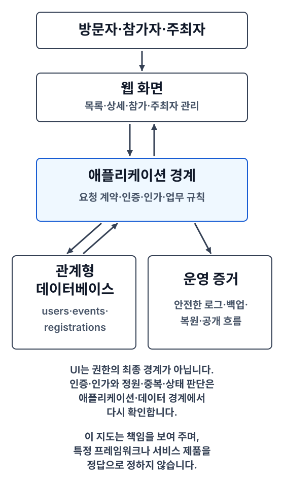

## 먼저 결론

첫 풀스택 프로젝트의 목표는 화면 몇 개를 만드는 데 있지 않습니다. 사용자 작업이 웹 화면, 애플리케이션 경계, 데이터베이스와 운영 절차를 통과하는 동안 누가 어떤 판단을 집행하고 무엇으로 성공을 증명할지 끝까지 연결하는 데 있습니다.

이 장은 작은 모임 일정·참가 신청 웹앱을 공개 조회부터 주최자 생성, 참가·취소, 정원·마감, 배포와 운영 인수까지 다섯 개의 수직 기능 조각으로 나눕니다. **수직 기능 조각(vertical slice)**: 화면만 또는 데이터베이스만 따로 만드는 작업이 아니라, 하나의 사용자 결과에 필요한 최소 경계를 세로로 관통해 독립적으로 검토할 수 있게 만든 작업 단위입니다.

첫 범위는 단일 웹앱과 하나의 관계형 데이터베이스로 충분합니다. 마이크로서비스, 메시지 큐, 별도 캐시처럼 아직 문제로 입증되지 않은 구조를 먼저 추가하지 않습니다.

## 왜 이 사례인가

모임 참가 웹앱에는 비로그인 방문자, 참가자, 주최자라는 서로 다른 역할이 있고 공개 읽기와 권한이 필요한 쓰기가 함께 있습니다. 참가 상태는 시간이 지나며 바뀌고 마지막 한 자리에는 동시 요청이 들어올 수 있으며, 배포 뒤에는 데이터와 복구 책임이 남습니다. 특정 산업 지식 없이도 프런트엔드, 백엔드, API, 데이터베이스, 인증, 인가, 테스트, Git, 배포와 운영이 왜 분리된 책임인지 한 흐름에서 볼 수 있습니다.

### 비유로 이해하기

이 시스템은 모임 장소 앞의 접수대와 참가 장부에 비유할 수 있습니다. 안내판은 공개 일정과 남은 자리를 보여 주고, 담당자는 신청자의 신원을 확인하며, 장부는 누가 어느 모임에 참가하는지와 정원이 찼는지를 보존합니다. 이 비유는 화면, 규칙 집행자와 권위 있는 데이터 기록이 서로 다른 책임이라는 점을 설명하는 데 맞습니다.

### 비유가 깨지는 지점

현실의 접수 담당자는 두 사람이 동시에 내미는 신청서를 눈앞에서 순서대로 처리할 수 있지만, 웹 요청은 여러 실행 경로에서 거의 동시에 도착할 수 있습니다. 화면에 남은 한 자리가 보였다는 사실만으로 자리를 보장할 수 없고, 애플리케이션 검사만으로 데이터베이스의 동시 갱신을 안전하게 만들 수도 없습니다. 데이터베이스 `commit`은 한 트랜잭션의 변경을 확정하는 일이며, 파일 변경 이력을 기록하는 Git `commit`과 다릅니다. 데이터베이스 `commit` 뒤 응답 전송이 실패하면 사용자는 실패 화면을 보면서도 신청은 이미 확정됐을 수 있으므로, 재조회와 중복 방지 규칙이 필요합니다.

## 문제와 비목표

주최자는 일정·설명·정원을 정해 모임을 만들고 공개 링크를 공유하려고 합니다. 방문자는 로그인하지 않고 모임 정보를 확인하며, 참가자는 참가하거나 자신의 참가를 취소하고, 주최자는 자신이 만든 모임을 수정·취소·마감하고 참가 현황을 확인합니다.

완주 범위는 모임 생성, 공개 조회, 참가, 취소, 정원, 모집 마감과 주최자 권한입니다. 다음은 첫 프로젝트의 비목표입니다.

- 결제와 환불
- 채팅과 댓글
- 알림
- 지도와 캘린더 연동
- 반복 모임
- 대기 명단과 추천
- 공개 검색
- 파일 업로드
- 운영자 신고 시스템

비목표는 “나중에 반드시 만든다”는 약속이 아닙니다. 현재 문제와 수용 기준을 흐리지 않도록 설계·구현·테스트 대상에서 제외한다는 경계입니다.

이 장의 계정·식별자·로그 예시는 모두 교육용 가상 값입니다. `user-host-001`, `user-participant-001`, `event-example-001` 같은 식별자는 실제 사람이나 서비스와 관련이 없습니다. **fixture**는 시험을 위해 준비한 가상 데이터와 상태입니다. fixture와 로그에 실제 이름·이메일·전화번호·토큰을 넣지 않습니다.

## 역할과 사용자 작업

| 역할 | 할 수 있는 작업 | 신뢰 경계에서 확인할 것 |
|---|---|---|
| 비로그인 방문자 | 공개 모임 한 건 조회 | 공개 가능한 필드인지, 존재하지 않음·취소됨·전달 실패를 구분하는지 |
| 참가자 | 자신의 참가 신청과 취소 | 인증된 주체가 요청 대상과 같은지, 활성 참가가 중복되지 않는지 |
| 주최자 | 자신이 만든 모임 생성·수정·취소·마감, 참가 현황 조회 | 현재 주체가 해당 `event_id`의 `host_id`와 일치하는지 |

**인증(authentication)**: “요청한 사람이 누구인가”를 확인하는 절차입니다. **인가(authorization)**: “확인된 이 사람이 이 대상에 이 행동을 해도 되는가”를 판단하는 절차입니다. 로그인 성공은 다른 사람의 모임을 수정하거나 다른 사람의 참가를 취소할 권한까지 주지 않습니다.

화면에서 수정 버튼을 숨기거나 참가자 ID 입력란을 없애는 것은 사용 경험을 정리하는 UI 표시일 뿐 권한 집행이 아닙니다. 서버는 매 요청에서 인증된 주체와 대상 데이터의 관계를 다시 확인하고, 데이터베이스는 허용된 상태와 관계·고유성 규칙을 보존해야 합니다.

## 시스템 지도

아래 지도에서 사용자 행동이 어떤 책임과 신뢰 경계를 거치는지, 애플리케이션에서 데이터베이스와 운영 증거로 어떻게 갈라지는지 확인해 보세요.



웹 화면은 사용자의 의도를 입력으로 받아 로딩·성공·실패 상태를 보여 줍니다. 애플리케이션 경계는 HTTP 요청을 API 계약에 맞게 해석하고 인증·인가·업무 규칙을 집행합니다. 관계형 데이터베이스는 사용자, 모임, 참가 관계와 `commit`된 상태의 권위 있는 원본을 보존합니다. 운영 증거는 안전한 로그, 백업, 격리된 복원 시험과 공개 사용자 흐름으로 배포 이후의 주장을 확인합니다. 이 지도는 책임의 연결을 보여 줄 뿐, 실제 권한 집행이나 복원 시험의 성공을 증명하지 않습니다.

화면, API, 데이터베이스와 운영 증거는 제품 이름이 아니라 책임입니다. 단일 애플리케이션 프로세스 안에 화면 렌더링과 API가 함께 있어도 이 책임과 신뢰 경계는 사라지지 않습니다.

:::note[프레임워크는 책임을 정한 뒤 선택합니다]
렌더링은 서버에서 할지 브라우저에서 할지, 사용자별 상태를 어디에서 읽고 갱신할지, 서버 측 권한 집행을 어떻게 보장할지, 어떤 배포 환경에서 실행할지, 팀이 어떤 기술을 운영할 수 있는지, 유지 비용을 감당할 수 있는지를 먼저 결정합니다. 단순 모놀리스와 하나의 관계형 데이터베이스라는 시작 가설의 이유·증거·변경 신호는 [아키텍처와 프레임워크](../../06-requirements-design/architecture-and-frameworks/)에서 다시 검토하세요. Supabase·Vercel·Codex Sites는 2026-08-13에 확인한 교체 가능한 선택 질문의 예시일 뿐이며, [Task 8의 현재 도구 매핑](../../reference/current-tool-mapping/)은 이 캡스톤이 세 제품이나 어떤 조합을 채택·구현·검증했다는 근거가 아닙니다. 관리형 백엔드나 배포 서비스에 매핑하더라도 데이터·권한·복구 책임은 사라지지 않습니다.
:::

## 상태와 데이터 관계

상태는 화면 문구가 아니라 허용되는 다음 행동을 결정하는 데이터 계약입니다.

| 데이터 | 핵심 필드 | 관계와 규칙 |
|---|---|---|
| `users` | `id` | 한 사용자는 여러 모임을 주최하고 여러 모임에 참가할 수 있음 |
| `events` | `id`, `host_id`, `status`, `capacity`, `version` | `users`와 `1:N`, `status`는 `open`, `closed`, `cancelled`, `version`은 동시 수정 감지용 정수 |
| `registrations` | `event_id`, `participant_id`, `status` | `users`와 `events`를 잇는 `N:M` 관계, `status`는 `confirmed`, `cancelled`, 동일 `(event_id, participant_id)`의 활성 참가는 중복 불가 |

이 교육용 설계에서는 새 모임을 `open`으로 만들고, 주최자만 `open → closed`로 모집을 마감하거나 `open`·`closed → cancelled`로 모임 자체를 취소할 수 있습니다. 재개는 첫 범위의 비목표이므로 `closed → open`과 `cancelled`에서 다른 상태로의 전이를 거절합니다. `cancelled` 모임의 내용·정원 수정과 새 참가도 거절하며, `closed` 모임의 정보·정원 수정은 소유권·버전·정원 하한을 지켜도 모집을 재개하지 않습니다.

만석은 별도 저장 상태가 아니라 `confirmed` 수와 `capacity`로 판단합니다. 만석이어도 `event.status`는 자동으로 `closed`가 되지 않습니다. 따라서 `open` 모임에서 자기 취소나 정원 증가로 자리가 생기면 새 참가가 가능하지만, 수동 마감한 `closed` 모임은 빈자리나 정원 증가만으로 다시 열리지 않습니다. 정원에는 `confirmed` 참가만 세며 `cancelled` 참가를 포함하지 않습니다.

모임 자체가 취소되면 기존 참가 행은 감사·자기 상태 조회를 위한 이력으로 보존합니다. 참가 행의 `confirmed`만 보고 유효한 참가로 안내하지 않고 `event.status = cancelled`를 함께 읽어 모임 취소를 우선 표시합니다. 참가자는 모임이 `open`·`closed`·`cancelled`인 경우 모두 자신의 `confirmed → cancelled` 전이를 요청할 수 있습니다. 다시 참가하려면 모임이 `open`이고 정원에 여유가 있어야 하며, 취소 이력을 남긴 채 활성 참가 하나만 확정합니다. 마감·모임 취소·정원 변경·참가는 같은 모임의 일관성 경계에서 조정합니다. 취소와 참가가 경쟁하면 참가가 먼저 확정된 뒤 모임이 취소되어 이력만 남거나, 모임 취소가 먼저 확정되어 참가가 거절됩니다. 어느 경우에도 취소된 모임의 유효 참가로 안내하지 않습니다.

애플리케이션 검사는 이해하기 쉬운 오류를 빨리 돌려주는 데 유용하지만 동시 요청 사이에서 규칙을 보존하는 최종 장치가 아닙니다. 허용 상태·양수 정원·활성 참가 고유성처럼 데이터 자체가 항상 지켜야 할 규칙은 가능한 데이터베이스 제약으로 보호하고, 여러 읽기와 쓰기가 하나의 결정이어야 하는 정원 판정은 트랜잭션으로 묶습니다.

데이터 불변식은 허용된 작업 전후에 항상 지켜야 하는 데이터 규칙이고, 테스트 오라클은 실제 결과를 맞다고 판정할 기준입니다. 이 사례에서 성공은 네 층으로 나눠 판정합니다. **화면 성공**은 사용자가 로딩·완료·거절·결과 불명을 구분하고 다음 행동을 찾는 상태, **업무 성공**은 방문자·참가자·주최자의 허용된 행동이 계약대로 끝난 상태, **데이터 불변식 성공**은 활성 중복 0건·`confirmed <= capacity`·소유권 밖 변경 0건이 권위 있는 데이터에서 유지된 상태, **운영 성공**은 배포 버전과 안전한 신호를 확인하고 백업에서 격리 복원한 뒤 핵심 흐름을 다시 검증한 상태입니다. 한 층의 증거를 다른 층의 성공으로 확대하지 않습니다.

## W-01 공개 조회

첫 조각은 `GET /events/:eventId`로 공개 모임 한 건을 조회하는 읽기 흐름입니다. 쓰기·소유권·동시성보다 먼저 브라우저에서 공개 정보가 정확한 상태로 전달되는 최소 경로를 완성합니다.

### 수용 기준

- 인증 정보가 없어도 공개 모임의 제목·설명·일정·정원·현재 확정 참가 수·모집 상태를 조회할 수 있습니다.
- 정상 공개 모임, 존재하지 않음, 취소됨, 로딩과 전달 실패를 서로 다른 화면 상태와 접근 가능한 문구로 표시합니다.
- `cancelled` 모임은 정상 모집 중인 모임처럼 보이지 않고 참가 행동을 제공하지 않습니다.

### 실패 상태

- 존재하지 않는 `event_id`를 빈 정상 화면이나 취소된 모임으로 오해하게 만듭니다.
- 네트워크·서버 전달 실패를 “모임이 없습니다”로 표시해 사용자가 다시 시도할지 판단하지 못합니다.
- 로딩 중 이전 모임의 참가 버튼이 남거나 취소된 모임에 참가 버튼이 활성화됩니다.
- 공개 조회인데 로그인 화면으로 강제로 보내 첫 계약을 불필요하게 넓힙니다.

### 직접 증거

- API 계약 테스트는 인증 헤더가 없는 정상 조회, 없는 식별자와 취소된 모임의 서로 다른 응답을 확인합니다.
- UI 상태 테스트는 로딩·정상·존재하지 않음·취소·전달 실패 각각의 문구와 참가 버튼 상태를 확인합니다.
- 브라우저 네트워크 기록은 요청 URL·응답 상태·본문이 화면 상태와 일치하는지 보여 주고, 공개 smoke 확인은 배포된 URL에서 같은 흐름을 다시 확인합니다.

## W-02 주최자 생성과 소유권

두 번째 조각은 `POST /events`, `PATCH /events/:eventId`와 주최자 전용 `GET /events/:eventId/registrations`입니다. 생성 요청의 `host_id`는 사용자가 보낸 본문을 믿어 정하지 않고 서버가 현재 인증된 주체에서 결정합니다.

### 수용 기준

- 인증된 사용자만 모임을 생성하며 저장된 `host_id`는 현재 인증 주체와 같습니다.
- 주최자는 자신이 만든 모임만 수정·취소·마감할 수 있고, 서버는 매 요청에서 현재 주체와 대상 모임의 `host_id`를 비교합니다.
- 주최자 전용 `GET /events/:eventId/registrations`는 참가 데이터를 반환하기 전에 현재 주체와 대상 모임의 `host_id`를 비교하고, 소유 주최자에게만 해당 `event_id`의 `participant_id`와 `registration.status`를 반환합니다.
- 수정 요청은 기대한 `event.version`을 보내고 현재 버전과 다르면 덮어쓰기 대신 안전한 충돌 응답을 받습니다.

### 실패 상태

- 미인증 요청이 모임을 생성하거나 수정합니다.
- 클라이언트가 보낸 `host_id`를 그대로 저장해 다른 사용자를 주최자로 가장합니다.
- 로그인했다는 사실만 확인하고 다른 사용자의 `event_id`를 수정·취소·마감합니다.
- 다른 주최자나 일반 참가자의 참가 현황 조회를 거절하지 않고 참가 데이터를 반환합니다.
- UI에서 관리 버튼을 숨긴 것을 인가 완료로 오해하고 서버의 소유권 검사를 생략합니다.

### 직접 증거

- 인증 통합 테스트는 미인증 생성이 거절되고 인증된 생성의 `host_id`가 서버의 현재 주체에서 결정되는지 확인합니다.
- 인가 부정 테스트는 가상 사용자 `user-host-002`가 `user-host-001` 소유의 `event-example-001`을 `PATCH`할 때 거절되고 데이터가 바뀌지 않는지 확인합니다.
- 참가 현황 인가 통합 테스트는 소유 주최자의 조회 성공, 비소유 주최자와 일반 참가자의 조회 거절, 거절 응답에 참가 식별자·상태 등 참가 데이터가 포함되지 않음을 확인합니다.
- 데이터 조회는 저장된 `host_id`, `status`, `version`을 보여 주며, 감사 가능한 안전한 로그는 원문 토큰이나 개인정보 없이 요청 상관 식별자·행동·결과를 남깁니다.

## W-03 참가와 취소

세 번째 조각은 `POST /events/:eventId/registrations`, `DELETE /events/:eventId/registrations/me`와 자기 상태를 읽는 `GET /events/:eventId/registrations/me`입니다. 참가·취소·자기 조회의 `participant_id`는 요청 본문이나 다른 사람의 식별자가 아니라 현재 인증된 주체에서 결정합니다. 이는 이 장에서 정한 교육용 API 계약이며 실제 구현 성공을 뜻하지 않습니다.

자기 조회는 대상 모임의 상태와 자신의 참가 상태(`not_registered`·`confirmed`·`cancelled`)만 반환합니다. `not_registered`는 조회 응답에서 관계가 없음을 뜻하며 데이터베이스에 저장하는 세 번째 참가 상태가 아닙니다. 모임이 없으면 별도의 없음 응답을 반환하고, 다른 참가자의 관계·식별자나 전체 목록은 반환하지 않습니다. 조회도 실패하면 화면은 결과 불명을 유지하고 안전한 읽기 재시도를 안내합니다. 확인되지 않은 POST를 무조건 재전송하지 않으며, 다시 보낸 참가 요청도 서버의 활성 고유성·정원·상태 규칙을 통과해야 합니다.

### 수용 기준

- 인증된 참가자는 모집 중인 모임에 자신의 참가를 신청하고 자신의 활성 참가만 취소할 수 있습니다.
- 동일 `(event_id, participant_id)`에는 `confirmed` 활성 신청이 하나만 존재하며 재시도나 빠른 두 번 누르기가 중복 행을 만들지 않습니다.
- 취소 성공 뒤 해당 참가 상태는 `cancelled`이고 현재 확정 참가 수에서 제외됩니다.
- 이미 취소된 참가에 같은 DELETE가 오면 추가 상태 변경·인원 감소·중복 취소 이력 없이 현재 `cancelled` 상태를 안전한 성공 응답으로 반환합니다. 미신청이면 별도의 미신청 응답을 주며, 처음 취소와 재시도의 응답이 반드시 같아야 한다는 뜻은 아닙니다.

### 실패 상태

- 미인증 사용자의 참가·취소를 받거나 본문에 넣은 다른 `participant_id`로 작업합니다.
- 같은 사용자의 활성 참가를 두 건 이상 만들거나 반복 취소 때 인원을 다시 줄이고 새 취소 이력을 중복 생성합니다.
- 다른 사용자의 참가를 URL이나 본문 식별자만 바꿔 취소합니다.
- 데이터베이스 `commit`은 성공했지만 응답 전송이 실패한 상황에서 화면 오류만 보고 무조건 다시 생성해 중복을 시도합니다.

### 직접 증거

- API 통합 테스트는 정상 참가·자기 취소, 미인증, 중복 신청과 타인 참가 취소의 거절을 분리해 확인합니다.
- 데이터베이스 제약 테스트는 애플리케이션의 사전 중복 검사와 별개로 동일 활성 `(event_id, participant_id)` 중복 저장이 거절되는지 확인합니다.
- 자기 조회 계약 시험은 미신청·확정·취소와 모임 취소 상태, 미인증·없는 모임·전달 실패를 구분합니다. 참가자 A가 B의 식별자를 추가로 보내도 A의 관계만 조회하거나 잘못된 요청을 거절하고, B의 관계·전체 참가자 목록은 반환하지 않아야 합니다.
- 첫 취소와 반복 취소, 취소 응답 유실 뒤 자기 조회에서 현재 상태·확정 인원·취소 이력이 일치하고 추가 부작용이 없는지 확인합니다.
- `commit` 뒤 응답 실패 시험은 클라이언트가 오류를 받은 뒤 현재 참가 상태를 재조회했을 때 이미 `confirmed`인 결과를 복구하고, 재시도가 두 번째 활성 행을 만들지 않는지 확인합니다. `rollback`은 아직 확정하지 않은 트랜잭션 변경을 취소하는 일입니다. 응답 실패가 곧 rollback이라는 뜻은 아니며 권위 있는 데이터 상태로 판단해야 합니다.

## W-04 정원·마감과 동시성

네 번째 조각은 참가 요청의 `event.status = open`, 현재 `confirmed` 참가 수, `capacity`, 동일 사용자의 활성 참가 여부와 정원 수정 요청의 새 `capacity`를 신뢰할 수 있는 애플리케이션·데이터 경계의 같은 트랜잭션에서 판정하는 규칙입니다. 주최자의 마감·취소·정원 수정과 참가 요청이 충돌할 수 있으므로 구현은 데이터베이스가 제공하는 잠금, 격리 또는 직렬화 재시도 같은 수단 중 선택한 전략과 실패 응답을 명시해야 합니다.

### 수용 기준

- `open`인 모임만 새 참가를 확정하고 `closed`나 `cancelled`이면 저장하지 않습니다.
- `confirmed` 수가 `capacity`보다 작을 때만 참가를 확정하며 트랜잭션이 끝난 뒤 확정 수는 정원을 넘지 않습니다.
- 주최자가 정원을 줄이는 `PATCH /events/:eventId`는 새 `capacity`가 같은 트랜잭션에서 확인한 현재 `confirmed` 수 이상일 때만 저장하고, 더 작으면 기존 정원을 바꾸지 않은 채 거절합니다.
- 두 요청 외의 변경과 별도 저장·전달 장애가 없는 시험에서 마지막 한 자리에 서로 다른 두 참가 요청이 경쟁하면 정확히 한 요청의 참가 행만 `commit`되어 확정되고, 다른 요청은 활성 참가 행을 만들지 않은 채 안전한 충돌·정원 마감 응답을 받습니다. 저장 실패·재시도 소진·응답 유실은 아래의 별도 시험으로 구분합니다.
- 정원 축소 `PATCH`와 참가 `POST`가 동시에 도착해 둘 다 성공할 수 없으면 최소 한 작업은 기존 정원이나 참가 상태를 부분 변경하지 않은 채 안전하게 거절되고, 모든 완료 순서에서 `confirmed <= capacity`를 유지합니다.
- 중복 여부, 상태와 정원 판정부터 참가 저장까지 하나의 트랜잭션이며 확정 전 중간 실패는 해당 트랜잭션의 `rollback`으로 끝납니다. `rollback`은 아직 확정하지 않은 변경을 취소하는 일이며 다른 요청의 정상 확정 결과나 이미 끝난 `commit`을 되돌리는 뜻이 아닙니다.

### 실패 상태

- 화면에 표시한 남은 자리나 트랜잭션 밖의 사전 조회만 믿고 두 요청을 모두 저장합니다.
- 애플리케이션의 `현재 인원 < capacity` 검사만으로 충분하다고 보고 데이터베이스 제약·트랜잭션·동시성 전략을 생략합니다.
- 정원 축소 전에 트랜잭션 밖에서 세어 둔 `confirmed`만 믿고 새 `capacity`를 저장해, 동시 참가 요청과 함께 완료된 뒤 `confirmed > capacity`가 됩니다.
- 주최자가 모집을 마감한 직후 늦게 도착한 참가 요청을 이전 `open` 화면 때문에 승인합니다.
- 직렬화 충돌이나 잠금 실패를 무한 재시도하거나 내부 오류 상세를 사용자에게 노출합니다.

### 직접 증거

- 마지막 한 자리 동시 요청 시험은 `capacity = 10`, 기존 `confirmed = 9`인 가상 모임에서 서로 다른 두 요청을 같은 시작 장벽에서 보내고 성공 1건·안전한 충돌 또는 마감 1건을 오라클로 삼습니다.
- 시작 장벽은 여러 시험 요청의 출발을 맞추는 장치입니다. 이것만으로 서버·DB의 읽기와 쓰기가 실제로 겹쳤다고 판단하지 않습니다. 격리된 가상 fixture와 대상 DB의 실제 엔진·격리 수준, 두 독립 연결을 사용하고 선택한 전략에 맞춰 경쟁 구간을 통제하거나 관측합니다. 잠금 전략에서는 첫 연결이 보호 경계를 잡은 동안 두 번째 연결의 대기를 확인하고, 충돌 검출 전략에서는 두 요청이 같은 이전 상태를 읽은 뒤 쓰기를 시도하도록 시험용 동기화 지점을 둡니다. 임의 대기 시간이나 mock 결과만으로 대신하지 않습니다. 사전 조회만 하는 결함 구현이 두 건을 저장하려는 교차 실행을 시험이 실제로 만들거나 검출하는지 확인합니다.
- 아래의 정확히 한 업무 변경 확정이라는 오라클은 두 요청 외의 변경과 별도 저장·전달 장애가 없는 경쟁 시험의 조건입니다. 거절 처리의 로그나 읽기 트랜잭션까지 한 건만 commit한다는 뜻은 아닙니다. 한 번 우연히 순차 실행된 성공을 경쟁 시험 전체의 증거로 삼지 않습니다.
- 시험 뒤 데이터 조회는 `confirmed = 10`, 활성 중복 0건, 부분 저장 0건을 보여야 하며 응답 도착 순서나 특정 참가자의 승리를 오라클로 삼지 않습니다.
- 정원 축소·참가 동시 시험은 `capacity = 10`, 기존 `confirmed = 9`인 가상 모임에서 `capacity`를 9로 줄이는 `PATCH`와 새 참가 `POST`를 같은 시작 장벽에서 보냅니다. 둘 중 정확히 하나만 `commit`되고 다른 하나는 안전하게 거절되며, 최종 오라클은 `capacity = 9, confirmed = 9` 또는 `capacity = 10, confirmed = 10`과 부분 저장 0건입니다.
- 이 동시 시험은 모든 반복에서 `confirmed <= capacity`를 확인하고, 응답 도착 순서·`PATCH`와 `POST` 중 특정 작업의 승리·구체적인 잠금 기법을 오라클로 삼지 않습니다.
- 상태 전환 통합 테스트는 `closed`·`cancelled`에서 새 참가, `cancelled`에서 정보·정원 수정, `event.version` 충돌에서 해당 수정이 저장되지 않는지 확인합니다. `closed`의 허용된 정보·정원 수정과 자기 참가 취소까지 금지하는 것은 아닙니다. 트랜잭션 로그와 오류 매핑은 재시도 가능 충돌과 최종 업무 거절을 구분합니다.
- 별도 저장 실패 시험은 해당 요청의 첫 데이터 변경 뒤·commit 전에 실패를 주입하고, 직접 조회로 그 요청의 부분 변경 0건과 다른 요청의 정상 확정 결과 보존을 확인합니다. 직렬화 실패와 유한 재시도 소진은 별도 오류 계약으로 시험하고, commit 뒤 응답 유실은 W-03의 자기 조회로 확인합니다. 네 실패를 모두 같은 rollback으로 설명하지 않습니다.
- 상태 정책 시험은 만석 뒤 자기 취소, 수동 마감 뒤 빈자리·정원 증가, 취소된 모임의 수정·재참가 거절과 모임 취소·참가 경쟁의 허용 최종 상태를 위 상태 계약과 대조합니다.

## W-05 배포와 운영 인수

다섯 번째 조각은 로컬에서 테스트를 통과한 결과를 운영 가능한 서비스 책임으로 넘기는 과정입니다. **운영 인수(operational handoff)**: 배포 명령 한 번이 아니라 실행 설정, 데이터, 관측, 복구와 공개 사용자 흐름의 소유자·절차·증거를 다음 운영 주체가 이어받을 수 있게 만드는 일입니다.

### 수용 기준

- 비밀과 환경 설정은 소스·브라우저 번들·로그와 분리되고 필수 키·허용 환경·회전 책임이 기록됩니다.
- 스키마 마이그레이션은 적용 대상 버전, 순서, 실패 시 중단·되돌림 판단과 실제 운영 데이터베이스를 구분합니다.
- 배포 버전은 소스 `commit`, 검증된 빌드 아티팩트와 실행 환경에 추적 가능하며 배포 성공과 공개 사용 성공을 같은 상태로 부르지 않습니다.
- 최소 로그는 요청 상관 식별자·작업 종류·결과·안전한 오류 범위를 제공하되 토큰·세션 식별자·실제 개인정보·연결 문자열을 기록하지 않습니다.
- 백업 생성 결과뿐 아니라 운영과 격리된 환경의 복원 시험, 복원된 데이터의 핵심 관계·수량 검증과 복구 절차를 기록합니다.
- 공개 URL에서 조회·참가·취소 smoke 흐름을 실행하고 사용한 계정과 데이터는 명시적인 가상 시험 값으로 격리·정리합니다.

### 실패 상태

- 로컬 빌드 성공, 배포 작업 성공과 공개 URL의 사용자 성공을 하나의 “배포 완료”로 합칩니다.
- 마이그레이션은 성공했지만 애플리케이션 버전과 스키마 버전이 맞지 않거나 잘못된 운영 데이터베이스를 가리킵니다.
- 백업 파일이 존재한다는 사실만 확인하고 실제 복원 가능성·복원 시간·데이터 일관성을 시험하지 않습니다.
- 참가 오류가 늘어도 안전한 로그와 상태별 지표가 없어 인증·인가·정원 충돌·데이터베이스 장애를 구분하지 못합니다.
- 이전 애플리케이션 버전만 되돌리고 호환되지 않는 데이터 변경과 이미 `commit`된 참가 상태의 복구 판단을 놓칩니다.

### 직접 증거

- 환경·마이그레이션 체크 결과는 비밀 값을 노출하지 않은 설정 키 목록, 대상 스키마 버전과 실제 운영 데이터베이스 식별 범위를 보여 줍니다.
- 빌드 기록은 입력 `commit`, 종료 코드와 아티팩트 식별자를, 배포 기록은 그 아티팩트가 어느 환경에 배치됐는지를, 공개 확인은 실제 URL의 응답과 조회·참가·취소 결과를 각각 보여 줍니다.
- 복원 증거는 백업 식별자, 격리된 복원 대상, 실행 명령·종료 결과, 복원된 `events`·`registrations` 관계 검증과 발견한 한계를 포함합니다.
- 운영 신호는 인증 실패, 인가 거절, 정원 충돌, 서버 오류와 smoke 실패를 구분하고 담당자가 안정화·재조회·버전 되돌림·데이터 복구 중 무엇을 선택할지 런북으로 연결합니다.

## W-01~W-05 요구에서 복구까지 추적

아래의 각 요구별 목록은 사용자 행동에서 복구까지 독립적으로 따라갑니다. `Git 작업 단위`는 구현할 때 한 변경 집합으로 묶을 범위이고, `배포·운영 증거`는 실제 승인된 환경에서 별도로 모아야 할 증거입니다. 이 원고와 로컬 문서 커밋은 실제 웹앱 구현·배포·복원 성공을 증명하지 않습니다.

### W-01 공개 조회 추적

- **사용자 행동:** 방문자가 공개 링크로 모임 상세를 엽니다.
- **상태 전이·데이터 변환:** 권위 있는 `events` 행을 공개 허용 필드와 현재 `confirmed` 수로 변환해 읽기 전용 화면 상태를 만듭니다.
- **인터페이스:** `GET /events/:eventId`와 로딩·정상·없음·취소·전달 실패 UI
- **인증·인가·권리:** 인증은 요구하지 않되 참가자 식별자와 비공개 필드는 공개 응답 권리 밖으로 둡니다.
- **실패 위험:** 없는 모임·취소·전달 실패를 같은 빈 화면으로 합치거나 이전 참가 버튼을 남깁니다.
- **테스트 오라클:** 상태별 계약·UI 테스트와 브라우저에서 응답·DOM·접근 가능한 문구가 일치하고 쓰기 0건입니다.
- **Git 작업 단위:** 공개 조회 계약·서비스·상태 UI·fixture·테스트만 한 diff와 로컬 `commit`에 묶습니다.
- **배포·운영 증거:** 입력 `commit`·아티팩트·배포 버전과 실제 URL의 HTTP 응답·H1·상태별 smoke를 연결합니다.
- **복구:** 이전 검증 아티팩트로 되돌린 뒤 공개 조회와 공개 필드 범위를 다시 확인하고, 데이터 행은 조회 실패만으로 삭제하지 않습니다.

### W-02 주최자 생성·소유권 추적

- **사용자 행동:** 인증된 주최자가 모임을 만들고 자신의 모임만 수정·취소·마감하거나 참가 현황을 봅니다.
- **상태 전이·데이터 변환:** 생성 시 현재 주체로 `host_id`를 정하고, 수정 시 `event.version`과 상태를 원자적으로 갱신하며 거절 시 기존 행을 보존합니다.
- **인터페이스:** `POST /events`, `PATCH /events/:eventId`, 주최자 전용 `GET /events/:eventId/registrations`
- **인증·인가·권리:** authentication으로 주체를 확인하고 authorization으로 현재 주체와 `events.host_id`의 소유권을 매 요청 집행합니다.
- **실패 위험:** 본문의 가짜 `host_id`, 비소유 수정, 참가 현황 노출, 오래된 버전 덮어쓰기가 생깁니다.
- **테스트 오라클:** 주최자 A/B 부정 테스트에서 비소유 요청은 거절·데이터 불변·참가 정보 0필드이고, 소유 요청만 기대한 버전을 만듭니다.
- **Git 작업 단위:** 인증 주체 매핑·소유권 정책·버전 계약·인가 부정 테스트를 한 수직 diff로 커밋합니다.
- **배포·운영 증거:** 배포 환경의 인증 설정·마이그레이션 버전과 가상 계정의 소유/비소유 smoke, 비밀 없는 인가 결과 로그를 연결합니다.
- **복구:** 의심 배포를 중지하고 권위 행과 감사 가능한 결과를 재조회하며, 호환되는 이전 아티팩트 또는 수정 배포 뒤 소유권 부정 흐름을 재검증합니다.

### W-03 참가·자기 취소 추적

- **사용자 행동:** 인증된 참가자가 자신의 참가를 신청하거나 취소하고 결과를 다시 확인합니다.
- **상태 전이·데이터 변환:** 인증 주체로 `participant_id`를 정해 활성 `(event_id, participant_id)`를 한 건만 `confirmed`로 만들거나 이력을 `cancelled`로 전환합니다.
- **인터페이스:** `POST /events/:eventId/registrations`, 자기 취소 `DELETE /events/:eventId/registrations/me`, 자기 조회 `GET /events/:eventId/registrations/me`
- **인증·인가·권리:** 참가자는 자신의 관계만 바꿀 수 있고 다른 참가자의 식별자를 보내도 권한을 얻지 못합니다. 자기 조회는 모임 상태와 인증된 자신의 관계만 반환하고, 조회 실패는 결과 불명으로 남깁니다.
- **실패 위험:** 중복 클릭·재시도·타인 취소 또는 `commit` 뒤 응답 유실을 실패로 오판해 중복 생성을 시도합니다.
- **테스트 오라클:** 정상·미인증·중복·타인 취소와 응답 유실을 분리하고, 최종 활성 중복 0건·자기 상태·확정 수·취소 이력이 계약과 같습니다. 반복 취소는 추가 인원 감소·취소 이력 없이 현재 취소 상태를 반환합니다.
- **Git 작업 단위:** 참가·자기 취소 계약, 활성 고유성 제약, 서비스·UI 결과 불명 상태와 해당 테스트만 함께 커밋합니다.
- **배포·운영 증거:** 가상 계정 smoke의 요청·응답·권위 상태, 중복·인가 결과 분포와 요청 상관 식별자를 같은 배포 버전에 연결합니다.
- **복구:** 응답 유실 때 즉시 재전송하지 않고 권위 상태와 처리 기록을 재조회하며, 장애 뒤 고유성·확정 수·자기 취소 흐름을 다시 확인합니다.

### W-04 정원·마감·동시성 추적

- **사용자 행동:** 참가자는 마지막 자리를 요청하고 주최자는 모집 상태나 정원을 바꿉니다.
- **상태 전이·데이터 변환:** `event.status`, `capacity`, 현재 `confirmed`, 활성 중복과 정원 축소 조건을 선택한 일관성 전략과 한 트랜잭션에서 판정합니다. 확정 전 실패는 해당 요청의 미확정 변경을 `rollback`하며 다른 요청의 정상 확정은 유지합니다.
- **인터페이스:** 참가 `POST`와 주최자 `PATCH`의 충돌·마감·재시도 가능 오류 계약
- **인증·인가·권리:** 참가와 주최자 주체·소유권을 각각 확인한 뒤에도 정원 불변식은 애플리케이션·데이터 경계에서 최종 집행합니다.
- **실패 위험:** 트랜잭션 밖 사본을 믿어 정원 초과, 부분 저장, 무한 재시도나 내부 잠금 정보 노출이 생깁니다.
- **테스트 오라클:** 실제 DB의 독립 연결과 경쟁 구간 통제·관측을 사용합니다. 두 요청 외 변경과 별도 장애가 없는 마지막 자리 경쟁은 업무 확정1·거절1·`confirmed = capacity`이고, 정원 축소 경쟁의 두 허용 최종 상태에 부분 저장이 없습니다. 저장 중 실패·재시도 소진·응답 유실은 별도 오라클로 확인합니다.
- **Git 작업 단위:** 선택한 동시성 전략·트랜잭션 경계·오류 매핑·경쟁 구간을 통제·관측하는 시험을 하나의 독립 커밋으로 묶습니다.
- **배포·운영 증거:** 대상 데이터베이스·버전의 실제 전략, 마이그레이션 결과, 충돌/오류 지표와 승인된 가상 동시 smoke를 배포 식별자에 연결합니다.
- **복구:** 경쟁 오류가 반복되면 쓰기나 배포를 안정화하고 권위 불변식을 재조회하며, 유한 재시도 또는 수정 배포 뒤 같은 통제된 경쟁 시험으로 복구를 판정합니다.

### W-05 배포·운영 인수 추적

- **사용자 행동:** 운영자가 검증된 버전을 배치하고 신호·백업·복원·공개 흐름을 인수합니다.
- **상태 전이·데이터 변환:** 소스 `commit`을 아티팩트·스키마·환경·배포 버전에 연결하고, 백업을 격리 대상에 복원해 데이터와 서비스 상태를 재구성합니다.
- **인터페이스:** 빌드·배포·마이그레이션 계약, 공개 URL, 로그·지표·알림, 백업·복원 런북
- **인증·인가·권리:** 배포·로그·백업 권한을 최소화하고 교육용 예제·소스·브라우저·로그에 실제 개인정보·비밀·토큰을 넣지 않습니다. 실제 운영에 필요한 업무 데이터는 승인된 접근 통제·암호화·보존 정책 아래 백업합니다. 자격 비밀과 과거 백업을 해독할 키는 별도의 보호·복구 체계로 연결합니다.
- **실패 위험:** 로컬 build·배포 작업·사용자 성공을 합치거나, 잘못된 DB·비밀 노출·복원하지 못하는 백업·호환되지 않는 코드 롤백이 생깁니다.
- **테스트 오라클:** 빌드 manifest와 smoke, 비밀 검사, 격리 복원에서 스키마·관계·수량·권한을 확인하고 복구 뒤 조회·참가·취소가 다시 성공합니다.
- **Git 작업 단위:** 환경 키 이름·마이그레이션·관측·런북 변경을 구현과 검토 가능한 단위로 나누고 각 커밋의 입력·되돌림을 기록합니다.
- **배포·운영 증거:** 입력 커밋·잠금 파일·아티팩트 ID·대상 환경·실제 URL·안전한 신호·백업 ID·복원 시간과 담당자를 한 인수 기록에 연결합니다.
- **복구:** 영향 기준에서 배포/쓰기를 중지하고 호환되는 아티팩트·설정·데이터를 복원한 뒤 권한·불변식·핵심 공개 흐름을 재검증하며 남은 부작용을 기록합니다.

테스트 통과는 테스트한 범위의 증거이고, `commit`은 로컬 변경 이력이며, build는 아티팩트 생성, deploy는 환경 배치입니다. 공개 URL의 화면·업무·데이터 결과와 복원 뒤 운영 성공은 각각 별도 증거가 있어야 합니다.

## AI 작업 계약

AI에게 “모임 앱을 만들어 달라”고만 요청하면 인증·인가, 실패 상태, 데이터 제약과 검증 범위가 조용히 생략될 수 있습니다. 다음처럼 한 수직 조각의 상태·목표·비목표·권한·수용 기준·검증과 보고 형식을 함께 줍니다.

```text
PROJECT_CONTEXT와 모임 웹앱 사례 계약, 현재 스키마·API·테스트를 먼저 읽어라.
이번 작업은 W-04 마지막 한 자리 동시 참가 규칙만 다룬다.
결제·알림·대기 명단·프레임워크 교체·새 패키지·배포는 범위 밖이다.
event.status = open, confirmed 수, capacity와 활성 중복 여부를 같은 트랜잭션에서 판정하라.
애플리케이션 사전 검사와 데이터베이스 제약·트랜잭션의 책임을 구분하라.
capacity 10, confirmed 9인 명시적 가상 fixture와 실제 DB의 두 독립 연결에서 경쟁 구간을 통제·관측하는 실패 테스트를 먼저 확인하라. 출발 장벽이나 임의 대기만으로 교차 실행을 입증했다고 하지 마라.
두 요청 외 변경과 별도 저장·전달 장애가 없는 경쟁 시험을 저장 중 실패·재시도 소진·commit 후 응답 유실 시험과 분리하라.
오라클은 성공 1건, 안전한 충돌 또는 마감 1건, 최종 confirmed 10, 활성 중복 0건이다.
허용된 테스트 fixture 밖의 사용자 데이터와 비밀에 접근하지 말고 외부 쓰기를 하지 마라.
완료 보고에는 변경 파일, diff, 실행 명령·종료 코드·테스트 수, 수용 기준별 직접 증거와 남은 위험을 포함하라.
```

작업이 길어지면 한 에이전트가 모든 층을 동시에 고치게 하지 않고 W-01부터 순서대로 한 조각씩 검토·통합합니다. 여러 작업자를 쓰더라도 같은 파일과 데이터베이스에 대한 쓰기 소유자를 정하고 최종 통합자가 전체 오라클을 다시 실행해야 합니다.

## 완료 체크리스트

- [ ] 문제, 완주 범위와 비목표를 한 문장씩 설명할 수 있나요?
- [ ] 방문자·참가자·주최자의 작업과 인증·인가 책임을 구분했나요?
- [ ] UI 표시가 서버·데이터베이스의 권한 집행을 대신하지 않는다고 확인했나요?
- [ ] `event.status`, `registration.status`, `capacity`, `version`과 사용자·모임·참가 관계를 정의했나요?
- [ ] W-01~W-05 각각에 수용 기준, 실패 상태와 직접 증거가 있나요?
- [ ] 활성 참가 중복을 데이터베이스 제약으로 보호하고 정원 판정을 같은 트랜잭션에 묶었나요?
- [ ] 마지막 한 자리 동시 요청에서 성공 1건과 안전한 실패 1건을 직접 검증했나요?
- [ ] `commit` 뒤 응답 실패를 `rollback`으로 단정하지 않고 재조회·중복 방지로 복구하나요?
- [ ] 테스트, 로컬 `commit`, build, deploy와 공개 확인을 서로 다른 상태와 증거로 기록했나요?
- [ ] 비밀·마이그레이션·운영 데이터베이스·안전한 로그·백업·격리 복원 시험의 책임자가 정해졌나요?
- [ ] fixture와 로그가 명시적인 가상 값만 사용하며 실제 개인정보·토큰을 포함하지 않나요?
- [ ] 특정 프레임워크나 서비스 제품을 아키텍처 책임과 같은 뜻으로 쓰지 않았나요?

## 짧은 연습

가상 모임 `event-example-001`의 정원이 3명이고 현재 `confirmed` 참가가 2명이라고 가정합니다. 참가자 A와 B가 거의 동시에 참가를 눌렀고, A의 브라우저는 응답을 받지 못했으며 B는 정원 마감 응답을 받았습니다.

1. 화면, 애플리케이션, 데이터베이스와 운영 증거가 각각 확인할 질문을 한 줄씩 적습니다.
2. “A의 신청은 실패했다”를 바로 결론 내릴 수 없는 이유와 재조회할 상태를 적습니다.
3. 재조회 전의 최종 `confirmed` 수와 A의 상태를 미확인으로 남기고, 서버의 확정·거절, 클라이언트가 실제 받은 응답, 전달 실패·결과 불명을 각각 적습니다. B의 거절 응답만으로 A의 확정을 입증할 수 있나요?
4. 이 연습에서 인증 테스트와 인가 테스트를 각각 하나씩 분리해 적습니다.
5. 공개 smoke 확인과 격리 복원 시험이 서로 대신할 수 없는 이유를 적습니다.

통제된 추가 시험에서는 다른 변경·장애가 없고 A의 commit이 끝난 직후 응답만 유실되도록 조건을 고정해 보세요. 이때 서버의 A 확정 1건과 B 거절 1건, A가 받은 성공 응답 0건과 전달 실패 1건, B가 받은 거절 응답 1건을 구분합니다. 자기 조회와 권위 데이터 확인으로 A의 confirmed와 최종 인원 3명·활성 중복 0건을 검증합니다. 이 추가 조건이 없는 원래 관측만으로 최종 3명이라고 단정해서는 안 됩니다. 답을 평가할 때는 특정 코드 문법보다 신뢰할 수 있는 경계, 원자적 판정, 직접 증거와 복구 순서가 드러나는지 확인합니다.

## 관련 장과 출처

- [소프트웨어는 시스템입니다](../../01-mental-models/software-is-a-system/)는 이 사례를 화면 묶음이 아니라 역할·경계·상태·흐름·제약과 운영 책임의 시스템으로 다시 그리는 기준을 제공합니다.
- [클라이언트·서버·풀스택](../../03-full-stack/client-server-full-stack/)은 참가 버튼에서 화면·요청·서버 판단·데이터·응답으로 이어지는 책임 축과 사용자 완료를 구분하는 데 연결됩니다.
- [HTTP 요청과 응답](../../03-full-stack/http-request-response/)은 공개 `GET`, 생성·참가 `POST`, 수정 `PATCH`, 자기 취소 `DELETE`의 의도·응답·재시도 차이를 검토하는 데 사용합니다.
- [API·데이터베이스·인증](../../04-backend-data/api-database-auth/)은 API 계약, 인증과 인가, 애플리케이션 검사, 데이터베이스 제약·트랜잭션과 `commit` 뒤 응답 실패를 더 깊게 설명합니다.
- [브라우저·DOM·렌더링](../../05-frontend/browser-dom-rendering/)은 로딩·정상·없음·취소·충돌·전달 실패가 서버 상태에서 접근 가능한 화면 증거로 바뀌는 과정을 확인하게 합니다.
- [PRD·두 종류의 SDD·TDD](../../06-requirements-design/prd-sdd-tdd/)는 W-01~W-05를 문제·요구·설계·작업·테스트로 추적하되 문서 종류와 개발 규율을 섞지 않는 기준을 제공합니다.
- [테스트 전략](../../08-quality/testing-strategy/)은 정상 예시 수보다 권한 침해·중복·정원 초과·응답 유실·복원 실패 같은 위험에 맞는 오라클과 실행 범위를 선택하게 합니다.
- [Git과 GitHub는 다릅니다](../../09-git-github/git-and-github/)는 작업 트리·staged diff·로컬 `commit`·원격 공유를 구분해 한 수직 조각의 검토 범위와 되돌릴 지점을 남기게 합니다.
- [빌드·배포·도메인·DNS](../../10-deployment-operations/build-deploy-domain-dns/)는 소스 검증, build, deploy, 실제 URL·HTTPS 응답과 공개 확인이 서로 다른 단계라는 판단을 보완합니다.
- [로그·모니터링·백업](../../10-deployment-operations/logs-monitoring-backup/)은 안전한 운영 신호, 장애 안정화, 백업과 격리 복원 시험, 복구 뒤 재검증을 하나의 운영 순환으로 연결합니다.
- [AI 코딩 에이전트와 일하는 법](../../11-ai-native/working-with-coding-agents/)은 범위·권한·수용 기준·검증 명령·보고 형식을 갖춘 작업 계약과 한 조각씩 통합하는 절차를 제공합니다.

이 장은 특정 서비스의 실제 동작을 주장하는 구현 안내가 아닙니다. 요구사항·설계·테스트·운영 분류는 SWEBOK, API 설명 형식은 OpenAPI, 인증·인가와 안전한 로깅은 OWASP, 트랜잭션·격리·제약은 PostgreSQL, HTTP와 웹 화면 범위는 MDN, 변경 이력은 Pro Git, 빌드·배포 단계는 Astro 공식 자료의 기존 확인 범위에 연결하며 구체적인 출처 URL·확인일·일반화 금지선은 저장소의 `research/source-map.md`에서 관리합니다.
