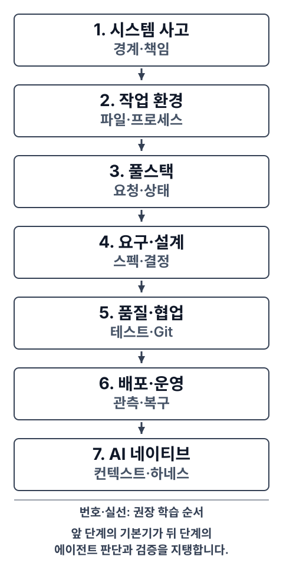

바이브 코딩은 자연어로 소프트웨어를 만드는 진입 장벽을 크게 낮췄습니다. 그러나 **입력 장벽이 낮아진 것과 결과를 책임질 수 있게 된 것은 별개의 문제**입니다. 화면이 그럴듯하게 보여도 데이터가 잘못 저장되거나 권한 검사가 빠질 수 있고, 테스트가 실제 요구를 확인하지 못하거나 배포 뒤 되돌릴 방법이 없을 수 있습니다.

이 핸드북은 Claude Code나 Codex의 명령어 모음이 아니라, 비개발자·데이터 분석가·PM·디자이너·도메인 전문가가 다음 세 가지 능력을 기르는 개발 온보딩 과정입니다.

1. 소프트웨어를 화면이 아니라 **구성요소·경계·상태·흐름·제약**으로 보는 능력
2. 아이디어를 **요구사항·설계·작업·검증 증거**로 바꾸는 능력
3. AI의 설명을 믿는 대신 **diff·테스트·빌드·로그·운영 신호**로 확인하는 능력

## 두 가지 출발점

처음 배우는 분은 [시작하기](start-here/)에서 목적을 확인한 뒤 [13장 Build Track](start-here/learning-paths/#build-track-작은-서비스를-끝까지)을 따라가세요. 요구사항에서 설계·테스트·Git·배포·운영과 두 캡스톤까지 결정이 이어지는 순서를 볼 수 있습니다.

지금 해결할 문제가 있는 분은 [이 가이드를 사용하는 법](start-here/how-to-use-this-guide/#필요한-내용만-찾기)에 따라 한국어 용어나 영문·약어로 검색하세요. 문제 문장은 관련 결과를 찾지 못할 수 있으므로 핵심어로 줄이거나 분야별 인덱스를 이용합니다. 검색 결과 한 문장만 믿지 말고 관련 장의 정의·시스템 위치·판단 규칙과 검증 증거까지 확인해야 합니다.

## 전체 학습 지도

시스템 사고부터 AI 네이티브까지 어떤 순서로 배우는지, 아래 그림의 번호와 화살표를 따라 확인해 보세요.

이 그림은 권장 학습 순서를 보여 줄 뿐, 모든 독자에게 강제되는 선행 조건이나 각 단계의 숙련을 증명하지는 않습니다.

컨텍스트 엔지니어링, 하네스 엔지니어링, 루프 엔지니어링은 마지막에 배치했습니다. 중요하지 않아서가 아닙니다. 이 개념들은 저장소, 아키텍처, 테스트, 권한, 관측 가능성 같은 기존 개발 기반을 에이전트 환경에 확장한 것이므로 **기본 구조를 먼저 알아야 정확하게 쓸 수 있기 때문**입니다.

## 세 가지 학습 경로

### 빠른 지도

두 시간 안에 전체 지형과 핵심 용어를 훑습니다. 중복되지 않는 최신 순서는 [학습 경로의 빠른 지도](start-here/learning-paths/#빠른-지도-전체-지형부터)에서 확인하세요.

### Build Track

아이디어 하나를 실제 서비스로 옮기는 흐름을 따라갑니다. 각 장에서 “무엇을 만들까”보다 “어떤 결정을 내려야 하고 무엇으로 확인할까”를 중심으로 봅니다. Phase 1의 공식 범위와 순서는 [두 사례를 포함한 13장 Build Track](start-here/learning-paths/#build-track-작은-서비스를-끝까지)에서 확인하세요.

### Deep Track

아키텍처, 테스트 전략, 데이터 모델, 운영, 보안, 에이전트 하네스를 더 깊게 공부합니다. 현재 제품 이름보다 선택의 이유와 트레이드오프를 설명할 수 있는 상태를 목표로 합니다.

## 이 핸드북이 약속하지 않는 것

이 핸드북은 특정 프로그래밍 언어의 완전한 문법서, 제품별 버튼 사용 설명서, 컴퓨터공학 과정 전체의 대체물, 한 번의 프롬프트로 완성된 제품을 만드는 성공담이 아닙니다. 모든 비개발자가 전문 개발자 역할을 대신해야 한다고 말하지도 않습니다. 위험이 큰 인증·개인정보·결제·권한·데이터 삭제·운영 변경에서는 전문가에게 넘겨야 할 경계를 판단하는 것까지가 학습 목표입니다.

## 완료 상태를 구분하세요

파일을 수정한 상태, 자동 검사를 통과한 상태, 브라우저에서 확인한 상태, 로컬 커밋을 만든 상태, 원격에 올린 상태, 실제로 배포하고 공개 URL을 확인한 상태는 서로 다릅니다. 한 증거가 다음 상태를 자동으로 보장하지 않습니다.
